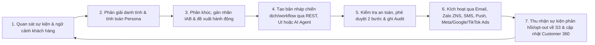
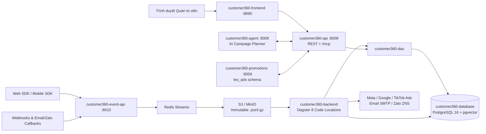

# LEOCDP: Agentic Customer 360 Platform

LEOCDP Customer 360 là nền tảng dữ liệu khách hàng hợp nhất (Customer Data Platform — CDP), phân giải danh tính (Customer Identity Resolution), phân tích thông minh và kích hoạt đa kênh có hỗ trợ AI theo kiến trúc đa người thuê (**multi-tenant**). Hệ thống chuyển hóa dữ liệu hồ sơ và sự kiện hành vi thô từ nhiều nguồn thành hồ sơ khách hàng hợp nhất (**Golden Record**), chân dung động (**Persona**), phân khúc khách hàng (**Segment**), đề xuất khuyến mãi và các chiến dịch tiếp thị được kiểm duyệt chặt chẽ.

- **Kho mã nguồn (GitHub):** [https://github.com/LEO-CDP/leo-customer360](https://github.com/LEO-CDP/leo-customer360)
- **Trang tài liệu trực tuyến:** [https://leo-cdp.github.io/leo-customer360/](https://leo-cdp.github.io/leo-customer360/)
- **Trung tâm tài liệu nội bộ:** [`docs/README.md`](docs/README.md) · **Bản tiếng Anh:** [`README.md`](README.md)

Kho mã nguồn được tổ chức xoay quanh **8 thành phần cốt lõi `customer360-*`** cùng các công cụ tạo dữ liệu và triển khai. Mỗi thành phần có ranh giới trách nhiệm rõ ràng: SQL định nghĩa tầng lưu trữ bền vững (`customer360-database`), DAO cung cấp lớp truy cập dữ liệu tái sử dụng (`customer360-dao`), các tác vụ Dagster xử lý và đồng bộ dữ liệu (`customer360-backend`), các dịch vụ FastAPI cung cấp giao kèo REST/MCP & thu nhận sự kiện (`customer360-api`, `customer360-event-api`, `customer360-promotions`), giao diện quản trị (`customer360-frontend`) và dịch vụ tác nhân AI (`customer360-agent`).

---

## Tầm nhìn & Kiến trúc Agentic Customer 360

Nền tảng kết hợp kiến trúc dữ liệu Customer 360 chuẩn doanh nghiệp với vòng lặp ra quyết định có sự hỗ trợ của AI (**Governed Agentic Loop**): mỗi tương tác trở thành ngữ cảnh khách hàng đáng tin cậy, mỗi quyết định đều có thể giải thích được, và mọi hành động gửi tin/đồng bộ quảng cáo đều đi qua bước phê duyệt của con người (**Human-in-the-loop**) cùng nhật ký kiểm toán.



### Các nguyên tắc kỹ thuật cốt lõi

* **Cô lập dữ liệu đa người thuê (Multi-tenant Isolation):** Mọi thao tác đọc, ghi, phân khúc, công cụ MCP và kích hoạt chiến dịch đều bắt buộc tuân thủ `tenant_id` ở cả tầng ứng dụng và tầng PostgreSQL Row-Level Security (RLS).
* **Tách biệt hoàn toàn luồng thu nhận sự kiện (Zero-DB Event Ingestion):** `customer360-event-api` xác thực, làm sạch payload, đẩy vào **Redis Streams** và ghi đối tượng bất biến `.jsonl.gz` lên **S3/MinIO**. Dịch vụ này hoàn toàn không có kết nối hay ghi trực tiếp vào PostgreSQL trên luồng request.
* **Quản trị phê duyệt trước khi kích hoạt (Approval Gate):** AI Agent có thể phân tích và tạo bản nháp chiến dịch/luồng công việc (`Draft → InReview`), nhưng chỉ quản trị viên được ủy quyền mới có thể phê duyệt (`Approved`) trước khi hệ thống thực thi gửi Email, Zalo ZNS hoặc đồng bộ tệp quảng cáo.
* **Tuân thủ quyền riêng tư & chống gửi trùng (Consent & Idempotency):** Mọi luồng gửi tin và đồng bộ tệp đối tượng đều kiểm tra `communication_preferences`, danh sách chặn `crm_suppression_list`, băm SHA-256 PII khi đẩy ra nền tảng quảng cáo, và đảm bảo tính lũy đẳng (idempotent) khi chạy lại.

---

## Kiến trúc Luồng Dữ liệu Tổng thể



### Vòng đời dữ liệu từ Thu thập đến Kích hoạt

1. **Thu thập sự kiện (`customer360-event-api`):** Web SDK (`leo.proxy.js` + `leo.observer.js`), Mobile SDK hoặc Webhook gửi lô sự kiện tới `POST /api/v1/tracking/logs` (hoặc `/data/api/v1/tracking/logs`). Sau khi qua bộ lọc bot và giới hạn tốc độ Redis, lô sự kiện được ghi bền vững vào Redis Stream và worker nền tải lên S3/MinIO theo phân vùng giờ UTC (`s3://data-tracking-<data_source_id>/events/YYYY-MM-DD-HH/<batch_uuid>.jsonl.gz`).
2. **Tổng hợp sự kiện & Đưa vào Staging (`analytics`):** Job Dagster `analytics` quét các đối tượng S3 mới theo con trỏ (cursor), cập nhật số liệu nguồn dữ liệu và trích xuất thông tin định danh sang bảng `cdp_raw_profiles_stage` thông qua `customer360-dao`.
3. **Phân giải danh tính & Chân dung khách hàng (`identity_resolution`):** `CustomerIdentityResolver` đọc động quy tắc khớp từ `cdp_profile_attributes`, nối hồ sơ thô vào `cdp_master_profiles` + `cdp_profile_links`, tính toán lại chân dung khách hàng qua `PersonaResolutionEngine`, và xuất bản chiếu sự kiện theo từng hồ sơ chính lên S3 (`MasterProfileEventProjector`).
4. **Tính toán Phân khúc & Nhãn IAB (`segmentation`):** Sensor và job `segmentation` thực thi các biểu thức SQL an toàn (`sql_rules`) trên `cdp_master_profiles` + `cdp_domain_profiles`, đồng bộ nhãn `segmentation_tags`, `audience_tags` (IAB Audience Taxonomy 1.1) và cập nhật `member_count`.
5. **Quản trị qua REST/MCP & Lập kế hoạch AI (`customer360-api` & `customer360-agent`):** Cung cấp API cho giao diện quản trị và các công cụ MCP tại `/mcp`. Khi người dùng yêu cầu AI lập kế hoạch, API gọi sang `customer360-agent` (sử dụng LiteLLM và kho prompt phiên bản hóa trong `cdp_ai_agents`) để sinh bản nháp Email/Zalo ZNS.
6. **Kích hoạt Chiến dịch & Đồng bộ Quảng cáo (`campaign_activation`, `email_engine`, `notification_engine`, `data_synch`):** Thực thi đồ thị workflow đã được phê duyệt, gửi Email có gắn link/pixel theo dõi, gửi Zalo ZNS, đồng bộ phản hồi opt-out từ S3 về `communication_preferences`, và đẩy tệp khách hàng đã băm SHA-256 lên Meta Custom Audience, Google Customer Match và TikTok Audience.

---

## Tám Thành phần Cốt lõi

| Thành phần | Trách nhiệm chính | Giao kèo & Bề mặt chính | Hình thái Runtime |
| --- | --- | --- | --- |
| [`customer360-database/`](customer360-database/README.md) | Lược đồ chuẩn, dữ liệu khởi tạo, view và các bản migration | PostgreSQL 16 schema `customer360` (62 bảng gốc, 15 phân vùng `graph_edges`), RLS, `pgvector`, `pg_trgm` | Các tập tin SQL chạy qua Docker init hoặc [`setup-and-upgrade-db.sh`](customer360-database/setup-and-upgrade-db.sh) |
| [`customer360-dao/`](customer360-dao/README.md) | Thư viện truy cập dữ liệu & logic dùng chung | SQLAlchemy 2.0 models, Pydantic schemas, repositories theo tenant, ngữ cảnh RLS, kiểm tra SQL safety, `FlowEngine`, `PersonaResolutionEngine` | Gói Python nội bộ (`leo-customer360-dao`); cài đặt vào các dịch vụ khác |
| [`customer360-backend/`](customer360-backend/README.md) | Điều phối dữ liệu & thực thi tác vụ nền | 8 Dagster Code Locations: `identity_resolution`, `segmentation`, `analytics`, `ai_agents_runners`, `data_synch`, `campaign_activation`, `email_engine`, `notification_engine` | Dagster webserver & daemon (`workspace.yaml`), phối hợp khóa qua Redis leases |
| [`customer360-api/`](customer360-api/README.md) | API ứng dụng trung tâm (REST & MCP) | REST API (`/api/v1/*`) cho hồ sơ, phân khúc, persona, chiến dịch, workflow, báo cáo, dữ liệu nguồn và MCP server gắn tại `/mcp` | FastAPI trên cổng `8008` |
| [`customer360-event-api/`](customer360-event-api/README.md) | Thu nhận sự kiện hành vi & Web SDK | `POST /api/v1/tracking/logs`, callback Email/Zalo, phục vụ tĩnh Web SDK (`/cdp-sdk/*`), Redis Streams → S3/MinIO `.jsonl.gz` | FastAPI trên cổng `8010` (không kết nối PostgreSQL) |
| [`customer360-promotions/`](customer360-promotions/README.md) | Quản lý vị trí quảng cáo, khuyến mãi & đề xuất | Quản lý placement, creative, banner, link tiếp thị, nội dung tài trợ và đề xuất theo tenant | FastAPI trên cổng `9009`; sử dụng schema `leo_ads` và Redis cache |
| [`customer360-frontend/`](customer360-frontend/README.md) | Giao diện quản trị & vận hành trên trình duyệt | Giao diện SPA/template, quản lý phiên đăng nhập, trực quan hóa hồ sơ 360, trình tạo phân khúc, trình soạn thảo workflow & trợ lý tài liệu | FastAPI web shell trên cổng `8890` (không kết nối DB trực tiếp) |
| [`customer360-agent/`](customer360-agent/README.md) | Dịch vụ & Client lập kế hoạch chiến dịch bằng AI | `POST /plan/campaign`, `POST /plan/zalo`, tích hợp đa nhà cung cấp LLM qua LiteLLM, quản lý phiên bản prompt | FastAPI trên cổng `8009` + gói client Python cho `customer360-api` |

> Ngoài 8 thành phần trên, kho mã nguồn còn có [`customer360-seeding/`](customer360-seeding/README.md) (trình giả lập dữ liệu đa lĩnh vực), [`deployments/`](deployments/README.md) (Terraform & kịch bản triển khai VM/VKS), [`k8s/`](k8s/README.md) (manifest Kubernetes) và [`tools/`](tools/) (công cụ tìm kiếm tài liệu RAG).

### Quy tắc phân bổ mã nguồn

* **Lược đồ, ràng buộc, trigger và chính sách RLS** đặt tại [`customer360-database/`](customer360-database/).
* **Model, schema, truy vấn tái sử dụng và công cụ kiểm tra an toàn SQL** đặt tại [`customer360-dao/`](customer360-dao/), không viết rải rác trên tầng router hay giao diện.
* **Các tác vụ xử lý lô, đồng bộ S3, tính toán phân khúc và gửi chiến dịch** đặt tại các Code Location tương ứng trong [`customer360-backend/`](customer360-backend/).
* **Xác thực người dùng, kiểm tra quyền RBAC, ngữ cảnh tenant và bề mặt REST/MCP** đặt tại [`customer360-api/`](customer360-api/).
* **Thu nhận sự kiện tốc độ cao** đặt tại [`customer360-event-api/`](customer360-event-api/) và chỉ giao tiếp với Redis + S3/MinIO.
* **Giao diện người dùng** đặt tại [`customer360-frontend/`](customer360-frontend/) và chỉ gọi qua HTTP API.
* **Kết nối LLM và lập kế hoạch chiến dịch AI** đặt tại [`customer360-agent/`](customer360-agent/).

---

## Ranh giới Lưu trữ & Giao kèo Runtime

| Loại dữ liệu | Hệ thống lưu trữ gốc (System of Record) | Ghi chú kỹ thuật |
| --- | --- | --- |
| Hồ sơ gốc (`cdp_master_profiles`), hồ sơ thô (`cdp_raw_profiles_stage`), liên kết định danh (`cdp_profile_links`), phân khúc (`cdp_segments`), CRM, workflow | PostgreSQL 16 — schema `customer360` | Bắt buộc áp dụng Row-Level Security (RLS) theo `tenant_id` |
| Sự kiện hành vi thô (Behavioral Events) | S3 / MinIO (`data-tracking-<data_source_id>`) | Các file bất biến `events/YYYY-MM-DD-HH/<batch_uuid>.jsonl.gz` kèm state marker `_processed/<object_id>.json` |
| Bản chiếu sự kiện theo hồ sơ chính (Master Profile Event Projections) | S3 / MinIO | Được cập nhật bởi `MasterProfileEventProjector` sau mỗi đợt CIR để phục vụ truy vấn timeline nhanh |
| Hàng đợi sự kiện, khóa phân tán (leases), giới hạn tốc độ (rate limit), bộ nhớ đệm API | Redis (`:6580`) | Redis Streams bắt buộc cho luồng nhận sự kiện; Redis leases ngăn chạy chồng chéo các job Dagster |
| Vị trí đặt quảng cáo, chiến dịch khuyến mãi, mẫu sáng tạo | PostgreSQL 16 — schema `leo_ads` | Thuộc quyền quản lý của `customer360-promotions` |
| Đăng ký tác nhân AI, mô hình chấm điểm và lịch sử phiên bản prompt | PostgreSQL 16 — bảng `customer360.cdp_ai_agents` | Khởi tạo từ [`customer360-database/init-cdp-ai-agents.sql`](customer360-database/init-cdp-ai-agents.sql) |

### Định tuyến Reverse Proxy trên môi trường triển khai

| Đường dẫn công khai | Dịch vụ đích | Cổng mặc định |
| --- | --- | --- |
| `/` | `customer360-frontend` | `8890` |
| `/c360api` | `customer360-api` | `8008` |
| `/mcp` | Bề mặt MCP gắn trên `customer360-api` | `8008` |
| `/data` | `customer360-event-api` (bao gồm cả `/data/cdp-sdk/*` và `/data/api/v1/tracking/logs`) | `8010` |
| `/ads` | `customer360-promotions` | `9009` |
| `/ai` | Dịch vụ tra cứu vector tài liệu nội bộ (qua frontend proxy) | `8001` |

---

## Hướng dẫn Phát triển Local

### 1. Khởi động nhanh bằng `dev-c360.sh`

```bash
cp .env.example .env
# Cập nhật các mật khẩu mẫu change_me_* trong .env trước khi chạy
./dev-c360.sh
```

Kịch bản [`dev-c360.sh`](dev-c360.sh) sẽ khởi động hạ tầng Docker (PostgreSQL, Redis, MinIO, Event API, và tùy chọn Keycloak), chờ kiểm tra sức khỏe (healthchecks), nạp dữ liệu mẫu khi cơ sở dữ liệu trống và khởi động lại các dịch vụ chạy trên máy host.

Các lệnh hỗ trợ thường dùng:

```bash
./dev-c360.sh no-seed        # Khởi động nhưng bỏ qua bước nạp dữ liệu mẫu CIR
./dev-c360.sh seed-new-data  # Bắn thêm dữ liệu sự kiện giả lập qua customer360-event-api
./dev-c360.sh restart        # Khởi động lại các dịch vụ chạy trên host và công cụ tìm kiếm tài liệu
./dev-c360.sh upgrade        # Build lại các container hiện tại mà không xóa dữ liệu volume
./dev-c360.sh reset -y       # Xóa toàn bộ Docker volume và khởi tạo lại từ đầu
```

Nếu muốn quản lý toàn bộ stack thông qua Docker Compose:

```bash
./manage-c360.sh start
./manage-c360.sh status
./manage-c360.sh logs customer360-api
```

### 2. Cài đặt gói `customer360-dao` và `customer360-agent` cục bộ

Khi phát triển trên máy host cho một dịch vụ cụ thể, cài đặt gói DAO dùng chung vào môi trường ảo của dịch vụ đó:

```bash
./customer360-dao/install-local.sh --service customer360-api --requirements
./customer360-dao/install-local.sh --service customer360-backend/segmentation --requirements
./customer360-agent/install-local.sh --service customer360-api --requirements
```

---

## Kiểm thử (Testing)

Chạy toàn bộ các bộ kiểm thử đơn vị (hermetic unit test suites) từ thư mục gốc của kho mã nguồn:

```bash
./run_all_tests.sh
```

Kịch bản [`run_all_tests.sh`](run_all_tests.sh) thực thi tuần tự 8 bộ kiểm thử: **Customer 360 DAO**, **Customer 360 API**, **Data Tracking API**, **Identity Resolution**, **Segmentation**, **Campaign Activation**, **Email Engine**, và **c360 Promotions**.

Bạn cũng có thể chạy kiểm thử riêng cho từng thành phần:

```bash
bash customer360-dao/run_tests.sh
./customer360-api/run_unit_tests.sh
./customer360-event-api/run_unit_tests.sh
./customer360-promotions/run_unit_tests.sh
./customer360-agent/run_unit_tests.sh
cd customer360-backend/identity_resolution && ./run_tests.sh
cd customer360-backend/segmentation && ./run_tests.sh
cd customer360-backend/campaign_activation && ./run_tests.sh
cd customer360-backend/email_engine && ./run_tests.sh
cd customer360-backend/notification_engine && ./run_tests.sh
cd customer360-backend/data_synch && pytest
```

---

## Bản đồ Tài liệu

* [`docs/README.md`](docs/README.md) — Danh mục tổng hợp toàn bộ tài liệu kiến trúc, nguồn dữ liệu, CIR, hướng dẫn từng màn hình UI, kế hoạch kỹ thuật và câu hỏi tích hợp.
* [`customer360-api/README.md`](customer360-api/README.md) — Bề mặt REST/MCP, xác thực, ngữ cảnh tenant và an toàn công cụ MCP.
* [`customer360-backend/README.md`](customer360-backend/README.md) — Kiến trúc 8 Code Location của Dagster, giới hạn tải, khóa Redis lease và điều phối dữ liệu.
* [`customer360-dao/README.md`](customer360-dao/README.md) — Cấu trúc gói DAO, mô hình dữ liệu, repositories, ngữ cảnh RLS và kiểm thử.
* [`customer360-database/README.md`](customer360-database/README.md) — Yêu cầu schema PostgreSQL 16, thứ tự khởi tạo, dữ liệu mẫu, view và migrations.
* [`customer360-event-api/README.md`](customer360-event-api/README.md) — Phong bì sự kiện (event envelope), Redis Streams, lưu trữ S3/MinIO, Web SDK và giao kèo Tracking API.
* [`customer360-promotions/README.md`](customer360-promotions/README.md) — Quản lý vị trí quảng cáo, chiến dịch khuyến mãi, nội dung tài trợ và đề xuất.
* [`customer360-frontend/README.md`](customer360-frontend/README.md) — Giao diện trình duyệt, luồng xác thực/phiên, template và tích hợp API.
* [`customer360-agent/README.md`](customer360-agent/README.md) — Tích hợp LiteLLM, kho lưu trữ prompt, các endpoint lập kế hoạch chiến dịch và bảo mật bằng bearer-token.
* [`deployments/README.md`](deployments/README.md) — Cấu trúc triển khai VM/VKS, Terraform, cấu hình proxy, giám sát và vận hành production.
* [`k8s/README.md`](k8s/README.md) — Tài liệu triển khai trên nền tảng Kubernetes.

## Tài liệu Tham khảo & Giấy phép

* **Giấy phép:** Phát hành theo giấy phép nguồn mở [Apache License 2.0](LICENSE).
* **Trang tài liệu chính thức:** [https://leo-cdp.github.io/leo-customer360/](https://leo-cdp.github.io/leo-customer360/)
* **Công nghệ nền tảng:** [PostgreSQL 16](https://www.postgresql.org/) · [pgvector](https://github.com/pgvector/pgvector) · [FastAPI](https://fastapi.tiangolo.com/) · [Dagster](https://dagster.io/) · [Model Context Protocol (MCP)](https://modelcontextprotocol.io/)