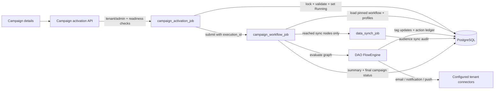
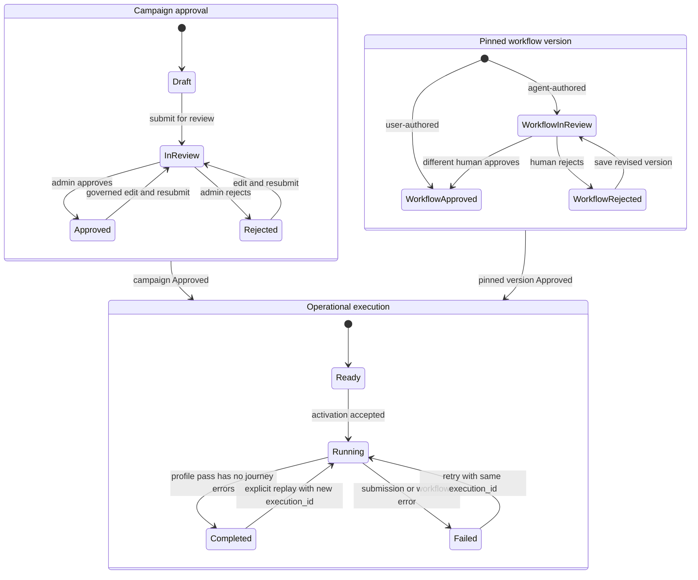

# Campaign workflow activation

`campaign_activation` is the only development execution path for campaigns.
Every campaign must have a selected segment and a pinned, approved persisted
workflow.

## Service map

The service is a Dagster code location, not an HTTP service. The API validates
the caller and campaign, then submits a Dagster activation run. The activation
op updates campaign state and submits a separate workflow run. The workflow
runner loads profiles, evaluates the saved workflow graph, and records action
outcomes.



The campaign workflow, state, and action ledgers are defined in the canonical
[`database-schema.sql`](../../customer360-database/database-schema.sql). The
workflow graph is versioned in `crm_flow_version`; campaign metadata pins one
version through `crm_campaign.workflow_id` and `workflow_version`. A flow's
published version is not a substitute for the campaign's pinned version.
For product use cases, the three state dimensions, and business-level
transition diagrams, see
[`MARKETING-WORKFLOW.md`](../../docs/marketing/MARKETING-WORKFLOW.md).

## Trigger

The API entry point is:

```text
POST /api/v1/admin/campaigns/{campaign_id}/activate
```

The route is tenant-scoped and tenant-admin protected. It requires:

- `crm_campaign.approval_status = 'Approved'`;
- `crm_campaign.segment_id`;
- `crm_campaign.workflow_id`;
- `crm_campaign.workflow_version`;
- the pinned `crm_flow_version.approval_status = 'Approved'`.

The activation API submits a Dagster run and returns its `run_id`; profile
execution is asynchronous.
To replay a campaign after it has completed, tenant admins pass
`{"restart": true}` to the same activation endpoint. Each completed-campaign
replay gets a new `workflow_execution_id`; there is no restart-count limit.

## Activation sequence

`campaign_activation_job` runs `activate_campaign_op`, which:

1. loads the campaign in the caller's tenant;
2. validates campaign approval;
3. validates the selected segment is active;
4. validates the pinned workflow version is approved;
5. updates `crm_campaign.status` to `Running`;
6. submits `campaign_workflow_job`.

No template-based or channel-dispatch fallback is selected by
`activate_campaign`.

## State model and retry semantics

Campaign approval, workflow-version approval, and operational execution are
separate states. Approval is a prerequisite, not an execution status.

| State dimension | States / transition | Owner |
| --- | --- | --- |
| Campaign approval | `Draft → InReview → Approved` or `Rejected`; edited rejected/approved drafts return for review | Campaign draft API and human reviewers |
| Pinned workflow version | User-authored versions are approved by persistence rules; agent-authored versions start `InReview` and require a different human reviewer | Workflow API and human reviewer |
| Campaign execution | `Ready → Running → Completed` or `Failed`; a failed run retries, a completed run can be replayed | Activation and workflow runner |



`Running` campaigns cannot be activated again. A failed campaign retry reuses
its `workflow_execution_id`, so successful and skipped per-profile actions in
that execution are not repeated. The API/UI offers explicit restart for a
completed campaign: the request includes the execution ID observed by the
caller, and activation allocates a new ID, preserving prior action history.
The API repository enforces this completed-only replay rule. The backend
activation function also accepts an explicit restart flag for `Failed` status
as a same-ID retry, but normal clients retry failed campaigns without that
flag.

The activation run and profile workflow run are separate Dagster runs. A
successful activation run means the child workflow was submitted, not that
profile actions completed. The workflow op can return `status = Failed` and
profile errors while the Dagster op itself succeeds; use the campaign status
and returned `errors` as the business outcome, not only the Dagster run color.

## Workflow execution

`campaign_workflow_job` runs `run_campaign_workflow_op`, implemented by
[`workflow_runner.py`](./campaign_activation/workflow_runner.py).

Direct Dagster configuration:

```yaml
ops:
  run_campaign_workflow_op:
    config:
      tenant_id: "<uuid>"
      campaign_id: "<uuid>"
      execution_id: "<uuid>" # Optional for manual legacy runs; if set, must match the campaign
```

The runner loads `Running` campaigns, or `Failed` campaigns during a retry. It then:

1. loads the exact workflow version with `crm_load_flow`;
2. validates the workflow through the DAO `FlowEngine`;
3. loads active profiles whose `segmentation_tags` contain the selected
   segment's `segment_tag`, using keyset pagination;
4. creates a `CdpMasterProfile` context for each profile;
5. processes the logical graph from the trigger node;
6. evaluates condition branches;
7. advances virtual time for wait nodes;
8. queries linked raw events for wait-for-event nodes;
9. activates every reachable action node;
10. records per-profile results and errors without stopping other profiles.

The workflow graph is the execution contract. The engine does not substitute
campaign-level templates or dispatch a whole segment outside the graph.

The runner selects active profiles whose current `segmentation_tags` contain
the selected segment's `segment_tag`, using UUID keyset pages. It does not
persist a frozen audience snapshot or guarantee that all pages observe one
database snapshot for the entire campaign. Segment membership can therefore
change while a long-running worker processes profiles.

## Frontend-to-runtime contract

The editor saves workflow schema version 2 JSON from
[`workflow-core.js`](../../customer360-frontend/static/js/workflow/workflow-core.js).
The action node types map to runtime behavior as follows:

| Frontend node | Persisted type | Runtime action |
| --- | --- | --- |
| Send email | `email` | Render and send the node subject/body for that profile |
| Send notification | `notification` | Send through the node's SMS, Zalo OA, WhatsApp, or mobile-native provider |
| Send web push | `push` | Send the node title/body to that profile's push tokens |
| Update profile / tag | `update_profile` | Add/remove the configured tag in `cdp_master_profiles` |
| Sync custom audience | `run_data_synch_job` | Submit a campaign-scoped audience sync action |

### Profile fields available to conditions

`condition` nodes read profile values from `CdpMasterProfile`. Numeric fields
support `ge`, `lt`, and `eq`; `segmentation_tags` supports `has` and `hasnt`.
Missing numeric values never match and follow the `no` branch.

| Field | Meaning |
| --- | --- |
| `engagement_score` | Interaction/engagement score (0–100) |
| `churn_probability` | Churn probability (0–1) |
| `lead_conversion_probability` | Lead/conversion probability (0–1) |
| `historical_clv` | Realized customer lifetime value |
| `predictive_clv` | Predicted future customer lifetime value |
| `latest_nps_score` | Latest NPS score (0–10) |
| `average_csat` | Average customer satisfaction score |
| `overall_sentiment_score` | NLP sentiment score (-1–1) |
| `profile_completeness_score` | Profile completeness score (0–100) |
| `identity_confidence_score` | Identity resolution confidence (0–1) |
| `segmentation_tags` | Membership tags, queried with `has` / `hasnt` |

`status_code` is intentionally excluded: the runner already filters to active
profiles before evaluating the workflow, so exposing this operational field
would not represent a useful marketing decision.

The workflow studio build guide exposes the same action set. Its action
controls are in `workflow-studio.js` and `workflow-template.js`.

Campaign metadata in
[`campaign-editor.html`](../../customer360-frontend/static/templates/campaign/campaign-editor.html)
is aligned with the workflow:

- Channel: `email`, `notification`, `push`, or `audience_sync`;
- Platform: provider selection appropriate to that channel;
- Language: the configured planning/content locale.

## Action execution and idempotency

Per-profile email, notification, push, and `update_profile` (tag) actions use
`crm_campaign_workflow_action_runs`, keyed by:

```text
campaign_id + workflow_execution_id + master_profile_id + node_id
```

The execution ID is stable across retries of a failed campaign execution, so
already-sent/applied/skipped actions are not repeated on those retries and
failed actions can be retried. An explicit replay of a `Completed` campaign
creates a new execution ID and therefore re-executes every reachable message
and profile action for the current segment, including actions sent in previous
executions. This may send duplicate messages. Every replay is retained as
separate action ledger rows; the number of replays is not capped. Provider IDs,
errors, and action metadata (`skip_reason`, tag changes) are recorded per
execution.

`WorkflowLedger` takes a PostgreSQL advisory lock around each per-profile/node
action. Completed `Sent`, `Applied`, and `Skipped` rows are not repeated within
the same execution; `Failed` rows are retried with an incremented
`attempt_count`. The campaign-scoped session advisory lock also serializes
workers for one campaign. Provider acceptance followed by a process crash
before ledger completion remains an uncertain external outcome; this is not
an exactly-once delivery guarantee.

## Runtime state observability

Runtime transitions (`WORKFLOW_ACTIVATED`, `WORKFLOW_RESTARTED`,
`WORKFLOW_SUBMISSION_FAILED`, `WORKFLOW_COMPLETED`, and `WORKFLOW_FAILED`) are
written to `sys_audit_log` under `resource_type = 'crm_campaign'` with
`before_data`/`after_data` snapshots so the Campaign Details history view
can display runtime execution transitions alongside human review decisions.
Activation audit writes are part of activation persistence. The workflow
runner's final summary audit is best-effort: a logging-table failure is rolled
back and logged without replacing the campaign result.

Both `activate_campaign_op` and `run_campaign_workflow_op` emit structured
Dagster `Output` metadata (`execution_id`, `workflow_run_id`, `profiles`,
`sent`, `skipped`, `applied`, `errors`, `duration_seconds`, `end_counts`,
`node_counts`, and `data_sync_run_ids`) for inspection in the Dagster UI. The
workflow result also includes start/finish timestamps and campaign, workflow,
and segment identifiers. `end_counts` distinguish `goal`, `exit`, `ended`, and
`error` journeys; `node_counts` count profile visits to each node. These are
execution counts, not unique-profile or provider-delivery metrics. In
particular, `applied` counts visits to `update_profile` nodes, not a guaranteed
number of distinct profile rows changed on retries.

### Operational checks

Use the campaign and execution IDs as correlation keys across the API
response, Dagster tags/output metadata, audit log, and action ledger. The
activation response's `run_id` identifies the activation run; the
`workflow_run_id` returned by `activate_campaign` identifies its child run.

```sql
SELECT campaign_id, tenant_id, status, approval_status, workflow_id,
       workflow_version, workflow_execution_id, updated_at
FROM customer360.crm_campaign
WHERE tenant_id = :tenant_id AND campaign_id = :campaign_id;
```

```sql
SELECT execution_id, master_profile_id, node_id, action_type, channel,
       status, attempt_count, provider, provider_message_id, error_message,
       metadata, run_id, updated_at
FROM customer360.crm_campaign_workflow_action_runs
WHERE tenant_id = :tenant_id AND campaign_id = :campaign_id
ORDER BY updated_at DESC, master_profile_id, node_id;
```

```sql
SELECT action, before_data, after_data, success, error_message, metadata, created_at
FROM customer360.sys_audit_log
WHERE tenant_id = :tenant_id
  AND resource_type = 'crm_campaign'
  AND resource_id = :campaign_id
ORDER BY created_at DESC;
```

Campaign `Completed` means the profile workflow pass finished without journey
errors. Audience-sync child runs are asynchronous; inspect each
`data_sync_run_id` in Dagster and `crm_ad_sync_runs` before considering an
external audience upload complete.

Audience-sync nodes are campaign-scoped rather than one provider request per
profile. Only nodes reached by at least one profile are submitted; unvisited
branches and empty segments do not trigger exports. The workflow runner submits
one `data_synch_job` per unique platform/audience-name pair. That job loads the
whole selected segment (not just the profiles that took the branch), applies
eligibility and suppression rules, hashes identifiers, and records
`crm_ad_sync_runs`. Submission is asynchronous; inspect that child run separately
before declaring the audience upload complete.

Provider failures mark the action `Failed` and the profile journey as an error;
other profiles continue, and the campaign finishes `Failed`. Retrying uses the
existing action ledger. Previously committed actions are not undone when a
later node fails. Concurrent activation requests are
serialized on the campaign row. A `Running` campaign cannot be activated again;
a `Completed` campaign can be replayed only with the explicit restart flag.
The workflow editor also refuses edits to a running campaign.

Activation and workflow workers also share a campaign-scoped session advisory
lock, so duplicate workflow jobs cannot interleave tags, messages, and status
updates. A queued restart carries the execution ID observed by the API; if that
execution has changed, the backend refuses the stale restart instead of
starting another replay. Contended action locks fail explicitly rather than
allowing downstream actions to run as if delivery had completed.

## Providers and consent

Provider connectors are loaded from active tenant rows in
`crm_connector_config`:

- `EMAIL`: SMTP or test mock;
- `SMS`: configured webhook or test mock;
- `PUSH`: OneSignal or test mock.

Workflow delivery requires explicit consent:

- `email_opt_in == true`;
- `sms_opt_in == true`;
- `push_opt_in == true`.

Missing consent is skipped. Raw profile data is not written to logs.

When no active connector exists, message actions log the node/channel and
record `Skipped`, not `Sent`; no provider request is made. Missing ADS connectors
produce a logging-only audience dry run with `uploaded_count = 0`,
`dry_run = true`, and audit metadata `reason = provider_not_configured`.
Explicitly configured `mock` message connectors remain available for tests and
are distinguished from absent connectors. Malformed configured providers still
fail explicitly rather than silently falling back to a dry run.

SMTP reads the password written by the provider configuration API from
`credentials.password`; legacy `smtp_password` is also accepted.

## Runtime boundaries and UAT execution model

This runner is a segment-based batch executor, not a real-time journey
scheduler. The worker queries active profiles matching the selected segment
tag in UUID keyset pages; it does not materialize a frozen membership snapshot
or hold one repeatable-read snapshot across all pages. The trigger event
describes the journey but does not subscribe to future events. Wait nodes
advance virtual time without sleeping. Wait-for-event nodes query events
already available in the corresponding journey window; they do not suspend
and resume later. The browser simulation uses estimated engagement outcomes,
not actual delivery receipts. Real-time event enrollment and durable delays
are not implemented.

## Persistence and development database

For this development database, initialize PostgreSQL from the complete
`customer360-database/database-schema.sql`. The workflow governance,
audience-sync, notification-node, action-ledger, campaign-template unlink, and
planning-constraints definitions are included directly in that schema; no
incremental workflow migrations are required.

Existing databases must also receive the current workflow definitions before
UAT: the eight-argument `crm_save_flow`, review/publish/load functions, campaign
workflow-link and planning-constraints columns, action ledger, and notification/
audience-sync node constraint, plus `crm_campaign.workflow_execution_id` and
the action-ledger execution ID/unique key migration. Dropping only the old five-argument function is
not sufficient. The canonical schema includes upgrade statements for those
workflow columns and node types without rewriting historical snapshots. Existing
action rows are preserved and grouped under one legacy execution ID per
campaign.

## UAT checklist

Before upgrading, stop old campaign workers. Apply the execution-ledger schema
upgrade and deploy the matching DAO, API, campaign activation, and data-sync
code together; old workers cannot write the new non-null execution ledger.
Campaign CRUD reads bypass the response cache so Refresh sees Dagster status
changes immediately. Audience sync uses a separate audit key per workflow
execution, preserving replay history while reusing an existing external audience.

1. Apply the current schema, install this checkout's DAO into the API/backend
   environments, and restart both Dagster code locations and the applications.
2. Select an active, computed segment with test profiles. Leave outbound
   connectors unconfigured for logging-only tests; set explicit consent on
   profiles when testing the message action path.
3. Create a campaign with a condition, both branches, message actions, a tag
   update, and optionally an audience-sync node. Save, reload, and confirm the
   exact pinned workflow version and selected segment are retained.
4. Submit and approve the campaign. For agent-created workflows, a different
   human admin must approve the workflow version before campaign activation.
5. Start the campaign and inspect the activation run and child workflow run.
   Check reached branches, tag changes, skipped delivery logs, action rows, and
   final campaign status. Repeated Start requests must not rerun a running
   campaign. A completed campaign offers an explicit Restart campaign
   action; confirm it only after verifying provider credentials, consent, and
   the possibility of duplicate sends.
6. Inspect any submitted audience-sync child run: without ADS configuration it
   must report a dry run with zero uploads. An unvisited sync branch must not
   submit a child run.
7. Test a configured provider failure using a test adapter: the action and
   campaign must fail, later actions for that profile must not run, and other
   profiles must still be processed. Also verify cross-tenant IDs are rejected.

Frontend regression tests (no npm dependencies):

```bash
node --test customer360-frontend/tests/workflow.test.js
```

Rollback-only PostgreSQL verification (from the repository root, with service
dependencies installed):

```bash
CAMPAIGN_PG_UAT=1 PYTHONPATH=customer360-dao/src:customer360-backend/campaign_activation \
  customer360-backend/campaign_activation/.venv/bin/python -m pytest -q \
  customer360-backend/campaign_activation/tests/test_uat_postgres.py
```

These tests apply the ledger upgrade twice, exercise message retry/replay,
campaign worker exclusion, and real activation/workflow/tag/event-query paths.
All DDL and fixtures are rolled back; providers and Dagster submission are
replaced with logging-only/local test adapters.

## Package layout

| Path | Responsibility |
| --- | --- |
| [`dagster_defs.py`](./dagster_defs.py) | Activation and workflow Dagster jobs |
| [`activation.py`](./campaign_activation/activation.py) | Approval, segment validation, Running status, workflow submission |
| [`workflow_runner.py`](./campaign_activation/workflow_runner.py) | Profile loading, graph execution, providers, action ledger |
| [`triggers.py`](./campaign_activation/triggers.py) | Workflow Dagster submission |
| [`db.py`](./campaign_activation/db.py) | PostgreSQL connection |
| [`tests/`](./tests/) | Activation and workflow execution tests |

## Local development

```bash
cd customer360-backend
dagster dev -w workspace.yaml

cd campaign_activation
bash run_tests.sh
```

## Deployment version logging

The Dagster code location emits a searchable version line when it loads, and
each campaign activation/workflow run repeats the same fingerprint:

```text
campaign_activation build service=campaign_activation build_date_time=<date-time> git_commit=<commit>
```

Set these non-secret environment variables in the production Dagster worker
and code-location environment:

```bash
BUILD_DATE_TIME=2026-10-19T15:37:00Z
GIT_COMMIT=ea695a0
```

`GIT_SHA` is accepted as a fallback for `GIT_COMMIT`. If
`BUILD_DATE_TIME` is missing or set to `unknown`, the code location uses its
UTC startup time. If commit metadata is missing, the log reports
`git_commit=unknown`. Search the Dagster worker/code-location logs for
`campaign_activation build` to confirm which deployment executed a run.
