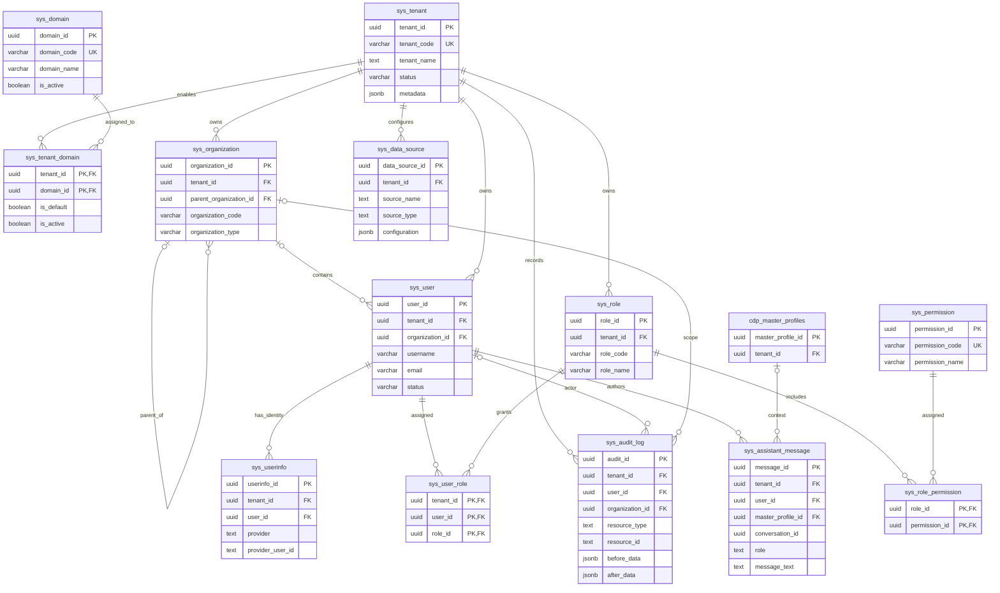
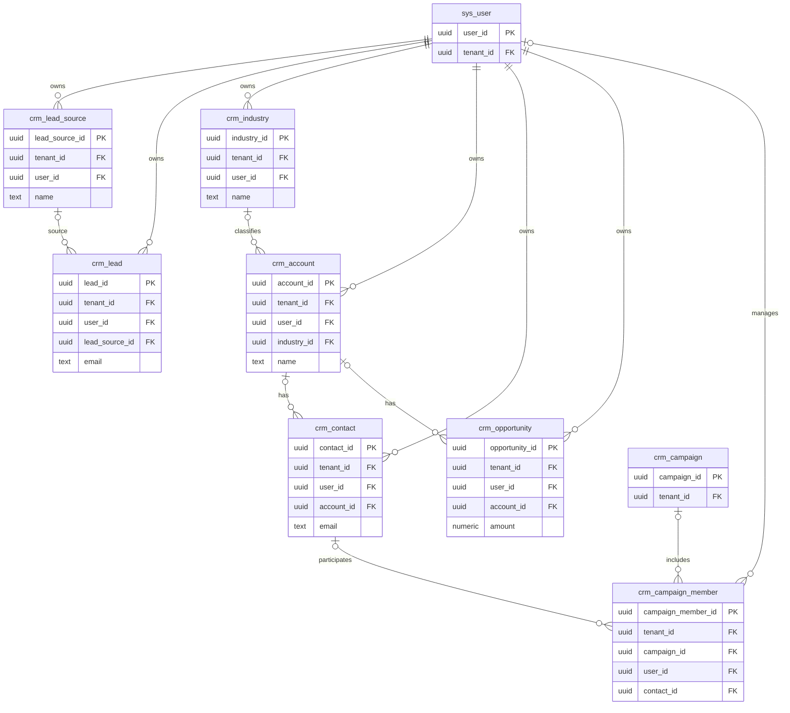
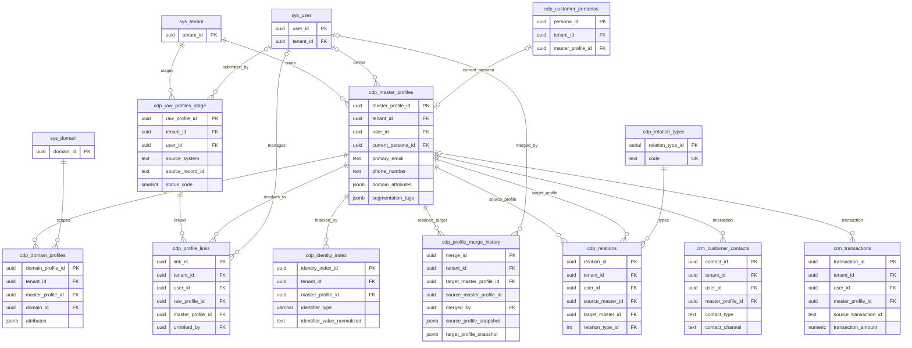
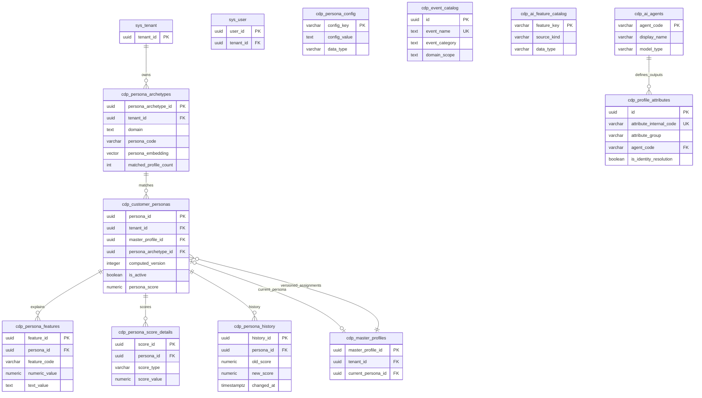
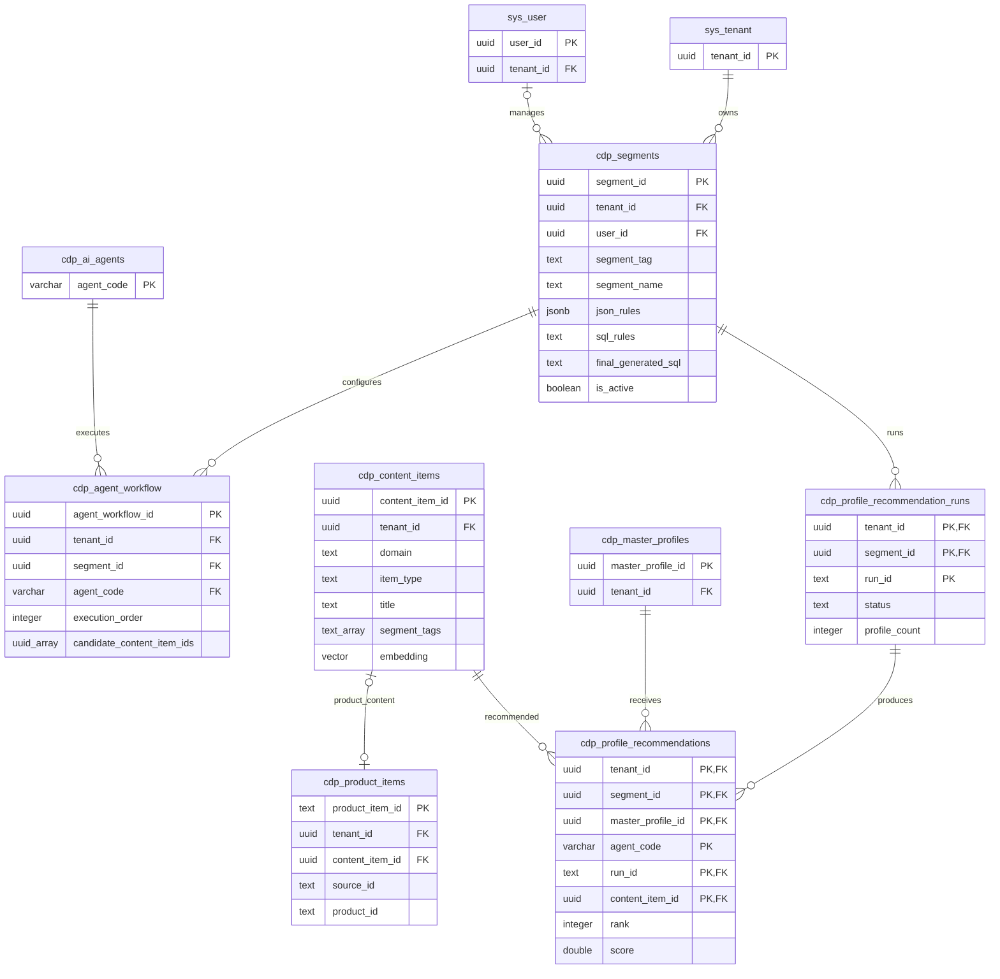
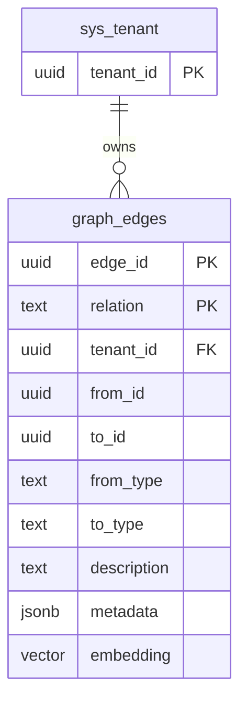
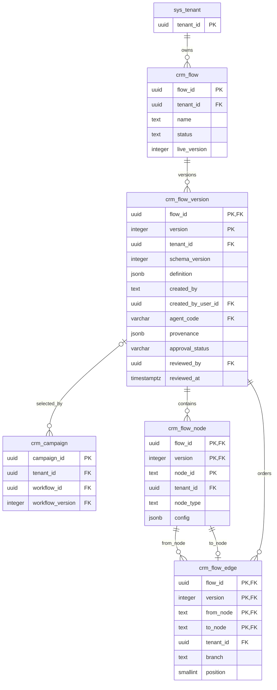

# Customer 360 database schema

`database-schema.sql` is the source of truth for this diagram. The diagrams below cover its 62 base tables, the 15 partitions of `graph_edges`, and both views. They show primary keys, tenant keys, important identifying columns, and declared foreign-key relationships; types are abbreviated for readability. They are not a substitute for the SQL definitions, which contain every exact type, column, check, index, trigger, and function.

All names are exact table or view names in the `customer360` schema. Where a relationship is tenant-scoped, the SQL uses a composite foreign key containing `tenant_id`; the diagram draws that relationship once rather than repeating `tenant_id` as a separate edge to `sys_tenant` in every subject area. Global dictionaries/catalogs that are not tenant-owned do not have a tenant edge.

## 1. Tenant, organization, users, and access control

`sys_permission` is global. `sys_domain` is a global dictionary; `sys_tenant_domain` associates domains with tenants. User-to-role, role-to-permission, and tenant-domain associations use composite primary keys.

## 2. CRM sales entities

Tenant-consistent composite foreign keys in the SQL reinforce the CRM references shown above. Nullable owners, account links, and lead sources remain optional.

## 3. CDP profiles and identity resolution

`source_master_profile_id` in `cdp_profile_merge_history` is intentionally not a foreign key: the merged source profile may no longer exist. `cdp_master_profiles` and `cdp_raw_profiles_stage` are wide ingestion/identity records; only relationship and identifying fields are expanded here.

## 4. Personas and AI metadata

`cdp_event_catalog`, `cdp_ai_feature_catalog`, `cdp_ai_agents`, `cdp_profile_attributes`, and `cdp_persona_config` are global metadata/configuration catalogs; they do not all have a tenant key. Persona assignments are versioned rows linking a master profile to a reusable archetype.

## 5. Segmentation, content, and recommendations

`cdp_product_items.content_item_id` is tenant-scoped and unique when present. `cdp_agent_workflow.candidate_content_item_ids` is an array validated by database triggers rather than a conventional foreign key. Recommendation records reference their run, tenant profile, and tenant content item with composite foreign keys.

## 6. Campaign planning, approval, activation, and reporting

```mermaid
erDiagram
    sys_tenant {
        uuid tenant_id PK
    }
    sys_user {
        uuid user_id PK
        uuid tenant_id FK
    }
    cdp_segments {
        uuid segment_id PK
        uuid tenant_id FK
    }
    cdp_persona_archetypes {
        uuid persona_archetype_id PK
        uuid tenant_id FK
    }
    cdp_master_profiles {
        uuid master_profile_id PK
        uuid tenant_id FK
    }
    cdp_content_items {
        uuid content_item_id PK
        uuid tenant_id FK
    }
    crm_message_templates {
        uuid template_id PK
        uuid tenant_id FK
        uuid persona_id FK
        uuid created_by FK
        uuid approved_by FK
        text message_type
        text status
    }
    crm_campaign {
        uuid campaign_id PK
        uuid tenant_id FK
        uuid user_id FK
        uuid approved_by FK
        uuid segment_id FK
        uuid workflow_id FK
        integer workflow_version FK
        text name
        varchar approval_status
        text strategy_summary
        jsonb ai_plan
    }
    crm_campaign_performance_daily {
        uuid performance_id PK
        uuid tenant_id FK
        uuid campaign_id FK
        uuid experiment_variant_id FK
        date report_date
        numeric spend
        bigint impressions
        bigint clicks
        bigint conversions
    }
    crm_campaign_member {
        uuid campaign_member_id PK
        uuid tenant_id FK
        uuid campaign_id FK
        uuid user_id FK
        uuid contact_id FK
    }
    crm_campaign_reviews {
        uuid review_id PK
        uuid tenant_id FK
        uuid campaign_id FK
        uuid reviewer_id FK
        text decision
    }
    crm_campaign_experiments {
        uuid experiment_id PK
        uuid tenant_id FK
        uuid campaign_id FK
        uuid winning_variant_id FK
        text status
        varchar primary_metric
    }
    crm_campaign_experiment_variants {
        uuid variant_id PK
        uuid tenant_id FK
        uuid experiment_id FK
        uuid segment_id FK
        uuid template_id FK
        numeric allocation_percentage
    }
    crm_campaign_content_items {
        uuid campaign_content_item_id PK
        uuid tenant_id FK
        uuid campaign_id FK
        uuid content_item_id FK
        integer position
    }
    crm_segment_sync_runs {
        uuid sync_run_id PK
        uuid tenant_id FK
        uuid segment_id FK
        uuid triggered_by FK
        text status
    }
    crm_ad_sync_runs {
        uuid sync_run_id PK
        uuid tenant_id FK
        uuid campaign_id FK
        uuid segment_id FK
        varchar platform
        varchar audience_name
        text idempotency_key UK
        text external_audience_id
        text status
        integer eligible_count
        integer uploaded_count
    }
    crm_campaign_workflow_action_runs {
        uuid action_run_id PK
        uuid tenant_id FK
        uuid campaign_id FK
        uuid master_profile_id FK
        text node_id
        varchar action_type
        varchar status
        text provider_message_id
        integer attempt_count
    }
    cdp_campaign_dispatch_logs {
        uuid dispatch_id PK
        uuid tenant_id FK
        uuid campaign_id FK
        uuid master_profile_id FK
        uuid template_id FK
        text status
        text provider_message_id
    }
    crm_connector_config {
        uuid connector_id PK
        uuid tenant_id FK
        uuid user_id FK
        varchar connector_type
        varchar provider
        jsonb config
    }
    crm_suppression_list {
        uuid suppression_id PK
        uuid tenant_id FK
        uuid master_profile_id FK
        uuid campaign_id FK
        uuid removed_by FK
        text channel
        text identifier
        text scope
    }

    sys_tenant ||--o{ crm_campaign : owns
    sys_user o|--o{ crm_campaign : owner
    sys_user o|--o{ crm_campaign : approver
    cdp_segments o|--o{ crm_campaign : targets
    crm_message_templates o|--o{ crm_campaign : uses
    crm_campaign ||--o{ crm_campaign_performance_daily : reports
    crm_campaign ||--o{ crm_campaign_member : includes
    sys_user o|--o{ crm_campaign_member : manages
    crm_campaign ||--o{ crm_campaign_reviews : reviewed_by
    sys_user ||--o{ crm_campaign_reviews : reviewer
    crm_campaign ||--o{ crm_campaign_experiments : tests
    sys_user o|--o{ crm_campaign_experiments : creates
    sys_user o|--o{ crm_message_templates : created_by
    sys_user o|--o{ crm_message_templates : approved_by
    crm_campaign_experiments ||--o{ crm_campaign_experiment_variants : contains
    cdp_segments ||--o{ crm_campaign_experiment_variants : targets
    crm_message_templates o|--o{ crm_campaign_experiment_variants : uses
    crm_campaign_experiment_variants o|--o| crm_campaign_experiments : winning_variant
    crm_campaign ||--o{ crm_campaign_content_items : plans
    cdp_content_items ||--o{ crm_campaign_content_items : selected_item
    cdp_segments ||--o{ crm_segment_sync_runs : synchronized
    sys_user o|--o{ crm_segment_sync_runs : triggered_by
    crm_campaign ||--o{ crm_ad_sync_runs : exports
    cdp_segments ||--o{ crm_ad_sync_runs : audience
    crm_campaign ||--o{ crm_campaign_workflow_action_runs : executes
    cdp_master_profiles ||--o{ crm_campaign_workflow_action_runs : action_target
    crm_campaign ||--o{ cdp_campaign_dispatch_logs : dispatches
    cdp_master_profiles ||--o{ cdp_campaign_dispatch_logs : recipient
    crm_message_templates o|--o{ cdp_campaign_dispatch_logs : rendered_from
    sys_user o|--o{ crm_connector_config : configures
    cdp_master_profiles o|--o{ crm_suppression_list : suppresses
    crm_campaign o|--o{ crm_suppression_list : campaign_scope
    sys_user o|--o{ crm_suppression_list : removes
    cdp_persona_archetypes o|--o{ crm_message_templates : guides
```

`crm_campaign.workflow_id`, `workflow_version`, and `tenant_id` reference the exact `(flow_id, version, tenant_id)` row in `crm_flow_version`; both workflow columns are nullable together. See the workflow diagram below. The daily performance view is derived and includes conversion, CPA, CTR, CVR, and ROAS aggregates.

## 7. General-purpose graph edges

`graph_edges` is partitioned by `relation`; the primary key is `(edge_id, relation)`. Its `from_id` and `to_id` are polymorphic identifiers and deliberately are not foreign keys. SQL creates 15 partitions: `graph_edges_belongs_to`, `graph_edges_comes_from`, `graph_edges_converted`, `graph_edges_follows`, `graph_edges_is_part_of`, `graph_edges_is_active_as`, `graph_edges_is_connected_to`, `graph_edges_is_from`, `graph_edges_created_by`, `graph_edges_is_driven_by`, `graph_edges_has_role`, `graph_edges_has`, `graph_edges_is_for_the`, `graph_edges_belongs_to_industry`, and the default partition `graph_edges_other`.

## 8. Persisted customer journey workflows

`crm_flow_version.definition` is the immutable workflow JSON snapshot; its author, agent and provenance are fixed too, and only the review fields change (`crm_review_flow_version`). `crm_flow_node` and `crm_flow_edge` are its immutable relational projection. `crm_flow.live_version` must reference an existing version and can only be published when that version is Approved. The campaign reference is separately pinned to a specific workflow version.

## Other schema objects

| Object | SQL definition |
| --- | --- |
| `vw_campaign_performance_metrics` | View joining `crm_campaign` to `crm_campaign_performance_daily` to calculate campaign-level totals and KPIs. |
| `crm_vw_flow_node` | View over `crm_flow_node` deriving message channel and wait duration. |

`database-schema.sql` also defines functions for saving/publishing/loading flow JSON, persona and embedding maintenance triggers, tenant-consistent composite foreign keys, indexes, and row-level security policies. Those implementation objects are omitted from the ER diagrams. For exact column definitions, check constraints, uniqueness, delete behavior, indexes, and functions, consult [`database-schema.sql`](./database-schema.sql).
