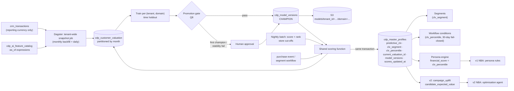

# CLV Regression Agent (`clv_prediction`)

> **Status:** living implementation plan · implemented on branch `feat/clv-regression-agent` (uncommitted, see §7) · **Owner:** AI agents / data science · **Last reviewed:** 2026-11-19
>
> **Goal:** turn the `regression` agent scaffold and `cdp_customer_valuation` into a working, tenant-safe Customer Lifetime Value pipeline whose output drives **audience segmentation/labelling** (`clv_segment`, `clv_percentile`) and **Next Best Action** (persona value tier now; uplift-weighted NBA later). **The LLM never produces a CLV number.**

## 1. Decision Summary

Each decision lists the choice, the reason, and the options rejected. Numbering follows the design review (Q1–Q16).

| # | Decision | Why | Rejected |
|---|---|---|---|
| Q1 | **Engine:** a trained LightGBM regressor (`lightgbm.LGBMRegressor`), as seeded. `cdp_customer_valuation` is the per-profile, point-in-time **feature snapshot** plus output slots. | Learns from observed behaviour; matches the `clv_prediction` seed. | Deterministic formula as the engine (kept only for the finance arithmetic in Q2); LLM-produced CLV (unauditable). **Precondition:** ≥ ~24 months of `crm_transactions` history per (tenant, domain). Below that, the pair stays on Jev / System One cold-start (model-layer §2.7). |
| Q2 | **Label:** net realised revenue in the 365 days **strictly after** `as_of_date` (completed, non-refunded transactions), trained on `log1p`. The prediction is written to **`expected_annual_revenue`**. `predicted_clv_12m`, `predicted_clv_36m`, `predicted_clv_horizon_*` and `predicted_contribution_profit_horizon` are **derived** with ΣSₜ·Mₜ/(1+r)ᵗ − CAC (`docs/research-papers/customer-value-measurement.md`). | Revenue is the only observable label (no cost or margin in `crm_transactions`); `predicted_clv_12m` is defined as **contribution value**, not revenue (`customer360-database/README.md:803`). | Contribution-profit label (margin not observed); 24–36 month label (discards recent customers). |
| Q3 | **Training rows:** a **tenant-wide** Dagster job writes monthly snapshots, both backfilled and going forward, and trains on a **time-based** holdout. Backfill uses `cdp_ai_feature_catalog` `:as_of` expressions only. Current-state `profile_*` features are dropped from training. Event features stay NULL until S3 retention is settled. `model_assumptions.backfilled = true`. | Point-in-time correctness; the segment-scoped runner would bias the training sample. | Accumulate-only (no model for a year); training inside the segment workflow. |
| Q4 | **A′, history plus projection:** `cdp_customer_valuation` is the history and system of record. In the **same transaction**, the scorer projects onto `cdp_master_profiles`: `predictive_clv` ← `predicted_clv_12m`, `clv_segment`, `clv_percentile` (Q16), a new `current_valuation_id`, `model_versions.clv_model` and `scores_updated_at`. `PATCH /master-profiles/{id}` **rejects** these fields. A re-projection job rebuilds them from the champion's latest `COMPUTED` snapshot. | Mirrors the persona pattern (`cdp_customer_personas` + `current_persona_id`); every documented consumer reads the master profile. | Repointing every consumer at the valuation table or a view (B / B′): six consumer changes for requirements no doc states. |
| Q5 | **`clv_segment`:** percentile tiers within (tenant, domain) over `COMPUTED` rows only. Minimum population of 500 (otherwise NULL). Hysteresis of ±2 percentile points at each cut-off. Cut-offs and the distribution are recorded in `model_assumptions`. | Currency-free, no per-tenant configuration, stable audience sizes. | Absolute per-tenant thresholds (configuration burden, currency); clusters (unordered). |
| Q6 | **Model unit:** one model per **(tenant, domain)**. | Tenant isolation; spend behaviour differs by domain. | A global pooled model (cross-tenant data use, mixed currencies); one model per tenant. |
| Q7 | **Registry:** new RLS table `cdp_model_versions`; artefacts in object storage at `models/tenant_id=<uuid>/domain=<code>/clv_prediction/<version>/`; a partial unique index allows **one CHAMPION** per (tenant, domain, agent). | Fits the existing RLS and tenant-prefix conventions; gives real lineage from each valuation row to its model. | MLflow (no multi-tenancy, a new service); model bytes in PostgreSQL. |
| Q8 | **Promotion gate (all must pass on the time holdout):** (1) normalised Gini and top-decile revenue capture beat the champion; (2) calibration within ±10–15% overall and per decile; (3) beats the persistence baseline (next 12 months = last 12 months); (4) **< 10%** of profiles change tier (configurable). Automatic promotion (`promoted_by='system'`) when all pass. **Human approval** for the first LightGBM champion replacing Jev, and for a challenger failing only the stability gate. | One metric is gameable; review only where outcomes change. | Fully automatic on one metric; always manual (rubber-stamping). |
| Q9 | **Scoring:** a tenant-wide batch scores and ranks everyone and stores the tier **cut-off values**. `purchase` events and segment workflows re-score single profiles with the champion, using the **frozen cut-offs** plus hysteresis. One shared scoring function. The `regression` pipeline returns `value = predicted_clv_12m` plus the snapshot ID. | Percentiles must be population-wide; the documented purchase → CLV refresh (`leo-data-journey-maps.md:95, 398`). | Batch only (stale after purchases); segment-scoped ranking (wrong tiers). |
| Q10 | **One writer:** only the CLV scorer writes valuation rows. It owns the CLV outputs, `model_confidence`, `data_quality_score`, `clv_segment`, `explanation` (SHAP), `feature_snapshot` and `insights` (an optional LLM narrative, generated when viewed and cached). **Deprecated, left NULL:** `churn_risk_score`, `purchase_intent_score`, `next_best_product_score`, `incremental_campaign_value`, `profile_quality_score`, `actions`. Other scores live in their homes catalogued in `cdp_profile_attributes`. | Immutable, reproducible snapshots; no copies that drift. | Many writers; copying other scores into the row; an LLM filling `actions` nightly. |
| Q11 | **Currency:** `sys_tenant.reporting_currency CHAR(3)` (required, default `VND`). Rows in the reporting currency, or with a NULL currency, are used as they are. **Other currencies are excluded**; the excluded share goes into `feature_snapshot` and lowers `data_quality_score`. **FX conversion is optional per tenant** (`sys_fx_rate`), switched on when the excluded share exceeds ~2% of revenue. | Tenants are mostly single-currency VND; never sum different currencies (`customer360-database/README.md:326, 871`). | One model per currency; always-on FX. |
| Q12 | **FX rate policy (when enabled):** transaction-date rate, using the tenant's local date. If that date has no rate, the latest earlier rate within 7 days. Otherwise the transaction is excluded and recorded as in Q11. | Realised-value semantics; reproducible in a backfill. | Valuation-date rate (future rates leak into the label); budget rates (configuration burden). |
| Q13 | **FX rate source:** **parked** until a tenant crosses the Q11 threshold. Candidates: State Bank of Vietnam central rate or Vietcombank published rates, plus a CSV import fallback. | Not needed for single-currency tenants. | — |
| Q14 | **Retention:** daily rows are kept for **35 days**; month-end rows for **36 months**; older rows are exported to Parquet under the tenant S3 prefix and then deleted. The table is **partitioned by month** of `as_of_date`. Same-day re-scoring upserts on the existing unique key. | Hysteresis and the stability gate need daily history; training needs monthly cohorts across 24 + 12 months. | Daily rows forever (~365M rows a year per 1M profiles); monthly-only (loses the daily trail). |
| Q15 | **Staleness:** an alert after **72 hours** without a successful run, with the value's age shown in the UI. **Automated consumers fail closed after 30 days** (workflow conditions, NBA and the persona engine treat CLV as missing). Values are never cleared. | Separates "people need to know" from "machines must stop acting on it". | No rule (silent wrong targeting); a hard NULL cut-off (segments empty out). |
| Q16 | **CLV → NBA:** CLV **publishes**; each consumer owns its use. **v1:** the persona `financial_score = clv_percentile` (a neutral default when missing or stale); `clv_percentile` is added to workflow condition fields; segments use `clv_segment`. **v2:** `campaign_uplift` writes `candidate_expected_value` (for retention, Δchurn × `predicted_clv_12m`); NBA ranks on that. | Attaches only to code and contracts that exist; fixes the VND 5,000 defect; value at stake belongs in uplift, per the catalogue (`init-cdp-ai-agents.sql:502`). | CLV as a value multiplier (rewards customers who would have bought anyway); feature only (no v1 effect); an NBA-internal retention optimiser (no engine, no action-cost data). |

### Cross-checked against

`customer360-database/database-schema.sql`, `customer360-database/init-cdp-ai-agents.sql`, `customer360-database/README.md`, `customer360-backend/ai_agents_runners/README.md`, `docs/research-papers/customer-value-measurement.md`, `docs/research-papers/the-customer360-model-layer.md`, `docs/research-papers/jev-decision-model-design.md`, `docs/research-papers/persona_as_a_vector_marketing_8.0.md`, `docs/action-plans/FULL-ANALYTICS-WITH-S3.md`, `docs/marketing/agentic-campaign-ops..md`, `docs/marketing/customer-journey-map.md`, `docs/architecture/leo-data-journey-maps.md`, `docs/ai-agent/agent-types-customer360.md`.

## 2. Architecture

## 3. Schema Changes

`database-schema.sql` is re-run idempotently by `setup-and-upgrade-db.sh` on every setup and upgrade, so all changes live there (guarded `ADD COLUMN IF NOT EXISTS` / `DO` blocks). `legacy-upgrade.sql` is a frozen historical script and is **not** edited; the deprecated columns are only commented now, and a later drop must also remove the `ADD COLUMN IF NOT EXISTS` lines and CHECK constraints in its step 012.

| Object | Change |
|---|---|
| `sys_tenant` | Add `reporting_currency CHAR(3) NOT NULL DEFAULT 'VND'`. Backfill existing tenants from their dominant transaction currency; confirm at first-champion approval (Q8). |
| `cdp_master_profiles` | Add `clv_percentile NUMERIC(5,2)` (0–100, CHECK) and `current_valuation_id UUID` (no FK: the partitioned valuation table is keyed by `(valuation_id, as_of_date)`). Fix the `predictive_clv` comment from "ML-predicted future revenue generation" to "12-month contribution value (projected from cdp_customer_valuation)". Explicit rounding from `NUMERIC(20,4)` to `NUMERIC(15,2)` on projection. |
| `cdp_profile_attributes` seed (`init-core-database.sql:415`) | Same description fix for `predictive_clv`; add a `clv_percentile` row in group `CLV_SCORING`. |
| `cdp_customer_valuation` | Convert to **range partitioning by month** of `as_of_date` (PK `(valuation_id, as_of_date)`; an existing empty table is recreated, a populated one is left alone with a NOTICE). `ensure_cdp_customer_valuation_partitions(from, to)` creates monthly partitions with the same forced tenant policy; bootstrap covers −36 to +3 months. Add nullable `model_version_id` FK to `cdp_model_versions` (the `model_version` string stays in the unique key). Deprecate the six non-CLV columns (Q10): comment as deprecated, stop writing them, drop them in a later release along with their CHECK constraints in `legacy-upgrade.sql:1371–1449`. Add covering index `(tenant_id, domain_code, master_profile_id, model_name, as_of_date DESC) WHERE calculation_status = 'COMPUTED'`. |
| `cdp_model_versions` (new) | `tenant_id, domain_code, agent_code, model_version, artifact_uri, feature_version, training_window, label_definition, metrics JSONB, tier_cutoffs JSONB, feature_keys, gate_result JSONB, status CHALLENGER/PENDING_APPROVAL/CHAMPION/REJECTED/RETIRED, promoted_at, promoted_by`. Forced RLS. Partial unique index for one `CHAMPION` per (tenant, domain, agent). |
| `sys_fx_rate` (new, **optional**, Q11/Q13) | `rate_date, base_currency, quote_currency, rate, source`. Tenant-agnostic reference data (no RLS). Created only when the first tenant needs FX. |

## 4. Code Touch-points

| Area | File(s) | Change |
|---|---|---|
| Feature catalogue | `customer360-database/init-cdp-ai-agents.sql` (`clv_prediction` seed) | Shared catalogue expressions are unchanged (other agents use them). The CLV feature SQL (`clv/repository.py`) mirrors the catalogue keys over a filtered transaction relation: status exclusion, refunds negated, reporting currency only. Features use transactions before the end of `as_of_date` (the catalogue's `<= :as_of`); the label uses the following 365 days, so the windows never overlap. The seed drops the three `profile_*` features, adds the tier/gate configuration and makes the prompt narrative-only; a guarded `UPDATE` upgrades an untouched v1 seed row in existing databases. |
| Regression pipeline | `customer360-backend/ai_agents_runners/agent_pipeline/agent_types/regression.py` | Implement `process()` as a thin per-profile scorer: load the champion, score, apply frozen cut-offs and hysteresis, write the snapshot and projection; return `value` plus the snapshot ID. |
| Batch / training | new Dagster assets under `customer360-backend/ai_agents_runners/` | Snapshot (backfill + daily), train, gate, promote, nightly score and rank, re-projection, retention export (Q14), staleness alert (Q15). |
| Persona engine | `customer360-dao/src/leo_customer360_dao/agentic_engines/persona_engine.py:572` | `compute_financial_score` reads `clv_percentile`; a neutral configurable default when it is NULL or `scores_updated_at` is older than 30 days. Remove `FINANCIAL_CLV_REFERENCE_DEFAULT`. Ship as a persona config version bump; suppress the burst of history rows for that one recompute. Same change in `customer360-dao/build/lib/...` if it is still packaged. |
| Workflow conditions | `customer360-dao/src/leo_customer360_dao/workflow/nodes.py:21`, `static/js/workflow/workflow-core.js` | Add `clv_percentile` to `NUMERIC_PROFILE_FIELDS` (keep both lists in sync). The condition node checks `scores_updated_at` (fail closed after 30 days). |
| Master profile API | `customer360-api` profile PATCH schema | Reject writes to `predictive_clv`, `clv_segment`, `clv_percentile` and `current_valuation_id`. |
| UI | `customer360-frontend/static/js/profile-list-view.js:31, 148`, `profile-detail-view.js:851` | Show the CLV age and a stale badge (Q15). |
| Docs | `docs/architecture/ROADMAP.md` (Trung hạn, ML scoring line), `docs/README.md` | Correct the PATCH write path for CLV; link this plan. |

## 5. Phases

1. **Foundations:** schema changes (§3, excluding FX), catalogue fixes, the `PATCH` guard, `predictive_clv` comment fixes.
2. **Snapshots and backfill:** the tenant-wide snapshot job; verify the Q1 history precondition per (tenant, domain) and report which pairs stay on Jev.
3. **Training and registry:** train per (tenant, domain), store artefacts, run the Q8 gate; the first champion per pair requires human approval.
4. **Scoring and projection:** nightly batch plus event and segment re-scoring through `regression.py`; same-transaction projection; re-projection job.
5. **Consumers:** persona `financial_score` migration, `clv_percentile` in workflow conditions, staleness alert and UI badge.
6. **Retention:** monthly partitions, Parquet export and partition drops (Q14). This phase depends on S3 retention.
7. **Later (v2):** `campaign_uplift` produces `candidate_expected_value`; the NBA optimisation engine is selected; optional FX (Q13).

## 6. Dependencies and Open Items

- **History precondition (Q1):** not yet verified per tenant. Without ~24 months of transactions, the pair runs on Jev cold-start.
- **S3 event retention:** still open in [Full Analytics with S3](FULL-ANALYTICS-WITH-S3.md); it blocks event features (Q3) and the Parquet export (Q14).
- **Tenant time zone:** `sys_tenant` has no time-zone field. It is needed for "tenant local date" in labels, snapshots and FX (Q12). It must be decided before Phase 2.
- **NULL vs `UNK` currency:** the database README records unset currency as `UNK`; this plan treats NULL **and** `UNK` as the reporting currency (Q11). Confirm with the data-ingestion owners.
- **NBA prompt:** the `next_best_action` seed asks the LLM for a numeric `score`, which conflicts with model-layer §2.7. To be resolved in NBA's own design.
- **FX source (Q13):** parked.
- **Profile merges:** a merged master keeps the surviving profile's percentile until the next nightly run (within the Q15 tolerance).

## 7. Implementation Status (2026-11-19)

Implemented on `feat/clv-regression-agent`, uncommitted. Tests: runner 175 passed (incl. 3 Postgres 16 end-to-end tests with a non-superuser role so forced RLS applies), database contracts 28, DAO 349 (2 pre-existing `google-genai` failures, identical on `main`), campaign activation 77, API 6, frontend 35.

**Deviations from the decisions above, with reasons:**

- **Persistence-baseline check (Q8):** "beats the baseline" means higher normalised Gini **and** top-decile capture. MAE was dropped: it rewards median-like predictions and conflicts with the mean calibration the gate also checks.
- **Money calibration:** `expm1` of a log-target model predicts the median, so predictions are scaled by actual ÷ fitted revenue on the training rows (stored as `metrics.calibration_scale`). Duan smearing was tried and inflated predictions ~160× on zero-inflated revenue.
- **Backfilled snapshots (Q3):** training recomputes point-in-time features at each month-end cut-off with the same SQL as scoring, instead of persisting feature-only valuation rows (which would sit in the table with no outputs). Nightly rows still accumulate as the forward history.
- **Cold start (Q1):** Jev / System One is not implemented in the repo. A (tenant, domain) without a champion is not scored or projected; the persona engine uses its neutral financial default.
- **Persona history burst (Q5/Q16):** the engine version is bumped to `persona-engine-v2` so rows from the one-off recompute are identifiable, but they are not suppressed.

**Open — needs a decision:**

- **Per-decile ±15% calibration (Q8).** On a realistic, noisy synthetic tenant (700 holdout rows, ~70 per decile) no model passed it, including isotonic calibration (worst decile 0.37); the model was rejected despite Gini 0.74 vs 0.46 for persistence. Options: a minimum rows per decile before the check applies, a confidence-interval test, or a looser per-decile tolerance with the ±15% kept overall.
- **Tenant time zone:** still open. Interim behaviour: `transaction_time` is used as stored (no conversion); `as_of_date` ends at midnight of the next day in that clock.
- **Purchase-event trigger:** `clv_rescore_job` exists, but nothing yet submits it on a `purchase` event.
- **`scores_updated_at` is shared** by all ML scores on the master profile; once churn or lead scoring write it, CLV staleness should move to a CLV-specific timestamp.
- **Retention partition drops:** rows are exported and deleted; dropping empty partitions older than 36 months is not automated yet.
