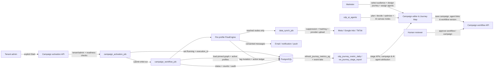
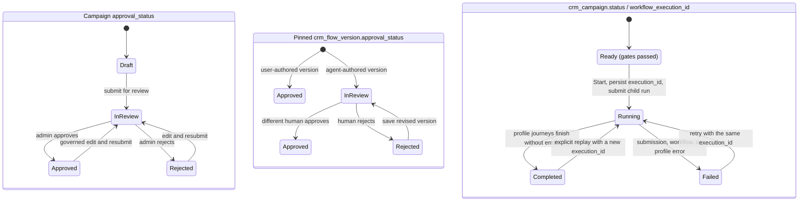
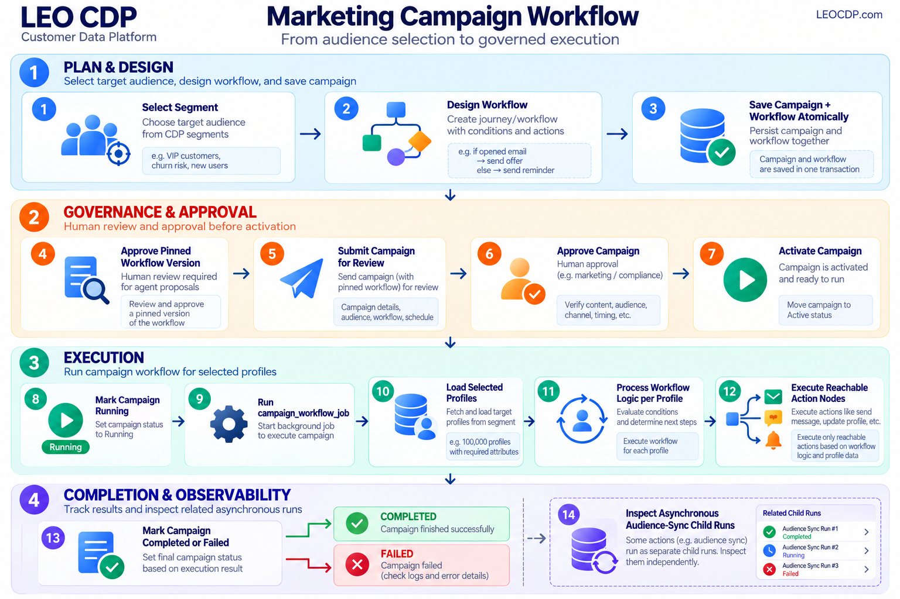
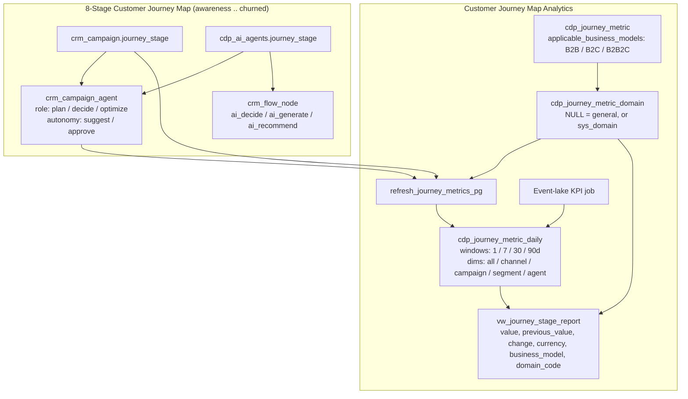

# Agentic campaign workflow

This document describes the campaign behavior that is implemented in the
repository today. The campaign is a workflow-owned execution record. It is
not a template-owned email campaign.

## Supported Marketing Domains

Campaigns use the tenant's active business-domain catalog. The API validates
domain values against `customer360.sys_domain` through
[`domains.py`](../../customer360-api/core/utils/domains.py), and the metadata
endpoint returns only domains enabled for the requested tenant. The catalog is
therefore tenant-scoped at runtime; do not assume that every tenant exposes
every seeded domain.

The current core seed catalog supports:

| Code | Business domain |
| --- | --- |
| `_` | Unclassified / Not set (fallback for profiles without a classified vertical) |
| `retail` | Retail & E-Commerce |
| `banking` | Banking & Financial Services |
| `insurance` | Insurance |
| `healthcare` | Healthcare |
| `telecom` | Telecommunications |
| `travel` | Travel & Hospitality |
| `real_estate` | Real Estate |
| `education` | Education |
| `manufacturing` | Manufacturing |
| `media` | Media & Entertainment |
| `hospitality` | Hospitality & Food Service |

These values are seeded in
[`init-core-database.sql`](../../customer360-database/init-core-database.sql)
and filtered through `sys_tenant_domain`. Profile identity resolution,
segmentation, content, persona APIs, and domain-scoped journey analytics use
the same active-domain catalog (`_` is excluded from domain-specific KPI
rollups). The special value `all` is accepted by APIs that support cross-domain
filters; it is not a row in `sys_domain`.

On `customer360.sys_tenant`, `business_type` stores the tenant's industry or
vertical (for example, `retail`), while `business_model` stores the tenant's
go-to-market model (`B2B`, `B2C`, or `B2B2C`, defaulting to `B2C`). Journey
analytics uses `business_model` to filter KPI applicability and `sys_domain` to
separate general (`domain_code IS NULL`) from domain-specific KPI snapshots.

Business domains are separate from campaign delivery channels. The workflow
engine currently supports email, web push, and notification providers for SMS,
Zalo OA, WhatsApp, and mobile-native push. Reached custom-audience actions
support Meta Ads, Google Ads, and TikTok Ads. These channel/provider
capabilities are configured per tenant and are skipped explicitly when the
required connector or consent is unavailable.


## Product and architecture overview

Marketing teams define a campaign audience, design a versioned customer
journey, obtain the required human approvals, and then explicitly start the
journey. The execution engine applies the saved graph to active profiles in
the selected segment. Each profile may take a different branch, receive
different channel actions, or reach an audience-sync action.



Three state dimensions must not be conflated:

1. **Campaign approval** answers whether the campaign plan is approved.
2. **Workflow-version approval** answers whether the exact pinned graph is
   approved.
3. **Operational execution status** answers whether that campaign execution is
   queued/running, completed, or failed.

The campaign is executable only when both approval dimensions are `Approved`,
the segment is active and computed, and the workflow root uses the same
segment. Approval never sends messages. Starting the campaign is a separate,
explicit tenant-admin action.

### State transitions



`Ready` is a conceptual state, not a persisted `crm_campaign.status` value.
Both approval states and audience readiness must be satisfied before entering
operational `Running`.

| Transition | Guard / side effect | Where to inspect |
| --- | --- | --- |
| Draft → InReview | Submit campaign after required fields and workflow are saved | Campaign approval state and history |
| InReview → Approved / Rejected | Tenant-admin review; agent workflow proposals also need an independent human workflow-version review | Campaign and workflow history |
| Ready → Running | Activation validates tenant, approvals, segment, and pinned workflow; creates or reuses `workflow_execution_id`; submits child Dagster run | Activation Dagster run, campaign state, `WORKFLOW_ACTIVATED` audit |
| Running → Completed | Profile pass ends with zero journey errors; messages may still have been skipped and audience-sync child jobs may still be processing | Campaign status, workflow run summary, action and audience-sync ledgers |
| Running → Failed | Submission failure, workflow exception, or one or more profile journey errors | Campaign status, `WORKFLOW_*_FAILED` audit, failed action rows, Dagster logs |
| Failed → Running | Retry reuses the same execution ID; completed actions are not repeated, failed actions may retry | Same execution's action-ledger rows and attempt counts |
| Completed → Running | Explicit tenant-admin replay, guarded by the observed execution ID; allocates a new execution ID | New execution rows and `WORKFLOW_RESTARTED` audit |

The activation API only exposes a completed-campaign replay. A failed campaign
is retried with Start, preserving the same execution ID. A replay traverses
current segment membership and current branch conditions, so it is a new pass,
not a resume checkpoint, and successful messages may be sent again.

### Business use cases

- **Consent-aware onboarding:** enroll an approved segment, send a welcome
  message, branch on engagement, then add a profile tag for later analysis.
- **Engagement-based retention:** branch using engagement or churn scores,
  send different content on each path, and end a path at a goal or exit node.
- **Event-informed follow-up:** query already-ingested linked events during a
  wait-for-event window and choose the happened/timeout branch. This is a
  batch-time check, not a future event subscription.
- **Paid-media audience refresh:** when at least one profile reaches a sync
  node, submit a campaign-scoped audience sync. The child job exports the
  selected segment subject to its own eligibility and suppression checks.
- **Controlled replay:** after reviewing status, audience, provider setup, and
  consent, an admin may replay a completed campaign. The replay is retained as
  a distinct execution and may create duplicate deliveries.

These use cases describe current graph capabilities; the platform does not
currently provide real-time journey enrollment or durable scheduled waits.

## Main campaign lifecycle



The only executable campaign path is:

```text
Select segment
  -> design workflow
  -> save campaign + workflow atomically
  -> approve pinned workflow version (human review for agent proposals)
  -> submit campaign for review
  -> approve campaign
  -> activate campaign
  -> mark campaign Running
  -> run campaign_workflow_job
  -> load selected profiles
  -> process workflow logic per profile
  -> execute reachable action nodes
  -> mark campaign Completed or Failed
  -> inspect any asynchronous audience-sync child runs separately
```

Activation requires all five conditions:

1. A selected `segment_id`.
2. A pinned `workflow_id`.
3. A pinned `workflow_version`.
4. `crm_campaign.approval_status = 'Approved'`.
5. `crm_flow_version.approval_status = 'Approved'`.

The segment must belong to the tenant, be active, have computed membership
(`status_code = 1`), and have a `segment_tag`. Its ID must match the workflow
root's `config.segment_id`. Activation is tenant-admin protected and rejects
campaigns already `Running`, or `Completed` without an explicit replay request.

`crm_message_templates` is an independent AI-agent messaging/template
system. `crm_campaign` has no `template_id` and no direct foreign key to
`crm_message_templates`.

## Campaign metadata

The campaign editor persists these campaign fields:

| Field | Database field | Purpose |
| --- | --- | --- |
| Campaign code | `campaign_code` | Tenant-scoped internal reference |
| Name | `name` | Required campaign name |
| Operational status | `status` | Draft, Active, Running, Paused, Completed, or Failed; activation sets Running and the runtime sets Completed/Failed |
| Channel | `channel` | `email`, `notification`, `push`, or `audience_sync`; existing legacy values are preserved when editing |
| Platform | `platform` | Provider/platform matching the selected channel |
| Language | `lang` | Planning and content locale |
| Description | `description` | Campaign description |
| Keywords | `keywords` | Search/planning keywords |
| Start date | `start_date` | Planned start |
| End date | `end_date` | Planned end |
| Budget | `budget_amount` | Campaign budget |
| Currency | `currency` | Budget currency |
| Objective | `objective` | Awareness, Leads, Conversions, App Install, or Visit Store |
| Journey stage | `journey_stage` | `awareness`, `acquisition`, `activation`, `engagement`, `conversion`, `retention`, `loyalty`, or `churned`; connects the campaign to the Customer Journey Map |
| Strategy summary | `strategy_summary` | Human description of the intended journey |
| Planning constraints | `planning_constraints` | Hard constraints for the planning agent |
| Owner | `user_id` | Authenticated campaign owner |
| Audience | `segment_id` | Selected Customer 360 segment |
| Workflow | `workflow_id` | Persisted workflow identity |
| Workflow version | `workflow_version` | Immutable version pinned to the campaign |
| Approval state | `approval_status` | Draft, InReview, Approved, or Rejected |
| Approval actor/time | `approved_by`, `approved_at` | Human approval evidence |
| Agent plan | `ai_plan` | Generated planning result and agent output |
| Metadata | `metadata` | Additional campaign metadata |

The editor implementation is:

- [`campaign-editor.html`](../../customer360-frontend/static/templates/campaign/campaign-editor.html)
- [`campaign-view.js`](../../customer360-frontend/static/js/campaign-view.js)

The editor does not expose a campaign template ID. The planning constraints
field is persisted as `crm_campaign.planning_constraints`; it is not silently
dropped from the form.

Channel and platform are campaign metadata, not substitutes for action-node
configuration. Notification platforms are `sms`, `zalo_oa`, `whatsapp`, and
`mobile_native`; audience platforms are `meta_ads`, `google_ads`, and
`tiktok_ads`. Start/end dates are planning metadata, not a runtime scheduler.

## Workflow design contract

The workflow studio is embedded by the campaign editor and stores schema
version 2 workflow JSON. The node catalog is defined in
[`workflow-core.js`](../../customer360-frontend/static/js/workflow/workflow-core.js).

### Input and logic nodes

| Node | Persisted type | Behavior |
| --- | --- | --- |
| Event trigger | `trigger` | Root node; records the audience and intended entry event |
| If / else | `condition` | Evaluates a profile field and chooses `yes` or `no` |
| Wait / Delay | `wait` | Advances virtual journey time |
| Wait for event | `wait_event` | Queries an already-available linked event in the virtual journey window, then selects happened/timeout |
| Goal / Exit | `exit` | Ends the profile journey as goal or exit |

### Action nodes

| UI action | Persisted type | Node configuration | Runtime |
| --- | --- | --- | --- |
| Send email | `email` | `subject`, `body` | Sends the rendered subject/body to the profile's email |
| Send notification | `notification` | `provider`, `body` | Sends through `sms`, `zalo_oa`, `whatsapp`, or `mobile_native` |
| Send web push | `push` | `title`, `body` | Sends the rendered title/body to the profile's push tokens |
| Update profile / tag | `update_profile` | `action`, `tag` | Adds or removes a segmentation tag in `cdp_master_profiles` |
| Sync custom audience | `run_data_synch_job` | `platform`, `audience_name` | Requests a campaign-scoped export only if at least one profile reaches this node |
| AI decision | `ai_decide` | `agent_code`, decision parameters | Scores or classifies a profile via a registered `cdp_ai_agents` entry to feed a downstream `condition` node |
| AI content generation | `ai_generate` | `agent_code`, generation parameters | Drafts personalized subject/body/copy via a registered `cdp_ai_agents` entry for a downstream send node |
| AI recommendation | `ai_recommend` | `agent_code`, ranking parameters | Selects product, content, or next-best action via a registered `cdp_ai_agents` entry |

In PostgreSQL (`customer360.crm_flow_node`), `agent_code` is a stored generated
column (`GENERATED ALWAYS AS (config ->> 'agent_code') STORED`) with a foreign
key to `customer360.cdp_ai_agents(agent_code)` and `crm_flow_node_ai_agent_check`
enforcing a non-blank `agent_code` whenever `node_type` is `ai_decide`,
`ai_generate`, or `ai_recommend`. Branching remains with `condition` (`yes` /
`no`), so `crm_flow_edge`, `crm_save_flow`, and `crm_load_flow` require no
structural change.

The current frontend studio, DAO engine, API, and canonical SQL support these
node types. API and engine validation enforce the configuration and graph
contract; SQL constraints are not a replacement for application validation.
Both branches of conditions and event waits are required. Message fields must
be non-empty strings, numeric values must be finite, and unsupported template
variables are rejected. The campaign editor validates through its embedded
studio API before sending a save request.

The notification provider is separate from the persisted node type. A
notification node with `provider: "sms"` targets the SMS connector; changing
the provider does not change the workflow node type.

Supported condition fields are real `cdp_master_profiles` fields:

- `engagement_score`
- `churn_probability`
- `lead_conversion_probability`
- `historical_clv`
- `predictive_clv`
- `latest_nps_score`
- `average_csat`
- `overall_sentiment_score`
- `profile_completeness_score`
- `identity_confidence_score`
- `segmentation_tags`

Numeric fields support `ge`, `lt`, and `eq`. Tag membership supports `has` and
`hasnt`. A null numeric value never matches and takes the condition's `no`
branch. The editor, campaign API validator, DAO engine, profile query, and
browser profile adapter use this same field contract. `status_code` is not a
marketing condition: active profiles are selected before graph execution.

Message templates support the runtime variable `{{first_name}}`. Campaign
workflow messages do not use `crm_message_templates`.

### Execution and simulation limits

The studio's **Check Flow** button validates the graph and runs a local preview;
it never activates the campaign. The **Simulation** tab labels modeled
deliveries, engagement, conversions, and value as simulated, not real campaign
performance. Results cover only loaded sample profiles and use virtual time.
Actual execution and reporting remain in Campaign details. The existing
`run()` plugin method and `onRunCampaign` callback names remain compatible;
their result is still a local simulation, not a delivery receipt.

The backend is a segment-based batch executor, not a frozen-audience or
durable, event-driven journey scheduler:

- At workflow start, the runner queries active profiles whose current
  segmentation tags contain the selected segment tag, in UUID keyset pages.
  It does not materialize an immutable membership snapshot or guarantee a
  single database snapshot across every page. The trigger event describes the
  journey but does not subscribe to or filter future customer events.
- Wait nodes advance virtual elapsed time without sleeping or scheduling a
  later task. Messages after a wait can therefore be sent during the same run.
- Event waits query linked raw events between the run start plus the current
  virtual offset and the end of the configured window. They do not suspend and
  resume when a future event arrives; an event not available at query time
  takes the timeout branch.
- Browser simulation uses estimated engagement/conversion outcomes, not actual
  provider receipts. Its selected-profile adapter preserves numeric condition
  fields, treats missing values as non-matches, and applies explicit consent
  when calculating message reachability.

UAT can verify segment-based batch execution, graph traversal, persistence, and
logging-only actions. Real-time enrollment, durable delays, and future-event
resumption are not implemented and must not be accepted as working scheduling
features.

## Save and review APIs

The campaign editor saves campaign metadata and the workflow in one
transaction:

```text
POST  /api/v1/campaigns/with-workflow
PATCH /api/v1/campaigns/{campaign_id}/with-workflow
GET   /api/v1/campaigns/{campaign_id}/workflow
```

Implementation:

- [`workflow_api.py`](../../customer360-api/core/routers/workflow_api.py)
- [`campaign_workflow_repository.py`](../../customer360-api/core/repositories/campaign_workflow_repository.py)
- [`workflow.py`](../../customer360-dao/src/leo_customer360_dao/schemas/workflow.py)

The save transaction:

1. validates tenant ownership and the selected segment;
2. validates workflow structure and audience alignment;
3. saves an immutable workflow version;
4. pins `workflow_id` and `workflow_version` on `crm_campaign`;
5. commits campaign and workflow together.

Running campaigns cannot be edited through the workflow save API. Edits to
approved campaigns go through campaign draft governance and require review
again. An unchanged workflow payload retains its existing pinned version.

The saving user must exist in the active tenant. After resetting/reseeding the
database, sign out and sign in again: a previously issued token can contain a
deleted user ID. The update API validates this before saving any workflow
version and returns `401` for an invalid actor. Do not remove the workflow
creator/reviewer foreign keys to work around stale authentication; later draft
and audit checks require the same tenant user.

Agent-authored workflow versions start `InReview`. A human tenant admin
reviews them through:

```text
POST /api/v1/workflows/{flow_id}/versions/{version}/review
```

User-created workflow versions are approved immediately by the persistence
rules. An agent proposal must be reviewed by a human other than the initiating
user. A workflow version cannot be published or executed until its approval
state is `Approved`; campaign execution uses the pinned version rather than
requiring it to be the flow's published live version.

### Approval and state-management UI

Keycloak `platform_admin` is root-equivalent in both frontend controls and
server authorization, including System Users root-role assignment. Roles are
read from top-level, realm, and client role arrays. This does not bypass tenant
scoping, valid local user membership, or the prohibition on reviewing one's
own agent proposal. Other administrator roles retain their existing tenant
permissions and are not implicitly promoted to root.

The campaign details page separates campaign approval, pinned-workflow approval,
and operational execution into three visible state summaries. **Manage state**
opens an accessible modal containing only the next actions available for the
loaded state and user role: submit, workflow approve/reject, campaign
approve/reject, or start. Each option explains its effect. Approval does not
automatically start execution.

Workflow reviews and campaign rejection accept an optional reason; campaign
approval does not expose a comment because its API does not persist one.
Controls are disabled during submission to prevent duplicate requests. Errors
remain inside the modal and preserve review text. **Refresh state** reloads
server state and retains the selected details tab; the server remains the
authority for permissions and transitions, including workflow self-review rules.

The **State history** tab shows newest-first campaign audit/review events,
recorded state transitions, actor IDs, local timestamps, and review reasons.
Filters select all activity, recorded state changes, or approval decisions;
raw before/after values remain available in expandable audit details.
Runtime execution transitions are written to `sys_audit_log` and can appear in
campaign history. Activation transitions are recorded with activation state
changes; the workflow runner's final summary audit is best-effort and does not
replace the campaign result if audit persistence fails. Workflow-version
review events are not campaign review rows and may not appear in this campaign
history feed. History has its own refresh/error state; the UI does not invent
missing events or treat current state as historical evidence.

## Activation API

The details page's performance tab loads
`GET /api/v1/campaigns/{campaign_id}/report`, using the authenticated tenant.
Optional `start_date` and `end_date` filters are inclusive and apply to both
the `summary` metrics and grouped `daily` rows. An existing campaign with no
performance data returns zero metrics and an empty daily series; missing or
other-tenant campaigns return `404`. An inverted date range returns `422`.
Deploy the matching API and DAO together; the frontend no longer masks a
missing report route with a lifetime analytics search fallback.

The activation endpoint is:

```text
POST /api/v1/admin/campaigns/{campaign_id}/activate
POST /api/v1/admin/campaigns/{campaign_id}/activate {"restart": true}
```

The second form explicitly replays a completed campaign. Each replay creates a
new `workflow_execution_id`; there is no restart-count limit. The replay runs
the pinned workflow against the current selected segment. Previously successful
message actions can send again, so the state modal requires an explicit
duplicate-delivery acknowledgement. Verify providers, consent, segment contents,
and business approval before replaying. A failed execution uses its existing
execution ID for retry and does not replay actions already completed in that
execution.

The **Manage state** modal offers this replay only for completed, approved
campaigns with an approved pinned workflow. It requires acknowledging that
successful messages can be sent again. Running campaigns cannot be activated
again. Failed executions use **Start campaign** to retry the same execution ID.

The API checks tenant-admin authorization, tenant ownership, human campaign
approval, active/computed audience, and the exact pinned workflow version's
approval before submitting Dagster. It returns `409` for a campaign that is not
ready, already `Running`, or `Completed` without an explicit restart request,
and `404` for a missing or other-tenant campaign. The implementation is:

- [`campaign_activation_api.py`](../../customer360-api/core/routers/campaign_activation_api.py)
- [`campaign_activation_repository.py`](../../customer360-api/core/repositories/campaign_activation_repository.py)

The API returns the activation Dagster run ID. It does not load profiles or
send messages inside the HTTP request.

Campaign CRUD reads are not response-cached: Refresh must reflect asynchronous
Dagster status updates immediately. The browser discards obsolete detail/report
responses after a newer refresh or navigation. The workflow iframe is updated
in place; refreshes while it initializes queue the latest saved workflow.

## Dagster and backend execution

Dagster definitions are in
[`dagster_defs.py`](../../customer360-backend/campaign_activation/dagster_defs.py).

### `campaign_activation_job`

`activate_campaign_op` calls
[`activate_campaign()`](../../customer360-backend/campaign_activation/campaign_activation/activation.py):

1. Load and lock the campaign row in the tenant RLS context.
2. Check campaign approval.
3. Check workflow version approval.
4. Check that the selected segment is active and computed.
5. Set `crm_campaign.status = 'Running'`.
6. Submit `campaign_workflow_job`.

If Dagster submission fails, activation marks the campaign `Failed` rather
than leaving it permanently `Running`.

### `campaign_workflow_job`

`run_campaign_workflow_op` calls
[`run_campaign_workflow()`](../../customer360-backend/campaign_activation/campaign_activation/workflow_runner.py):

1. Load a `Running` campaign, or a `Failed` campaign during retry.
2. Verify the run's `execution_id` still matches the campaign's persisted
   `workflow_execution_id`, preventing an obsolete child run from executing.
3. Load the pinned workflow with `crm_load_flow`.
4. Validate the workflow with the DAO `FlowEngine`.
5. Read active profiles whose `segmentation_tags` contain the selected
   segment's `segment_tag`, using keyset pagination.
6. Build a profile execution context for each profile.
7. Evaluate triggers, conditions, waits, and event waits.
8. Execute reachable email, notification, push, and profile-tag actions;
   collect reached audience-sync node IDs.
9. Record provider outcomes and errors.
10. Submit audience-sync jobs for reached targets only and mark the campaign
   `Failed` if any profile errored, otherwise `Completed`.
11. Return `profiles`, `sent`, `skipped`, `applied`, `errors`,
    `execution_id`, and `data_sync_run_ids`, alongside campaign and tenant IDs.

Email, notification, and push connectors are resolved from active tenant
`crm_connector_config` rows first. If there is no active tenant EMAIL row, an
explicit `EMAIL_DISPATCH_ADAPTER` of `smtp` or `mock` supplies the email
fallback; an unset adapter leaves email unconfigured. SMS, chat, and push have
no environment fallback. Missing explicit channel consent is skipped:

- `communication_preferences.email_opt_in == true`
- `communication_preferences.sms_opt_in == true`
- `communication_preferences.push_opt_in == true`

Email requires email consent and an email address. SMS, Zalo OA, and WhatsApp
notifications require SMS consent and a phone number. Mobile-native
notifications and web push require push consent and push tokens. Missing
consent/contact skips the action before calling a gateway.

### Send notification providers

The Send notification node stores a `provider` configuration:

| Provider | Connector | Recipient data |
| --- | --- | --- |
| `sms` | `connector_type = 'SMS'` | `phone_number` |
| `zalo_oa` | `connector_type = 'CHAT'`, provider `ZALO` | `phone_number` |
| `whatsapp` | `connector_type = 'CHAT'`, provider `WHATSAPP` | `phone_number` |
| `mobile_native` | `connector_type = 'PUSH'` | `push_tokens` |

`zalo_oa` and `whatsapp` use the configured connector `webhook_url`. The
`mobile_native` provider uses the configured mobile notification API (for
example OneSignal) and the profile's native subscription tokens. Provider
credentials remain in connector `credentials` JSONB; the workflow never
stores provider secrets.

Existing notification workflows without `provider` remain valid and default to
the `sms` provider in the DAO/backend. The studio's current notification
configuration includes an explicit provider.

### Missing providers and logging-only UAT

| Configuration | Behavior | Evidence |
| --- | --- | --- |
| No active tenant EMAIL connector, with no explicit `EMAIL_DISPATCH_ADAPTER` fallback | Log the node and return skipped; make no network call | Action ledger `Skipped`; summary `sent` is not incremented |
| No active tenant EMAIL connector, with `EMAIL_DISPATCH_ADAPTER=smtp` | Use the configured `SMTP_*` environment fallback (local DEV uses Mailpit) | Action ledger records SMTP provider and outcome |
| No active SMS/CHAT/PUSH connector | Log the node/channel and return skipped; make no network call | Action ledger `Skipped`; summary `sent` is not incremented |
| No active ADS connector for a submitted audience export | Complete a logging-only dry run; do not call an adapter | `dry_run = true`, `uploaded_count = 0`, `reason = provider_not_configured`; reason also stored in audit metadata |
| Explicitly configured message connector with provider `mock` | Simulate a successful send without a network call | Mock provider ID and action ledger `Sent` |
| Configured provider fails or has invalid settings | Report failure explicitly; do not disguise it as a dry run | Failed action/run and error evidence |

Leave connectors absent for logging-only UAT; a configured real connector can
send real messages. Missing-provider logging excludes raw recipient/message
content. Provider-call exception logs contain the channel, node, and error type;
the action ledger retains detailed errors for restricted troubleshooting.
SMTP reads the API-managed password from `credentials.password`, with
`smtp_password` retained for legacy compatibility.

### Audience-sync scope and completion

After the profile pass, the runner submits one `data_synch_job` per unique
platform/audience-name pair reached by at least one profile. Unvisited branches
and empty segments submit no exports.

The child job reloads the **whole selected campaign segment**, not just profiles
that took the branch. It filters inactive profiles, invalid identifiers, and
active global/campaign suppression entries, then normalizes and SHA-256 hashes
identifiers before upload. It does not infer a provider-specific advertising
consent policy from message opt-in flags.

The campaign can be `Completed` while an audience child job is still running or
later fails. `data_sync_run_ids` are submission IDs, not proof of upload success.
Inspect the child Dagster run and `crm_ad_sync_runs` separately. See the
[audience-sync service guide](../../customer360-backend/data_synch/README.md).

Workflow audience submissions include their execution ID in the sync audit
key, so full replays preserve earlier audit rows. Existing external audience IDs
are reused for the same target. A session advisory lock serializes concurrent
jobs for the same tenant/campaign/platform/audience.

## Unifying Campaigns and AI Agents in Customer Journey Map Analytics

Campaigns, AI agents, and customer lifecycle KPIs share a unified 8-stage
Customer Journey Map defined in
[`database-schema.sql`](../../customer360-database/database-schema.sql)
and the [legacy upgrade](../../customer360-database/legacy-upgrade.sql)
(historical steps 017 and 018):

```text
awareness -> acquisition -> activation -> engagement -> conversion -> retention -> loyalty -> churned
```



### 1. Connecting Campaigns to AI Agents

- **Journey-stage alignment:** Both `crm_campaign.journey_stage` and
  `cdp_ai_agents.journey_stage` use the same 8-stage vocabulary (`NULL` on
  `cdp_ai_agents` indicates a cross-stage agent). This allows the Journey Map UI
  to display live campaigns and assigned AI agents side by side at every stage.
- **Campaign–agent assignments (`crm_campaign_agent`):** Records which registered
  AI agents work on a campaign, in which `role` (`plan`, `decide`, `optimize`),
  at which `autonomy` level (`suggest` for advisory output, `approve` for
  agent-drafted artifacts requiring human approval), with optional
  `pinned_instruction_version` and JSONB `guardrails`.
- **Workflow canvas AI nodes (`crm_flow_node`):** Workflow versions can embed
  `ai_decide`, `ai_generate`, and `ai_recommend` nodes whose `config->>'agent_code'`
  is projected into the stored generated column `crm_flow_node.agent_code` and
  validated by a foreign key to `cdp_ai_agents(agent_code)`.

### 2. Journey Stage KPI Catalog (`cdp_journey_metric` & `cdp_journey_metric_domain`)

Each stage reports governed KPIs from `customer360.cdp_journey_metric`:

| Stage | Primary KPI (`is_primary = true`) | Secondary / Stage KPI | Source |
| --- | --- | --- | --- |
| `awareness` | `visitors` (`count`) | `awareness_conversion` (`percent`) | `event_lake` |
| `acquisition` | `new_leads` (`count`) | `acquisition_conversion` (`percent`) | `event_lake` |
| `activation` | `activated_users` (`count`) | `activation_conversion` (`percent`) | `event_lake` |
| `engagement` | `active_customers` (`count`) | `purchase_frequency` (`ratio`) | `transaction` |
| `conversion` | `orders` (`count`) | `conversion_rate` (`percent`) | `transaction` / `event_lake` |
| `retention` | `retention_rate` (`percent`) | `churn_risk_rate` (`percent`) | `transaction` / `profile` |
| `loyalty` | `repeat_purchase_rate` (`percent`) | `referral_rate` (`percent`) | `transaction` / `event_lake` |
| `churned` | `churn_rate` (`percent`) | `winback_rate` (`percent`) | `transaction` / `event_lake` |
| Cross-stage (`NULL`) | — | `campaign_spend` (`currency`), `campaign_conversions` (`count`), `campaign_revenue` (`currency`) | `campaign` |

- **Business-model support (`B2B`, `B2C`, `B2B2C`):** `cdp_journey_metric.applicable_business_models`
  declares which go-to-market models each KPI supports (defaulting to
  `ARRAY['B2B', 'B2C', 'B2B2C']`). `sys_tenant.business_model` (default `'B2C'`)
  determines the tenant's business model for snapshot generation and view
  filtering.
- **General vs. `sys_domain` scope (`cdp_journey_metric_domain`):** A row with
  `domain_code IS NULL` enables the general (cross-domain) KPI; a row with an
  active `sys_domain.domain_code` enables domain-scoped reporting for that KPI.

### 3. Daily Trailing-Window Snapshots & Attribution (`cdp_journey_metric_daily`)

- **Trailing windows (`window_days` in `1`, `7`, `30`, `90`):** Rates and
  distinct profile counts cannot be summed across days, so each snapshot stores
  the exact numerator, denominator, and value for the trailing window ending on
  `report_date`.
- **Dimensions (`dim_type` / `dim_value`):**
  - `all` (`''`): stage-level aggregate.
  - `campaign` (`campaign_id::text`): per-campaign contribution within the stage.
  - `agent` (`agent_code`): attribution for each active AI agent assigned to
    campaigns in that stage via `crm_campaign_agent`. Full campaign metrics are
    attributed to each active assigned agent (non-additive when a campaign has
    multiple active agents).
  - `channel` and `segment`: available for channel/segment breakdowns.
- **Currency separation (`currency`):** Campaign-derived metrics carry the
  campaign's normalized ISO 4217 currency code (or `UNK` when unset) and never
  sum different currencies together.
- **Nightly PostgreSQL refresh (`refresh_journey_metrics_pg(p_tenant, p_date)`):**
  Requires transaction-local `app.tenant_id` to match `p_tenant`, replaces only
  PostgreSQL-sourced metrics for `(p_tenant, p_date, business_model)` while
  preserving event-lake snapshots, and computes both general (`domain_code IS NULL`)
  and enabled `sys_domain` transaction/churn rollups plus campaign/agent rollups.
- **Reporting view (`vw_journey_stage_report`):** Security-invoker view joining
  current snapshots to the prior window (`report_date - window_days`) with
   matching `tenant_id`, `window_days`, `journey_stage`, `metric_code`,
  `dim_type`, `dim_value`, `business_model`, `domain_code`, and `currency` to
  compute `previous_value`, `change`, and `change_kind` (`points` for percentage
  KPIs, `percent` for count/ratio/currency KPIs).

## Database model

The canonical schema is
[`database-schema.sql`](../../customer360-database/database-schema.sql).

Campaign workflow tables:

| Table | Role |
| --- | --- |
| `crm_campaign` | Campaign metadata, owner, segment, `journey_stage`, workflow pin, approval state, planning fields |
| `crm_campaign_agent` | Campaign-to-AI-agent assignments (`role`, `autonomy`, `pinned_instruction_version`, `guardrails`) |
| `cdp_ai_agents` | Unified AI agent and ML model registry, prompt versions, and agent `journey_stage` |
| `cdp_segments` | Selected audience definition and membership tag |
| `crm_flow` | Workflow identity and lifecycle |
| `crm_flow_version` | Immutable workflow JSON snapshot and governance state |
| `crm_flow_node` | Shredded workflow nodes for queries, including AI nodes and generated `agent_code` FK |
| `crm_flow_edge` | Parent/child workflow edges |
| `crm_campaign_workflow_action_runs` | Per-execution/profile/node action idempotency and provider results |
| `crm_ad_sync_runs` | Campaign-scoped audience-sync audit state |
| `cdp_journey_metric` | Journey stage KPI catalog with `applicable_business_models` (`B2B`, `B2C`, `B2B2C`) |
| `cdp_journey_metric_domain` | General (`NULL`) and `sys_domain`-specific scope mappings for journey KPIs |
| `cdp_journey_metric_daily` | Tenant-scoped daily trailing-window KPI snapshots across stages, dimensions, domains, and currencies |
| `vw_journey_stage_report` | Security-invoker reporting view with current value, prior window value, and delta |
| `cdp_master_profiles` | Profiles loaded into workflow execution and churn/domain journey rollups |
| `crm_transactions` | Transaction facts used for engagement, conversion, retention, and loyalty journey KPIs |
| `cdp_raw_profiles_stage` | Raw events used by wait-for-event execution |
| `cdp_profile_links` | Raw-to-master profile event linkage |
| `crm_connector_config` | Tenant provider configuration |
| `crm_suppression_list` | Global and campaign suppression rules |
| `crm_campaign_reviews` | Campaign human approval history |

The canonical schema is the source of truth for fresh initialization and the
workflow upgrade definitions. An existing database must receive the current:

- campaign `workflow_id`, `workflow_version`, `workflow_execution_id`, `planning_constraints`,
  and `journey_stage` columns, paired-null check, and tenant-scoped workflow-version foreign key;
- workflow author/review columns, constraints, and immutable-snapshot triggers;
- eight-argument `crm_save_flow` and current review/publish/load functions;
- notification, audience-sync, and AI (`ai_decide`, `ai_generate`, `ai_recommend`)
  node-type constraints, generated `crm_flow_node.agent_code` column/FK, and node view;
- `crm_campaign_agent` table with composite tenant-campaign foreign key and forced RLS
  ([legacy upgrade, step 017](../../customer360-database/legacy-upgrade.sql));
- `sys_tenant.business_model` (default `'B2C'`), `cdp_journey_metric`,
  `cdp_journey_metric_domain`, `cdp_journey_metric_daily`, `refresh_journey_metrics_pg`,
  and `vw_journey_stage_report`
  ([legacy upgrade, step 018](../../customer360-database/legacy-upgrade.sql));
- per-execution action-ledger key migration and audience-sync audit tables.

The execution-ledger migration retains existing action rows by assigning them
to one legacy execution per campaign. Apply the schema before deploying the
replay-capable API and Dagster code; old worker code cannot process the new
execution identifier configuration.

Dropping the legacy five-argument `crm_save_flow` overload alone is not enough.
Do not drop/recreate a populated database merely to update workflow definitions.
The node-type constraint upgrade preserves immutable legacy projections with
`NOT VALID` while enforcing the current node catalog for new writes; it does not
convert old `sms` workflow snapshots into runnable `notification` nodes.

Stop old campaign workers before applying the execution-ledger migration;
deploy the matching DAO, API, campaign activation, and data-sync code together.
Install the current DAO checkout in API/backend environments and restart the
applications and Dagster code locations after applying the schema. SQL verified
inside a rolled-back transaction does not mean the deployment has been upgraded.

## Idempotency and failure behavior

Per-profile email, notification, push, and profile-tag action idempotency is
keyed by:

```text
campaign_id + workflow_execution_id + master_profile_id + node_id
```

The runner uses a PostgreSQL advisory lock for that key to serialize competing
message attempts. A campaign-wide session lock also prevents overlapping
workflow workers from interleaving profile changes or completion status. Queued
restarts are checked against the execution ID observed at request time so an
obsolete request cannot start a second replay after the first finishes.
Rows already `Sent`, `Applied`, or `Skipped` are not retried within the same execution; failed
attempts increment the attempt count. Tag updates are recorded as `Applied`
with action/tag metadata, and are also retried only if their ledger row is not
already complete. Consequently, configuring a provider later does not replay
logging-only skips until an explicit completed-campaign replay creates a new
execution. A replay re-evaluates current branches and current segment
membership; it is a new pass, not a per-profile resume checkpoint.

This is not an exactly-once delivery guarantee: a process crash after provider
acceptance but before ledger completion can leave an uncertain outcome.

A failed delivery stops downstream nodes for that profile, increments the
profile error count, and makes the campaign `Failed`; other profiles continue.
Previously committed actions are not undone. Per-profile errors are returned
in the workflow summary and may coexist with a successful Dagster op result;
inspect campaign status and `errors`, not only Dagster's run color. Profile
actions and ledger updates commit as they execute, so a later failure does not
atomically roll back earlier side effects for that profile.
Workflow-level exceptions are raised to Dagster and mark a loaded campaign
`Failed`. Missing/completed campaigns are not changed to `Failed` merely because
another execution was attempted.

## UAT checklist

1. Apply the required schema definitions, install the matching DAO, and restart
   the API/frontend and Dagster code locations. Confirm both
   `campaign_activation_job` and `campaign_workflow_job` are available; include
   `data_synch_job` when testing audience export.
2. Use a dedicated tenant and active, computed segment with test profiles.
   Leave outbound connectors absent. Give selected profiles explicit consent
   and contact data so tests reach the missing-provider gateway path; also
   include profiles without consent to test the earlier skip.
3. Save and reload a workflow with both condition branches, messages, a tag
   action, and optionally an audience-sync node. Confirm the audience, node
   configuration, and pinned version survive reload.
4. Verify incomplete branches, blank messages, non-finite numeric values, and
   unknown placeholders cannot be saved. Verify running campaigns cannot be
   edited and other-tenant campaign IDs cannot be loaded or activated.
5. Submit and approve the campaign; for agent proposals, have a different human
   admin approve the pinned workflow first. Confirm activation is refused before
   these approvals and for already running campaigns. A completed campaign
   without the explicit restart flag must also be refused.
6. Activate and inspect both activation and child workflow runs. Expect message
   skips rather than sends, expected tags/branches, zero errors for the happy
   path, and final campaign `Completed`. Empty audiences should produce zero
   profiles and no sync submissions.
7. On a completed test campaign, use **Restart campaign** and confirm the
   duplicate-delivery acknowledgement. Verify a new execution ID and ledger
   rows are created while previous execution rows remain. Repeated restarts are
   allowed; use mock/test providers or a dedicated test audience because real
   providers may send messages again.
8. Inspect reached audience-sync child runs separately: absent ADS configuration
   must yield a dry run and zero uploads. An unvisited sync branch must not
   submit a job. Remember that a reached branch exports the whole segment.
9. With a test-only configured provider, exercise a delivery failure. Confirm
   the action and campaign fail, downstream nodes for that profile do not run,
   and other profiles are still processed. Inspect retry attempts and ledger
   skips without assuming exactly-once external delivery.

### Regression coverage

- [Campaign API contract tests](../../customer360-api/tests/test_workflow_api.py):
  atomic save/load, running-edit guard, and all current studio recipes validated
  against the API and executed by the DAO.
- [Activation API tests](../../customer360-api/tests/test_campaign_activation_router.py):
  tenant ownership, approval/pin checks, and running/completed guards.
- [Backend workflow tests](../../customer360-backend/campaign_activation/tests/test_workflow_runner.py):
  logging-only actions, SMTP credentials, event lookup, branch-scoped sync
  submission, and per-profile failure isolation.
- [Rollback-only PostgreSQL UAT tests](../../customer360-backend/campaign_activation/tests/test_uat_postgres.py):
  real execution-ledger retry/replay, worker exclusion, repeated activation,
  raw-event lookup, tag writes, and provider-free audience export audit rows.
  Enable explicitly with `CAMPAIGN_PG_UAT=1`; no schema or fixture data is committed.
- [DAO engine tests](../../customer360-dao/src/tests/test_workflow_engine.py) and
  [PostgreSQL persistence tests](../../customer360-dao/src/tests/test_workflow_repository.py):
  graph execution, validation, round trips, and governance.
- [Database schema contract tests](../../customer360-database/tests/test_campaign_agent_schema.py) and
  [journey reporting schema tests](../../customer360-database/tests/test_journey_reporting_schema.py):
  verify campaign-to-agent assignments, AI workflow node constraints, B2B/B2C/B2B2C
  business-model defaults, `sys_domain` metric scopes, and currency-separated journey
  reporting in both `database-schema.sql` and forward migrations `017` / `018`.
- [Frontend regression tests](../../customer360-frontend/tests/workflow.test.js):
  profile/consent mapping, validation, simulation, and iframe-aware saving.

Run frontend regressions from the repository root:

```bash
node --test customer360-frontend/tests/workflow.test.js
```

Deployment-level [activation E2E tests](../../customer360-api/tests/e2e/test_campaign_activation_e2e.py)
require `E2E_BASE_URL`; real activation also requires the suite's opt-in campaign
configuration. Unit tests and rolled-back SQL checks do not replace a live UAT
run.

## Explicitly outside this campaign flow

- Direct campaign-to-`crm_message_templates` links.
- Campaign template IDs in the campaign editor.
- Segment-wide email or notification dispatch.
- Campaign activation through `email_engine_job` or `notification_engine_job`.
- Frontend-only approval or publish decisions.
- Cross-tenant profile access.
