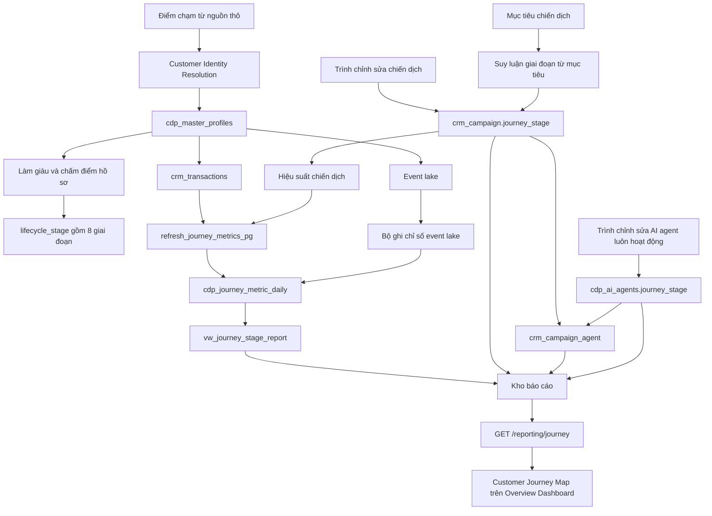
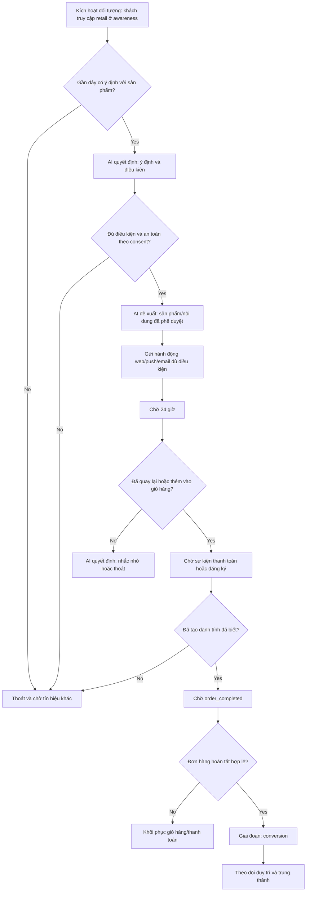
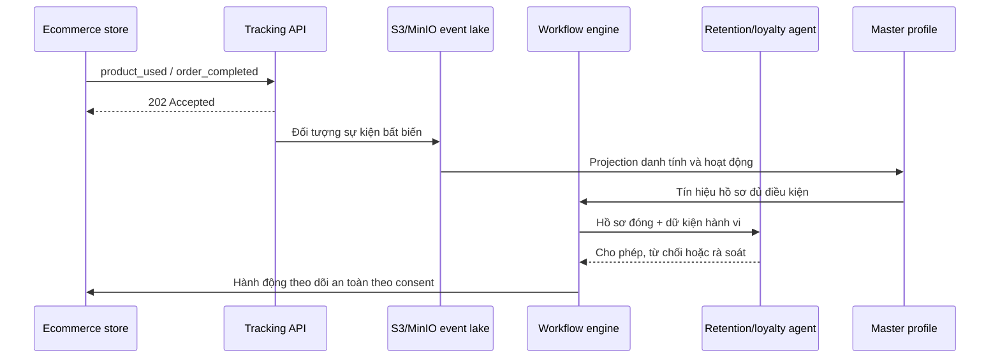
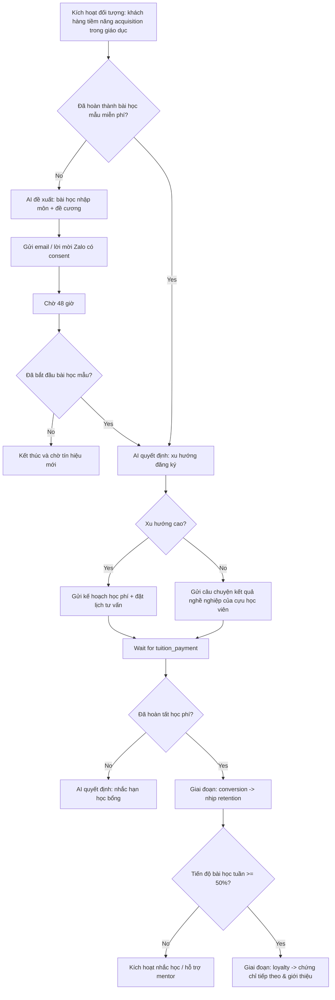
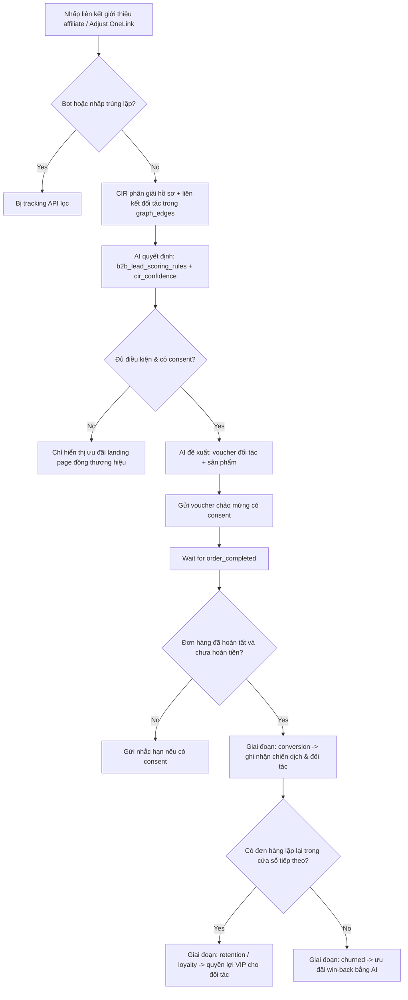
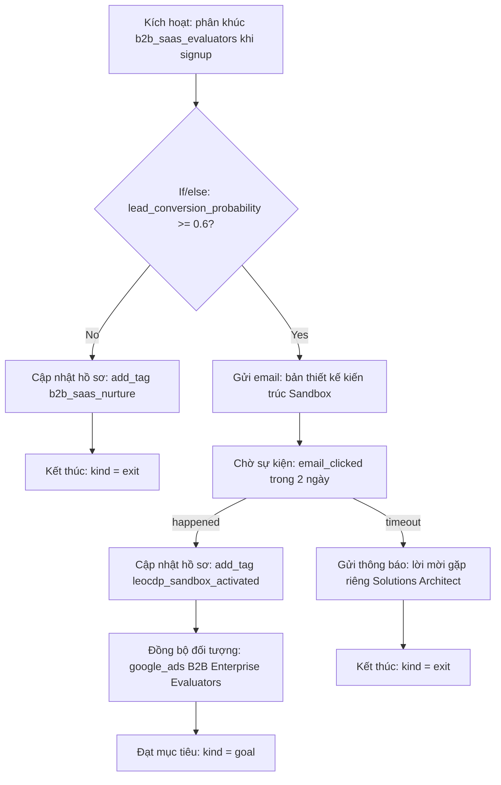

# Cẩm nang Customer Journey Map


**Customer Journey Map** là cẩm nang vận hành và báo cáo phân tích về tiếp thị,
sản phẩm và doanh thu trong LEO CDP, được giới hạn theo tenant. Tài liệu theo
dõi tiến trình của hồ sơ khách hàng qua tám giai đoạn vòng đời chuẩn, kết hợp
theo dõi hành vi, Customer Identity Resolution (CIR), phân khúc Audience
Builder, workflow chiến dịch có bước phê duyệt và AI agent trong một chế độ
xem vận hành. Mỗi giai đoạn bao gồm:

- **KPI chính** và **các KPI hỗ trợ cho giai đoạn** cùng phần so sánh giữa các kỳ;
- **chiến dịch tiếp thị** nhắm đến giai đoạn (`crm_campaign.journey_stage`);
- **phân công AI agent cho chiến dịch** (`plan`, `decide`, `optimize` trong `crm_campaign_agent`); và
- **AI agent luôn hoạt động** được cấu hình để chấm điểm và tối ưu liên tục (`cdp_ai_agents.journey_stage`).

Báo cáo được hiển thị trên Overview Dashboard
([`overview-dashboard.html`](../../customer360-frontend/static/templates/dashboard/overview-dashboard.html)
và [`overview-view.js`](../../customer360-frontend/static/js/overview-view.js))
đồng thời được cung cấp qua `GET /reporting/journey`
([`reporting_api.py`](../../customer360-api/core/routers/reporting_api.py))
được hỗ trợ bởi [`reporting_respository.py`](../../customer360-dao/src/leo_customer360_dao/repositories/reporting_respository.py)
và `customer360.vw_journey_stage_report`.

---

## Mục lục

1. [Tám giai đoạn hành trình & tham chiếu danh mục KPI](#1-the-eight-journey-stages--kpi-catalog-reference)
2. [Nguồn dữ liệu chuẩn & hợp đồng schema](#2-source-of-truth--schema-contracts)
3. [Pipeline xử lý đầu-cuối & hành vi UI](#3-end-to-end-processing-pipeline--ui-behavior)
4. [Logic xử lý theo từng giai đoạn](#4-stage-by-stage-processing-logic)
5. [Cẩm nang vận hành: Hướng dẫn thiết lập từng bước](#5-operational-playbook-step-by-step-setup-guide)
   - [Cẩm nang A: Cấu hình mô hình kinh doanh & domain của tenant](#playbook-a-configure-tenant-business-model--domain)
   - [Cẩm nang B: Thiết lập AI agent, workflow phân khúc & liên kết chiến dịch](#playbook-b-set-up-ai-agents-segment-workflows--campaign-bindings)
   - [Cẩm nang C: Tạo, phê duyệt & kích hoạt workflow chiến dịch chính xác](#playbook-c-build-approve--activate-an-accurate-campaign-workflow)
   - [Cẩm nang D: Tính toán & xác minh KPI giai đoạn hành trình](#playbook-d-compute--verify-journey-stage-kpis)
6. [Cách kiểm thử trên máy cục bộ](#6-how-to-test-locally)
7. [Khắc phục sự cố](#7-troubleshooting)
8. [Quy tắc vận hành & an toàn tenant](#8-operational--tenant-safety-rules)
9. [Các trường hợp sử dụng đầu-cuối theo ngành](#9-end-to-end-industry-use-cases)
   - [Trường hợp 1: Thương mại điện tử (B2C) — Từ khách truy cập web đến khách mua lại](#use-case-1-e-commerce-b2c--web-visitor-to-repeat-buyer)
   - [Trường hợp 2: Giáo dục & EdTech (B2C) — Từ người tìm hiểu khóa học đến học viên tốt nghiệp](#use-case-2-education--edtech-b2c--course-explorer-to-enrolled-graduate)
   - [Trường hợp 3: Tiếp thị liên kết & đối tác (B2B2C) — Từ lượt giới thiệu của nhà xuất bản đến chuyển đổi đã quyết toán](#use-case-3-affiliate--partner-marketing-b2b2c--publisher-referral-to-settled-conversion)
   - [Trường hợp 4: SaaS doanh nghiệp (B2B) — LEO CDP tự sử dụng và hành trình áp dụng](#use-case-4-enterprise-saas-b2b--leo-cdp-dogfooding--adoption-journey)
   - [Danh sách kiểm tra xác minh liên trường hợp & SQL](#cross-use-case-verification-checklist--sql)

---

## 1. Tám giai đoạn hành trình & tham chiếu danh mục KPI

Các giai đoạn được sắp xếp và hiển thị nhất quán trong database, DAO, API,
pipeline seeding và UI frontend:

| # | Giai đoạn (`journey_stage`) | Nhãn | Ý nghĩa | KPI chính (`metric_code`) | KPI hỗ trợ (`metric_code`) | AI agent mặc định của giai đoạn (`agent_code`) | Hành động tiếp theo thường gặp |
|---:|---|---|---|---|---|---|---|
| 1 | `awareness` | **Nhận biết** | Một người đã được tiếp cận hoặc ghi nhận nhưng chưa thể hiện tín hiệu thu hút khách hàng tiềm năng đủ điều kiện. | `visitors` (`count`, càng cao càng tốt) | `awareness_conversion` (`percent`) | `eligibility_policy` / `data_quality_cir_confidence` | Mở rộng độ phủ, ghi nhận sự đồng ý và tạo điểm chạm đầu tiên dễ nhận biết. |
| 2 | `acquisition` | **Thu hút** | Khách truy cập đã trở thành khách hàng tiềm năng có thể nhận diện hoặc cung cấp tín hiệu thu hút đủ điều kiện. | `new_leads` (`count`, càng cao càng tốt) | `acquisition_conversion` (`percent`) | `lead_scoring` / `b2b_lead_scoring_rules` | Đánh giá mức độ phù hợp và nuôi dưỡng khách hàng tiềm năng bằng bằng chứng, ưu đãi phù hợp. |
| 3 | `activation` | **Kích hoạt** | Người đó đã hoàn thành cột mốc ban đầu về sản phẩm, ứng dụng, tài khoản hoặc onboarding. | `activated_users` (`count`, càng cao càng tốt) | `activation_conversion` (`percent`) | `product_recommendation` | Hướng dẫn người đó đến thời điểm đầu tiên nhận được giá trị thiết thực. |
| 4 | `engagement` | **Tương tác** | Người đó đang tích cực sử dụng sản phẩm hoặc tương tác qua một hay nhiều kênh. | `active_customers` (`count`, càng cao càng tốt) | `purchase_frequency` (`ratio`) | `journey_behavior_clustering` / `behavior_anomaly_detector` | Tăng cường tương tác hữu ích và giảm trở ngại. |
| 5 | `conversion` | **Chuyển đổi** | Người đó đã hoàn tất hành động thương mại mục tiêu, chẳng hạn như đặt hàng, đặt chỗ hoặc đăng ký thuê bao. | `orders` (`count`, càng cao càng tốt) | `conversion_rate` (`percent`) | `customer_demand_forecast` | Cải thiện chất lượng chuyển đổi, giá trị giỏ hàng và ý định mua lại. |
| 6 | `retention` | **Duy trì** | Khách hàng đã chuyển đổi vẫn hoạt động trong kỳ so sánh. | `retention_rate` (`percent`, càng cao càng tốt) | `churn_risk_rate` (`percent`, càng thấp càng tốt) | `campaign_uplift` / `cx_sentiment_llm_v1` | Bảo vệ mối quan hệ và can thiệp khi nguy cơ rời bỏ tăng. |
| 7 | `loyalty` | **Trung thành** | Khách hàng được duy trì mua hàng nhiều lần, giới thiệu thương hiệu hoặc thể hiện giá trị cao bền vững. | `repeat_purchase_rate` (`percent`, càng cao càng tốt) | `referral_rate` (`percent`) | `clv_prediction` / `clv_regression_v1` | Ghi nhận lòng trung thành, lượt giới thiệu và hành vi thuộc hạng cao cấp. |
| 8 | `churned` | **Đã rời bỏ** | So với kỳ trước, khách hàng đã ngừng tương tác hoặc mua hàng trong kỳ hiện tại. | `churn_rate` (`percent`, càng thấp càng tốt) | `winback_rate` (`percent`, càng cao càng tốt) | `next_best_action` / `churn_prediction_v2` | Kích hoạt hành trình tái tương tác, win-back hoặc khôi phục an toàn theo quy tắc suppression. |

> **Lưu ý:** `churned` là một giai đoạn hành trình chuẩn, khác với cột dự đoán
> `churn_risk_tier` (`low`, `medium`, `high`, `critical`) trong
> `cdp_master_profiles`. Khách hàng có thể có `churn_risk_tier = 'high'` nhưng
> vẫn ở `retention`; `churned` đại diện cho khách hàng đã ngừng hoạt động và được
> theo dõi trong giai đoạn Churned cùng các chương trình win-back.

### Danh mục đầy đủ 19 chỉ số (`customer360.cdp_journey_metric`)

Mọi KPI trong Customer Journey Map đều được định nghĩa trong
`customer360.cdp_journey_metric` và chụp snapshot hằng ngày vào
`customer360.cdp_journey_metric_daily`:

| `metric_code` | `journey_stage` | Nhãn | `unit` | `source` | `is_primary` | `higher_is_better` | Cửa sổ (`window_days`) | Quy ước tính toán |
|---|---|---|---|---|---:|---:|---|---|
| `visitors` | `awareness` | Khách truy cập | `count` | `event_lake` | `TRUE` | `TRUE` | `1, 7, 30, 90` | Danh tính khách truy cập riêng biệt được ghi nhận trong event lake trong khoảng `[report_date - W + 1, report_date]`. |
| `awareness_conversion` | `awareness` | Chuyển đổi sang giai đoạn kế tiếp | `percent` | `event_lake` | `FALSE` | `TRUE` | `1, 7, 30, 90` | `100.0 * new_leads / NULLIF(visitors, 0)` trong cửa sổ lùi. |
| `new_leads` | `acquisition` | Khách hàng tiềm năng mới | `count` | `event_lake` | `TRUE` | `TRUE` | `1, 7, 30, 90` | Hồ sơ/danh tính riêng biệt đạt giai đoạn acquisition trong cửa sổ lùi. |
| `acquisition_conversion` | `acquisition` | Chuyển đổi sang giai đoạn kế tiếp | `percent` | `event_lake` | `FALSE` | `TRUE` | `1, 7, 30, 90` | `100.0 * activated_users / NULLIF(new_leads, 0)` trong cửa sổ lùi. |
| `activated_users` | `activation` | Người dùng đã kích hoạt | `count` | `event_lake` | `TRUE` | `TRUE` | `1, 7, 30, 90` | Hồ sơ riêng biệt hoàn thành sự kiện onboarding/kích hoạt trong cửa sổ lùi. |
| `activation_conversion` | `activation` | Chuyển đổi sang giai đoạn kế tiếp | `percent` | `event_lake` | `FALSE` | `TRUE` | `1, 7, 30, 90` | `100.0 * active_customers / NULLIF(activated_users, 0)` trong cửa sổ lùi. |
| `active_customers` | `engagement` | Khách hàng hoạt động | `count` | `transaction` | `TRUE` | `TRUE` | `1, 7, 30, 90` | Số `master_profile_id` riêng biệt có giao dịch hợp lệ trong `crm_transactions` ở cửa sổ `W`. |
| `purchase_frequency` | `engagement` | Tần suất mua hàng | `ratio` | `transaction` | `FALSE` | `TRUE` | `1, 7, 30, 90` | `ROUND(buyer_orders / NULLIF(active_customers, 0), 4)` trong cửa sổ `W`. |
| `orders` | `conversion` | Đơn hàng | `count` | `transaction` | `TRUE` | `TRUE` | `1, 7, 30, 90` | Số bản ghi `crm_transactions` trong cửa sổ `W`, loại trừ `rule->'exclude_status'` (`cancelled`, `failed`, `refunded`). |
| `conversion_rate` | `conversion` | Tỷ lệ chuyển đổi | `percent` | `event_lake` | `FALSE` | `TRUE` | `1, 7, 30, 90` | Tỷ lệ khách truy cập/người đang cân nhắc hoàn tất chuyển đổi trong cửa sổ `W`. |
| `retention_rate` | `retention` | Tỷ lệ duy trì | `percent` | `transaction` | `TRUE` | `TRUE` | `7, 30, 90` (`w >= 7`) | `100.0 * retained_buyers / NULLIF(previous_buyers, 0)` so sánh cửa sổ hiện tại `W` với cửa sổ trước đó `W`. |
| `churn_risk_rate` | `retention` | Tỷ lệ rủi ro rời bỏ | `percent` | `profile` | `FALSE` | `FALSE` | `1` (tại một thời điểm) | `100.0 * COUNT(*) FILTER (WHERE churn_probability >= 0.7) / NULLIF(COUNT(*), 0)` trên các hồ sơ đang hoạt động (`status_code = 1`). |
| `repeat_purchase_rate` | `loyalty` | Tỷ lệ mua lại | `percent` | `transaction` | `TRUE` | `TRUE` | `30, 90` (`w >= 30`) | `100.0 * COUNT(*) FILTER (WHERE orders >= 2) / NULLIF(active_customers, 0)` trong cửa sổ `W`. |
| `referral_rate` | `loyalty` | Tỷ lệ giới thiệu | `percent` | `event_lake` | `FALSE` | `TRUE` | `1, 7, 30, 90` | Tỷ lệ khách hàng hoạt động tạo sự kiện giới thiệu trong cửa sổ `W`. |
| `churn_rate` | `churned` | Tỷ lệ rời bỏ | `percent` | `transaction` | `TRUE` | `FALSE` | `7, 30, 90` (`w >= 7`) | `100.0 * (previous_buyers - retained_buyers) / NULLIF(previous_buyers, 0)` (`100 - retention_rate`). |
| `winback_rate` | `churned` | Tỷ lệ win-back | `percent` | `event_lake` | `FALSE` | `TRUE` | `1, 7, 30, 90` | Tỷ lệ hồ sơ trước đây đã rời bỏ/quay vòng lại và tương tác trở lại hoặc chuyển đổi trong cửa sổ `W`. |
| `campaign_spend` | `NULL` (mọi giai đoạn) | Chi tiêu chiến dịch | `currency` | `campaign` | `FALSE` | `FALSE` | `1, 7, 30, 90` | Tổng `crm_campaign_performance_daily.spend`, nhóm theo `(journey_stage, currency)` và `dim_type IN ('all', 'campaign', 'agent')`. |
| `campaign_conversions` | `NULL` (mọi giai đoạn) | Chuyển đổi từ chiến dịch | `count` | `campaign` | `FALSE` | `TRUE` | `1, 7, 30, 90` | Tổng `crm_campaign_performance_daily.conversions`, nhóm theo `(journey_stage, currency)` và `dim_type`. |
| `campaign_revenue` | `NULL` (mọi giai đoạn) | Doanh thu chiến dịch | `currency` | `campaign` | `FALSE` | `TRUE` | `1, 7, 30, 90` | Tổng `crm_campaign_performance_daily.revenue_estimated`, nhóm theo `(journey_stage, currency)` và `dim_type`. |

---

## 2. Nguồn dữ liệu chuẩn & hợp đồng schema

Tập thuật ngữ chuẩn gồm 8 giai đoạn được định nghĩa trong
[`journey.py`](../../customer360-dao/src/leo_customer360_dao/schemas/journey.py):

```text
awareness | acquisition | activation | engagement | conversion | retention | loyalty | churned
```

Database áp dụng chính xác tập thuật ngữ này bằng các ràng buộc `CHECK` trên:

- `customer360.cdp_master_profiles.lifecycle_stage`
- `customer360.crm_campaign.journey_stage`
- `customer360.cdp_ai_agents.journey_stage`
- `customer360.cdp_journey_metric.journey_stage`
- `customer360.cdp_journey_metric_daily.journey_stage`

Các tệp schema và migration:

- [`database-schema.sql`](../../customer360-database/database-schema.sql) — định nghĩa schema chuẩn.
- [`017_agent_campagn_journey.sql`](../../customer360-database/migrations/017_agent_campagn_journey.sql) — bổ sung `journey_stage` cho chiến dịch và AI agent, tạo `crm_campaign_agent`, chuẩn hóa giá trị `lifecycle_stage` của hồ sơ giữa các tenant theo RLS và seed baseline chấm điểm persona `LIFECYCLE_BEHAVIOR_*_BASE`.
- [`018_journey_report.sql`](../../customer360-database/migrations/018_journey_report.sql) — tạo `cdp_journey_metric`, `cdp_journey_metric_domain`, `cdp_journey_metric_daily`, `refresh_journey_metrics_pg(p_tenant, p_date)` và `vw_journey_stage_report`.

---

## 3. Pipeline xử lý đầu-cuối & hành vi UI



### 1. Phân giải danh tính

Các bản ghi Adjust, OneSignal, Web Tracking và nguồn khác được tải vào
`cdp_raw_profiles_stage`. Quy trình CIR hợp nhất các bản ghi thô khớp nhau thành các hàng
`cdp_master_profiles` trong phạm vi tenant và ghi lại liên kết trong
`cdp_profile_links`.

Bản đồ hành trình dùng master profile đã phân giải làm danh tính ở cấp khách
hàng. Bản đồ không suy luận hồ sơ xuyên tenant từ một truy vấn không giới hạn phạm vi.

### 2. Làm giàu hồ sơ và gán giai đoạn

Demo seeder làm giàu từng hồ sơ đã phân giải với:

- `lifecycle_stage`;
- `last_activity_at`;
- `customer_since`;
- điểm tương tác và điểm rủi ro rời bỏ;
- xác suất chuyển đổi khách hàng tiềm năng;
- CLV lịch sử và dự đoán; và
- thẻ cùng thuộc tính phân khúc nhận biết giai đoạn.

Để kiểm thử cục bộ có tính xác định, demo seeder đầy đủ phân bổ hồ sơ vào cả
tám giai đoạn. Pipeline production có thể gán giai đoạn theo quy tắc nghiệp vụ
hoặc mô hình, nhưng giá trị được lưu phải thuộc một trong tám giá trị cho phép.

### 3. Nhắm mục tiêu chiến dịch

Chiến dịch có thể lưu rõ `crm_campaign.journey_stage`. Nếu chiến dịch chưa có
giai đoạn được chỉ định rõ, DAO suy luận giai đoạn từ mục tiêu bằng
`infer_journey_stage_from_objective()`:

| Ví dụ về mục tiêu | Giai đoạn được xác định |
|---|---|
| `Awareness`, `Brand awareness` | Nhận biết |
| `Leads`, `Lead generation`, `Acquisition` | Thu hút |
| `App Install`, `Activation`, `Onboarding` | Kích hoạt |
| `Visit store`, `Engagement` | Tương tác |
| `Conversions`, `Conversion`, `Sales` | Chuyển đổi |
| `Retention` | Duy trì |
| `Loyalty`, `Referral` | Trung thành |
| `Win-back`, `Winback`, `Re-engagement`, `Churn` | Đã rời bỏ |

Nên chỉ định rõ giai đoạn trong trình chỉnh sửa chiến dịch. Suy luận từ mục
tiêu là phương án dự phòng để tương thích, không thay thế cấu hình chiến dịch
tường minh.

### 4. Liên kết chiến dịch và AI agent

`crm_campaign_agent` liên kết chiến dịch với một hoặc nhiều AI agent đã đăng ký. Mỗi liên kết có:

- `role`: `plan`, `decide` hoặc `optimize`;
- `autonomy`: `suggest` hoặc `approve`;
- phiên bản instruction được ghim (không bắt buộc);
- guardrails; và
- trạng thái hoạt động.

Báo cáo hiển thị các phân công này trên thẻ chiến dịch thuộc giai đoạn tương
ứng. Báo cáo cũng hiển thị riêng các agent luôn hoạt động từ `cdp_ai_agents`
có `journey_stage` khớp với giai đoạn. Kho báo cáo có thể xem agent đang hoạt
động nhưng không có giai đoạn là agent dùng xuyên nhiều giai đoạn.

### 5. Danh mục KPI và snapshot

`cdp_journey_metric` là danh mục chỉ số toàn cục. Danh mục định nghĩa nhãn,
đơn vị, nguồn, cờ chỉ số chính, chiều đánh giá tốt hơn và các mô hình kinh
doanh áp dụng. `cdp_journey_metric_daily` lưu các giá trị trong phạm vi tenant
theo:

- ngày báo cáo;
- cửa sổ lùi (`1`, `7`, `30` hoặc `90` ngày);
- mô hình kinh doanh (`B2B`, `B2C` hoặc `B2B2C`);
- domain tùy chọn;
- giai đoạn hành trình;
- chỉ số;
- chiều dữ liệu (`all`, `channel`, `campaign`, `segment` hoặc `agent`); và
- tiền tệ đối với chỉ số suy ra từ chiến dịch.

Hàm PostgreSQL `customer360.refresh_journey_metrics_pg(tenant_id, report_date)`
tính toán các chỉ số giao dịch, hồ sơ và chiến dịch. Các chỉ số event lake như
khách truy cập, khách hàng tiềm năng, người dùng đã kích hoạt, tỷ lệ chuyển
đổi, lượt giới thiệu và tỷ lệ win-back được quy trình phân tích event lake ghi
theo cùng hợp đồng snapshot.

Báo cáo so sánh snapshot hiện tại với snapshot kết thúc trước đó một cửa sổ:

- count, ratio, currency: mức thay đổi phần trăm tương đối nếu có giá trị kỳ trước;
- percent: mức chênh lệch theo điểm phần trăm (`current - previous`);
- `higher_is_better = false` được dùng cho các chỉ số như tỷ lệ rời bỏ để UI
  diễn giải đúng chiều biến động.

### 6. API và hiển thị dashboard

Endpoint API:

```http
GET /reporting/journey?days=90&window=30
```

Tenant đã xác thực là nguồn có thẩm quyền. Tham số truy vấn `tenant_id` được
cung cấp không thể ghi đè tenant trong ngữ cảnh xác thực của yêu cầu (nếu
không khớp sẽ trả về `403 Forbidden`; giá trị `window` ngoài `1, 7, 30, 90`
sẽ trả về `422 Unprocessable Entity`).

Trong [`overview-view.js`](../../customer360-frontend/static/js/overview-view.js),
`journeyWindow(days)` ánh xạ bộ chọn kỳ của Overview Dashboard
(`#overview-period-select`) sang tham số truy vấn `window`:

| Kỳ Overview (`days`) | `window` hành trình (`window_days`) | Chỉ số PostgreSQL được tính |
|---|---|---|
| `days <= 3` | `1` (cửa sổ lùi 1 ngày) | `orders`, `active_customers`, `purchase_frequency`, `churn_risk_rate`, `campaign_*` |
| `days <= 7` | `7` (cửa sổ lùi 7 ngày) | Các chỉ số trên (trừ `churn_risk_rate`) + `retention_rate`, `churn_rate` |
| `days <= 30` | `30` (cửa sổ lùi 30 ngày) | Tất cả chỉ số 7 ngày + `repeat_purchase_rate` |
| `days > 30` (mặc định `90`) | `90` (cửa sổ lùi 90 ngày) | Tất cả chỉ số 30 ngày trong cửa sổ so sánh 90 ngày |

Phản hồi luôn chứa các đối tượng của tám giai đoạn theo đúng thứ tự, kể cả khi
giai đoạn không có snapshot hiện tại. Trong trường hợp đó
[`reporting_respository.py`](../../customer360-dao/src/leo_customer360_dao/repositories/reporting_respository.py)
dùng `cdp_journey_metric` (hoặc `DEFAULT_STAGE_PRIMARY_METRICS` trong
[`journey.py`](../../customer360-dao/src/leo_customer360_dao/schemas/journey.py))
để cung cấp metadata KPI chính với `value = null`, nhờ đó frontend hiển thị
`"Không có dữ liệu"` và `"Không có snapshot KPI"` thay vì âm thầm bỏ qua giai
đoạn. Khi một số (nhưng không phải tất cả) giai đoạn có snapshot KPI
(`0 < stagesWithKpis < 8`), UI hiển thị banner màu hổ phách
`#journey-report-snapshot-notice`.

Overview Dashboard hiển thị:

- **Các nhãn tóm tắt ở header**: `#journey-report-stage-count` (`8 giai đoạn`),
  `#journey-report-campaign-count` (`<N> chiến dịch`),
  `#journey-report-agent-count` (`<M> AI agent riêng biệt`), và
  `#journey-report-meta` (`KPI snapshot <YYYY-MM-DD> · <W>-day window`);
- **Thanh chevron tương tác gồm 8 giai đoạn** (`#journey-report-track`): nhấp
  vào chevron bất kỳ (`[data-journey-stage-link]`) sẽ cuộn mượt đến và focus
  thẻ giai đoạn (`#journey-stage-<stage>`);
- **Ô KPI chính & sparkline**: giá trị được định dạng (`%`, ratio `0.00`,
  `currency` hoặc số nguyên), mức chênh lệch giữa các kỳ (`+X.X% vs prior` hoặc
  `+X.X pts vs prior`, tô màu xanh lục bảo khi
  `higher_is_better ? change >= 0 : change <= 0`), cùng sparkline SVG của giai đoạn;
- **Thẻ chiến dịch**: hiển thị tối đa 2 thẻ mỗi giai đoạn (có nút
  `Hiện thêm N chiến dịch`), hiển thị nhãn trạng thái chiến dịch
  (`Running`, `Active`, `Workflow in review`, `Approved`, `Paused`,
  `Completed`, `Failed · retry`, `Rejected`, `Draft`), metadata `channel · platform`,
  tối đa 2 nhãn agent được phân công (`<ShortName> · <role>`) cùng bộ đếm phần
  còn lại `+N`. Nếu giai đoạn không có chiến dịch, thẻ hiển thị
  `+ Tạo chiến dịch` (`[data-start-campaign-stage]`), mở Campaign Editor
  (`C360.campaignView.openCreateForStage(stage)`) với
  `#campaign-field-journey-stage` được điền sẵn; và
- **Danh sách AI agent luôn hoạt động**: tối đa 3 hàng hiển thị mỗi giai đoạn
  (có nút `Hiện thêm N agent ⌄`), lấy từ `cdp_ai_agents` có
  `journey_stage == stage` hoặc `(journey_stage IS NULL AND status == 'ACTIVE')`.

---

## 4. Logic xử lý theo từng giai đoạn

Phần sau mô tả logic xử lý cho từng giai đoạn. Giai đoạn là cách phân loại
nghiệp vụ chuẩn; tên sự kiện và ngưỡng cụ thể được cấu hình theo tenant trong
`cdp_journey_metric.rule`.

### 1. Nhận biết (Awareness)

**Đầu vào**

- sự kiện của khách truy cập ẩn danh hoặc đã biết;
- lượt xem trang, lượt hiển thị quảng cáo, lượt xem nội dung hoặc sự kiện điểm chạm đầu tiên;
- dữ liệu về độ phủ và phân bổ chiến dịch.

**Xử lý**

1. Loại bỏ sự kiện trùng lặp theo tenant và danh tính hồ sơ/phiên.
2. Đếm khách truy cập riêng biệt trong cửa sổ lùi được yêu cầu.
3. Tính tỷ lệ chuyển tiếp từ khách truy cập sang tín hiệu giai đoạn kế tiếp đã cấu hình.
4. Ghi nhận phân bổ cho các chiến dịch nhận biết đang hoạt động và AI agent được phân công.

**Chỉ số báo cáo**

- `visitors` — số lượng chính;
- `awareness_conversion` — tỷ lệ phần trăm hỗ trợ.

**AI agent thường dùng**

- AI agent về danh tính/độ tin cậy hoặc chất lượng độ phủ;
- công cụ lập kế hoạch khám phá đối tượng và nhận biết thương hiệu.

### 2. Thu hút (Acquisition)

**Đầu vào**

- sự kiện tạo hoặc xác nhận đủ điều kiện cho khách hàng tiềm năng;
- biểu mẫu, đăng ký, tạo tài khoản và chiến dịch thu hút có thể phân bổ;
- nguồn thu hút và các trường chiến dịch trên hồ sơ.

**Xử lý**

1. Loại bỏ hồ sơ hoặc khách hàng tiềm năng mới bị trùng lặp.
2. Đếm khách hàng tiềm năng mới riêng biệt.
3. So sánh khách hàng tiềm năng đủ điều kiện với tín hiệu kích hoạt.
4. Áp dụng quy tắc về consent, suppression và chiến dịch của tenant trước khi kích hoạt.

**Chỉ số báo cáo**

- `new_leads` — số lượng chính;
- `acquisition_conversion` — tỷ lệ phần trăm hỗ trợ.

**AI agent thường dùng**

- chấm điểm khách hàng tiềm năng;
- công cụ lập kế hoạch đối tượng thu hút;
- AI agent đánh giá chất lượng nguồn hoặc mức độ phù hợp.

### 3. Kích hoạt (Activation)

**Đầu vào**

- cài đặt ứng dụng;
- thiết lập tài khoản;
- hoàn tất onboarding;
- hành động đầu tiên có ý nghĩa trong sản phẩm.

**Xử lý**

1. Xác định hồ sơ đã hoàn tất sự kiện kích hoạt của tenant.
2. Đếm người dùng đã kích hoạt riêng biệt.
3. So sánh người dùng đã kích hoạt với tín hiệu tương tác hoặc chuyển đổi.
4. Xếp hạng nội dung onboarding, đề xuất hoặc kích hoạt.

**Chỉ số báo cáo**

- `activated_users` — số lượng chính;
- `activation_conversion` — tỷ lệ phần trăm hỗ trợ.

**AI agent thường dùng**

- đề xuất sản phẩm;
- AI agent onboarding/nuôi dưỡng;
- bộ phát hiện bất thường kích hoạt.

### 4. Tương tác (Engagement)

**Đầu vào**

- phiên gần đây và sự kiện sản phẩm có ý nghĩa;
- giao dịch của khách hàng đang hoạt động;
- độ đa dạng của hệ thống nguồn và lịch sử tương tác.

**Xử lý**

1. Xác định hồ sơ đang hoạt động trong kỳ báo cáo.
2. Tổng hợp khách hàng hoạt động được xác nhận bằng giao dịch và tần suất mua hàng.
3. Kết hợp tín hiệu tương tác với độ mới của hồ sơ và độ đa dạng kênh.
4. Chuyển chiến dịch tương tác và quyết định của AI đến các hồ sơ đủ điều kiện.

**Chỉ số báo cáo**

- `active_customers` — số lượng chính;
- `purchase_frequency` — tỷ lệ hỗ trợ.

**AI agent thường dùng**

- phân cụm hành vi hành trình;
- đề xuất tăng tương tác;
- phát hiện bất thường.

### 5. Chuyển đổi (Conversion)

**Đầu vào**

- đơn hàng, lượt đặt chỗ, thuê bao đã hoàn tất hoặc dữ kiện chuyển đổi tương đương;
- bản ghi hiệu suất chiến dịch;
- trạng thái giao dịch và tiền tệ.

**Xử lý**

1. Loại trừ giao dịch bị hủy, thất bại và hoàn tiền theo quy tắc chỉ số.
2. Đếm đơn hàng hợp lệ trong từng cửa sổ lùi.
3. Tính tỷ lệ chuyển đổi từ mẫu số chuyển đổi trong event lake.
4. Phân bổ chi tiêu, chuyển đổi và doanh thu theo chiều chiến dịch và AI agent,
   không cộng gộp các loại tiền tệ.

**Chỉ số báo cáo**

- `orders` — số lượng chính;
- `conversion_rate` — tỷ lệ phần trăm hỗ trợ;
- các chiều chi tiêu, chuyển đổi và doanh thu chiến dịch.

**AI agent thường dùng**

- dự báo nhu cầu;
- tối ưu hóa ưu đãi/đề xuất;
- tối ưu hóa uplift chiến dịch.

### 6. Duy trì (Retention)

**Đầu vào**

- người mua trong cửa sổ hiện tại;
- người mua trong cửa sổ trước;
- hoạt động gần nhất và xác suất rời bỏ;
- sự kiện hỗ trợ và cảm xúc.

**Xử lý**

1. Tạo cohort người mua ở cửa sổ trước có cùng độ dài.
2. Tìm những người mua xuất hiện trong cả cửa sổ trước và hiện tại.
3. Tính tỷ lệ người mua được duy trì trên tổng số người mua ở cửa sổ trước.
4. Tính riêng tỷ trọng tại thời điểm hiện tại của hồ sơ hoạt động có xác
   suất rời bỏ vượt ngưỡng đã cấu hình.

**Chỉ số báo cáo**

- `retention_rate` — tỷ lệ phần trăm chính;
- `churn_risk_rate` — tỷ lệ phần trăm hỗ trợ.

**AI agent thường dùng**

- bộ phân tích trải nghiệm khách hàng/cảm xúc;
- bộ tối ưu hóa uplift chiến dịch;
- AI agent can thiệp để duy trì khách hàng.

### 7. Trung thành (Loyalty)

**Đầu vào**

- đơn hàng mua lại;
- thời gian gắn bó của khách hàng;
- hạng thành viên;
- lượt giới thiệu, vận động ủng hộ và hành vi giá trị cao.

**Xử lý**

1. Đếm người mua có ít nhất hai lần mua hợp lệ trong cửa sổ.
2. Chia số người mua lại cho số người mua trong cửa sổ hiện tại.
3. Kết hợp dữ liệu mua lại với CLV, thời gian gắn bó và sự kiện giới thiệu để
   tạo đối tượng khách hàng trung thành.
4. Đảm bảo phân bổ lượt giới thiệu và chiến dịch an toàn theo tenant và tiền tệ.

**Chỉ số báo cáo**

- `repeat_purchase_rate` — tỷ lệ phần trăm chính;
- `referral_rate` — tỷ lệ phần trăm hỗ trợ.

**AI agent thường dùng**

- hồi quy CLV;
- AI agent bán thêm gói cao cấp/trung thành;
- AI agent tối ưu hóa giới thiệu.

### 8. Đã rời bỏ (Churned)

**Đầu vào**

- khách hàng không hoạt động;
- hành vi mua hàng suy giảm hoặc mất đi;
- xác suất rời bỏ cao;
- sự kiện win-back và tái tương tác.

**Xử lý**

1. So sánh cohort người mua trước đó với người mua hiện tại.
2. Đếm người mua ở kỳ trước không quay lại.
3. Tính tỷ lệ rời bỏ bằng số người mua đã mất chia cho số người mua ở kỳ trước.
4. Theo dõi riêng kết quả win-back; win-back thành công không xóa số đo lịch
   sử của giai đoạn churned.
5. Áp dụng quy tắc suppression, consent và giờ yên tĩnh trước khi gửi hành
   động khôi phục.

**Chỉ số báo cáo**

- `churn_rate` — tỷ lệ phần trăm chính, càng thấp càng tốt;
- `winback_rate` — tỷ lệ phần trăm hỗ trợ.

**AI agent thường dùng**

- dự đoán churn;
- next-best-action;
- bộ tối ưu hóa win-back/tái tương tác.

---

## 5. Cẩm nang vận hành: Hướng dẫn thiết lập từng bước

Dùng cẩm nang vận hành gồm 4 phần này khi onboarding tenant doanh nghiệp, cấu
hình AI agent, xây dựng workflow chiến dịch nhắm theo giai đoạn hoặc làm mới
các KPI của Customer Journey Map.

### Cẩm nang A: Cấu hình mô hình kinh doanh & domain của tenant

1. **Đặt `sys_tenant.business_model`**: Chọn `'B2B'`, `'B2C'` (mặc định) hoặc
   `'B2B2C'`. Cả `refresh_journey_metrics_pg` lẫn bộ ghi event lake đều ghi
   giá trị này vào `cdp_journey_metric_daily.business_model`, và
   `vw_journey_stage_report` filters `cur.business_model = ANY(m.applicable_business_models)`.
   lọc theo `cur.business_model = ANY(m.applicable_business_models)`.
2. **Đăng ký hoặc bật domain kinh doanh (`sys_domain` & `sys_tenant_domain`)**:
   Các domain tích hợp sẵn được seed trong
   [`init-core-database.sql`](../../customer360-database/init-core-database.sql)
   gồm `_` (chưa phân loại), `retail`, `banking`, `insurance`, `healthcare`,
   `telecom`, `travel`, `real_estate`, `education`, `manufacturing`, `media`
   và `hospitality`. Domain tùy chỉnh (chẳng hạn `saas`) được thêm trực tiếp
   vào `customer360.sys_domain` và `customer360.sys_tenant_domain`, không cần
   migration schema.
3. **Giới hạn KPI theo domain (`cdp_journey_metric_domain`)**:
   - Các hàng báo cáo chung (`GET /reporting/journey`) đọc hàng có
     `domain_code IS NULL` và `dim_type = 'all'`.
   - Phân tích được tách theo domain (`domain_code = '<domain>'`) cần có hàng
     `(metric_code, domain_code)` tương ứng trong `customer360.cdp_journey_metric_domain`.

### Cẩm nang B: Thiết lập AI agent, workflow phân khúc & liên kết chiến dịch

LEO CDP điều phối AI agent trên **ba bề mặt được kết nối**. Cấu hình từng bề
mặt theo vai trò của nó:

| Bề mặt | Table / API | Mục đích | Tác động đến UI/runtime |
|---|---|---|---|
| **1. Danh mục AI agent toàn cục & theo giai đoạn** | `customer360.cdp_ai_agents` (`GET/POST/PUT /ai-agents/`) | Định nghĩa `agent_code`, `model_type` (10 loại chuẩn), `journey_stage` (`awareness` .. `churned` hoặc `NULL`), `status`, `schedule_definition`, `input_features` nằm trong danh sách cho phép (được xác minh với `cdp_ai_feature_catalog`), `hyperparameters` và prompt có phiên bản. | Hiển thị **AI agent luôn hoạt động** ở cuối thẻ mỗi giai đoạn trên Customer Journey Map. |
| **2. Workflow AI agent của phân khúc** | `customer360.cdp_agent_workflow` (`POST /api/v1/segments/{segment_id}/workflow/run`) | Pipeline theo thứ tự cho từng phân khúc (`execution_order = 1, 2, ...`) do `customer360-backend/ai_agents_runners` thực thi. Chạy `eligibility_policy` xác định (ghi trạng thái sẵn sàng của kênh vào `communication_preferences.eligibility_policy`) và `product_recommendation` (`ranking_recommendation` trên tập đóng `candidate_content_item_ids`). | Làm giàu hồ sơ phân khúc bằng điều kiện đủ tiêu chuẩn của kênh và nội dung được xếp hạng trước hoặc đồng thời với việc thực thi chiến dịch. |
| **3. Liên kết AI agent với chiến dịch** | `customer360.crm_campaign_agent` | Liên kết `(tenant_id, campaign_id, agent_code, role)` với `role IN ('plan', 'decide', 'optimize')`, `autonomy IN ('suggest', 'approve')`, `pinned_instruction_version` và `guardrails`. | Hiển thị **nhãn `<Agent> · <role>` màu tím** trên thẻ chiến dịch trong Customer Journey Map và phân bổ `campaign_spend`, `campaign_conversions`, `campaign_revenue` vào `dim_type = 'agent'`. |

### Cẩm nang C: Tạo, phê duyệt & kích hoạt workflow chiến dịch chính xác

Mọi chiến dịch production trong LEO CDP đều tuân theo sự phân tách nghiêm ngặt
giữa **metadata chiến dịch**, **định nghĩa đồ thị workflow**, **phê duyệt của
con người** và **thực thi Dagster**:

#### 1. Chọn channel & platform chuẩn cho chiến dịch (`campaign-view.js`)

Trong Campaign Editor
([`campaign-editor.html`](../../customer360-frontend/static/templates/campaign/campaign-editor.html)),
hãy đặt:

- **Giai đoạn hành trình mục tiêu (`journey_stage`)**: Luôn chỉ định rõ
  (`awareness` .. `churned`) để chiến dịch xuất hiện trên thẻ giai đoạn mong
  muốn, kể cả khi `objective` chung chung (ví dụ `Conversions`).
- **Channel & platform**:

| `crm_campaign.channel` | Giá trị `crm_campaign.platform` được phép | Connector gửi runtime (`crm_connector_config`) |
|---|---|---|
| `email` | `email` | `EMAIL` (connector SMTP của tenant hoặc `EMAIL_DISPATCH_ADAPTER=smtp`/`mock`) |
| `notification` | `sms`, `zalo_oa`, `whatsapp`, `mobile_native` | `SMS` / webhook thông báo hoặc connector của nhà cung cấp |
| `push` | `push` | `PUSH` (OneSignal hoặc mock connector) |
| `audience_sync` | `meta_ads`, `google_ads`, `tiktok_ads` | `data_synch_job` bất đồng bộ → `crm_ad_sync_runs` |

#### 2. Tạo đồ thị workflow hợp lệ `schema_version = 2` (`workflow-core.js` & `crm_flow_node`)

Visual Workflow Studio
([`workflow-core.js`](../../customer360-frontend/static/js/workflow/workflow-core.js))
và backend `DAO FlowEngine`
([`workflow_runner.py`](../../customer360-backend/campaign_activation/campaign_activation/workflow_runner.py))
xác thực cây JSON được lưu qua `customer360.crm_save_flow`:

| `type` của node | Danh mục | Khóa `config` bắt buộc | `branch` được phép ở node con | Hợp đồng runtime/database |
|---|---|---|---|---|
| `trigger` | Đầu vào (Root) | `segment_id` (UUID), `event` (`signup`, `cart_abandoned`, `purchase`, `inactive_30d`, `birthday`) | Không có (chỉ node gốc) | Phải là node gốc (`jsonb_typeof(definition->'root') = 'object'`). |
| `condition` | Logic | `field` (`engagement_score`, `churn_probability`, `lead_conversion_probability`, `historical_clv`, `predictive_clv`, `latest_nps_score`, `average_csat`, `overall_sentiment_score`, `profile_completeness_score`, `identity_confidence_score`, `segmentation_tags`), `op` (`ge`, `lt`, `eq`, `has`, `hasnt`), `value` | `yes`, `no` | Đánh giá các trường `CdpMasterProfile`; nếu thiếu giá trị số thì chọn `no`. |
| `wait` | Logic | `amount` (int >= 1), `unit` (`minutes`, `hours`, `days`) | Không có | Đẩy thời gian đánh giá ảo để kiểm tra sự kiện tiếp theo. |
| `wait_event` | Logic | `event` (`purchase`, `email_opened`, `email_clicked`), `amount` (int >= 1), `unit` (`minutes`, `hours`, `days`) | `happened`, `timeout` | Truy vấn sự kiện thô được liên kết trong khoảng thời gian chờ. |
| `email` | Kích hoạt | `subject`, `body` (hỗ trợ `{{first_name}}`) | Không có | Yêu cầu `email_opt_in == true` và không có suppression email/toàn cục đang hoạt động. |
| `notification` | Kích hoạt | `provider` (`sms`, `zalo_oa`, `whatsapp`, `mobile_native`), `body` | Không có | Yêu cầu opt-in rõ ràng cho kênh (`sms_opt_in`, `zalo_opt_in`, `whatsapp_opt_in` hoặc `push_opt_in`). |
| `push` | Kích hoạt | `title`, `body` | Không có | Yêu cầu `push_opt_in == true` và token push hợp lệ. |
| `update_profile` | Kích hoạt | `action` (`add_tag`, `remove_tag`), `tag` | Không có | Thêm hoặc xóa thẻ trong `cdp_master_profiles.segmentation_tags`. |
| `run_data_synch_job` | Kích hoạt | `platform` (`meta_ads`, `google_ads`, `tiktok_ads`), `audience_name` | Không có | Gửi `data_synch_job` trong phạm vi chiến dịch nếu có >= 1 hồ sơ đi tới node này. |
| `exit` | Logic (Kết thúc) | `kind` (`goal`, `exit`) | Kết thúc (không có node con) | Kết thúc nhánh (`end_counts.goal` so với `end_counts.exit`). |
| `ai_decide` / `ai_recommend` / `ai_generate` | AI (`crm_flow_node`) | `agent_code` (phải tồn tại trong `cdp_ai_agents`) | Không có | Được lưu trong cột được sinh `crm_flow_node.agent_code` với FK `crm_flow_node_agent_fk`. |

#### 3. Trình tự phê duyệt có kiểm soát & kích hoạt

1. **Lưu workflow**: Gọi `customer360.crm_save_flow(...)`. Workflow do người dùng lưu (`p_actor = 'user'`) được chuyển ngay sang `Approved`; workflow do agent đề xuất (`p_actor = 'agent'`) bắt đầu ở trạng thái `InReview`.
2. **Rà soát workflow của agent (nếu `InReview`)**: Một người rà soát khác (`p_reviewer <> created_by_user_id`) gọi `customer360.crm_review_flow_version(..., p_decision => 'approve')` hoặc `POST /workflows/{flow_id}/versions/{version}/review`.
3. **Xuất bản & ghim workflow**: Gọi `customer360.crm_publish_flow(tenant_id, flow_id, version)` và đặt `crm_campaign.workflow_id` cùng `crm_campaign.workflow_version`.
4. **Gửi duyệt & phê duyệt chiến dịch**: Chuyển `crm_campaign.approval_status` từ `Draft` → `InReview` (`POST /campaigns/{id}/submit-for-approval`) → `Approved` (`POST /campaigns/{id}/approve`).
5. **Kích hoạt chiến dịch**: Gọi `POST /api/v1/admin/campaigns/{campaign_id}/activate`. Thao tác này kích hoạt `campaign_activation_job` → `campaign_workflow_job`, ghi các hàng idempotency theo từng hồ sơ vào `crm_campaign_workflow_action_runs` và các lần chuyển trạng thái vào `sys_audit_log`.

### Cẩm nang D: Tính toán & xác minh KPI giai đoạn hành trình

1. **Làm mới KPI lấy từ PostgreSQL** (`orders`, `active_customers`, `purchase_frequency`, `retention_rate`, `repeat_purchase_rate`, `churn_rate`, `churn_risk_rate`, `campaign_spend`, `campaign_conversions`, `campaign_revenue`):
   ```sql
   SELECT set_config('app.tenant_id', '11111111-1111-1111-1111-111111111111', false);
   SELECT customer360.refresh_journey_metrics_pg('11111111-1111-1111-1111-111111111111'::uuid, CURRENT_DATE);
   ```
2. **Upsert KPI event lake** (`visitors`, `awareness_conversion`, `new_leads`, `acquisition_conversion`, `activated_users`, `activation_conversion`, `conversion_rate`, `referral_rate`, `winback_rate`) vào `customer360.cdp_journey_metric_daily` với `tenant_id`, `report_date`, `window_days` và `business_model` tương ứng (cho cả `report_date = CURRENT_DATE` và `report_date = CURRENT_DATE - window_days` để `vw_journey_stage_report` tính `previous_value` và `change` giữa các kỳ).

---

## 6. Cách kiểm thử trên máy cục bộ

### Điều kiện tiên quyết

Dùng môi trường cục bộ thông thường của repository và đảm bảo PostgreSQL,
Redis, object storage cùng các dịch vụ ứng dụng mà demo cần đều đang chạy.
Không sao chép thông tin xác thực vào tài liệu này hoặc commit tệp `.env`.

### Đặt lại toàn bộ và seed dữ liệu demo

Từ thư mục gốc của repository:

```bash
./dev-c360.sh reset -y
```

Quy trình reset dựng lại database cục bộ, áp dụng schema chuẩn và các
migration, sau đó chạy pipeline demo:

1. seed hồ sơ thô từ Adjust/OneSignal/Web Tracking;
2. chạy Customer Identity Resolution;
3. seed chiến dịch CRM, liên kết campaign-agent và AI agent;
4. làm giàu master profile trên cả tám giai đoạn;
5. seed giao dịch, liên hệ, persona và sự kiện hành vi;
6. làm mới chỉ số hành trình từ PostgreSQL; và
7. điền snapshot hành trình kiểu event lake cho cửa sổ hiện tại và cửa sổ so sánh.

Cũng có thể chạy trực tiếp demo phân giải danh tính:

```bash
(cd customer360-backend/identity_resolution && bash run-demo.sh)
```

Theo mặc định, demo dùng tenant
`11111111-1111-1111-1111-111111111111`.

### Xác minh độ bao phủ hồ sơ

Chạy truy vấn giới hạn theo tenant:

```sql
SELECT lifecycle_stage, COUNT(*) AS profile_count
FROM customer360.cdp_master_profiles
WHERE tenant_id = '11111111-1111-1111-1111-111111111111'
GROUP BY lifecycle_stage
ORDER BY CASE lifecycle_stage
    WHEN 'awareness' THEN 1
    WHEN 'acquisition' THEN 2
    WHEN 'activation' THEN 3
    WHEN 'engagement' THEN 4
    WHEN 'conversion' THEN 5
    WHEN 'retention' THEN 6
    WHEN 'loyalty' THEN 7
    WHEN 'churned' THEN 8
END;
```

Kết quả mong đợi: sau khi seed demo đầy đủ, phải có đủ giá trị của cả tám giai đoạn.

### Xác minh độ bao phủ chiến dịch và agent

```sql
SELECT journey_stage, COUNT(*) AS campaign_count
FROM customer360.crm_campaign
WHERE tenant_id = '11111111-1111-1111-1111-111111111111'
GROUP BY journey_stage
ORDER BY journey_stage;

SELECT journey_stage, COUNT(*) AS agent_count
FROM customer360.cdp_ai_agents
WHERE journey_stage IS NOT NULL
GROUP BY journey_stage
ORDER BY journey_stage;

SELECT c.journey_stage, c.name, ca.agent_code, ca.role, ca.autonomy
FROM customer360.crm_campaign c
LEFT JOIN customer360.crm_campaign_agent ca
  ON ca.tenant_id = c.tenant_id
 AND ca.campaign_id = c.campaign_id
 AND ca.is_active = TRUE
WHERE c.tenant_id = '11111111-1111-1111-1111-111111111111'
ORDER BY c.journey_stage, c.name, ca.role;
```

### Xác minh snapshot KPI

```sql
SELECT
    report_date,
    window_days,
    journey_stage,
    metric_code,
    value,
    previous_value,
    change,
    change_kind
FROM customer360.vw_journey_stage_report
WHERE tenant_id = '11111111-1111-1111-1111-111111111111'
  AND dim_type = 'all'
  AND domain_code IS NULL
ORDER BY window_days, journey_stage, metric_code;
```

Để làm mới trực tiếp các chỉ số lấy từ PostgreSQL, trước tiên hãy đặt ngữ cảnh
tenant vì hàm xác thực tenant theo RLS:

```sql
SELECT set_config(
    'app.tenant_id',
    '11111111-1111-1111-1111-111111111111',
    false
);

SELECT customer360.refresh_journey_metrics_pg(
    '11111111-1111-1111-1111-111111111111'::uuid,
    CURRENT_DATE
);
```

### Xác minh API

Khi API đang chạy và có phiên tenant đã xác thực:

```bash
curl -sS 'http://localhost:8000/reporting/journey?days=90&window=30' \
  -H 'Authorization: Bearer <local-token>' | jq .
```

Xác minh rằng:

- `stages` chứa chính xác tám đối tượng theo thứ tự đã nêu;
- mỗi giai đoạn có `stage` và `label` như mong đợi;
- chỉ số chính vẫn hiện diện ngay cả khi giá trị là `null`;
- `campaigns` chỉ chứa chiến dịch của giai đoạn tương ứng;
- campaign agent có vai trò `plan`, `decide` hoặc `optimize`; và
- `agents` chứa các agent luôn hoạt động tương ứng.

Endpoint được cô lập theo tenant. Nếu tham số truy vấn `tenant_id` khác tenant
đã xác thực, endpoint trả về `403`.

### Xác minh dashboard

Mở trang tổng quan dashboard trên frontend và kiểm tra Customer Journey Map.
Xác minh:

1. dải tám giai đoạn được sắp xếp từ Nhận biết đến Đã rời bỏ;
2. chọn giai đoạn sẽ cập nhật thẻ/chi tiết giai đoạn;
3. giá trị KPI, mức thay đổi so với kỳ trước và trạng thái không khả dụng được thể hiện rõ;
4. thẻ chiến dịch hiển thị trạng thái, mục tiêu và vai trò agent; và
5. Churned trình bày tỷ lệ rời bỏ theo nguyên tắc càng thấp càng tốt và có thông tin win-back.

### Kiểm thử tự động

Các bài kiểm thử tập trung vào hành trình và schema:

```bash
customer360-api/.venv/bin/pytest \
  customer360-database/tests/test_campaign_agent_schema.py \
  customer360-database/tests/test_journey_reporting_schema.py \
  customer360-dao/src/tests/test_journey_contracts.py \
  customer360-dao/src/tests/test_persona_engine.py \
  customer360-seeding/test_seed_full_demo_data.py \
  customer360-api/tests/test_reporting_journey_api.py
```

Chạy bộ kiểm thử dịch vụ rộng hơn khi thay đổi các hợp đồng dùng chung về hồ
sơ, chiến dịch hoặc báo cáo.

---

## 7. Khắc phục sự cố

### Migration thất bại khi thêm ràng buộc `lifecycle_stage`

Migration này phải chạy sau schema cơ sở và trước migration báo cáo hành
trình. Migration hiện tại giới hạn các thao tác cập nhật theo tenant vì các
bảng hồ sơ dùng RLS bắt buộc. Sau khi triển khai migration đã cập nhật, hãy
chạy lại từ bước database-schema:

```bash
./deployments/deploy-all.sh uat apply --from db-schema
```

Không tắt RLS hoặc thêm lại các giá trị cũ vào ràng buộc. Nếu lỗi vẫn còn, hãy
kiểm tra các giá trị không hợp lệ bằng truy vấn vận hành có đặc quyền và giới
hạn theo tenant, đồng thời xác minh role triển khai có thể đặt session setting
`app.tenant_id`.

### Giai đoạn hiển thị “Không có dữ liệu”

Kiểm tra theo thứ tự:

1. `cdp_journey_metric` có chỉ số chính đang hoạt động cho giai đoạn;
2. `cdp_journey_metric_daily` có hàng hiện tại cho `window_days` được yêu cầu;
3. `business_model` khớp với tenant (`B2B`, `B2C` hoặc `B2B2C`);
4. có `dim_type = 'all'` và `domain_code IS NULL` cho báo cáo chung;
5. các chỉ số event lake đã được ghi; và
6. cache báo cáo đã hết hạn hoặc được vô hiệu hóa.

API vẫn có thể trả về giai đoạn cùng metadata KPI trong danh mục khi thiếu
snapshot. Đây là chủ ý, giúp phân biệt “giai đoạn tồn tại nhưng không có dữ
liệu” với “giai đoạn chưa được triển khai”.

### Chiến dịch xuất hiện ở sai giai đoạn

Trước tiên, kiểm tra `crm_campaign.journey_stage`. Nếu giá trị là `NULL`, hãy
đối chiếu objective với ánh xạ mục tiêu trong
[`journey.py`](../../customer360-dao/src/leo_customer360_dao/schemas/journey.py).
Nếu cách diễn đạt objective chưa rõ, hãy chỉ định rõ giai đoạn mục tiêu trong
trình chỉnh sửa chiến dịch.

### Chiến dịch không có nhãn agent

Kiểm tra các điều kiện sau:

- chiến dịch và agent thuộc cùng một tenant;
- `crm_campaign_agent.is_active = TRUE`;
- `agent_code` có trong `cdp_ai_agents`; và
- vai trò phân công là `plan`, `decide` hoặc `optimize`.

### Không có dữ liệu ở Churned

Churned cần cả phép so sánh hợp lệ giữa người mua hiện tại/kỳ trước cho
`churn_rate` lẫn dữ liệu event lake hoặc dữ liệu đã seed cho `winback_rate`.
Hãy kiểm tra riêng ngày giao dịch, trạng thái giao dịch bị loại trừ, cửa sổ
hiện tại và trước đó, cùng các phân công agent/chiến dịch `churned`.

---

## 8. Quy tắc vận hành & an toàn tenant

- Luôn lọc dữ liệu báo cáo theo `tenant_id` đã xác thực.
- Luôn đặt `app.tenant_id` trước khi ghi hoặc làm mới các bảng tenant được RLS bảo vệ.
- Không bao giờ cộng gộp tổng tiền tệ chiến dịch thuộc các loại tiền khác nhau.
- Xem `churn_risk_tier` là nhóm điểm rủi ro, không phải giai đoạn hành trình.
- Xem phê duyệt chiến dịch, phê duyệt workflow và trạng thái thực thi là các cơ chế kiểm soát riêng biệt.
- Không dùng báo cáo hành trình để gửi tin nhắn trực tiếp; việc kích hoạt và thực thi workflow vẫn phải là các thao tác tường minh, có bước phê duyệt.

---

## 9. Trường hợp sử dụng đầu-cuối theo ngành

Bốn trường hợp sử dụng đầu-cuối dưới đây minh họa cách tracking web/ứng dụng,
Customer Identity Resolution (CIR), phân khúc Audience Builder, AI agent,
workflow chiến dịch và sổ cái giao dịch phối hợp xuyên suốt cả 8 giai đoạn:

| Trường hợp sử dụng | Mô hình kinh doanh (`sys_tenant.business_model`) | Domain chính (`sys_domain.domain_code`) | Hành trình cốt lõi |
|---|---|---|---|
| **Trường hợp 1: Thương mại điện tử** | `B2C` | `retail` | Khách truy cập cửa hàng ẩn danh → kích hoạt giỏ hàng/tài khoản → đơn hàng đầu tiên (`conversion`) → khách mua lại (`loyalty`) / win-back (`churned`). |
| **Trường hợp 2: Giáo dục & EdTech** | `B2C` | `education` | Người tìm hiểu đề cương → khách hàng tiềm năng từ webinar/dùng thử (`acquisition`) → buổi học thử (`activation`) → đăng ký học phí (`conversion`) → hoàn thành khóa học (`retention`) → chứng chỉ nâng cao & giới thiệu (`loyalty`). |
| **Trường hợp 3: Tiếp thị liên kết & đối tác** | `B2B2C` | `retail` / `travel` | Nhấp liên kết giới thiệu của đối tác/nhà xuất bản (`awareness`) → thu thập khách hàng tiềm năng đồng thương hiệu (`acquisition`) → onboarding ứng dụng/tài khoản (`activation`) → đơn hàng tại nhà bán lẻ + hoa hồng đối tác (`conversion`) → mua lại tại nhiều nhà bán lẻ (`retention`/`loyalty`) → tái kích hoạt đối tác/người tiêu dùng (`churned`). |
| **Trường hợp 4: SaaS doanh nghiệp (LEO CDP)** | `B2B` | `saas` | Tìm hiểu tài liệu & kiến trúc (`awareness`) → khách hàng tiềm năng và tài khoản đủ điều kiện trong hội đồng mua hàng B2B (`acquisition`) → cấp sandbox & pipeline tracking/CIR đầu tiên (`activation`) → phân khúc, chiến dịch & AI agent hoạt động (`engagement`) → hợp đồng thuê bao doanh nghiệp (`conversion`) → gia hạn qua nhiều quý (`retention`) → mở rộng hạng/tenant & ủng hộ sản phẩm (`loyalty`) / khôi phục workspace (`churned`). |

---

### Trường hợp 1: Thương mại điện tử (B2C) — Từ khách truy cập web đến khách mua lại

Trường hợp này minh họa cách tenant thương mại điện tử bán lẻ `B2C`
(`domain = 'retail'`) sử dụng tracking web, phân giải danh tính, workflow
chiến dịch có AI hỗ trợ và sự kiện giao dịch để chuyển khách truy cập ẩn danh
thành khách mua lại.

#### Mục tiêu kinh doanh

Một nhà bán lẻ thương mại điện tử muốn:

1. nhận diện khách truy cập ẩn danh thể hiện ý định với sản phẩm;
2. nuôi dưỡng những khách truy cập đó mà không làm lộ hoặc bịa đặt dữ liệu cá nhân;
3. chuyển đổi khách truy cập thành khách hàng đã đăng ký và thanh toán;
4. đo lường từng lần chuyển giai đoạn; và
5. tiếp tục duy trì mối quan hệ thông qua hành trình retention và loyalty.

Chiến dịch có tên **Ecommerce First Purchase Conversion** và nhắm đến domain
`retail`.

#### Tác nhân và thành phần dữ liệu

| Thành phần | Trách nhiệm |
|---|---|
| Ecommerce web SDK | Phát sự kiện xem trang, tìm kiếm, sản phẩm, giỏ hàng, thanh toán và mua hàng. |
| `customer360-event-api` | Xác thực và tiếp nhận lô tracking, sau đó đưa vào hàng đợi mà không kết nối database. |
| Redis Stream | Bàn giao bền vững giữa API tracking công khai và worker lưu trữ đối tượng. |
| Event lake Bronze trên S3/MinIO | Lưu đối tượng sự kiện NDJSON nén, bất biến và các marker đã xử lý. |
| CIR worker | Ghép danh tính ẩn danh và đã biết vào `cdp_master_profiles` và `cdp_profile_links`. |
| Segment engine | Tính tư cách thành viên đối tượng từ thuộc tính hồ sơ và thuộc tính suy ra từ sự kiện. |
| Workflow chiến dịch | Thực thi đồ thị đã phê duyệt cho từng hồ sơ với bước chờ, điều kiện, node AI và hành động. |
| AI agent | Lập kế hoạch, quyết định hoặc tối ưu hành động đủ điều kiện tiếp theo dựa trên dữ kiện và guardrails được cung cấp. |
| Ecommerce webhook | Gửi sự kiện đăng ký, thanh toán và hoàn tất đơn hàng. |
| Báo cáo hành trình | Ghi và đọc snapshot KPI giai đoạn cho dashboard. |

#### Cấu hình chiến dịch và agent

Trước khi kích hoạt, marketer cấu hình chiến dịch trong trình chỉnh sửa chiến dịch:

```text
Campaign: Ecommerce First Purchase Conversion
Business Model: B2C
Domain: retail
Targeted Journey Stage: awareness
Objective: Conversions
Channel: Email / web notification / push, depending on consent
```

Giai đoạn mục tiêu được chỉ định rõ là `awareness`, dù objective `Conversions`
thường được suy luận thành `conversion`. Chỉ định rõ giai đoạn rất quan trọng:
chiến dịch bắt đầu với khách truy cập và nhằm đưa họ đi qua phễu. Chỉ suy luận
từ objective làm phương án dự phòng khi chưa lưu giai đoạn tường minh.

Ví dụ về phân công campaign-agent:

| Agent | Vai trò | Mục đích trong chiến dịch này |
|---|---|---|
| `lead_scoring` | `decide` | Chấm điểm xem khách truy cập có đủ ý định để bắt đầu nuôi dưỡng hay không. |
| `product_recommendation` | `optimize` | Chọn đề xuất sản phẩm hoặc nội dung từ tập ứng viên đóng. |
| `campaign_planner` | `plan` | Lập kế hoạch dựa trên đối tượng, objective, ràng buộc và nội dung đã phê duyệt được cung cấp. |
| `next_best_action` | `decide` | Chọn hành động đủ điều kiện tiếp theo sau tín hiệu mới. |
| `churn_prediction_v2` | `decide` | Dùng sau này để đánh giá rủi ro retention hoặc win-back, không dùng cho acquisition khi chưa có consent. |

Mối liên kết campaign-agent được lưu trong `crm_campaign_agent`. Các agent
luôn hoạt động được dùng trên bản đồ giai đoạn lưu trong
`cdp_ai_agents.journey_stage`.

#### Đồ thị workflow

Marketer tạo và phê duyệt workflow tương tự như sau:



Workflow thực tế phải sử dụng các loại node được repository hỗ trợ và phiên
bản flow đã lưu. Node AI không bỏ qua bước phê duyệt hoặc trực tiếp xuất bản
chiến dịch. Chúng trả về quyết định hoặc đề xuất để workflow engine đánh giá
theo các quy tắc consent, suppression, connector, giờ yên tĩnh và nhà cung cấp.

#### Bước 1: Khách truy cập ẩn danh bước vào Nhận biết (`awareness`)

Khi khách truy cập mở cửa hàng trực tuyến, web SDK tạo các mã định danh
ẩn danh/phiên ổn định và phát một lô sự kiện:

```bash
curl -i -X POST \
  'http://localhost:8010/api/v1/tracking/logs' \
  -H 'Content-Type: application/json' \
  -d '{
    "data_source_id": "11111111-1111-1111-1111-111111111111",
    "session_id": "web-session-7f2a",
    "anonymous_id": "web-anon-91ab",
    "device_fingerprint": "web-fingerprint-44cd",
    "metadata": {
      "source": "web",
      "domain": "retail",
      "utm_source": "google",
      "utm_campaign": "summer-running-shoes"
    },
    "events": [
      {
        "event_name": "page_view",
        "page_url": "https://shop.example.test/",
        "properties": {
          "page_type": "home"
        }
      },
      {
        "event_name": "product_view",
        "page_url": "https://shop.example.test/products/running-shoes",
        "properties": {
          "product_id": "shoe-1001",
          "category": "running-shoes"
        }
      },
      {
        "event_name": "search",
        "properties": {
          "query": "lightweight running shoes"
        }
      }
    ]
  }'
```

Tracking API:

1. xác thực kích thước yêu cầu, trường danh tính, cấu trúc sự kiện và thuộc
   tính động;
2. từ chối dữ liệu sai định dạng hoặc lưu lượng bot theo chính sách tracking;
3. trả về `202 Accepted` sau khi publish lô dữ liệu lên Redis Streams;
4. ghi đối tượng NDJSON bất biến, nén gzip vào bucket nguồn;
5. ghi marker `_processed/<object-id>.json` sau khi đối tượng được lưu thành công; và
6. không kết nối trực tiếp tới PostgreSQL.

Ở thời điểm này, khách truy cập là tín hiệu Nhận biết. Sự kiện chưa đại diện
cho khách hàng đã biết và không được xem là liên hệ CRM, trừ khi tenant có
danh tính hợp lệ và đường kích hoạt được cho phép.

Báo cáo Nhận biết nhận:

- số lượng khách truy cập dựa trên các danh tính sự kiện riêng biệt;
- dữ liệu phân bổ chiến dịch từ metadata UTM/nguồn;
- `awareness_conversion` khi ghi nhận sự kiện giai đoạn kế tiếp đã cấu hình.

#### Bước 2: Phát hiện ý định đưa khách truy cập đến Thu hút (`acquisition`)

Một projection của event lake hoặc analytics job tiêu thụ đối tượng sự kiện
bất biến. Quy trình suy ra các dữ kiện hành vi không chứa PII, chẳng hạn:

```text
product_view_count = 3
search_count = 1
category = running-shoes
cart_value = 0
last_seen_at = current event time
source = google
```

Segment engine có thể dùng các dữ kiện này thông qua thuộc tính hồ sơ đã lưu,
projection sự kiện hoặc phân khúc đối tượng được tính trước. Ví dụ về phân
khúc thực tế:

```sql
domain = 'retail'
AND lifecycle_stage = 'awareness'
AND engagement_score >= 40
AND last_activity_at >= (now() - INTERVAL '7 days')
```

AI agent ra quyết định chỉ nhận hợp đồng đầu vào đóng do workflow cung cấp.
Ví dụ:

```json
{
  "profile": {
    "domain": "retail",
    "lifecycle_stage": "awareness",
    "engagement_score": 68,
    "preferred_channel": "Website",
    "source_systems": ["WebTracking"]
  },
  "behavior": {
    "product_view_count": 3,
    "search_count": 1,
    "cart_value": 0
  },
  "campaign": {
    "journey_stage": "awareness",
    "objective": "Conversions"
  },
  "candidate_content_item_ids": [
    "approved-product-card-1001",
    "approved-guide-running-shoes"
  ]
}
```

Agent có thể trả về quyết định như sau:

```json
{
  "decision": "allow",
  "next_stage": "acquisition",
  "reason_codes": ["high_product_intent", "recent_activity"],
  "recommended_action": "show_product_guide"
}
```

Agent không được tự tạo danh tính hồ sơ, product ID, template ID hoặc tuyên bố
cá nhân hóa. Nếu thiếu dữ kiện bắt buộc hoặc tín hiệu consent, agent trả về
`deny` hoặc `review` và workflow kết thúc hoặc chờ.

#### Bước 3: Hành động nuôi dưỡng an toàn theo consent

Agent đề xuất chỉ chọn từ danh sách đóng gồm nội dung đã phê duyệt. Một hành
động có thể là:

```text
Show the approved running-shoe guide on the website
or display a consent-safe web notification.
```

Với khách truy cập ẩn danh, workflow nên ưu tiên hành động trên site hoặc
phiên ẩn danh. Không được gửi email hoặc SMS chỉ vì sự kiện có mã định danh
đã băm hoặc chưa xác minh. Kênh gửi tin cần:

- danh tính đã được ánh xạ vào hồ sơ;
- consent rõ ràng cho kênh;
- không có bản ghi suppression đang hoạt động;
- connector đã cấu hình;
- template/nội dung đủ điều kiện hợp lệ; và
- kiểm tra giờ yên tĩnh và giới hạn tần suất.

Workflow ghi lại các node đã đi qua và kết quả hành động trong action ledger.
Hành động bị bỏ qua do thiếu consent khác với lỗi workflow và phải vẫn có thể
quan sát được.

#### Bước 4: Khách truy cập được nhận diện và đạt Kích hoạt (`activation`)

Khách truy cập nhấp vào hướng dẫn, tạo tài khoản hoặc gửi thông tin thanh
toán. Sau đó, trang thương mại điện tử gửi lô tracking có danh tính qua
`POST /api/v1/tracking/logs` (`TrackingLogRequest`):

```bash
curl -i -X POST \
  'http://localhost:8010/api/v1/tracking/logs' \
  -H 'Content-Type: application/json' \
  -d '{
    "data_source_id": "11111111-1111-1111-1111-111111111111",
    "session_id": "web-session-7f2a",
    "anonymous_id": "web-anon-91ab",
    "device_id": "web-device-44cd",
    "user_id": "shopper-0082",
    "metadata": {
      "source": "online_store",
      "domain": "retail",
      "source_url": "https://shop.example.test/register"
    },
    "events": [
      {
        "event_name": "account_created",
        "event_time": "2026-10-28T11:30:00Z",
        "properties": {
          "account_id": "acct-0082",
          "email": "shopper@example.test"
        }
      }
    ]
  }'
```

> **Lưu ý bảo mật về consent & callback (`schemas.py`):** Các cập nhật consent đã xác minh
> (`email_opt_in = true`, `push_opt_in = true`) và các sự kiện opt-out
> (`email-unsubscribed`, `zalo-opt-out`) được tiếp nhận qua endpoint CRM đã xác thực
> / callback consent đã xác minh thay vì thuộc tính tracking công khai không xác thực
> (`properties.consent_update` bị từ chối rõ ràng trên endpoint công khai
> `/api/v1/tracking/logs`).

Sự kiện được xử lý bất đồng bộ. CIR sử dụng các mã định danh hiện có và liên
kết danh tính đã có để hợp nhất điểm chạm ẩn danh của khách truy cập với
master profile. Hồ sơ hiện có bằng chứng rõ hơn về Thu hút hoặc Kích hoạt:

```text
source_systems = ["WebTracking"]
external_ids includes shopper-0082
communication_preferences.email_opt_in = true
communication_preferences.push_opt_in = true
lifecycle_stage = activation
```

Việc gán giai đoạn do pipeline làm giàu hồ sơ hoặc vòng đời thực hiện; tracking
API chỉ xác thực và lưu sự kiện.

#### Bước 5: Thực thi workflow sau phê duyệt (`engagement`)

Chiến dịch không được thực thi chỉ vì đã lưu. Trình tự bắt buộc là:

1. Lưu chiến dịch và giai đoạn mục tiêu được chỉ định rõ.
2. Lưu đồ thị workflow và liên kết phân khúc.
3. Phân công campaign agent và guardrails.
4. Gửi chiến dịch để người phụ trách rà soát.
5. Phê duyệt chiến dịch.
6. Phê duyệt phiên bản workflow đã ghim.
7. Khởi chạy chiến dịch qua activation API.
8. Activation job xác thực tenant, phê duyệt, phân khúc đang hoạt động và trạng thái sẵn sàng của workflow.
9. Activation job tạo hoặc dùng lại execution ID rồi gửi workflow child run.
10. Flow engine theo từng hồ sơ đánh giá điều kiện và node AI.

Workflow đánh giá hồ sơ vừa được nhận diện:

```text
profile.lifecycle_stage = activation
profile.email_opt_in = true
profile.push_opt_in = true
profile.suppressed_channels = []
profile.last_activity_at = recent
```

Node AI decide có thể cho phép gửi nhắc nhở qua push hoặc email. Notification
planner chọn một template đã phê duyệt và chỉ điền các biến đã khai báo:

```json
{
  "template_id": "approved-first-purchase-template",
  "template_data": {
    "first_name": "provided-by-approved-profile-field",
    "product_url": "provided-by-approved-candidate-content"
  },
  "action_plan": [
    "Send one push reminder during the permitted local-time window"
  ]
}
```

Nếu `email_opt_in` là false, workflow không được âm thầm chuyển sang email.
Workflow có thể chọn kênh được xác nhận đủ điều kiện một cách tường minh, chờ
consent hoặc kết thúc với lý do được ghi nhận.

#### Bước 6: Thanh toán và hoàn tất đơn hàng (`conversion`)

Khi khách truy cập đặt hàng, nền tảng thương mại điện tử phát sự kiện
`purchase` / `order_completed` (trong đó `campaign_id` / `leocpid` trong sự
kiện được xác thực là UUID, còn `utm_campaign` trong `metadata` chứa slug mã
chiến dịch):

```json
{
  "data_source_id": "11111111-1111-1111-1111-111111111111",
  "session_id": "web-session-7f2a",
  "user_id": "shopper-0082",
  "metadata": {
    "source": "online_store",
    "domain": "retail",
    "utm_campaign": "ecommerce-first-purchase-conversion"
  },
  "events": [
    {
      "event_name": "purchase",
      "event_time": "2026-10-28T12:15:00Z",
      "campaign_id": "33333333-3333-3333-3333-333333333333",
      "properties": {
        "order_id": "ORD-0082-1001",
        "currency": "VND",
        "order_total": 1290000,
        "item_count": 1,
        "items": [
          {
            "sku": "shoe-1001",
            "quantity": 1,
            "price": 1290000
          }
        ],
        "transaction_status": "completed"
      }
    }
  ]
}
```

Sự kiện được lưu vào event lake, còn pipeline thương mại/giao dịch ghi một
hàng hoàn tất hợp lệ vào `crm_transactions`. Chỉ số conversion loại trừ các
trạng thái đã hủy, thất bại và hoàn tiền.

Trên journey map, hồ sơ hiện là khách hàng ở giai đoạn Conversion:

```text
lifecycle_stage = conversion
customer_since = 2026-10-28
last_activity_at = order event time
historical_clv = order value
```

Sau đó, workflow conversion có thể:

- ghi nhận phân bổ chiến dịch;
- dừng nhánh nhắc nhở acquisition;
- gửi hành động onboarding sau mua hàng;
- lên lịch chờ retention; và
- đưa đơn hàng vào các chỉ số `orders`, `conversion_rate`, chuyển đổi chiến dịch và doanh thu.

#### Bước 7: Mua lại và ủng hộ thương hiệu (`retention` & `loyalty`)

Sau đơn hàng, workflow retention chờ tín hiệu sử dụng sản phẩm, duyệt lại,
tương tác với bộ phận hỗ trợ hoặc đơn hàng thứ hai:



Khi khách hàng mua lại trong kỳ so sánh:

- `repeat_purchase_rate` tăng;
- hồ sơ chuyển sang `loyalty`;
- `clv_regression_v1` / `clv_prediction` cập nhật giá trị dự đoán;
- chiến dịch loyalty cung cấp quyền lợi giới thiệu hoặc VIP; và
- Journey Map phân bổ chiến dịch và agent cho Loyalty.

#### Bước 8: Không hoạt động và Win-Back (`churned`)

Nếu khách hàng không quay lại:

1. cohort người mua trước đó vẫn là mẫu số so sánh;
2. cửa sổ hiện tại không có giao dịch mua hợp lệ;
3. người mua đã mất được tính vào `churn_rate`;
4. pipeline vòng đời gán `churned` cho hồ sơ; và
5. `churn_prediction_v2` cùng `next_best_action` đánh giá hành động khôi phục có được phép hay không.

Win-back thành công được ghi nhận như tín hiệu hoạt động/chuyển đổi mới và
được tính vào `winback_rate`; sự kiện này không ghi đè các snapshot lịch sử.

---

### Trường hợp 2: Giáo dục & EdTech (B2C) — Từ người tìm hiểu khóa học đến học viên tốt nghiệp

Trường hợp này minh họa cách một học viện trực tuyến hoặc trường đại học
(`business_model = 'B2C'`, `domain = 'education'`) theo dõi học viên tiềm năng
từ lúc duyệt chương trình học ẩn danh, qua bài học thử, thanh toán học phí,
tiến độ khóa học, hoàn tất chứng chỉ cho đến hoạt động bán thêm cho cựu học viên.

#### Mục tiêu kinh doanh

Một nhà cung cấp EdTech muốn:

1. thu hút học viên tiềm năng đang tìm hiểu chứng chỉ nghề nghiệp (`awareness`);
2. chuyển người tham dự webinar hoặc tải đề cương thành ứng viên đủ điều kiện (`acquisition`);
3. hướng dẫn ứng viên hoàn thành bài đánh giá miễn phí hoặc bài học mẫu (`activation`);
4. nuôi dưỡng người học thử tích cực để họ đăng ký học phí (`conversion`);
5. theo dõi mức hoàn thành bài học hằng tuần để ngăn học viên bỏ dở (`engagement` & `retention`); và
6. giúp học viên tốt nghiệp chuyển sang lộ trình nâng cao và giới thiệu cựu học viên (`loyalty`), hoặc tái tương tác với người học đình trệ (`churned`).

Chiến dịch có tên **Data & AI Certificate Enrollment Journey** và nhắm đến
domain `education`.

#### Tác nhân và thành phần dữ liệu

| Thành phần | Trách nhiệm |
|---|---|
| Web & Mobile SDK của Learning Portal | Phát sự kiện `view-course`, `download-syllabus`, `start-lesson`, `complete-lesson` và `complete-course` (`event_category = 'EDUCATION'`). |
| `customer360-event-api` | Xác thực và xếp hàng sự kiện hành vi học viên lên S3/MinIO mà không ghi trực tiếp vào database. |
| CIR & Domain Profile Engine | Phân giải danh tính học viên vào `cdp_master_profiles` và lưu thuộc tính đặc thù giáo dục (`student_id`, `enrolled_programs`, `learning_mode`, `course_completion_rate`) trong `cdp_domain_profiles`. |
| Audience Builder (`cdp_segments`) | Đánh giá phân khúc giáo dục (ví dụ `lifecycle_stage IN ('awareness', 'acquisition', 'activation') AND domain = 'education'`). |
| AI Agent (`cdp_ai_agents`) | Chấm điểm xu hướng đăng ký, đề xuất khóa học từ `cdp_content_items` và phát hiện việc học viên bỏ dở bài học. |
| LMS / Tuition Billing Webhook | Đẩy giao dịch `course_enrollment`, `tuition_payment` và `certification_fee` vào `crm_transactions`. |

#### Cấu hình chiến dịch và agent

```text
Campaign: Data & AI Certificate Enrollment Journey
Business Model: B2C
Domain: education
Targeted Journey Stage: acquisition
Objective: Leads
Channel: Email / Mobile App Push / Zalo OA
```

Các campaign agent và agent theo giai đoạn được phân công:

| Agent | Vai trò | Giai đoạn | Trách nhiệm trong hành trình giáo dục |
|---|---|---|---|
| `lead_scoring` | `decide` | `acquisition` | Chấm điểm học viên tiềm năng dựa trên lượt xem đề cương, tham dự webinar và mối quan tâm về lộ trình nghề nghiệp. |
| `product_recommendation` | `optimize` | `activation` | Đề xuất module nhập môn phù hợp nhất hoặc hướng dẫn học bổng từ `cdp_content_items` đã phê duyệt. |
| `journey_behavior_clustering` | `decide` | `engagement` | Phân cụm nhịp độ học (`self_paced`, `instructor_led`, `hybrid`) và đánh dấu học viên bị chậm tiến độ. |
| `cx_sentiment_llm_v1` | `decide` | `retention` | Phân tích phản hồi về mentor/hỗ trợ để kích hoạt tư vấn học tập trước khi học viên bỏ khóa. |
| `clv_prediction` | `optimize` | `loyalty` | Xác định học viên tốt nghiệp có tỷ lệ hoàn thành cao để đề xuất lộ trình nâng cao và phần thưởng giới thiệu cựu học viên. |
| `next_best_action` | `decide` | `churned` | Chọn phương án chuyển cohort hoặc học bổ túc cho học viên không hoạt động. |

#### Đồ thị workflow



#### Bước 1: Học viên tiềm năng tìm hiểu chương trình học (`awareness` → `acquisition`)

Học viên tiềm năng truy cập website học viện từ chiến dịch tìm kiếm, xem chương
trình **AI Foundations** và yêu cầu nhận đề cương:

```bash
curl -i -X POST \
  'http://localhost:8010/api/v1/tracking/logs' \
  -H 'Content-Type: application/json' \
  -d '{
    "data_source_id": "11111111-1111-1111-1111-111111111111",
    "session_id": "edu-session-301",
    "anonymous_id": "edu-anon-8841",
    "device_fingerprint": "edu-fp-9920",
    "metadata": {
      "source": "web",
      "domain": "education",
      "utm_source": "google",
      "utm_campaign": "vn_edu_scholarship_q4"
    },
    "events": [
      {
        "event_name": "start-course",
        "page_url": "https://academy.example.test/programs/ai-foundations",
        "properties": {
          "program_code": "AI-FOUND-101",
          "learning_mode": "hybrid",
          "preview": true
        }
      }
    ]
  }'
```

Khi học viên gửi biểu mẫu đề cương kèm consent email/Zalo rõ ràng, CIR phân
giải hồ sơ với `domain = 'education'` và `lifecycle_stage = 'acquisition'`,
làm tăng `new_leads` trên thẻ giai đoạn Acquisition.

#### Bước 2: Onboarding bài học mẫu (`activation`)

Workflow đã phê duyệt gọi `product_recommendation` để chọn bài học nhập môn từ
`cdp_content_items` (`domain = 'education'`) và gửi lời mời có consent. Khi
học viên hoàn thành bài học mẫu, cổng học tập phát một lô `TrackingLogRequest`:

```json
{
  "data_source_id": "11111111-1111-1111-1111-111111111111",
  "session_id": "edu-session-302",
  "user_id": "STU-204910",
  "metadata": {
    "source": "web",
    "domain": "education",
    "source_url": "https://academy.example.test/learn/ai-foundations/lesson-1"
  },
  "events": [
    {
      "event_name": "complete-lesson",
      "event_time": "2026-10-28T14:10:00Z",
      "properties": {
        "email": "learner.minh@example.test",
        "course_code": "AI-FOUND-101",
        "lesson_id": "LESSON-01",
        "completion_seconds": 1420
      }
    }
  ]
}
```

Hồ sơ chuyển sang `lifecycle_stage = 'activation'` và làm tăng
`activated_users` cùng `activation_conversion`.

#### Bước 3: Đăng ký học phí (`conversion`) và tiến độ học tập (`engagement` / `retention`)

Khi học viên thanh toán học phí (`transaction_type = 'tuition_payment'` hoặc
`course_enrollment` trong `crm_transactions` với `transaction_status = 'completed'`),
`refresh_journey_metrics_pg` tính giao dịch vào `orders` (Conversion) và
`active_customers` (Engagement).

Hồ sơ domain giáo dục của học viên (`cdp_domain_profiles`) theo dõi tiến độ:

```json
{
  "student_id": "STU-204910",
  "institution_name": "Demo Online Academy",
  "learning_mode": "hybrid",
  "course_completion_rate": 0.82,
  "enrolled_programs": ["AI Foundations", "Data Analytics Certificate"]
}
```

#### Bước 4: Tốt nghiệp, lộ trình nâng cao & khôi phục học viên có nguy cơ (`loyalty` & `churned`)

- **Trung thành (`loyalty`)**: Học viên đăng ký chứng chỉ thứ hai hoặc thanh toán
  `certification_fee` trong cửa sổ tiếp theo làm tăng `repeat_purchase_rate`,
  còn lượt giới thiệu của cựu học viên làm tăng `referral_rate`.
- **Đã rời bỏ (`churned`)**: Học viên có `course_completion_rate` đình trệ và
  không đăng ký kỳ tiếp theo được tính vào `churn_rate` và chuyển đến workflow
  win-back của giai đoạn `churned` (đề xuất chuyển cohort hoặc module ôn tập,
  tùy thuộc vào các bước kiểm tra consent và suppression).

---

### Trường hợp 3: Tiếp thị liên kết & đối tác (B2B2C) — Từ giới thiệu của nhà xuất bản đến chuyển đổi đã quyết toán

Trường hợp này minh họa cách tenant vận hành theo mô hình go-to-market
`B2B2C` (`sys_tenant.business_model = 'B2B2C'`) điều phối hành trình liên
quan đến cả **đối tác/nhà xuất bản affiliate B2B** (`crm_account` /
`crm_contact`) và **người tiêu dùng cuối được giới thiệu**
(`cdp_master_profiles`), kết nối qua `customer360.graph_edges`.

#### Mục tiêu kinh doanh

Một sàn thương mại/doanh nghiệp dựa trên đối tác muốn:

1. phân bổ lưu lượng người tiêu dùng đến từ bên ngoài cho nhà xuất bản
   affiliate, KOL hoặc đối tác phân phối B2B cụ thể (`awareness`);
2. xác minh chất lượng lưu lượng và lọc lượt nhấp bot/gian lận trước khi phân
   bổ khách hàng tiềm năng (`acquisition`);
3. onboarding người tiêu dùng được giới thiệu qua landing page đồng thương
   hiệu hoặc cài đặt ứng dụng (`activation`);
4. chuyển đổi người tiêu dùng được giới thiệu thành đơn hàng đã quyết toán,
   đồng thời phân bổ doanh thu và hoa hồng cho đối tác (`conversion`);
5. duy trì cả người tiêu dùng cuối lẫn đối tác affiliate hiệu quả cao
   (`retention` & `loyalty`); và
6. phát hiện cohort được giới thiệu không hoạt động hoặc đối tác affiliate
   không còn hoạt động để win-back (`churned`).

Chiến dịch có tên **Partner Co-Branded Seasonal Promotion** và chạy trên
tenant có `business_model = 'B2B2C'`.

#### Tác nhân và thành phần dữ liệu

| Thành phần | Trách nhiệm |
|---|---|
| Liên kết tracking đối tác & Web/Adjust SDK | Ghi nhận sự kiện nhấp và cài đặt có `utm_source=affiliate`, `utm_medium=partner`, `utm_campaign` và `partner_account_id`. |
| `customer360-event-api` | Lọc User-Agent bot (`accepted=false, filtered=true`), áp dụng giới hạn tốc độ và ghi sự kiện giới thiệu hợp lệ vào S3/MinIO. |
| Thực thể CRM B2B (`crm_account`, `crm_contact`) | Đại diện cho nhà xuất bản affiliate hoặc tổ chức đối tác và quản lý tài khoản của họ. |
| Đồ thị quan hệ (`graph_edges` & `cdp_relations`) | Liên kết người tiêu dùng được giới thiệu trong `cdp_master_profiles` với `crm_account` / `crm_contact` của đối tác (`from_type = 'cdp_master_profiles'`, `to_type = 'crm_contact'`). |
| `cdp_journey_metric_daily` (`business_model = 'B2B2C'`) | Lưu snapshot KPI `B2B2C` theo các chiều `all`, `channel`, `campaign`, `segment` và `agent`. |
| Sổ cái quyết toán & đơn hàng (`crm_transactions`) | Ghi nhận giao dịch mua của người tiêu dùng (`transaction_status = 'completed'`) và loại trừ đơn hàng `cancelled`, `failed` hoặc `refunded` khỏi chỉ số chuyển đổi và chi trả đối tác. |

#### Cấu hình chiến dịch và agent

Đảm bảo mô hình go-to-market của tenant được đặt thành `B2B2C`:

```sql
UPDATE customer360.sys_tenant
SET business_model = 'B2B2C'
WHERE tenant_id = '11111111-1111-1111-1111-111111111111';
```

Cấu hình chiến dịch:

```text
Campaign: Partner Co-Branded Seasonal Promotion
Business Model: B2B2C
Domain: retail (or travel)
Targeted Journey Stage: acquisition
Objective: Conversions
Channel: Paid Social / Affiliate Partner Network / Push / Email
```

Các campaign agent và agent theo giai đoạn được phân công:

| Agent | Vai trò | Giai đoạn | Trách nhiệm trong hành trình affiliate B2B2C |
|---|---|---|---|
| `data_quality_cir_confidence` | `decide` | `awareness` | Đánh giá tính duy nhất của mã định danh và độ tin cậy của kết quả khớp CIR trên lưu lượng affiliate đầu vào. |
| `b2b_lead_scoring_rules` | `decide` | `acquisition` | Chấm điểm khách hàng tiềm năng được đối tác giới thiệu dựa trên hạng đối tác, mức tương tác landing page và độ đầy đủ hồ sơ. |
| `product_recommendation` | `optimize` | `activation` | Chọn ưu đãi đồng thương hiệu của đối tác từ danh mục `cdp_content_items` đóng. |
| `customer_demand_forecast` | `optimize` | `conversion` | Dự báo nhu cầu voucher/hàng tồn cho chiến dịch đối tác có lưu lượng cao. |
| `campaign_uplift` | `optimize` | `retention` | Đo uplift tăng thêm của hoạt động đồng tiếp thị với đối tác so với mua lại tự nhiên. |
| `clv_regression_v1` | `optimize` | `loyalty` | Dự đoán CLV ròng 90 ngày theo từng nguồn đối tác để tối ưu bậc hoa hồng đối tác. |
| `churn_prediction_v2` | `decide` | `churned` | Xác định khách hàng được giới thiệu có nguy cơ churn cao sau chương trình khuyến mại để win-back. |

#### Workflow Graph



#### Bước 1: Nhấp affiliate & tiếp nhận an toàn trước bot (`awareness`)

Khi người tiêu dùng nhấp vào liên kết của nhà xuất bản affiliate, web SDK hoặc
liên kết phân bổ trên thiết bị di động gửi sự kiện kèm metadata phân bổ đối tác:

```bash
curl -i -X POST \
  'http://localhost:8010/api/v1/tracking/logs' \
  -H 'Content-Type: application/json' \
  -d '{
    "data_source_id": "11111111-1111-1111-1111-111111111111",
    "session_id": "aff-session-5501",
    "anonymous_id": "aff-anon-7712",
    "device_fingerprint": "aff-fp-3319",
    "metadata": {
      "source": "affiliate_network",
      "domain": "retail",
      "utm_source": "partner_shopora",
      "utm_medium": "affiliate",
      "utm_campaign": "retail-mega-meta-002",
      "partner_account": "Shopora"
    },
    "events": [
      {
        "event_name": "item-view",
        "page_url": "https://shop.example.test/partner/shopora/deals",
        "properties": {
          "affiliate_code": "AFF-SHOPORA-2026",
          "voucher_code": "SHOPORA15",
          "product_id": "SKU-8821"
        }
      }
    ]
  }'
```

Lưu lượng crawler hoặc scraper có User-Agent bot được `customer360-event-api`
lọc ngay tại edge (`accepted=false, filtered=true`), bảo vệ cả chỉ số
`visitors` trong giai đoạn Awareness lẫn chỉ số nhấp của đối tác.

#### Bước 2: Đăng ký đồng thương hiệu & liên kết đồ thị B2B2C (`acquisition` & `activation`)

Khi người mua được giới thiệu đăng ký hoặc nhận voucher của đối tác:

1. CIR phân giải người mua vào `cdp_master_profiles` (`acquisition_source = 'partner_shopora'`, `acquisition_campaign = 'retail-mega-meta-002'`).
2. Liên kết đối tác được ghi trong `customer360.graph_edges`, kết nối người
   tiêu dùng (`cdp_master_profiles`) với tổ chức/liên hệ đối tác
   (`crm_account` / `crm_contact`), và trong `cdp_master_profiles.attributes`:

```json
{
  "affiliate_code": "AFF-SHOPORA-2026",
  "partner_account_name": "Shopora",
  "journey_stage": "activation"
}
```

#### Bước 3: Quyết toán đơn hàng ròng & phân bổ đa chiều (`conversion`)

Khi người mua hoàn tất giao dịch bằng voucher affiliate, đơn hàng được tiếp
nhận vào `crm_transactions` cùng `campaign_id` và `attributes.affiliate_code`.

Điểm quan trọng là `refresh_journey_metrics_pg` kiểm tra
`cdp_journey_metric.rule` của `orders`:

```json
{"exclude_status": ["cancelled", "failed", "refunded"]}
```

- Chỉ các đơn hàng hợp lệ, chưa hoàn tiền mới được tính vào `orders` (`conversion`).
- `refresh_journey_metrics_pg` ghi các hàng `cdp_journey_metric_daily` với
  `business_model = 'B2B2C'`, phân tách theo:
  - `dim_type = 'all'` (KPI tổng thể của giai đoạn),
  - `dim_type = 'channel'` (ví dụ `Affiliate` / `Paid Social`),
  - `dim_type = 'campaign'` (UUID chiến dịch cụ thể),
  - `dim_type = 'segment'` (UUID phân khúc đối tượng mục tiêu); và
  - `dim_type = 'agent'` (phân bổ cho từng AI agent đang hoạt động trong `crm_campaign_agent`).

#### Bước 4: Duy trì sau khuyến mại, CLV đối tác & Win-Back (`retention`, `loyalty`, `churned`)

Cohort thu hút qua affiliate thường có tỷ lệ churn ban đầu cao hơn nếu khách
hàng chỉ mua để nhận chiết khấu một lần:

- **Duy trì (`retention`)**: `campaign_uplift` và `retention_rate` đo tỷ lệ
  người mua đến từ đối tác quay lại mua trong cửa sổ tiếp theo.
- **Trung thành (`loyalty`)**: `clv_regression_v1` đánh giá người mua lại
  (`repeat_purchase_rate`) và lượt giới thiệu giữa người tiêu dùng
  (`referral_rate`) để đội ngũ tiếp thị thưởng cho đối tác mang về khách hàng
  có CLV cao, thay vì người chỉ săn chiết khấu một lần.
- **Đã rời bỏ (`churned`)**: Người mua được giới thiệu không quay lại trong cửa
  sổ tiếp theo sẽ làm tăng `churn_rate`. `churn_prediction_v2` và
  `next_best_action` kích hoạt workflow win-back đồng thương hiệu an toàn theo
  consent; người mua được khôi phục được đo bằng `winback_rate`.

---

### Trường hợp 4: SaaS doanh nghiệp (B2B) — LEO CDP tự sử dụng & hành trình áp dụng

Trường hợp này minh họa cách doanh nghiệp vận hành theo mô hình SaaS **`B2B`**
(`sys_tenant.business_model = 'B2B'`, `domain = 'saas'`) dùng **chính LEO CDP
làm sản phẩm** ("dogfooding"). Đây cũng là bản thiết kế tham chiếu đầu-cuối
để **mọi đội ngũ kỹ thuật hoặc tiếp thị phát triển trên LEO CDP** có thể:

1. onboarding domain tùy chỉnh (`saas`) vào **Customer Journey Map** mà không
   cần migration schema;
2. tạo **chiến dịch B2B** chính xác, có bước phê duyệt, nhắm rõ giai đoạn và
   dùng đồ thị workflow có phiên bản; và
3. cấu hình **AI Agent** (`cdp_ai_agents`), liên kết campaign-agent
   (`crm_campaign_agent`) và node AI trong workflow (`ai_decide`, `ai_recommend`,
   `ai_generate`) để KPI giai đoạn, nhãn agent và guardrails thực thi phối hợp
   liền mạch.

#### Mục tiêu kinh doanh

Các đội ngũ tăng trưởng, kiến trúc giải pháp và thành công khách hàng của LEO
CDP muốn:

1. thu hút người đánh giá kỹ thuật (CTO, Data Architect, Growth Lead) đọc tài
   liệu LEO CDP hoặc khám phá demo kiến trúc trực tiếp (`awareness`);
2. xác định khách hàng tiềm năng B2B đủ điều kiện và liên kết thành viên hội
   đồng mua hàng với tài khoản doanh nghiệp (`crm_lead` → `crm_contact` →
   `crm_account`) (`acquisition`);
3. hướng dẫn workspace dùng thử đạt **"Khoảnh khắc Aha!"** — cấu hình
   `sys_data_source`, tiếp nhận lô sự kiện đầu tiên qua `customer360-event-api`
   và phân giải hàng `cdp_master_profiles` đầu tiên (`activation`);
4. thúc đẩy áp dụng workspace hằng tuần qua phân khúc Audience Builder, chiến
   dịch đã phê duyệt và AI agent đang hoạt động (`engagement`);
5. chuyển tài khoản dùng thử có giao dịch `crm_opportunity` đang mở thành thuê
   bao LEO CDP Enterprise trả phí theo năm hoặc nhiều năm (`conversion`);
6. giám sát tình trạng workspace, khối lượng tiếp nhận qua API và cảm xúc
   hỗ trợ để ngăn rủi ro gia hạn (`retention`); và
7. mở rộng tài khoản có mức độ áp dụng cao sang hạng đa tenant/khối lượng lớn
   hơn và giới thiệu làm case study (`loyalty`), hoặc tái tương tác với tài
   khoản dùng thử/ngừng hoạt động (`churned`).

Chiến dịch chính là **LEO CDP Enterprise Sandbox-to-Subscription**, nhắm đến
domain `saas` theo `business_model = 'B2B'`.

#### Tác nhân và thành phần dữ liệu

| Thành phần | Trách nhiệm |
|---|---|
| Tài liệu LEO CDP, trang tiếp thị & SDK đo telemetry sandbox | Phát sự kiện `page-view`, `file-download` (sách trắng kiến trúc), `user-login`, `sandbox-provisioned`, `data-source-connected`, `segment-published` và `campaign-activated` (`domain = 'saas'`). |
| `customer360-event-api` | Áp dụng giới hạn kích thước payload, lọc lưu lượng bot và chuyển luồng sự kiện đến Redis Streams → S3/MinIO Bronze lake mà không kết nối trực tiếp PostgreSQL. |
| CIR & SaaS Domain Profile Engine | Phân giải danh tính người đánh giá (`work_email`, `github_handle`, `tenant_admin_id`) vào `cdp_master_profiles` và lưu telemetry workspace SaaS (`sandbox_tenant_id`, `monthly_tracked_users`, `active_data_sources`, `active_ai_agents`, `plan_tier`) trong `cdp_domain_profiles`. |
| Đồ thị CRM B2B (`crm_lead`, `crm_contact`, `crm_account`, `crm_opportunity`, `crm_industry`, `graph_edges`) | Ánh xạ từng người đánh giá (`cdp_master_profiles` / `crm_contact`) tới tổ chức mục tiêu (`crm_account`) và giao dịch thuê bao doanh nghiệp (`crm_opportunity`). |
| Audience Builder (`cdp_segments`) | Đánh giá phân khúc SaaS B2B bằng cách kết hợp thuộc tính hồ sơ, giai đoạn và tín hiệu áp dụng workspace. |
| Campaign & Workflow Engine (`crm_campaign`, `crm_flow`, `crm_flow_version`, `crm_flow_node`) | Thực thi workflow đã được con người phê duyệt và ghim phiên bản, với các node `ai_decide`, `ai_recommend` và `ai_generate`. |
| Danh mục & liên kết AI Agent (`cdp_ai_agents`, `cdp_ai_feature_catalog`, `crm_campaign_agent`) | Chạy chấm điểm luôn hoạt động cấp giai đoạn (`cdp_ai_agents.journey_stage`) và vai trò `plan` / `decide` / `optimize` trong phạm vi chiến dịch (`crm_campaign_agent`). |
| Sổ cái thanh toán & hợp đồng SaaS (`crm_transactions`) | Ghi nhận hóa đơn `saas_subscription`, `annual_license` và `volume_expansion` đã quyết toán (`transaction_status = 'completed'`), cung cấp dữ liệu cho `refresh_journey_metrics_pg`. |

#### Ánh xạ 8 giai đoạn hành trình sang mức độ áp dụng sản phẩm LEO CDP

Khi doanh nghiệp dùng LEO CDP để đo lường chính LEO CDP, từng giai đoạn trong
8 giai đoạn chuẩn tương ứng với các cột mốc cụ thể của SaaS B2B và tăng trưởng
dẫn dắt bởi sản phẩm (PLG):

| # | Giai đoạn (`journey_stage`) | Cột mốc B2B SaaS / LEO CDP | KPI chính (`metric_code`) | KPI hỗ trợ (`metric_code`) | Bảng & tín hiệu LEO CDP chính |
|---:|---|---|---|---|---|
| 1 | `awareness` | Người đánh giá đọc tài liệu LEO CDP, xem sơ đồ schema hoặc tham dự webinar kiến trúc. | `visitors` | `awareness_conversion` | Event lake S3/MinIO (`page-view`, `content-view`, `file-download`), `cdp_raw_profiles_stage`. |
| 2 | `acquisition` | Người đánh giá yêu cầu sandbox hoặc gửi biểu mẫu demo B2B kèm email công việc + consent; được liên kết với `crm_lead` / `crm_account`. | `new_leads` | `acquisition_conversion` | `cdp_master_profiles` (`lifecycle_stage = 'acquisition'`), `crm_lead`, `crm_contact`, `crm_account`, `graph_edges`. |
| 3 | `activation` | Quản trị viên workspace cấp sandbox LEO CDP, tạo `sys_data_source`, gửi lô tracking `202 Accepted` và phân giải hồ sơ đầu tiên. | `activated_users` | `activation_conversion` | `cdp_domain_profiles` (`first_event_ingested = true`, `cir_run_completed = true`), `lifecycle_stage = 'activation'`. |
| 4 | `engagement` | Hội đồng mua hàng tích cực xây dựng `cdp_segments`, cấu hình `cdp_ai_agents` và chạy chiến dịch thử qua các chu kỳ thanh toán. | `active_customers` | `purchase_frequency` | `crm_transactions` (cột mốc dùng thử/sử dụng hoặc thanh toán định kỳ), `cdp_domain_profiles.domain_attributes`. |
| 5 | `conversion` | `crm_opportunity` đóng (`Closed Won`) và hóa đơn thuê bao trả phí đầu tiên được quyết toán trong `crm_transactions`. | `orders` | `conversion_rate` | `crm_opportunity` (`stage = 'Closed Won'`), `crm_transactions` (`transaction_status = 'completed'`). |
| 6 | `retention` | Khách hàng doanh nghiệp gia hạn thuê bao qua các cửa sổ so sánh, đồng thời duy trì `churn_probability < 0.7`. | `retention_rate` | `churn_risk_rate` | `cdp_journey_metric_daily` (`window_days IN (7, 30, 90)`), `cdp_master_profiles.churn_probability`. |
| 7 | `loyalty` | Khách hàng mua thêm gói dung lượng sự kiện, nâng cấp lên Enterprise đa tenant hoặc giới thiệu doanh nghiệp đối tác. | `repeat_purchase_rate` | `referral_rate` | Nhiều giao dịch `crm_transactions` đã quyết toán trong cửa sổ (`order_count >= 2`), lượt giới thiệu trong `cdp_relations` / `graph_edges`. |
| 8 | `churned` | Tài khoản thuê bao hoặc dùng thử ngừng gia hạn hoặc giảm hoạt động tiếp nhận/đăng nhập xuống 0 trong cửa sổ hiện tại so với cửa sổ trước. | `churn_rate` | `winback_rate` | Người mua đã ngừng hoạt động trong `refresh_journey_metrics_pg`, các lượt chạy workflow win-back trong `crm_campaign_workflow_action_runs`. |

#### Bước 1: Onboarding domain `saas` & cấu hình tenant cho `B2B`

Vì `cdp_master_profiles.domain` được xác thực dựa trên các hàng đang hoạt động
trong `customer360.sys_domain` thay vì ràng buộc `CHECK` được hardcode, mọi
doanh nghiệp phát triển trên LEO CDP đều có thể onboarding domain `saas` và
bật báo cáo hành trình `B2B` bằng SQL idempotent:

```sql
-- 1. Set RLS tenant context for the session.
SELECT set_config('app.tenant_id', '11111111-1111-1111-1111-111111111111', false);

-- 2. Set the tenant's go-to-market model to B2B.
UPDATE customer360.sys_tenant
SET business_model = 'B2B',
    business_type  = 'saas'
WHERE tenant_id = '11111111-1111-1111-1111-111111111111';

-- 3. Register the 'saas' domain in sys_domain (no schema migration required).
INSERT INTO customer360.sys_domain (
    domain_code,
    domain_name,
    description,
    display_order,
    is_system,
    is_active
)
VALUES (
    'saas',
    'B2B SaaS & Cloud Platforms',
    'Enterprise software, Customer Data Platforms (LEO CDP), APIs, and cloud subscriptions',
    12,
    TRUE,
    TRUE
)
ON CONFLICT (domain_code) DO UPDATE
SET is_active = TRUE,
    updated_at = now();

-- 4. Enable the 'saas' domain for the tenant.
INSERT INTO customer360.sys_tenant_domain (tenant_id, domain_id, is_default, is_active)
SELECT
    '11111111-1111-1111-1111-111111111111'::uuid,
    d.domain_id,
    FALSE,
    TRUE
FROM customer360.sys_domain d
WHERE d.domain_code = 'saas'
ON CONFLICT (tenant_id, domain_id) DO UPDATE
SET is_active = TRUE;

-- 5. Scope all journey KPIs so refresh_journey_metrics_pg and vw_journey_stage_report
--    compute both tenant-wide (domain_code IS NULL) and domain-specific (domain_code = 'saas') slices.
INSERT INTO customer360.cdp_journey_metric_domain (metric_code, domain_code)
SELECT m.metric_code, 'saas'
FROM customer360.cdp_journey_metric m
ON CONFLICT (metric_code, domain_code) DO NOTHING;
```

> **Vì sao Bước 5 quan trọng với nhà phát triển:** `refresh_journey_metrics_pg` join
> `cdp_journey_metric_domain` bằng `md.domain_code = p.domain`. Nếu thêm domain
> mới vào `sys_domain` mà không seed `cdp_journey_metric_domain`, các chỉ số
> chung (`domain_code IS NULL`) vẫn được tính, nhưng lát cắt hành trình lọc
> theo domain sẽ bị bỏ qua.

#### Bước 2: Thiết lập AI agent chính xác trên cả 8 giai đoạn

Để Customer Journey Map hiển thị **thẻ Agent luôn hoạt động** trên mọi giai
đoạn VÀ **nhãn vai trò Agent** (`plan`, `decide`, `optimize`) trên thẻ chiến
dịch, nhà phát triển phải đáp ứng bốn hợp đồng database:

1. **Hợp đồng feature (`cdp_ai_feature_catalog`)**: Mọi khóa feature trong
   `cdp_ai_agents.input_features` phải tồn tại trong `cdp_ai_feature_catalog`,
   không trùng lặp.
2. **Hợp đồng giai đoạn & mô hình (`cdp_ai_agents`)**:
   - `model_type` phải thuộc một trong 10 loại chuẩn (`classification`,
     `regression`, `clustering`, `ranking_recommendation`, `forecasting`,
     `anomaly_detection`, `uplift_modeling`, `optimization`, `rules_engine`,
     `generative_llm`).
   - `journey_stage` phải là `NULL` (dùng xuyên giai đoạn) hoặc một trong 8
     giai đoạn chuẩn (`awareness` .. `churned`).
   - `status = 'ACTIVE'` cùng `schedule_definition` cron hợp lệ giúp agent
     xuất hiện trong bảng AI Agent luôn hoạt động của giai đoạn.
3. **Hợp đồng liên kết chiến dịch (`crm_campaign_agent`)**:
   - Liên kết `(tenant_id, campaign_id, agent_code, role)` với
     `role IN ('plan', 'decide', 'optimize')` and
     `autonomy IN ('suggest', 'approve')`.
   - Lưu ý: `crm_campaign_agent` chủ ý không cho phép `autonomy = 'auto'` vì
     xuất bản workflow yêu cầu con người phê duyệt.
   - Ghim `pinned_instruction_version` để khóa phiên bản prompt đã được phê
     duyệt cùng chiến dịch và truyền `guardrails` JSONB để giới hạn hành vi runtime.
4. **Hợp đồng node workflow (`crm_flow_node`)**:
   - Mọi node `ai_decide`, `ai_recommend` hoặc `ai_generate` trong định nghĩa
     workflow JSON **phải** có `config.agent_code` không rỗng và tồn tại trong
     `cdp_ai_agents` (được áp dụng bởi cột được sinh `agent_code` và khóa ngoại
     `crm_flow_node_agent_fk`).

 Cấu hình AI agent theo từng giai đoạn cho SaaS B2B trên LEO CDP:

| Agent (`agent_code`) | `model_type` | `journey_stage` | `role` chiến dịch | Trách nhiệm SaaS B2B trên LEO CDP |
|---|---|---|---|---|
| `eligibility_policy` | `rules_engine` | `awareness` | `decide` | Xác minh email công việc/domain doanh nghiệp đủ điều kiện, consent GDPR/PDPA và trạng thái sẵn sàng của kênh (`communication_preferences.eligibility_policy`). |
| `data_quality_cir_confidence` | `classification` | `awareness` | `decide` | Chấm điểm độ tin cậy phân giải danh tính giữa phiên tài liệu ẩn danh, tài khoản GitHub và email doanh nghiệp. |
| `b2b_lead_scoring_rules` | `rules_engine` | `acquisition` | `decide` | Chấm điểm khách hàng tiềm năng trong hội đồng mua hàng B2B dựa trên vai trò (`CTO`, `Head of Data`, `Growth Lead`), mức độ tìm hiểu tài liệu và quy mô công ty. |
| `campaign_planner` | `generative_llm` | `NULL` (xuyên giai đoạn) | `plan` | Soạn chiến lược chiến dịch, kế hoạch hành động và chọn template từ tập ứng viên đóng, qua bước con người rà soát (`autonomy = 'approve'`). |
| `product_recommendation` | `ranking_recommendation` | `activation` | `optimize` | Đề xuất bản thiết kế onboarding kỹ thuật tiếp theo (ví dụ *Event API Quickstart*, *PostgreSQL 16 RLS Guide*, *Dagster CIR Pipeline*) từ `cdp_content_items`. |
| `journey_behavior_clustering` | `clustering` | `engagement` | `decide` | Phân cụm workspace tenant theo kiểu sử dụng (`data_engineering_heavy`, `marketing_automation_heavy`, `full_stack_cdp`). |
| `behavior_anomaly_detector` | `anomaly_detection` | `engagement` | `decide` | Phát hiện mức giảm đột ngột của tốc độ tiếp nhận `POST /api/v1/tracking/logs` hoặc các job đồng bộ thất bại trong workspace khách hàng. |
| `customer_demand_forecast` | `forecasting` | `conversion` | `optimize` | Dự báo nhu cầu dung lượng sự kiện và chỗ ngồi doanh nghiệp để xác định quy mô đề xuất thuê bao hằng năm (`crm_opportunity`). |
| `cx_sentiment_llm_v1` | `generative_llm` | `retention` | `decide` | Phân tích ticket hỗ trợ kỹ thuật, trao đổi kết nối Slack/Zalo và phản hồi onboarding để phát hiện sớm rủi ro gia hạn. |
| `campaign_uplift` | `uplift_modeling` | `retention` | `optimize` | Đo uplift tăng thêm đối với tỷ lệ duy trì workspace 90 ngày từ lời mời tham dự giờ tư vấn của Solutions Architect. |
| `clv_regression_v1` | `regression` | `loyalty` | `optimize` | Dự đoán mức tăng doanh thu định kỳ hằng năm (ARR) ròng và xác định tài khoản sẵn sàng nâng cấp Enterprise đa tenant. |
| `churn_prediction_v2` | `classification` | `churned` | `decide` | Chấm điểm xác suất churn workspace trong 30 ngày dựa trên số người dùng hoạt động suy giảm, pipeline đình trệ và ticket chưa xử lý. |
| `next_best_action` | `optimization` | `churned` | `decide` | Chọn biện pháp win-back có giá trị kỳ vọng cao nhất (workshop hướng dẫn migration, gia hạn sandbox hoặc điều chỉnh hạng phù hợp). |

SQL để xác minh và kích hoạt AI agent cho journey map:

```sql
-- Activate and assign canonical journey stages for the B2B SaaS agent suite.
UPDATE customer360.cdp_ai_agents AS a
SET journey_stage       = v.journey_stage,
    status              = 'ACTIVE',
    schedule_definition = COALESCE(a.schedule_definition, v.default_schedule),
    updated_at          = now()
FROM (
    VALUES
        ('eligibility_policy',          'awareness',   '0 */6 * * *'),
        ('data_quality_cir_confidence', 'awareness',   '0 1 * * *'),
        ('b2b_lead_scoring_rules',      'acquisition', '*/15 * * * *'),
        ('lead_scoring',                'acquisition', '0 */4 * * *'),
        ('product_recommendation',      'activation',  '0 */2 * * *'),
        ('journey_behavior_clustering', 'engagement',  '0 3 * * *'),
        ('behavior_anomaly_detector',   'engagement',  '0 4 * * *'),
        ('customer_demand_forecast',    'conversion',  '0 5 * * *'),
        ('cx_sentiment_llm_v1',         'retention',   '0 * * * *'),
        ('campaign_uplift',             'retention',   '0 6 * * *'),
        ('clv_regression_v1',           'loyalty',     '0 3 * * 0'),
        ('clv_prediction',              'loyalty',     '0 2 * * 0'),
        ('churn_prediction_v2',         'churned',     '0 2 * * *'),
        ('next_best_action',            'churned',     '0 1 * * *')
) AS v(agent_code, journey_stage, default_schedule)
WHERE a.agent_code = v.agent_code;
```

#### Bước 3: Tạo chiến dịch chính xác & workflow có bước phê duyệt

Để chiến dịch xuất hiện trên đúng thẻ giai đoạn, được thực thi an toàn và
phân bổ chuyển đổi/doanh thu cho cả chiến dịch lẫn AI agent, hãy làm theo
trình tự thiết lập chính xác sau:

```text
Campaign: LEO CDP Enterprise Sandbox-to-Subscription
Campaign Code: saas-leocdp-sandbox-ent-2026
Business Model: B2B
Domain: saas
Targeted Journey Stage: activation (explicitly set; overrides objective fallback)
Objective: Conversions
Currency: USD
Channel: email
Platform: email
```

##### 3.1 Tạo phân khúc đối tượng B2B, nội dung đã phê duyệt & workflow AI của phân khúc

```sql
SELECT set_config('app.tenant_id', '11111111-1111-1111-1111-111111111111', false);

-- 1. Create an Audience Builder segment in cdp_segments.
--    Note: campaign_activation loads active profiles whose cdp_master_profiles.segmentation_tags
--    contains cdp_segments.segment_tag ('b2b_saas_evaluators').
INSERT INTO customer360.cdp_segments (
    segment_id,
    tenant_id,
    domain,
    segment_tag,
    audience_tags,
    segment_name,
    description,
    json_rules,
    sql_rules,
    processed_by,
    is_active,
    status_code
)
VALUES (
    'aaaa1111-2222-3333-4444-555566667777'::uuid,
    '11111111-1111-1111-1111-111111111111'::uuid,
    'saas',
    'b2b_saas_evaluators',
    ARRAY['B2B_Enterprise', 'SaaS_Decision_Makers']::TEXT[],
    'B2B SaaS Evaluators — Sandbox Activation & Enterprise Upgrade',
    'Technical evaluators and buying-committee contacts evaluating LEO CDP.',
    '{
      "condition": "AND",
      "rules": [
        {"field": "domain", "operator": "equal", "value": "saas"},
        {"field": "lifecycle_stage", "operator": "in", "value": ["acquisition", "activation", "engagement"]},
        {"field": "engagement_score", "operator": "greater_or_equal", "value": 45}
      ]
    }'::jsonb,
    $sql$domain = 'saas' AND lifecycle_stage IN ('acquisition', 'activation', 'engagement') AND engagement_score >= 45$sql$,
    'human',
    TRUE,
    1
)
ON CONFLICT (tenant_id, segment_tag) DO UPDATE
SET segment_name = EXCLUDED.segment_name,
    json_rules   = EXCLUDED.json_rules,
    sql_rules    = EXCLUDED.sql_rules,
    is_active    = TRUE,
    status_code  = 1,
    updated_at   = now();

-- 2. Register closed-catalog onboarding content in cdp_content_items
--    (item_type must be 'news', 'video', 'product', or 'article'; segment_tags is TEXT[]).
INSERT INTO customer360.cdp_content_items (
    content_item_id,
    tenant_id,
    domain,
    item_type,
    title,
    summary,
    cta_label,
    cta_url,
    segment_tags,
    status_code
)
VALUES
    (
        'bbbb1111-0000-0000-0000-000000000001'::uuid,
        '11111111-1111-1111-1111-111111111111'::uuid,
        'saas',
        'article',
        'LEO CDP 15-Minute Sandbox Quickstart: Event API to Resolved Profile',
        'Step-by-step guide to ingest tracking events via Redis/MinIO and run CIR.',
        'Open Quickstart',
        'https://docs.leocdp.example.test/quickstart/event-api-and-cir',
        ARRAY['b2b_saas_evaluators', 'activation', 'data_engineer']::TEXT[],
        1
    ),
    (
        'bbbb1111-0000-0000-0000-000000000002'::uuid,
        '11111111-1111-1111-1111-111111111111'::uuid,
        'saas',
        'product',
        'LEO CDP Production Blueprint: PostgreSQL 16 RLS, AI Agents & Journey Map',
        'Enterprise architecture guide for multi-tenant isolation and AI governance.',
        'View Architecture Blueprint',
        'https://docs.leocdp.example.test/architecture/enterprise-rls-and-ai-agents',
        ARRAY['b2b_saas_evaluators', 'conversion', 'cto_architect']::TEXT[],
        1
    )
ON CONFLICT (content_item_id) DO NOTHING;

-- 3. Bind ordered Segment AI Agent steps in cdp_agent_workflow so
--    POST /api/v1/segments/{segment_id}/workflow/run evaluates eligibility_policy first
--    and ranks the closed candidate_content_item_ids via product_recommendation second.
INSERT INTO customer360.cdp_agent_workflow (
    tenant_id,
    segment_id,
    agent_code,
    execution_order,
    is_active,
    schedule_definition,
    candidate_content_item_ids,
    configuration
)
VALUES
    (
        '11111111-1111-1111-1111-111111111111'::uuid,
        'aaaa1111-2222-3333-4444-555566667777'::uuid,
        'eligibility_policy',
        1,
        TRUE,
        '0 */6 * * *',
        ARRAY[]::UUID[],
        '{"campaign_id": "dddd1111-2222-3333-4444-555566667777"}'::jsonb
    ),
    (
        '11111111-1111-1111-1111-111111111111'::uuid,
        'aaaa1111-2222-3333-4444-555566667777'::uuid,
        'product_recommendation',
        2,
        TRUE,
        '0 */2 * * *',
        ARRAY[
            'bbbb1111-0000-0000-0000-000000000001'::uuid,
            'bbbb1111-0000-0000-0000-000000000002'::uuid
        ],
        '{"strategy": "hybrid", "top_k": 2, "minimum_score": 0.25}'::jsonb
    )
ON CONFLICT (tenant_id, segment_id, agent_code) DO UPDATE
SET execution_order            = EXCLUDED.execution_order,
    candidate_content_item_ids = EXCLUDED.candidate_content_item_ids,
    configuration              = EXCLUDED.configuration,
    is_active                  = TRUE,
    updated_at                 = now();
```

##### 3.2 Lưu và ghim đồ thị workflow (`crm_save_flow` + `crm_publish_flow`)

Biểu diễn trực quan đồ thị workflow SaaS B2B:



Lưu và xuất bản workflow bằng `customer360.crm_save_flow` (`schema_version = 2`),
tuân thủ chính xác hợp đồng node của `workflow-core.js` / `DAO FlowEngine`:

```sql
-- Save workflow version (user-authored versions are marked 'Approved' on save;
-- agent-authored proposals use p_actor => 'agent' and require crm_review_flow_version
-- by a different human reviewer before crm_publish_flow).
SELECT *
FROM customer360.crm_save_flow(
    p_tenant   => '11111111-1111-1111-1111-111111111111'::uuid,
    p_flow_id  => 'cccc1111-2222-3333-4444-555566667777'::uuid,
    p_name     => 'LEO CDP Enterprise Sandbox-to-Subscription Flow',
    p_workflow => '{
      "schema_version": 2,
      "root": {
        "id": "n1",
        "type": "trigger",
        "config": {
          "segment_id": "aaaa1111-2222-3333-4444-555566667777",
          "event": "signup"
        },
        "children": [
          {
            "id": "n2",
            "type": "condition",
            "config": {
              "field": "lead_conversion_probability",
              "op": "ge",
              "value": "0.6"
            },
            "children": [
              {
                "id": "n3",
                "branch": "yes",
                "type": "email",
                "config": {
                  "subject": "{{first_name}}, your LEO CDP Sandbox Architecture Blueprint",
                  "body": "Hi {{first_name}}, follow the approved blueprint to connect your first data source and verify CIR."
                },
                "children": [
                  {
                    "id": "n4",
                    "type": "wait_event",
                    "config": {
                      "event": "email_clicked",
                      "amount": 2,
                      "unit": "days"
                    },
                    "children": [
                      {
                        "id": "n5",
                        "branch": "happened",
                        "type": "update_profile",
                        "config": {
                          "action": "add_tag",
                          "tag": "leocdp_sandbox_activated"
                        },
                        "children": [
                          {
                            "id": "n6",
                            "type": "run_data_synch_job",
                            "config": {
                              "platform": "google_ads",
                              "audience_name": "LEO CDP Enterprise Evaluators"
                            },
                            "children": [
                              {
                                "id": "n7",
                                "type": "exit",
                                "config": {"kind": "goal"}
                              }
                            ]
                          }
                        ]
                      },
                      {
                        "id": "n8",
                        "branch": "timeout",
                        "type": "notification",
                        "config": {
                          "provider": "zalo_oa",
                          "body": "Hi {{first_name}}, book a 1-on-1 LEO CDP Solutions Architect session to complete your sandbox setup."
                        },
                        "children": [
                          {
                            "id": "n9",
                            "type": "exit",
                            "config": {"kind": "exit"}
                          }
                        ]
                      }
                    ]
                  }
                ]
              },
              {
                "id": "n10",
                "branch": "no",
                "type": "update_profile",
                "config": {
                  "action": "add_tag",
                  "tag": "b2b_saas_nurture"
                },
                "children": [
                  {
                    "id": "n11",
                    "type": "exit",
                    "config": {"kind": "exit"}
                  }
                ]
              }
            ]
          }
        ]
      }
    }'::jsonb,
    p_actor    => 'user'
);

-- Publish version 1 as the live version of the flow.
SELECT *
FROM customer360.crm_publish_flow(
    '11111111-1111-1111-1111-111111111111'::uuid,
    'cccc1111-2222-3333-4444-555566667777'::uuid,
    1
);
```

> **Lưu ý về workflow do AI đề xuất (`p_actor = 'agent'`) và node `ai_*`:**
> Khi `campaign_planner` đề xuất phiên bản workflow (`created_by = 'agent'`),
> `crm_save_flow` đặt `approval_status = 'InReview'`. Mọi node `ai_decide`,
> `ai_recommend` hoặc `ai_generate` trong `crm_flow_node` phải chỉ định
> `config.agent_code` hợp lệ tham chiếu đến `cdp_ai_agents(agent_code)`. Người
> rà soát phải là người **khác** người khởi tạo lượt chạy agent
> (`p_reviewer <> created_by_user_id`) và phải gọi
> `customer360.crm_review_flow_version(p_tenant, p_flow_id, p_version, p_reviewer, 'approve', 'Reviewed B2B guardrails')`
> trước khi `crm_publish_flow` có thể đưa phiên bản đó vào hoạt động.

##### 3.3 Tạo chiến dịch & liên kết campaign agent (`crm_campaign` + `crm_campaign_agent`)

```sql
-- 1. Create and approve the campaign with an explicit journey_stage and pinned workflow version.
INSERT INTO customer360.crm_campaign (
    campaign_id,
    tenant_id,
    segment_id,
    campaign_code,
    name,
    status,
    approval_status,
    approved_at,
    channel,
    platform,
    objective,
    journey_stage,
    strategy_summary,
    planning_constraints,
    start_date,
    end_date,
    budget_amount,
    currency,
    workflow_id,
    workflow_version
)
VALUES (
    'dddd1111-2222-3333-4444-555566667777'::uuid,
    '11111111-1111-1111-1111-111111111111'::uuid,
    'aaaa1111-2222-3333-4444-555566667777'::uuid,
    'saas-leocdp-sandbox-ent-2026',
    'LEO CDP Enterprise Sandbox-to-Subscription',
    'Active',
    'Approved',
    now(),
    'email',
    'email',
    'Conversions',
    'activation', -- Explicit stage overrides 'Conversions' -> 'conversion' fallback
    'Guide B2B SaaS evaluators from sandbox provisioning to first resolved profile and Enterprise subscription.',
    'Require explicit work-email opt-in; cap outreach to 2 emails/week; restrict recommendations to approved saas cdp_content_items.',
    CURRENT_DATE - 14,
    CURRENT_DATE + 76,
    15000.00,
    'USD',
    'cccc1111-2222-3333-4444-555566667777'::uuid,
    1
)
ON CONFLICT (tenant_id, campaign_code) DO UPDATE
SET journey_stage    = EXCLUDED.journey_stage,
    channel          = EXCLUDED.channel,
    platform         = EXCLUDED.platform,
    status           = EXCLUDED.status,
    approval_status  = EXCLUDED.approval_status,
    workflow_id      = EXCLUDED.workflow_id,
    workflow_version = EXCLUDED.workflow_version,
    updated_at       = now();

-- 2. Bind AI agents to the campaign with explicit roles (plan, decide, optimize),
--    autonomy ('approve' or 'suggest'), pinned prompt versions, and JSONB guardrails.
INSERT INTO customer360.crm_campaign_agent (
    tenant_id,
    campaign_id,
    agent_code,
    role,
    autonomy,
    pinned_instruction_version,
    guardrails,
    is_active
)
VALUES
    (
        '11111111-1111-1111-1111-111111111111'::uuid,
        'dddd1111-2222-3333-4444-555566667777'::uuid,
        'campaign_planner',
        'plan',
        'approve',
        1,
        '{"allowed_channels": ["email", "notification"], "max_touches_per_week": 2}'::jsonb,
        TRUE
    ),
    (
        '11111111-1111-1111-1111-111111111111'::uuid,
        'dddd1111-2222-3333-4444-555566667777'::uuid,
        'b2b_lead_scoring_rules',
        'decide',
        'approve',
        1,
        '{"min_lead_score": 60, "require_corporate_domain": true}'::jsonb,
        TRUE
    ),
    (
        '11111111-1111-1111-1111-111111111111'::uuid,
        'dddd1111-2222-3333-4444-555566667777'::uuid,
        'product_recommendation',
        'optimize',
        'approve',
        1,
        '{"allowed_domain": "saas", "closed_catalog_only": true}'::jsonb,
        TRUE
    )
ON CONFLICT (campaign_id, agent_code, role) DO UPDATE
SET autonomy                   = EXCLUDED.autonomy,
    pinned_instruction_version = EXCLUDED.pinned_instruction_version,
    guardrails                 = EXCLUDED.guardrails,
    is_active                  = TRUE,
    updated_at                 = now();
```

#### Bước 4: Tìm hiểu tài liệu (`awareness`) → Tài khoản B2B & hội đồng mua hàng đủ điều kiện (`acquisition`)

Giám đốc Dữ liệu của **FinVantage Corp** đọc tài liệu Customer Journey Map
của LEO CDP và tải hướng dẫn kiến trúc PostgreSQL 16:

```bash
curl -i -X POST \
  'http://localhost:8010/api/v1/tracking/logs' \
  -H 'Content-Type: application/json' \
  -d '{
    "data_source_id": "11111111-1111-1111-1111-111111111111",
    "session_id": "saas-session-901",
    "anonymous_id": "saas-anon-4410",
    "device_fingerprint": "saas-fp-7781",
    "metadata": {
      "source": "docs_portal",
      "domain": "saas",
      "utm_source": "github",
      "utm_medium": "organic",
      "utm_campaign": "saas-leocdp-sandbox-ent-2026"
    },
    "events": [
      {
        "event_name": "page-view",
        "page_url": "https://docs.leocdp.example.test/marketing/customer-journey-map",
        "properties": {
          "doc_section": "end-to-end-industry-use-cases",
          "product": "LEO CDP"
        }
      },
      {
        "event_name": "file-download",
        "page_url": "https://docs.leocdp.example.test/architecture/enterprise-rls-and-ai-agents",
        "properties": {
          "asset_id": "bbbb1111-0000-0000-0000-000000000002",
          "asset_type": "architecture_blueprint"
        }
      }
    ]
  }'
```

Khi người đánh giá yêu cầu workspace sandbox LEO CDP (`submit-contact`) bằng
email doanh nghiệp `linh.tran@finvantage.example.test` và chủ động opt-in:

1. **CIR** hợp nhất `saas-anon-4410` vào master profile trong
   `cdp_master_profiles` (`domain = 'saas'`, `company_name = 'FinVantage Corp'`,
   `job_title = 'Chief Data Officer'`, `lifecycle_stage = 'acquisition'`).
2. **Các thực thể CRM B2B** được tạo và liên kết trong `customer360.graph_edges`:
   - `crm_account` (`FinVantage Corp`) được phân loại bằng `crm_industry`
     (`Financial Technology`);
   - `crm_lead` được chuyển đổi (`relation = 'converted'`) thành `crm_contact`,
     liên kết (`relation = 'belongs_to'`) với `crm_account`;
   - `crm_opportunity` (`FinVantage Corp — LEO CDP Enterprise Annual`) được
     liên kết (`relation = 'has'`) với `crm_account`.
3. `b2b_lead_scoring_rules` đánh giá các feature đầu vào đóng (`website_visits`,
   `email_opens`, `job_title`) và đưa tài khoản đủ điều kiện đến bước kích hoạt sandbox.

#### Bước 5: Cấp sandbox & lần chạy pipeline đầu tiên (`activation` & `engagement`)

Khi người đánh giá cấp workspace sandbox, cấu hình data source đầu tiên và
xác minh customer profile đã phân giải đầu tiên, control plane của LEO CDP
phát một lô `TrackingLogRequest` (với UUID của chiến dịch trong `campaign_id`
và slug chiến dịch trong `metadata.utm_campaign`):

```json
{
  "data_source_id": "11111111-1111-1111-1111-111111111111",
  "session_id": "saas-session-902",
  "user_id": "LEOCDP-ORG-FINVANTAGE",
  "metadata": {
    "source": "cloud_console",
    "domain": "saas",
    "utm_campaign": "saas-leocdp-sandbox-ent-2026"
  },
  "events": [
    {
      "event_name": "user-login",
      "event_time": "2026-10-28T15:20:00Z",
      "campaign_id": "dddd1111-2222-3333-4444-555566667777",
      "properties": {
        "email": "linh.tran@finvantage.example.test",
        "sandbox_tenant_id": "99999999-8888-7777-6666-555544443333",
        "milestone": "first_journey_report_verified",
        "active_data_sources": 3,
        "resolved_profiles_count": 12500,
        "active_campaigns_count": 2,
        "active_ai_agents_count": 6
      }
    }
  ]
}
```

Hồ sơ domain SaaS của tài khoản (`cdp_domain_profiles`) lưu telemetry tăng
trưởng dẫn dắt bởi sản phẩm:

```json
{
  "organization_id": "LEOCDP-ORG-FINVANTAGE",
  "sandbox_tenant_id": "99999999-8888-7777-6666-555544443333",
  "plan_tier": "enterprise_trial",
  "monthly_tracked_profiles": 12500,
  "active_data_sources": ["WebTracking", "Adjust", "PostgreSQL_CRM"],
  "active_ai_agents": ["b2b_lead_scoring_rules", "product_recommendation", "churn_prediction_v2"],
  "first_cir_completed": true,
  "journey_map_configured": true
}
```

- Hoàn tất cột mốc onboarding sandbox chuyển hồ sơ sang
  `lifecycle_stage = 'activation'` và làm tăng `activated_users` cùng
  `activation_conversion`.
- Việc sử dụng workspace hằng tuần và các mục thanh toán theo cột mốc làm tăng
  `active_customers` và `purchase_frequency` trong `engagement`, trong khi
  `journey_behavior_clustering` và `behavior_anomaly_detector` giám sát tình
  trạng workspace.

#### Bước 6: Hợp đồng thuê bao doanh nghiệp (`conversion`)

Khi FinVantage Corp ký hợp đồng LEO CDP Enterprise hằng năm:

1. `crm_opportunity.stage` được cập nhật thành `'Closed Won'`.
2. Hệ thống thanh toán ghi giao dịch hoàn tất vào `crm_transactions`
   (`transaction_type = 'saas_subscription'`, `transaction_status = 'completed'`,
   `entity_type = 'subscription'`, `entity_name = 'LEO CDP Enterprise Annual'`,
   `currency = 'USD'`).
3. `refresh_journey_metrics_pg` tính hợp đồng đã quyết toán vào `orders`
   (`conversion`) và `active_customers` (`engagement`) theo
   `business_model = 'B2B'` (cho cả `domain_code IS NULL` và
   `domain_code = 'saas'`), đồng thời loại trừ mọi hóa đơn `cancelled`, `failed`
   hoặc `refunded`.
4. Các hàng hiệu suất chiến dịch trong `crm_campaign_performance_daily` được
   tổng hợp thành `campaign_spend`, `campaign_conversions` và `campaign_revenue`
   trong `cdp_journey_metric_daily` với `currency = 'USD'`, phân bổ theo:
   - `dim_type = 'all'`,
   - `dim_type = 'campaign'` (`dddd1111-2222-3333-4444-555566667777`), and
   - `dim_type = 'agent'` (`campaign_planner`, `b2b_lead_scoring_rules`,
     `product_recommendation`).

#### Bước 7: Gia hạn nhiều quý, mở rộng hạng & khôi phục churn (`retention`, `loyalty`, `churned`)

- **Duy trì (`retention`)**: Tài khoản Enterprise gia hạn hoặc quyết toán hóa
  đơn theo cột mốc trong cả cửa sổ trước `[report_date - 2W + 1, report_date - W]`
  và cửa sổ hiện tại `[report_date - W + 1, report_date]` được tính là khách
  hàng duy trì trong `retention_rate`. Đồng thời, `cx_sentiment_llm_v1` và
  `churn_risk_rate` giám sát hồ sơ đang hoạt động có `churn_probability >= 0.7`
  để Customer Success có thể can thiệp trước ngày gia hạn.
- **Trung thành (`loyalty`)**: Tài khoản mua thêm gói dung lượng sự kiện, bổ
  sung tenant đơn vị kinh doanh (`order_count >= 2` trong cửa sổ 30/90 ngày)
  hoặc giới thiệu doanh nghiệp đối tác sẽ làm tăng `repeat_purchase_rate` và
  `referral_rate`. `clv_regression_v1` xếp hạng tài khoản theo mức tăng ARR
  ròng dự đoán.
- **Đã rời bỏ (`churned`)**: Tài khoản có lưu lượng tiếp nhận của workspace
  giảm về 0 và không gia hạn trong cửa sổ hiện tại làm tăng `churn_rate`.
  `churn_prediction_v2` và `next_best_action` kích hoạt workflow khôi phục an
  toàn theo consent (chẳng hạn kiểm tra tình trạng kiến trúc có hướng dẫn hoặc
  hỗ trợ nâng cấp data connector); tài khoản được khôi phục được theo dõi bằng
  `winback_rate`.

#### Bản thiết kế dành cho nhà phát triển: Danh sách kiểm tra để xây dựng chiến dịch, AI agent & Journey Map trên LEO CDP

Bất kỳ doanh nghiệp hoặc đội ngũ kỹ thuật nào phát triển trên LEO CDP cũng có
thể dùng danh sách này để xác minh Customer Journey Map, chiến dịch và AI
agent được kết nối chính xác:

| Lớp | Yêu cầu | Table/function chuẩn | Lỗi thường gặp cần tránh |
|---|---|---|---|
| **1. Tenant & domain** | Đặt `sys_tenant.business_model` (`B2B`, `B2C` hoặc `B2B2C`), đăng ký domain tùy chỉnh trong `sys_domain` + `sys_tenant_domain` và ánh xạ KPI trong `cdp_journey_metric_domain`. | `sys_tenant`, `sys_domain`, `sys_tenant_domain`, `cdp_journey_metric_domain` | Thêm domain vào `sys_domain` nhưng không chèn `(metric_code, domain_code)` vào `cdp_journey_metric_domain`. |
| **2. Giai đoạn hồ sơ** | Chỉ lưu 8 giá trị giai đoạn chữ thường trong `cdp_master_profiles.lifecycle_stage` và `cdp_domain_profiles.lifecycle_stage`. | `cdp_master_profiles`, `cdp_domain_profiles` | Đưa `churn_risk_tier` (`high`, `critical`) hoặc giá trị cũ (`prospect`, `lead`, `vip`) vào `lifecycle_stage`. |
| **3. Danh mục AI agent** | Đăng ký agent với `model_type` hợp lệ, `journey_stage` (`awareness` .. `churned` hoặc `NULL`), `status = 'ACTIVE'`, `schedule_definition` và `input_features` nằm trong danh sách cho phép. | `cdp_ai_agents`, `cdp_ai_feature_catalog` | Dùng tên feature chưa có trong danh mục ở `input_features` hoặc để `status = 'INACTIVE'` trong khi mong agent xuất hiện trên thẻ giai đoạn. |
| **4. Giai đoạn & tiền tệ chiến dịch** | Chỉ định rõ `crm_campaign.journey_stage` và cung cấp `currency` theo ISO 4217 gồm 3 chữ cái (`VND`, `USD`, v.v.). | `crm_campaign` | Chỉ dựa vào chuỗi `objective` mơ hồ khi chiến dịch nhắm giai đoạn đầu phễu (ví dụ chiến dịch `activation` có objective `Conversions`). |
| **5. Liên kết campaign-agent** | Liên kết từng campaign agent trong `crm_campaign_agent` với `role IN ('plan', 'decide', 'optimize')`, `autonomy IN ('suggest', 'approve')`, `is_active = TRUE` và `guardrails`. | `crm_campaign_agent` | Truyền `autonomy = 'auto'` (bị ràng buộc `CHECK` từ chối) hoặc quên đặt `is_active = TRUE`. |
| **6. Đồ thị workflow & phê duyệt** | Lưu flow bằng `crm_save_flow` (`schema_version = 2`), đảm bảo mỗi node `ai_*` có `config.agent_code`, phê duyệt qua `crm_review_flow_version` (nếu agent tạo), xuất bản qua `crm_publish_flow` và ghim `(workflow_id, workflow_version)` trên `crm_campaign`. | `crm_flow`, `crm_flow_version`, `crm_flow_node`, `crm_save_flow`, `crm_publish_flow` | Dùng node `ai_decide` / `ai_recommend` / `ai_generate` mà không có `config.agent_code`, hoặc kích hoạt chiến dịch khi phiên bản workflow vẫn là `Draft`/`InReview`. |
| **7. Làm mới KPI & báo cáo** | Gọi `set_config('app.tenant_id', ...)` trước `refresh_journey_metrics_pg(tenant_id, report_date)` và ghi chỉ số event lake (`visitors`, `new_leads`, `activated_users`, `conversion_rate`, `referral_rate`, `winback_rate`) với `business_model` tương ứng. | `refresh_journey_metrics_pg`, `cdp_journey_metric_daily`, `vw_journey_stage_report` | Ghi hàng `cdp_journey_metric_daily` với `business_model = 'B2C'` trong khi `sys_tenant.business_model` là `'B2B'` hoặc `'B2B2C'`. |

---

### Danh sách kiểm tra xác minh liên trường hợp & SQL

Chạy lần lượt một trong bốn trường hợp sử dụng và xác minh từng ranh giới:

| Ranh giới | Xác minh |
|---|---|
| Chấp nhận tracking web / SDK | `POST /api/v1/tracking/logs` trả về `202 Accepted` (bot trả về `filtered=true`). |
| Đã lưu sự kiện | S3/MinIO có đối tượng `.jsonl.gz` bất biến và marker `_processed/<object_id>.json`. |
| Đã xác lập danh tính | `cdp_profile_links` liên kết điểm chạm nguồn thô với `cdp_master_profiles`. |
| Liên kết domain, B2B & B2B2C | `cdp_domain_profiles` lưu thuộc tính domain (`retail`, `education`, `saas`); `crm_lead`, `crm_contact`, `crm_account`, `crm_opportunity` và `graph_edges` lưu quan hệ hội đồng mua hàng B2B và đối tác B2B2C. |
| Đã gán giai đoạn | `cdp_master_profiles.lifecycle_stage` là một trong 8 giai đoạn chuẩn (`awareness` .. `churned`). |
| Chiến dịch & workflow sẵn sàng | Cả `crm_campaign.approval_status` và `crm_flow_version.approval_status` đã ghim đều là `Approved`, và mọi node flow `ai_*` tham chiếu `cdp_ai_agents.agent_code` hợp lệ. |
| Quyết định agent & consent | `crm_campaign_agent` liên kết agent `plan`/`decide`/`optimize` với `autonomy IN ('suggest', 'approve')`; `crm_campaign_workflow_action_runs` ghi kết quả allow/deny/skip và áp dụng consent rõ ràng cho kênh. |
| Đã ghi nhận chuyển đổi | `crm_transactions` ghi các giao dịch hoàn tất (`purchase`, `tuition_payment`, `saas_subscription`) và loại trừ trạng thái `cancelled`, `failed`, `refunded`. |
| Đã cập nhật dashboard | `vw_journey_stage_report` và `GET /reporting/journey` trả về đủ 8 giai đoạn theo `business_model` của tenant (`B2B`, `B2C` hoặc `B2B2C`). |

Các truy vấn SQL hữu ích để kiểm tra cả bốn trường hợp sử dụng:

```sql
-- 1. Set tenant context for RLS-protected tables.
SELECT set_config('app.tenant_id', '11111111-1111-1111-1111-111111111111', false);

-- 2. Profile distribution across domains and the 8 journey stages (B2C retail, B2C education, B2B2C, B2B saas).
SELECT
    domain,
    lifecycle_stage,
    COUNT(*) AS profile_count,
    ROUND(AVG(engagement_score), 1) AS avg_engagement,
    ROUND(AVG(churn_probability), 3) AS avg_churn_prob
FROM customer360.cdp_master_profiles
WHERE tenant_id = '11111111-1111-1111-1111-111111111111'
GROUP BY domain, lifecycle_stage
ORDER BY domain, CASE lifecycle_stage
    WHEN 'awareness' THEN 1
    WHEN 'acquisition' THEN 2
    WHEN 'activation' THEN 3
    WHEN 'engagement' THEN 4
    WHEN 'conversion' THEN 5
    WHEN 'retention' THEN 6
    WHEN 'loyalty' THEN 7
    WHEN 'churned' THEN 8
END;

-- 3. Education domain profiles and course completion progress (Use Case 2).
SELECT
    dp.master_profile_id,
    dp.lifecycle_stage,
    dp.engagement_score,
    dp.domain_attributes ->> 'student_id' AS student_id,
    dp.domain_attributes ->> 'learning_mode' AS learning_mode,
    dp.domain_attributes ->> 'course_completion_rate' AS course_completion_rate,
    dp.domain_attributes -> 'enrolled_programs' AS enrolled_programs
FROM customer360.cdp_domain_profiles dp
JOIN customer360.sys_domain d ON d.domain_id = dp.domain_id
WHERE dp.tenant_id = '11111111-1111-1111-1111-111111111111'
  AND d.domain_code = 'education'
LIMIT 20;

-- 4. B2B2C partner-to-consumer and B2B account/contact/opportunity graph edges (Use Cases 3 & 4).
SELECT
    ge.from_type,
    ge.from_id,
    ge.relation,
    ge.to_type,
    ge.to_id,
    ge.description
FROM customer360.graph_edges ge
WHERE ge.tenant_id = '11111111-1111-1111-1111-111111111111'
  AND ge.from_type IN ('cdp_master_profiles', 'crm_lead', 'crm_contact', 'crm_account')
ORDER BY ge.created_at DESC
LIMIT 30;

-- 5. B2B SaaS campaign, pinned workflow version, AI flow nodes, and campaign-agent bindings (Use Case 4).
SELECT
    c.campaign_code,
    c.name AS campaign_name,
    c.journey_stage,
    c.approval_status AS campaign_approval,
    fv.version AS workflow_version,
    fv.approval_status AS workflow_approval,
    ca.agent_code,
    ca.role AS agent_role,
    ca.autonomy,
    ca.pinned_instruction_version,
    ca.guardrails
FROM customer360.crm_campaign c
LEFT JOIN customer360.crm_flow_version fv
  ON fv.tenant_id = c.tenant_id
 AND fv.flow_id = c.workflow_id
 AND fv.version = c.workflow_version
LEFT JOIN customer360.crm_campaign_agent ca
  ON ca.tenant_id = c.tenant_id
 AND ca.campaign_id = c.campaign_id
 AND ca.is_active = TRUE
WHERE c.tenant_id = '11111111-1111-1111-1111-111111111111'
ORDER BY c.journey_stage, c.campaign_code, ca.role;

-- 6. Campaign & AI agent attribution in cdp_journey_metric_daily across B2B / B2C / B2B2C.
SELECT
    journey_stage,
    metric_code,
    dim_type,
    dim_value,
    value,
    currency,
    business_model,
    domain_code
FROM customer360.cdp_journey_metric_daily
WHERE tenant_id = '11111111-1111-1111-1111-111111111111'
  AND window_days = 30
  AND dim_type IN ('all', 'channel', 'campaign', 'agent')
ORDER BY report_date DESC, journey_stage, dim_type, metric_code
LIMIT 40;
```