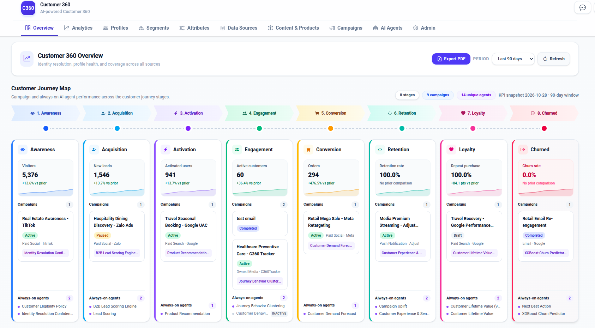
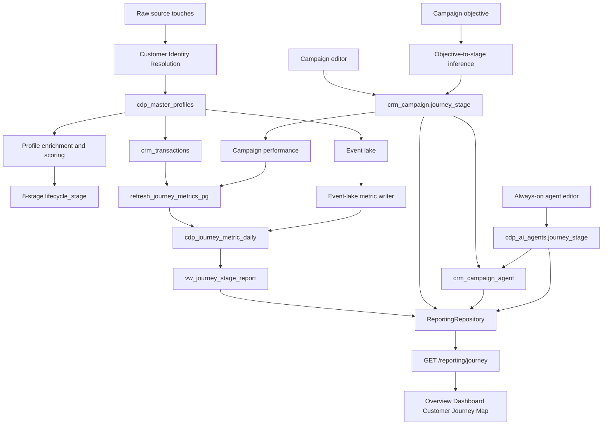
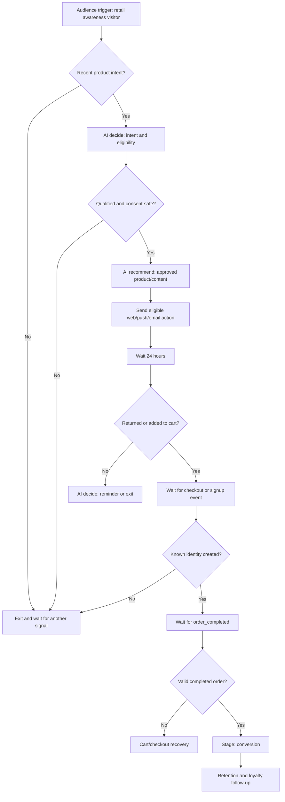
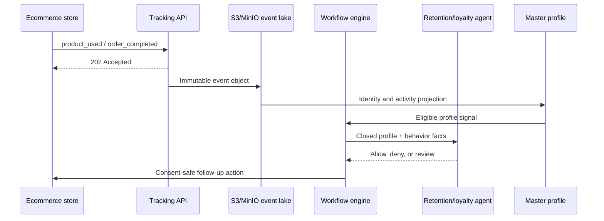
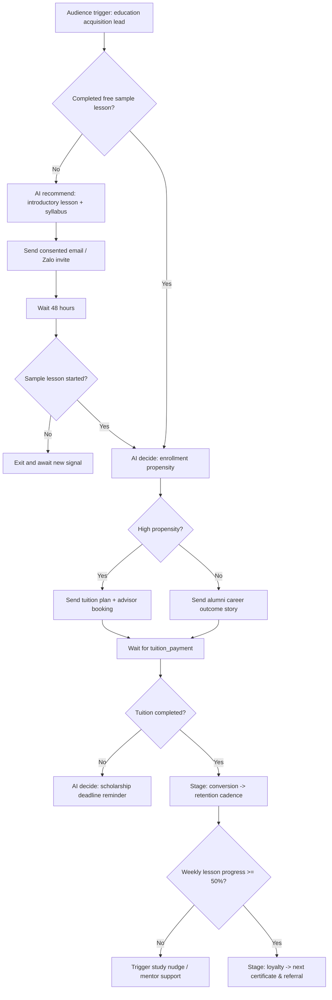
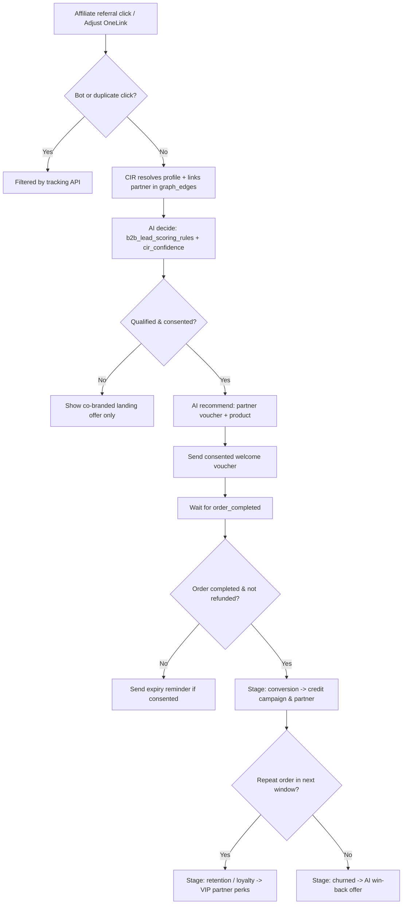
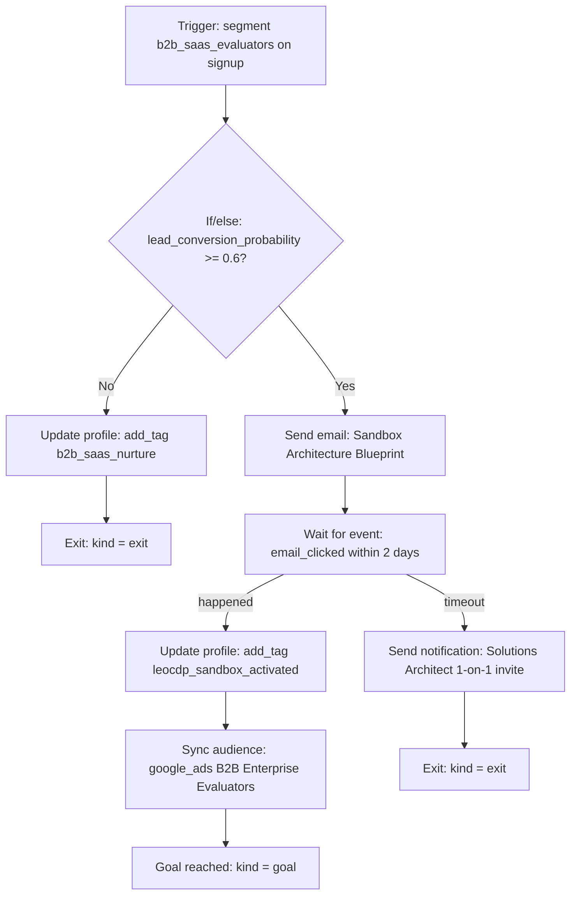

# Customer Journey Map Playbook



The **Customer Journey Map** is the tenant-scoped marketing, product, and
revenue operations playbook and analytics report in LEO CDP. It tracks how
customer profiles progress through eight canonical lifecycle stages, uniting
behavioral tracking, Customer Identity Resolution (CIR), Audience Builder
segments, approval-gated campaign workflows, and AI agents in a single
operational view. Each stage combines:

- a **primary KPI** and **supporting stage KPIs** with period-over-period comparisons;
- **marketing campaigns** targeted at the stage (`crm_campaign.journey_stage`);
- **campaign-to-agent assignments** (`plan`, `decide`, `optimize` in `crm_campaign_agent`); and
- **always-on AI agents** configured for continuous scoring and optimization (`cdp_ai_agents.journey_stage`).

The report is rendered on the Overview Dashboard
([`overview-dashboard.html`](../../customer360-frontend/static/templates/dashboard/overview-dashboard.html)
and [`overview-view.js`](../../customer360-frontend/static/js/overview-view.js))
and exposed through `GET /reporting/journey`
([`reporting_api.py`](../../customer360-api/core/routers/reporting_api.py))
backed by [`reporting_respository.py`](../../customer360-dao/src/leo_customer360_dao/repositories/reporting_respository.py)
and `customer360.vw_journey_stage_report`.

---

## Table of Contents

1. [The Eight Journey Stages & KPI Catalog Reference](#1-the-eight-journey-stages--kpi-catalog-reference)
2. [Source of Truth & Schema Contracts](#2-source-of-truth--schema-contracts)
3. [End-to-End Processing Pipeline & UI Behavior](#3-end-to-end-processing-pipeline--ui-behavior)
4. [Stage-by-Stage Processing Logic](#4-stage-by-stage-processing-logic)
5. [Operational Playbook: Step-by-Step Setup Guide](#5-operational-playbook-step-by-step-setup-guide)
   - [Playbook A: Configure Tenant Business Model & Domain](#playbook-a-configure-tenant-business-model--domain)
   - [Playbook B: Set Up AI Agents, Segment Workflows & Campaign Bindings](#playbook-b-set-up-ai-agents-segment-workflows--campaign-bindings)
   - [Playbook C: Build, Approve & Activate an Accurate Campaign Workflow](#playbook-c-build-approve--activate-an-accurate-campaign-workflow)
   - [Playbook D: Compute & Verify Journey Stage KPIs](#playbook-d-compute--verify-journey-stage-kpis)
6. [How to Test Locally](#6-how-to-test-locally)
7. [Troubleshooting](#7-troubleshooting)
8. [Operational & Tenant-Safety Rules](#8-operational--tenant-safety-rules)
9. [End-to-End Industry Use Cases](#9-end-to-end-industry-use-cases)
   - [Use Case 1: E-Commerce (B2C) — Web Visitor to Repeat Buyer](#use-case-1-e-commerce-b2c--web-visitor-to-repeat-buyer)
   - [Use Case 2: Education & EdTech (B2C) — Course Explorer to Enrolled Graduate](#use-case-2-education--edtech-b2c--course-explorer-to-enrolled-graduate)
   - [Use Case 3: Affiliate & Partner Marketing (B2B2C) — Publisher Referral to Settled Conversion](#use-case-3-affiliate--partner-marketing-b2b2c--publisher-referral-to-settled-conversion)
   - [Use Case 4: Enterprise SaaS (B2B) — LEO CDP Dogfooding & Adoption Journey](#use-case-4-enterprise-saas-b2b--leo-cdp-dogfooding--adoption-journey)
   - [Cross-Use-Case Verification Checklist & SQL](#cross-use-case-verification-checklist--sql)

---

## 1. The Eight Journey Stages & KPI Catalog Reference

Stages are ordered and rendered consistently across the database, DAO, API,
seeding pipeline, and frontend UI:

| # | Stage (`journey_stage`) | Label | Meaning | Primary KPI (`metric_code`) | Supporting KPI (`metric_code`) | Default Stage AI Agent (`agent_code`) | Typical Next Action |
|---:|---|---|---|---|---|---|---|
| 1 | `awareness` | **Awareness** | A person has been reached or observed but has not yet shown a qualified acquisition signal. | `visitors` (`count`, higher is better) | `awareness_conversion` (`percent`) | `eligibility_policy` / `data_quality_cir_confidence` | Build reach, capture consent, and create a recognizable first touch. |
| 2 | `acquisition` | **Acquisition** | A visitor has become an identifiable lead or supplied a qualified acquisition signal. | `new_leads` (`count`, higher is better) | `acquisition_conversion` (`percent`) | `lead_scoring` / `b2b_lead_scoring_rules` | Qualify and nurture the lead with relevant proof and offers. |
| 3 | `activation` | **Activation** | The person has completed an initial product, app, account, or onboarding milestone. | `activated_users` (`count`, higher is better) | `activation_conversion` (`percent`) | `product_recommendation` | Guide the person to the first meaningful value moment. |
| 4 | `engagement` | **Engagement** | The person is actively using the product or interacting across one or more channels. | `active_customers` (`count`, higher is better) | `purchase_frequency` (`ratio`) | `journey_behavior_clustering` / `behavior_anomaly_detector` | Increase useful engagement and reduce friction. |
| 5 | `conversion` | **Conversion** | The person has completed a target commercial action, such as an order, booking, or subscription. | `orders` (`count`, higher is better) | `conversion_rate` (`percent`) | `customer_demand_forecast` | Improve conversion quality, basket size, and repeat intent. |
| 6 | `retention` | **Retention** | A converted customer remains active over a comparison period. | `retention_rate` (`percent`, higher is better) | `churn_risk_rate` (`percent`, lower is better) | `campaign_uplift` / `cx_sentiment_llm_v1` | Protect the relationship and intervene when churn risk rises. |
| 7 | `loyalty` | **Loyalty** | A retained customer repeatedly purchases, advocates, or demonstrates durable high value. | `repeat_purchase_rate` (`percent`, higher is better) | `referral_rate` (`percent`) | `clv_prediction` / `clv_regression_v1` | Reward loyalty, referrals, and premium-tier behavior. |
| 8 | `churned` | **Churned** | A customer has stopped engaging or purchasing in the current window compared with the prior window. | `churn_rate` (`percent`, lower is better) | `winback_rate` (`percent`, higher is better) | `next_best_action` / `churn_prediction_v2` | Trigger re-engagement, win-back, or suppression-safe recovery journeys. |

> **Note:** `churned` is a canonical journey stage, distinct from the
> predictive `churn_risk_tier` column (`low`, `medium`, `high`, `critical`) on
> `cdp_master_profiles`. A customer can have `churn_risk_tier = 'high'` while
> still in `retention`; `churned` represents customers who have lapsed and are
> tracked by the Churned stage and win-back programs.

### Complete 19-Metric Catalog (`customer360.cdp_journey_metric`)

Every KPI in the Customer Journey Map is defined in `customer360.cdp_journey_metric`
and snapped daily into `customer360.cdp_journey_metric_daily`:

| `metric_code` | `journey_stage` | Label | `unit` | `source` | `is_primary` | `higher_is_better` | Windows (`window_days`) | Computation Contract |
|---|---|---|---|---|---:|---:|---|---|
| `visitors` | `awareness` | Visitors | `count` | `event_lake` | `TRUE` | `TRUE` | `1, 7, 30, 90` | Distinct visitor identities observed in event lake within `[report_date - W + 1, report_date]`. |
| `awareness_conversion` | `awareness` | Conversion to next | `percent` | `event_lake` | `FALSE` | `TRUE` | `1, 7, 30, 90` | `100.0 * new_leads / NULLIF(visitors, 0)` in the trailing window. |
| `new_leads` | `acquisition` | New leads | `count` | `event_lake` | `TRUE` | `TRUE` | `1, 7, 30, 90` | Distinct profiles/identities reaching acquisition in the trailing window. |
| `acquisition_conversion` | `acquisition` | Conversion to next | `percent` | `event_lake` | `FALSE` | `TRUE` | `1, 7, 30, 90` | `100.0 * activated_users / NULLIF(new_leads, 0)` in the trailing window. |
| `activated_users` | `activation` | Activated users | `count` | `event_lake` | `TRUE` | `TRUE` | `1, 7, 30, 90` | Distinct profiles completing an onboarding/activation event in the trailing window. |
| `activation_conversion` | `activation` | Conversion to next | `percent` | `event_lake` | `FALSE` | `TRUE` | `1, 7, 30, 90` | `100.0 * active_customers / NULLIF(activated_users, 0)` in the trailing window. |
| `active_customers` | `engagement` | Active customers | `count` | `transaction` | `TRUE` | `TRUE` | `1, 7, 30, 90` | Distinct `master_profile_id` with valid transactions in `crm_transactions` during window `W`. |
| `purchase_frequency` | `engagement` | Purchase frequency | `ratio` | `transaction` | `FALSE` | `TRUE` | `1, 7, 30, 90` | `ROUND(buyer_orders / NULLIF(active_customers, 0), 4)` in window `W`. |
| `orders` | `conversion` | Orders | `count` | `transaction` | `TRUE` | `TRUE` | `1, 7, 30, 90` | Count of `crm_transactions` in window `W` excluding `rule->'exclude_status'` (`cancelled`, `failed`, `refunded`). |
| `conversion_rate` | `conversion` | Conversion rate | `percent` | `event_lake` | `FALSE` | `TRUE` | `1, 7, 30, 90` | Percentage of visitors/active evaluators completing a conversion in window `W`. |
| `retention_rate` | `retention` | Retention rate | `percent` | `transaction` | `TRUE` | `TRUE` | `7, 30, 90` (`w >= 7`) | `100.0 * retained_buyers / NULLIF(previous_buyers, 0)` comparing current window `W` to prior window `W`. |
| `churn_risk_rate` | `retention` | Churn risk | `percent` | `profile` | `FALSE` | `FALSE` | `1` (point-in-time) | `100.0 * COUNT(*) FILTER (WHERE churn_probability >= 0.7) / NULLIF(COUNT(*), 0)` on active profiles (`status_code = 1`). |
| `repeat_purchase_rate` | `loyalty` | Repeat purchase | `percent` | `transaction` | `TRUE` | `TRUE` | `30, 90` (`w >= 30`) | `100.0 * COUNT(*) FILTER (WHERE orders >= 2) / NULLIF(active_customers, 0)` in window `W`. |
| `referral_rate` | `loyalty` | Referral rate | `percent` | `event_lake` | `FALSE` | `TRUE` | `1, 7, 30, 90` | Share of active customers generating referral events in window `W`. |
| `churn_rate` | `churned` | Churn rate | `percent` | `transaction` | `TRUE` | `FALSE` | `7, 30, 90` (`w >= 7`) | `100.0 * (previous_buyers - retained_buyers) / NULLIF(previous_buyers, 0)` (`100 - retention_rate`). |
| `winback_rate` | `churned` | Win-back rate | `percent` | `event_lake` | `FALSE` | `TRUE` | `1, 7, 30, 90` | Percentage of previously lapsed/churned profiles re-engaging or converting in window `W`. |
| `campaign_spend` | `NULL` (all stages) | Campaign spend | `currency` | `campaign` | `FALSE` | `FALSE` | `1, 7, 30, 90` | Sum of `crm_campaign_performance_daily.spend` grouped by `(journey_stage, currency)` and `dim_type IN ('all', 'campaign', 'agent')`. |
| `campaign_conversions` | `NULL` (all stages) | Campaign conversions | `count` | `campaign` | `FALSE` | `TRUE` | `1, 7, 30, 90` | Sum of `crm_campaign_performance_daily.conversions` grouped by `(journey_stage, currency)` and `dim_type`. |
| `campaign_revenue` | `NULL` (all stages) | Campaign revenue | `currency` | `campaign` | `FALSE` | `TRUE` | `1, 7, 30, 90` | Sum of `crm_campaign_performance_daily.revenue_estimated` grouped by `(journey_stage, currency)` and `dim_type`. |

---

## 2. Source of Truth & Schema Contracts

The canonical 8-stage vocabulary is defined in
[`journey.py`](../../customer360-dao/src/leo_customer360_dao/schemas/journey.py):

```text
awareness | acquisition | activation | engagement | conversion | retention | loyalty | churned
```

The database enforces this exact vocabulary via `CHECK` constraints across:

- `customer360.cdp_master_profiles.lifecycle_stage`
- `customer360.crm_campaign.journey_stage`
- `customer360.cdp_ai_agents.journey_stage`
- `customer360.cdp_journey_metric.journey_stage`
- `customer360.cdp_journey_metric_daily.journey_stage`

Schema and migration files:

- [`database-schema.sql`](../../customer360-database/database-schema.sql) — canonical schema definition.
- [`017_agent_campagn_journey.sql`](../../customer360-database/migrations/017_agent_campagn_journey.sql) — adds `journey_stage` to campaigns and AI agents, creates `crm_campaign_agent`, normalizes profile `lifecycle_stage` values across tenants under RLS, and seeds `LIFECYCLE_BEHAVIOR_*_BASE` persona scoring baselines.
- [`018_journey_report.sql`](../../customer360-database/migrations/018_journey_report.sql) — creates `cdp_journey_metric`, `cdp_journey_metric_domain`, `cdp_journey_metric_daily`, `refresh_journey_metrics_pg(p_tenant, p_date)`, and `vw_journey_stage_report`.

---

## 3. End-to-End Processing Pipeline & UI Behavior



### 1. Identity resolution

Raw Adjust, OneSignal, Web Tracking, and other source records are loaded into
`cdp_raw_profiles_stage`. The CIR process consolidates matching raw records
into tenant-scoped `cdp_master_profiles` rows and records the links in
`cdp_profile_links`.

The journey map uses the resolved master profile as its customer-level
identity. It does not infer a cross-tenant profile from an unscoped query.

### 2. Profile enrichment and stage assignment

The demo seeder enriches each resolved profile with:

- `lifecycle_stage`;
- `last_activity_at`;
- `customer_since`;
- engagement and churn scores;
- lead conversion probability;
- historical and predictive CLV; and
- stage-aware segmentation tags and attributes.

For deterministic local testing, the full demo seeder distributes profiles
across all eight stages. Production pipelines may assign stages from business
rules or models, but the stored value must be one of the eight allowed
values.

### 3. Campaign targeting

Campaigns can store an explicit `crm_campaign.journey_stage`. If a campaign
does not yet have an explicit stage, the DAO infers one from its objective
using `infer_journey_stage_from_objective()`:

| Objective examples | Resolved stage |
|---|---|
| `Awareness`, `Brand awareness` | Awareness |
| `Leads`, `Lead generation`, `Acquisition` | Acquisition |
| `App Install`, `Activation`, `Onboarding` | Activation |
| `Visit store`, `Engagement` | Engagement |
| `Conversions`, `Conversion`, `Sales` | Conversion |
| `Retention` | Retention |
| `Loyalty`, `Referral` | Loyalty |
| `Win-back`, `Winback`, `Re-engagement`, `Churn` | Churned |

The campaign editor is the preferred place to set the stage explicitly.
Objective inference is a compatibility fallback, not a replacement for
explicit campaign configuration.

### 4. Campaign and AI-agent association

`crm_campaign_agent` links a campaign to one or more registered AI agents.
Each link has:

- `role`: `plan`, `decide`, or `optimize`;
- `autonomy`: `suggest` or `approve`;
- optional pinned instruction version;
- guardrails; and
- active status.

The report shows these assignments on the campaign card for the matching
stage. It separately shows always-on agents from `cdp_ai_agents` where
`journey_stage` matches the stage. An active agent with no stage can be
treated as cross-stage by the reporting repository.

### 5. KPI catalog and snapshots

`cdp_journey_metric` is the global metric catalog. It defines the label, unit,
source, primary flag, directionality, and applicable business models.
`cdp_journey_metric_daily` stores tenant-scoped values for:

- report date;
- trailing window (`1`, `7`, `30`, or `90` days);
- business model (`B2B`, `B2C`, or `B2B2C`);
- optional domain;
- journey stage;
- metric;
- dimension (`all`, `channel`, `campaign`, `segment`, or `agent`); and
- currency for campaign-derived metrics.

The PostgreSQL function
`customer360.refresh_journey_metrics_pg(tenant_id, report_date)` calculates
transaction, profile, and campaign metrics. Event-lake metrics such as
visitors, leads, activated users, conversion rate, referrals, and win-back
rate are written by the event-lake analytics process using the same snapshot
contract.

The report compares the current snapshot with the snapshot ending one window
earlier:

- count, ratio, currency: relative percentage change when a prior value is
  available;
- percent: point change (`current - previous`);
- `higher_is_better = false` is used for metrics such as churn rate so the UI
  can interpret direction correctly.

### 6. API and dashboard rendering

The API endpoint is:

```http
GET /reporting/journey?days=90&window=30
```

The authenticated tenant is authoritative. A supplied `tenant_id` query
parameter cannot override the tenant from the request authentication context
(mismatches return `403 Forbidden`; invalid `window` values outside `1, 7, 30, 90`
return `422 Unprocessable Entity`).

In [`overview-view.js`](../../customer360-frontend/static/js/overview-view.js),
`journeyWindow(days)` maps the Overview Dashboard's period selector
(`#overview-period-select`) to the `window` query parameter:

| Overview Period (`days`) | Journey `window` (`window_days`) | PostgreSQL Metrics Computed |
|---|---|---|
| `days <= 3` | `1` (1-day trailing window) | `orders`, `active_customers`, `purchase_frequency`, `churn_risk_rate`, `campaign_*` |
| `days <= 7` | `7` (7-day trailing window) | Above (except `churn_risk_rate`) + `retention_rate`, `churn_rate` |
| `days <= 30` | `30` (30-day trailing window) | All 7-day metrics + `repeat_purchase_rate` |
| `days > 30` (default `90`) | `90` (90-day trailing window) | All 30-day metrics over a 90-day comparison window |

The response always contains the eight ordered stage objects, even when a
stage has no current snapshot. In that case [`reporting_respository.py`](../../customer360-dao/src/leo_customer360_dao/repositories/reporting_respository.py)
uses `cdp_journey_metric` (or `DEFAULT_STAGE_PRIMARY_METRICS` in
[`journey.py`](../../customer360-dao/src/leo_customer360_dao/schemas/journey.py))
to provide the primary KPI metadata with `value = null`, allowing the
frontend to render `"Not available"` and `"KPI snapshot not available"`
rather than silently omitting the stage. When some (but not all) stages have
KPI snapshots (`0 < stagesWithKpis < 8`), the UI displays the amber banner
`#journey-report-snapshot-notice`.

The Overview Dashboard renders:

- **Header summary pills**: `#journey-report-stage-count` (`8 stages`),
  `#journey-report-campaign-count` (`<N> campaigns`),
  `#journey-report-agent-count` (`<M> unique agents`), and
  `#journey-report-meta` (`KPI snapshot <YYYY-MM-DD> · <W>-day window`);
- **Interactive 8-stage chevron track** (`#journey-report-track`): clicking any
  chevron (`[data-journey-stage-link]`) smoothly scrolls to and focuses the
  stage card (`#journey-stage-<stage>`);
- **Primary KPI box & sparkline**: formatted value (`%`, ratio `0.00`,
  `currency`, or integer), period-over-period delta (`+X.X% vs prior` or
  `+X.X pts vs prior`, colored emerald when
  `higher_is_better ? change >= 0 : change <= 0`), and stage SVG sparkline;
- **Campaign cards**: up to 2 visible cards per stage (with a
  `Show N more campaigns` toggle), displaying the campaign status pill
  (`Running`, `Active`, `Workflow in review`, `Approved`, `Paused`,
  `Completed`, `Failed · retry`, `Rejected`, `Draft`), `channel · platform`
  metadata, and up to 2 assigned agent chips (`<ShortName> · <role>`) plus a
  `+N` overflow counter. When a stage has zero campaigns, the card renders
  `+ Start a campaign` (`[data-start-campaign-stage]`), which opens the
  Campaign Editor (`C360.campaignView.openCreateForStage(stage)`) with
  `#campaign-field-journey-stage` pre-populated; and
- **Always-on agent list**: up to 3 visible rows per stage (with a
  `Show N more agents ⌄` toggle), populated from `cdp_ai_agents` where
  `journey_stage == stage` or `(journey_stage IS NULL AND status == 'ACTIVE')`.

---

## 4. Stage-by-Stage Processing Logic

The following describes the processing logic for each stage. The stage is a
canonical business classification; exact event names and thresholds are
tenant-configurable in `cdp_journey_metric.rule`.

### 1. Awareness

**Inputs**

- anonymous or known visitor events;
- page views, ad impressions, content views, or first-touch events;
- campaign reach and attribution data.

**Processing**

1. Deduplicate events by tenant and profile/session identity.
2. Count distinct visitors in the requested trailing window.
3. Calculate the transition rate from visitors to the configured next-stage
   signal.
4. Attribute active awareness campaigns and their assigned agents.

**Report metrics**

- `visitors` — primary count;
- `awareness_conversion` — supporting percent.

**Typical agents**

- identity/confidence or reach-quality agent;
- audience discovery and brand-awareness planner.

### 2. Acquisition

**Inputs**

- lead-created or lead-qualified events;
- forms, registrations, account creation, and attributable acquisition
  campaigns;
- acquisition source and campaign fields on the profile.

**Processing**

1. Deduplicate newly acquired profiles or leads.
2. Count distinct new leads.
3. Compare qualified leads with the activation signal.
4. Apply consent, suppression, and tenant campaign rules before activation.

**Report metrics**

- `new_leads` — primary count;
- `acquisition_conversion` — supporting percent.

**Typical agents**

- lead scoring;
- acquisition audience planner;
- source-quality or qualification agent.

### 3. Activation

**Inputs**

- app install;
- account setup;
- onboarding completion;
- first meaningful product action.

**Processing**

1. Identify profiles that completed the tenant's activation event.
2. Count distinct activated users.
3. Compare activated users with the engagement or conversion signal.
4. Rank onboarding, recommendation, or activation content.

**Report metrics**

- `activated_users` — primary count;
- `activation_conversion` — supporting percent.

**Typical agents**

- product recommendation;
- onboarding/nurture agent;
- activation anomaly detector.

### 4. Engagement

**Inputs**

- recent sessions and meaningful product events;
- active customer transactions;
- source-system breadth and interaction history.

**Processing**

1. Determine active profiles in the reporting window.
2. Aggregate transaction-backed active customers and purchase frequency.
3. Combine engagement signals with profile recency and channel breadth.
4. Route engagement campaigns and AI decisions to eligible profiles.

**Report metrics**

- `active_customers` — primary count;
- `purchase_frequency` — supporting ratio.

**Typical agents**

- journey behavior clustering;
- engagement recommendation;
- anomaly detection.

### 5. Conversion

**Inputs**

- completed orders, bookings, subscriptions, or equivalent conversion facts;
- campaign performance records;
- transaction status and currency.

**Processing**

1. Exclude cancelled, failed, and refunded transactions according to the
   metric rule.
2. Count valid orders in each trailing window.
3. Calculate conversion rate from the event-lake conversion denominator.
4. Attribute spend, conversions, and revenue to campaign and agent
   dimensions without combining currencies.

**Report metrics**

- `orders` — primary count;
- `conversion_rate` — supporting percent;
- campaign spend, conversions, and revenue dimensions.

**Typical agents**

- demand forecast;
- offer/recommendation optimizer;
- campaign uplift optimizer.

### 6. Retention

**Inputs**

- current-window buyers;
- previous-window buyers;
- last activity and churn probability;
- support and sentiment events.

**Processing**

1. Build the previous buyer cohort for the same window size.
2. Find buyers present in both previous and current windows.
3. Calculate retained buyers divided by previous buyers.
4. Separately calculate the point-in-time share of active profiles above the
   configured churn probability threshold.

**Report metrics**

- `retention_rate` — primary percent;
- `churn_risk_rate` — supporting percent.

**Typical agents**

- customer experience/sentiment analyzer;
- campaign uplift optimizer;
- retention intervention agent.

### 7. Loyalty

**Inputs**

- repeat orders;
- customer tenure;
- membership tier;
- referrals, advocacy, and high-value behavior.

**Processing**

1. Count buyers with at least two valid purchases in the window.
2. Divide repeat buyers by current-window buyers.
3. Combine repeat-purchase data with CLV, tenure, and referral events for
   loyalty audiences.
4. Keep referral and campaign attribution tenant- and currency-safe.

**Report metrics**

- `repeat_purchase_rate` — primary percent;
- `referral_rate` — supporting percent.

**Typical agents**

- CLV regression;
- loyalty/premium upsell agent;
- referral optimization agent.

### 8. Churned

**Inputs**

- customer inactivity;
- lost or declining purchase behavior;
- high churn probability;
- win-back and re-engagement events.

**Processing**

1. Compare the previous buyer cohort with current buyers.
2. Count previous buyers who did not return.
3. Calculate churn rate as lost buyers divided by previous buyers.
4. Track win-back outcomes separately; a successful win-back does not erase
   the historical churned-stage measurement.
5. Apply suppression, consent, and quiet-hour rules before sending recovery
   actions.

**Report metrics**

- `churn_rate` — primary percent, lower is better;
- `winback_rate` — supporting percent.

**Typical agents**

- churn prediction;
- next-best-action;
- win-back/re-engagement optimizer.

---

## 5. Operational Playbook: Step-by-Step Setup Guide

Use this 4-part operational playbook whenever onboarding a business tenant,
configuring AI agents, building a stage-targeted campaign workflow, or
refreshing Customer Journey Map KPIs.

### Playbook A: Configure Tenant Business Model & Domain

1. **Set `sys_tenant.business_model`**: Choose `'B2B'`, `'B2C'` (default), or
   `'B2B2C'`. Both `refresh_journey_metrics_pg` and event-lake writers stamp
   this value onto `cdp_journey_metric_daily.business_model`, and
   `vw_journey_stage_report` filters `cur.business_model = ANY(m.applicable_business_models)`.
2. **Register or enable the business domain (`sys_domain` & `sys_tenant_domain`)**:
   Built-in domains seeded in [`init-core-database.sql`](../../customer360-database/init-core-database.sql)
   are `_` (unclassified), `retail`, `banking`, `insurance`, `healthcare`,
   `telecom`, `travel`, `real_estate`, `education`, `manufacturing`, `media`,
   and `hospitality`. Custom domains (such as `saas`) are added directly to
   `customer360.sys_domain` and `customer360.sys_tenant_domain` without schema
   migrations.
3. **Scope domain KPIs (`cdp_journey_metric_domain`)**:
   - General report rows (`GET /reporting/journey`) read rows where
     `domain_code IS NULL` and `dim_type = 'all'`.
   - Domain-sliced analytics (`domain_code = '<domain>'`) require a matching
     `(metric_code, domain_code)` row in `customer360.cdp_journey_metric_domain`.

### Playbook B: Set Up AI Agents, Segment Workflows & Campaign Bindings

LEO CDP orchestrates AI agents across **three connected surfaces**. Configure
each surface according to its role:

| Surface | Table / API | Purpose | UI / Runtime Effect |
|---|---|---|---|
| **1. Global & Stage AI Agent Registry** | `customer360.cdp_ai_agents` (`GET/POST/PUT /ai-agents/`) | Defines `agent_code`, `model_type` (10 canonical types), `journey_stage` (`awareness` .. `churned` or `NULL`), `status`, `schedule_definition`, allow-listed `input_features` (verified against `cdp_ai_feature_catalog`), `hyperparameters`, and versioned prompts. | Renders **Always-on agents** at the bottom of each stage card on the Customer Journey Map. |
| **2. Segment AI Agent Workflow** | `customer360.cdp_agent_workflow` (`POST /api/v1/segments/{segment_id}/workflow/run`) | Ordered per-segment pipeline (`execution_order = 1, 2, ...`) executed by `customer360-backend/ai_agents_runners`. Runs deterministic `eligibility_policy` (writes channel readiness to `communication_preferences.eligibility_policy`) and `product_recommendation` (`ranking_recommendation` over closed `candidate_content_item_ids`). | Enriches segment profiles with channel eligibility and ranked content before or alongside campaign execution. |
| **3. Campaign Agent Binding** | `customer360.crm_campaign_agent` | Binds `(tenant_id, campaign_id, agent_code, role)` with `role IN ('plan', 'decide', 'optimize')`, `autonomy IN ('suggest', 'approve')`, `pinned_instruction_version`, and `guardrails`. | Renders violet **`<Agent> · <role>` badges** on campaign cards in the Customer Journey Map and attributes `campaign_spend`, `campaign_conversions`, and `campaign_revenue` to `dim_type = 'agent'`. |

### Playbook C: Build, Approve & Activate an Accurate Campaign Workflow

Every production campaign in LEO CDP follows a strict separation between
**Campaign Metadata**, **Workflow Graph Definition**, **Human Approval**, and
**Dagster Execution**:

#### 1. Select Canonical Campaign Channel & Platform (`campaign-view.js`)

In the Campaign Editor ([`campaign-editor.html`](../../customer360-frontend/static/templates/campaign/campaign-editor.html)),
set:

- **Targeted Journey Stage (`journey_stage`)**: Always set explicitly (`awareness` .. `churned`) so the campaign is placed on the intended stage card even if `objective` is general (e.g., `Conversions`).
- **Channel & Platform**:

| `crm_campaign.channel` | Allowed `crm_campaign.platform` values | Runtime Delivery Connector (`crm_connector_config`) |
|---|---|---|
| `email` | `email` | `EMAIL` (tenant SMTP connector or `EMAIL_DISPATCH_ADAPTER=smtp`/`mock`) |
| `notification` | `sms`, `zalo_oa`, `whatsapp`, `mobile_native` | `SMS` / notification webhook or provider connector |
| `push` | `push` | `PUSH` (OneSignal or mock connector) |
| `audience_sync` | `meta_ads`, `google_ads`, `tiktok_ads` | Asynchronous `data_synch_job` → `crm_ad_sync_runs` |

#### 2. Build a Valid `schema_version = 2` Workflow Graph (`workflow-core.js` & `crm_flow_node`)

The Visual Workflow Studio ([`workflow-core.js`](../../customer360-frontend/static/js/workflow/workflow-core.js))
and backend `DAO FlowEngine` ([`workflow_runner.py`](../../customer360-backend/campaign_activation/campaign_activation/workflow_runner.py))
validate the JSON tree saved via `customer360.crm_save_flow`:

| Node `type` | Category | Required `config` Keys | Allowed `branch` on Children | Runtime / Database Contract |
|---|---|---|---|---|
| `trigger` | Input (Root) | `segment_id` (UUID), `event` (`signup`, `cart_abandoned`, `purchase`, `inactive_30d`, `birthday`) | None (root only) | Must be the root node (`jsonb_typeof(definition->'root') = 'object'`). |
| `condition` | Logic | `field` (`engagement_score`, `churn_probability`, `lead_conversion_probability`, `historical_clv`, `predictive_clv`, `latest_nps_score`, `average_csat`, `overall_sentiment_score`, `profile_completeness_score`, `identity_confidence_score`, `segmentation_tags`), `op` (`ge`, `lt`, `eq`, `has`, `hasnt`), `value` | `yes`, `no` | Evaluates `CdpMasterProfile` fields; missing numeric values take `no`. |
| `wait` | Logic | `amount` (int >= 1), `unit` (`minutes`, `hours`, `days`) | None | Advances virtual evaluation time for downstream event checks. |
| `wait_event` | Logic | `event` (`purchase`, `email_opened`, `email_clicked`), `amount` (int >= 1), `unit` (`minutes`, `hours`, `days`) | `happened`, `timeout` | Queries linked raw events within the wait window. |
| `email` | Activate | `subject`, `body` (supports `{{first_name}}`) | None | Requires `email_opt_in == true` and no active email/global suppression. |
| `notification` | Activate | `provider` (`sms`, `zalo_oa`, `whatsapp`, `mobile_native`), `body` | None | Requires explicit channel opt-in (`sms_opt_in`, `zalo_opt_in`, `whatsapp_opt_in`, or `push_opt_in`). |
| `push` | Activate | `title`, `body` | None | Requires `push_opt_in == true` and valid push token. |
| `update_profile` | Activate | `action` (`add_tag`, `remove_tag`), `tag` | None | Adds or removes the tag in `cdp_master_profiles.segmentation_tags`. |
| `run_data_synch_job` | Activate | `platform` (`meta_ads`, `google_ads`, `tiktok_ads`), `audience_name` | None | Submits campaign-scoped `data_synch_job` if reached by >= 1 profile. |
| `exit` | Logic (Terminal) | `kind` (`goal`, `exit`) | Terminal (no children) | Ends the branch (`end_counts.goal` vs `end_counts.exit`). |
| `ai_decide` / `ai_recommend` / `ai_generate` | AI (`crm_flow_node`) | `agent_code` (must exist in `cdp_ai_agents`) | None | Stored in generated column `crm_flow_node.agent_code` with FK `crm_flow_node_agent_fk`. |

#### 3. Governed Approval & Activation Sequence

1. **Save workflow**: Call `customer360.crm_save_flow(...)`. User-saved flows (`p_actor = 'user'`) are immediately `Approved`; agent-proposed flows (`p_actor = 'agent'`) start `InReview`.
2. **Review agent workflow (if `InReview`)**: A different human reviewer (`p_reviewer <> created_by_user_id`) calls `customer360.crm_review_flow_version(..., p_decision => 'approve')` or `POST /workflows/{flow_id}/versions/{version}/review`.
3. **Publish & pin workflow**: Call `customer360.crm_publish_flow(tenant_id, flow_id, version)` and set `crm_campaign.workflow_id` and `crm_campaign.workflow_version`.
4. **Submit & approve campaign**: Transition `crm_campaign.approval_status` from `Draft` → `InReview` (`POST /campaigns/{id}/submit-for-approval`) → `Approved` (`POST /campaigns/{id}/approve`).
5. **Activate campaign**: Call `POST /api/v1/admin/campaigns/{campaign_id}/activate`. This triggers `campaign_activation_job` → `campaign_workflow_job`, recording per-profile idempotency rows in `crm_campaign_workflow_action_runs` and state transitions in `sys_audit_log`.

### Playbook D: Compute & Verify Journey Stage KPIs

1. **Refresh PostgreSQL-sourced KPIs** (`orders`, `active_customers`, `purchase_frequency`, `retention_rate`, `repeat_purchase_rate`, `churn_rate`, `churn_risk_rate`, `campaign_spend`, `campaign_conversions`, `campaign_revenue`):
   ```sql
   SELECT set_config('app.tenant_id', '11111111-1111-1111-1111-111111111111', false);
   SELECT customer360.refresh_journey_metrics_pg('11111111-1111-1111-1111-111111111111'::uuid, CURRENT_DATE);
   ```
2. **Upsert Event-Lake KPIs** (`visitors`, `awareness_conversion`, `new_leads`, `acquisition_conversion`, `activated_users`, `activation_conversion`, `conversion_rate`, `referral_rate`, `winback_rate`) into `customer360.cdp_journey_metric_daily` with matching `tenant_id`, `report_date`, `window_days`, and `business_model` (for both `report_date = CURRENT_DATE` and `report_date = CURRENT_DATE - window_days` so `vw_journey_stage_report` computes period-over-period `previous_value` and `change`).

---

## 6. How to Test Locally

### Prerequisites

Use the repository's normal local environment and ensure PostgreSQL,
Redis, object storage, and the application services required by the demo are
running. Do not copy credentials into this document or commit `.env` files.

### Full reset and demo seed

From the repository root:

```bash
./dev-c360.sh reset -y
```

The reset flow rebuilds the local database, applies the canonical schema and
migrations, then runs the demo pipeline:

1. seed raw Adjust/OneSignal/Web Tracking profiles;
2. run Customer Identity Resolution;
3. seed CRM campaigns, campaign-agent links, and AI agents;
4. enrich master profiles across all eight stages;
5. seed transactions, contacts, personas, and behavioral events;
6. refresh PostgreSQL journey metrics; and
7. populate event-lake-style journey snapshots for current and comparison
   windows.

The identity-resolution demo can also be run directly:

```bash
(cd customer360-backend/identity_resolution && bash run-demo.sh)
```

The demo uses tenant
`11111111-1111-1111-1111-111111111111` by default.

### Verify profile coverage

Run a tenant-scoped query:

```sql
SELECT lifecycle_stage, COUNT(*) AS profile_count
FROM customer360.cdp_master_profiles
WHERE tenant_id = '11111111-1111-1111-1111-111111111111'
GROUP BY lifecycle_stage
ORDER BY CASE lifecycle_stage
    WHEN 'awareness' THEN 1
    WHEN 'acquisition' THEN 2
    WHEN 'activation' THEN 3
    WHEN 'engagement' THEN 4
    WHEN 'conversion' THEN 5
    WHEN 'retention' THEN 6
    WHEN 'loyalty' THEN 7
    WHEN 'churned' THEN 8
END;
```

Expected result: all eight stage values are present after a full demo seed.

### Verify campaign and agent coverage

```sql
SELECT journey_stage, COUNT(*) AS campaign_count
FROM customer360.crm_campaign
WHERE tenant_id = '11111111-1111-1111-1111-111111111111'
GROUP BY journey_stage
ORDER BY journey_stage;

SELECT journey_stage, COUNT(*) AS agent_count
FROM customer360.cdp_ai_agents
WHERE journey_stage IS NOT NULL
GROUP BY journey_stage
ORDER BY journey_stage;

SELECT c.journey_stage, c.name, ca.agent_code, ca.role, ca.autonomy
FROM customer360.crm_campaign c
LEFT JOIN customer360.crm_campaign_agent ca
  ON ca.tenant_id = c.tenant_id
 AND ca.campaign_id = c.campaign_id
 AND ca.is_active = TRUE
WHERE c.tenant_id = '11111111-1111-1111-1111-111111111111'
ORDER BY c.journey_stage, c.name, ca.role;
```

### Verify KPI snapshots

```sql
SELECT
    report_date,
    window_days,
    journey_stage,
    metric_code,
    value,
    previous_value,
    change,
    change_kind
FROM customer360.vw_journey_stage_report
WHERE tenant_id = '11111111-1111-1111-1111-111111111111'
  AND dim_type = 'all'
  AND domain_code IS NULL
ORDER BY window_days, journey_stage, metric_code;
```

For a direct refresh of PostgreSQL-sourced metrics, set the tenant context
first because the function validates the RLS tenant:

```sql
SELECT set_config(
    'app.tenant_id',
    '11111111-1111-1111-1111-111111111111',
    false
);

SELECT customer360.refresh_journey_metrics_pg(
    '11111111-1111-1111-1111-111111111111'::uuid,
    CURRENT_DATE
);
```

### Verify the API

With the API running and an authenticated tenant session:

```bash
curl -sS 'http://localhost:8000/reporting/journey?days=90&window=30' \
  -H 'Authorization: Bearer <local-token>' | jq .
```

Verify that:

- `stages` contains exactly eight objects in the documented order;
- each stage has the expected `stage` and `label`;
- the primary metric is present even when its value is `null`;
- `campaigns` only contains campaigns for that stage;
- campaign agents include `plan`, `decide`, or `optimize` roles; and
- `agents` contains matching always-on agents.

The endpoint is tenant-isolated. A `tenant_id` query parameter that differs
from the authenticated tenant returns `403`.

### Verify the dashboard

Open the dashboard overview page in the frontend and inspect the Customer
Journey Map. Check:

1. the eight-stage ribbon is ordered from Awareness to Churned;
2. selecting a stage updates the stage card/details;
3. KPI values, prior-period changes, and unavailable states are explicit;
4. campaign cards show status, objective, and agent roles; and
5. Churned uses a lower-is-better churn-rate presentation and includes
   win-back context.

### Automated tests

Targeted journey and schema tests:

```bash
customer360-api/.venv/bin/pytest \
  customer360-database/tests/test_campaign_agent_schema.py \
  customer360-database/tests/test_journey_reporting_schema.py \
  customer360-dao/src/tests/test_journey_contracts.py \
  customer360-dao/src/tests/test_persona_engine.py \
  customer360-seeding/test_seed_full_demo_data.py \
  customer360-api/tests/test_reporting_journey_api.py
```

Run the broader service test suites when changing shared profile, campaign,
or reporting contracts.

---

## 7. Troubleshooting

### The migration fails while adding `lifecycle_stage` constraint

The migration must run after the base schema and before the journey report
migration. The current migration scopes updates by tenant because the profile
tables use forced RLS. Re-run from the database-schema step after deploying
the updated migration:

```bash
./deployments/deploy-all.sh uat apply --from db-schema
```

Do not disable RLS or add legacy values back to the constraint. If the error
continues, inspect invalid values with a privileged, tenant-scoped operational
query and check that the deployment role can set the `app.tenant_id` session
setting.

### A stage shows “Not available”

Check, in order:

1. `cdp_journey_metric` contains an active primary metric for the stage;
2. `cdp_journey_metric_daily` has a current row for the requested
   `window_days`;
3. `business_model` matches the tenant (`B2B`, `B2C`, or `B2B2C`);
4. `dim_type = 'all'` and `domain_code IS NULL` exist for the general report;
5. event-lake metrics have been written; and
6. the reporting cache has expired or has been invalidated.

The API may still return the stage and catalog KPI metadata when a snapshot is
missing. That is intentional and distinguishes “stage exists, data is
unavailable” from “stage was not implemented.”

### A campaign appears on the wrong stage

Inspect `crm_campaign.journey_stage` first. If it is `NULL`, compare the
objective with the objective mapping in
[`journey.py`](../../customer360-dao/src/leo_customer360_dao/schemas/journey.py).
Set the targeted stage explicitly in the campaign editor when the objective
wording is ambiguous.

### A campaign has no agent badge

Check that:

- the campaign and agent belong to the same tenant;
- `crm_campaign_agent.is_active = TRUE`;
- `agent_code` exists in `cdp_ai_agents`; and
- the assignment role is `plan`, `decide`, or `optimize`.

### Churned is empty

Churned requires both a valid current/previous buyer comparison for
`churn_rate` and event-lake or seeded data for `winback_rate`. Check
transaction dates, excluded transaction statuses, current and previous
windows, and the `churned` agent/campaign assignments separately.

---

## 8. Operational & Tenant-Safety Rules

- Always filter reporting data by the authenticated `tenant_id`.
- Always set `app.tenant_id` before writing or refreshing RLS-protected
  tenant tables.
- Never combine campaign currency totals across currencies.
- Treat `churn_risk_tier` as a risk score bucket, not a journey stage.
- Treat campaign approval, workflow approval, and execution status as
  separate controls.
- Do not use the journey report to send messages directly; activation and
  workflow execution remain explicit, approval-gated operations.

---

## 9. End-to-End Industry Use Cases

The four end-to-end use cases below show how web/app tracking, Customer
Identity Resolution (CIR), Audience Builder segments, AI agents, campaign
workflows, and transaction ledgers work together across all 8 stages for:

| Use Case | Business Model (`sys_tenant.business_model`) | Primary Domain (`sys_domain.domain_code`) | Core Journey Arc |
|---|---|---|---|
| **Use Case 1: E-Commerce** | `B2C` | `retail` | Anonymous storefront visitor → cart/account activation → first order (`conversion`) → repeat buyer (`loyalty`) / win-back (`churned`). |
| **Use Case 2: Education & EdTech** | `B2C` | `education` | Syllabus explorer → webinar/trial lead (`acquisition`) → trial lesson (`activation`) → tuition enrollment (`conversion`) → course completion (`retention`) → advanced certificate & referral (`loyalty`). |
| **Use Case 3: Affiliate & Partner Marketing** | `B2B2C` | `retail` / `travel` | Partner/publisher referral link click (`awareness`) → co-branded lead capture (`acquisition`) → app/account onboarding (`activation`) → merchant order + partner commission (`conversion`) → multi-merchant repeat (`retention`/`loyalty`) → partner/consumer reactivation (`churned`). |
| **Use Case 4: Enterprise SaaS (LEO CDP)** | `B2B` | `saas` | Docs & architecture explorer (`awareness`) → qualified B2B buying-committee lead & account (`acquisition`) → sandbox provisioning & first tracking/CIR pipeline (`activation`) → active segments, campaigns & AI agents (`engagement`) → enterprise subscription contract (`conversion`) → multi-quarter renewal (`retention`) → tier/tenant expansion & advocacy (`loyalty`) / workspace recovery (`churned`). |

---

### Use Case 1: E-Commerce (B2C) — Web Visitor to Repeat Buyer

This use case shows how a `B2C` retail ecommerce tenant (`domain = 'retail'`)
uses web tracking, identity resolution, an AI-assisted campaign workflow, and
transaction events to convert an anonymous visitor into a repeat customer.

#### Business Goal

An ecommerce retailer wants to:

1. identify anonymous visitors who show product intent;
2. nurture those visitors without exposing or inventing personal data;
3. convert the visitor into a registered and paying customer;
4. measure each stage transition; and
5. continue the relationship with retention and loyalty journeys.

The campaign is called **Ecommerce First Purchase Conversion** and targets
the `retail` domain.

#### Actors and Data Components

| Component | Responsibility |
|---|---|
| Ecommerce web SDK | Emits page, search, product, cart, checkout, and purchase events. |
| `customer360-event-api` | Validates and accepts tracking batches, then queues them without a database connection. |
| Redis Stream | Durable handoff between the public tracking API and the object-storage worker. |
| S3/MinIO Bronze event lake | Stores immutable compressed NDJSON event objects and processed markers. |
| CIR worker | Matches anonymous and known identities into `cdp_master_profiles` and `cdp_profile_links`. |
| Segment engine | Computes audience membership from profile and event-derived attributes. |
| Campaign workflow | Executes the approved per-profile graph with waits, conditions, AI nodes, and actions. |
| AI agents | Plan, decide, or optimize the next eligible action using supplied facts and guardrails. |
| Ecommerce webhook | Sends registration, checkout, and order-completed events. |
| Journey reporting | Writes and reads stage KPI snapshots for the dashboard. |

#### Campaign and Agent Configuration

Before activation, a marketer configures the campaign in the campaign editor:

```text
Campaign: Ecommerce First Purchase Conversion
Business Model: B2C
Domain: retail
Targeted Journey Stage: awareness
Objective: Conversions
Channel: Email / web notification / push, depending on consent
```

The explicit targeted stage is `awareness`, even though the objective
`Conversions` normally infers `conversion`. The explicit stage is important:
this campaign starts with visitors and is intended to move them through the
funnel. Objective inference is only a fallback when no explicit stage has
been saved.

Example campaign-agent assignments:

| Agent | Role | Purpose in this campaign |
|---|---|---|
| `lead_scoring` | `decide` | Scores whether the visitor has enough intent to enter nurture. |
| `product_recommendation` | `optimize` | Selects a product or content recommendation from the closed candidate set. |
| `campaign_planner` | `plan` | Produces a plan from the supplied audience, objective, constraints, and approved content. |
| `next_best_action` | `decide` | Chooses the next eligible action after a new signal. |
| `churn_prediction_v2` | `decide` | Used later for retention or win-back risk, not for unconsented acquisition. |

The campaign-agent relationship is stored in `crm_campaign_agent`. The
always-on agents used by the stage map are stored in
`cdp_ai_agents.journey_stage`.

#### Workflow Graph

The marketer creates and approves a workflow similar to:



The actual workflow must use the repository's supported node types and
persisted flow version. AI nodes do not bypass approval or directly publish a
campaign. They return a decision or recommendation that the workflow engine
evaluates against consent, suppression, connector, quiet-hour, and provider
rules.

#### Step 1: Anonymous Visitor Enters Awareness (`awareness`)

When the visitor opens the storefront, the web SDK generates stable
anonymous/session identifiers and emits a batch:

```bash
curl -i -X POST \
  'http://localhost:8010/api/v1/tracking/logs' \
  -H 'Content-Type: application/json' \
  -d '{
    "data_source_id": "11111111-1111-1111-1111-111111111111",
    "session_id": "web-session-7f2a",
    "anonymous_id": "web-anon-91ab",
    "device_fingerprint": "web-fingerprint-44cd",
    "metadata": {
      "source": "web",
      "domain": "retail",
      "utm_source": "google",
      "utm_campaign": "summer-running-shoes"
    },
    "events": [
      {
        "event_name": "page_view",
        "page_url": "https://shop.example.test/",
        "properties": {
          "page_type": "home"
        }
      },
      {
        "event_name": "product_view",
        "page_url": "https://shop.example.test/products/running-shoes",
        "properties": {
          "product_id": "shoe-1001",
          "category": "running-shoes"
        }
      },
      {
        "event_name": "search",
        "properties": {
          "query": "lightweight running shoes"
        }
      }
    ]
  }'
```

The tracking API:

1. validates the request size, identity fields, event structure, and dynamic
   properties;
2. rejects malformed or bot traffic according to tracking policy;
3. returns `202 Accepted` after publishing the batch to Redis Streams;
4. writes an immutable gzip-compressed NDJSON object to the source bucket;
5. writes a `_processed/<object-id>.json` marker after the object succeeds; and
6. does not connect directly to PostgreSQL.

At this point the visitor is an Awareness signal. The event is not yet a
known customer and should not be treated as a CRM contact unless the tenant
has a valid identity and an allowed activation path.

The Awareness report receives:

- a visitor count from distinct event identities;
- campaign attribution from UTM/source metadata;
- `awareness_conversion` when the configured next-stage event is observed.

#### Step 2: Intent Detection Moves the Visitor Toward Acquisition (`acquisition`)

An event-lake projection or analytics job consumes the immutable event object.
It derives non-PII behavioral facts such as:

```text
product_view_count = 3
search_count = 1
category = running-shoes
cart_value = 0
last_seen_at = current event time
source = google
```

The segment engine can use these facts through persisted profile attributes,
event projections, or a precomputed audience segment. A practical segment is:

```sql
domain = 'retail'
AND lifecycle_stage = 'awareness'
AND engagement_score >= 40
AND last_activity_at >= (now() - INTERVAL '7 days')
```

The AI decision agent receives only the closed input contract supplied by the
workflow. For example:

```json
{
  "profile": {
    "domain": "retail",
    "lifecycle_stage": "awareness",
    "engagement_score": 68,
    "preferred_channel": "Website",
    "source_systems": ["WebTracking"]
  },
  "behavior": {
    "product_view_count": 3,
    "search_count": 1,
    "cart_value": 0
  },
  "campaign": {
    "journey_stage": "awareness",
    "objective": "Conversions"
  },
  "candidate_content_item_ids": [
    "approved-product-card-1001",
    "approved-guide-running-shoes"
  ]
}
```

The agent may return a decision such as:

```json
{
  "decision": "allow",
  "next_stage": "acquisition",
  "reason_codes": ["high_product_intent", "recent_activity"],
  "recommended_action": "show_product_guide"
}
```

The agent must not invent a profile identity, product ID, template ID, or
personalized claim. If a required fact or consent signal is absent, it returns
`deny` or `review`, and the workflow exits or waits.

#### Step 3: Consent-Safe Nurture Action

The recommendation agent selects only from the closed list of approved
content. A possible action is:

```text
Show the approved running-shoe guide on the website
or display a consent-safe web notification.
```

For an anonymous visitor, the workflow should prefer an on-site or anonymous
session action. It must not send email or SMS merely because a hashed or
unverified identifier appears in an event. A message channel requires:

- an identity mapped to the profile;
- explicit channel consent;
- no active suppression record;
- a configured connector;
- valid template/content eligibility; and
- quiet-hour and frequency-cap checks.

The workflow records reached nodes and action outcomes in the action ledger.
An action that is skipped because consent is unavailable is different from a
workflow failure and must remain observable.

#### Step 4: Visitor Identifies and Reaches Activation (`activation`)

The visitor clicks the guide, creates an account, or submits checkout details.
The ecommerce site then sends an identity-bearing tracking batch via
`POST /api/v1/tracking/logs` (`TrackingLogRequest`):

```bash
curl -i -X POST \
  'http://localhost:8010/api/v1/tracking/logs' \
  -H 'Content-Type: application/json' \
  -d '{
    "data_source_id": "11111111-1111-1111-1111-111111111111",
    "session_id": "web-session-7f2a",
    "anonymous_id": "web-anon-91ab",
    "device_id": "web-device-44cd",
    "user_id": "shopper-0082",
    "metadata": {
      "source": "online_store",
      "domain": "retail",
      "source_url": "https://shop.example.test/register"
    },
    "events": [
      {
        "event_name": "account_created",
        "event_time": "2026-10-28T11:30:00Z",
        "properties": {
          "account_id": "acct-0082",
          "email": "shopper@example.test"
        }
      }
    ]
  }'
```

> **Consent & Callback Security Note (`schemas.py`):** Verified consent updates
> (`email_opt_in = true`, `push_opt_in = true`) and opt-out events
> (`email-unsubscribed`, `zalo-opt-out`) are ingested through the authenticated
> CRM / verified consent callback endpoints rather than unauthenticated public
> tracking properties (`properties.consent_update` is explicitly rejected on
> public `/api/v1/tracking/logs`).

The event is processed asynchronously. CIR uses the available identifiers and
existing identity links to consolidate the visitor's anonymous touch with a
master profile. The profile now has stronger Acquisition or Activation
evidence:

```text
source_systems = ["WebTracking"]
external_ids includes shopper-0082
communication_preferences.email_opt_in = true
communication_preferences.push_opt_in = true
lifecycle_stage = activation
```

The stage assignment is made by the profile enrichment or lifecycle pipeline;
the tracking API itself only validates and stores the event.

#### Step 5: Workflow Execution After Approval (`engagement`)

The campaign is not executed when it is merely saved. The required sequence
is:

1. Save the campaign and explicit targeted stage.
2. Save the workflow graph and segment association.
3. Assign campaign agents and guardrails.
4. Submit the campaign for human review.
5. Approve the campaign.
6. Approve the pinned workflow version.
7. Start the campaign through the activation API.
8. The activation job validates tenant, approval, active segment, and workflow
   readiness.
9. The activation job creates or reuses an execution ID and submits the
   workflow child run.
10. The per-profile flow engine evaluates conditions and AI nodes.

The workflow evaluates the newly identified profile:

```text
profile.lifecycle_stage = activation
profile.email_opt_in = true
profile.push_opt_in = true
profile.suppressed_channels = []
profile.last_activity_at = recent
```

The AI decide node can allow a push or email reminder. The notification
planner selects one approved template and fills only declared variables:

```json
{
  "template_id": "approved-first-purchase-template",
  "template_data": {
    "first_name": "provided-by-approved-profile-field",
    "product_url": "provided-by-approved-candidate-content"
  },
  "action_plan": [
    "Send one push reminder during the permitted local-time window"
  ]
}
```

If `email_opt_in` is false, the workflow must not fall back silently to
email. It may choose an explicitly eligible channel, wait for consent, or
exit with a recorded reason.

#### Step 6: Checkout and Order Completion (`conversion`)

When the visitor places an order, the ecommerce platform emits a `purchase` /
`order_completed` event (where `campaign_id` / `leocpid` in an event is
validated as a UUID, and `utm_campaign` in `metadata` carries the campaign code
slug):

```json
{
  "data_source_id": "11111111-1111-1111-1111-111111111111",
  "session_id": "web-session-7f2a",
  "user_id": "shopper-0082",
  "metadata": {
    "source": "online_store",
    "domain": "retail",
    "utm_campaign": "ecommerce-first-purchase-conversion"
  },
  "events": [
    {
      "event_name": "purchase",
      "event_time": "2026-10-28T12:15:00Z",
      "campaign_id": "33333333-3333-3333-3333-333333333333",
      "properties": {
        "order_id": "ORD-0082-1001",
        "currency": "VND",
        "order_total": 1290000,
        "item_count": 1,
        "items": [
          {
            "sku": "shoe-1001",
            "quantity": 1,
            "price": 1290000
          }
        ],
        "transaction_status": "completed"
      }
    }
  ]
}
```

The event is persisted to the event lake, while the commerce/transaction
pipeline writes a valid completed row to `crm_transactions`. The conversion
metric excludes cancelled, failed, and refunded statuses.

The profile is now a Conversion-stage customer for the journey map:

```text
lifecycle_stage = conversion
customer_since = 2026-10-28
last_activity_at = order event time
historical_clv = order value
```

The conversion workflow can then:

- record campaign attribution;
- stop the acquisition reminder branch;
- send a post-purchase onboarding action;
- schedule a retention wait; and
- expose the order in `orders`, `conversion_rate`, campaign conversion, and
  revenue metrics.

#### Step 7: Repeat Purchase and Advocacy (`retention` & `loyalty`)

After the order, a retention workflow waits for product use, repeat browsing,
support interaction, or a second order:



When the customer purchases again within the comparison period:

- `repeat_purchase_rate` increases;
- the profile progresses to `loyalty`;
- `clv_regression_v1` / `clv_prediction` updates predicted value;
- the loyalty campaign offers referral or VIP benefits; and
- the Journey Map attributes the campaign and agent to Loyalty.

#### Step 8: Inactivity and Win-Back (`churned`)

If the customer does not return:

1. the previous buyer cohort remains the comparison denominator;
2. the current window shows no valid purchase;
3. the lost buyer contributes to `churn_rate`;
4. the profile is assigned `churned` by the lifecycle pipeline; and
5. `churn_prediction_v2` and `next_best_action` evaluate whether a recovery
   action is permitted.

A successful win-back is recorded as a new activity/conversion signal and
contributes to `winback_rate`; it does not rewrite historical snapshots.

---

### Use Case 2: Education & EdTech (B2C) — Course Explorer to Enrolled Graduate

This use case demonstrates how an online learning academy or university
(`business_model = 'B2C'`, `domain = 'education'`) tracks prospective learners
from anonymous curriculum browsing through trial lessons, tuition payment,
active course progress, certificate completion, and alumni upsell.

#### Business Goal

An EdTech provider wants to:

1. capture prospective students researching career certificates (`awareness`);
2. convert webinar or syllabus downloaders into qualified applicants (`acquisition`);
3. guide applicants to complete a free diagnostic or sample lesson (`activation`);
4. nurture engaged trial learners into paid tuition enrollment (`conversion`);
5. monitor weekly lesson completion to prevent course drop-off (`engagement` & `retention`); and
6. graduate learners into advanced pathways and alumni referrals (`loyalty`) or re-engage stalled learners (`churned`).

The campaign is called **Data & AI Certificate Enrollment Journey** and targets
the `education` domain.

#### Actors and Data Components

| Component | Responsibility |
|---|---|
| Learning Portal Web & Mobile SDK | Emits `view-course`, `download-syllabus`, `start-lesson`, `complete-lesson`, and `complete-course` events (`event_category = 'EDUCATION'`). |
| `customer360-event-api` | Validates and queues learner behavioral events to S3/MinIO without direct database writes. |
| CIR & Domain Profile Engine | Resolves learner identity into `cdp_master_profiles` and stores education-specific attributes (`student_id`, `enrolled_programs`, `learning_mode`, `course_completion_rate`) in `cdp_domain_profiles`. |
| Audience Builder (`cdp_segments`) | Evaluates education segments (for example, `lifecycle_stage IN ('awareness', 'acquisition', 'activation') AND domain = 'education'`). |
| AI Agents (`cdp_ai_agents`) | Scores enrollment propensity, recommends courses from `cdp_content_items`, and detects lesson-completion drop-offs. |
| LMS / Tuition Billing Webhook | Pushes `course_enrollment`, `tuition_payment`, and `certification_fee` transactions into `crm_transactions`. |

#### Campaign and Agent Configuration

```text
Campaign: Data & AI Certificate Enrollment Journey
Business Model: B2C
Domain: education
Targeted Journey Stage: acquisition
Objective: Leads
Channel: Email / Mobile App Push / Zalo OA
```

Assigned campaign and stage agents:

| Agent | Role | Stage | Responsibility in Education Journey |
|---|---|---|---|
| `lead_scoring` | `decide` | `acquisition` | Scores prospective students based on syllabus views, webinar attendance, and career track interest. |
| `product_recommendation` | `optimize` | `activation` | Recommends the best-fit introductory module or scholarship guide from approved `cdp_content_items`. |
| `journey_behavior_clustering` | `decide` | `engagement` | Clusters study cadence (`self_paced`, `instructor_led`, `hybrid`) and flags learners falling behind. |
| `cx_sentiment_llm_v1` | `decide` | `retention` | Analyzes mentor/support feedback to trigger academic advisor outreach before drop-out. |
| `clv_prediction` | `optimize` | `loyalty` | Identifies high-completion graduates for advanced degree tracks and alumni referral rewards. |
| `next_best_action` | `decide` | `churned` | Selects cohort deferral or refresher offers for inactive learners. |

#### Workflow Graph



#### Step 1: Prospective Learner Explores Curriculum (`awareness` → `acquisition`)

A prospective learner visits the academy website from a search campaign, views
the **AI Foundations** curriculum, and requests the syllabus:

```bash
curl -i -X POST \
  'http://localhost:8010/api/v1/tracking/logs' \
  -H 'Content-Type: application/json' \
  -d '{
    "data_source_id": "11111111-1111-1111-1111-111111111111",
    "session_id": "edu-session-301",
    "anonymous_id": "edu-anon-8841",
    "device_fingerprint": "edu-fp-9920",
    "metadata": {
      "source": "web",
      "domain": "education",
      "utm_source": "google",
      "utm_campaign": "vn_edu_scholarship_q4"
    },
    "events": [
      {
        "event_name": "start-course",
        "page_url": "https://academy.example.test/programs/ai-foundations",
        "properties": {
          "program_code": "AI-FOUND-101",
          "learning_mode": "hybrid",
          "preview": true
        }
      }
    ]
  }'
```

When the learner submits the syllabus form with explicit email/Zalo consent,
CIR resolves the profile with `domain = 'education'` and `lifecycle_stage = 'acquisition'`,
incrementing `new_leads` on the Acquisition stage card.

#### Step 2: Sample Lesson Onboarding (`activation`)

The approved workflow invokes `product_recommendation` to select an introductory
lesson from `cdp_content_items` (`domain = 'education'`) and sends a consented
invitation. When the learner completes the sample lesson, the learning portal
emits a `TrackingLogRequest` batch:

```json
{
  "data_source_id": "11111111-1111-1111-1111-111111111111",
  "session_id": "edu-session-302",
  "user_id": "STU-204910",
  "metadata": {
    "source": "web",
    "domain": "education",
    "source_url": "https://academy.example.test/learn/ai-foundations/lesson-1"
  },
  "events": [
    {
      "event_name": "complete-lesson",
      "event_time": "2026-10-28T14:10:00Z",
      "properties": {
        "email": "learner.minh@example.test",
        "course_code": "AI-FOUND-101",
        "lesson_id": "LESSON-01",
        "completion_seconds": 1420
      }
    }
  ]
}
```

The profile advances to `lifecycle_stage = 'activation'` and increments
`activated_users` and `activation_conversion`.

#### Step 3: Tuition Enrollment (`conversion`) and Study Progress (`engagement` / `retention`)

When the learner pays tuition (`transaction_type = 'tuition_payment'` or
`course_enrollment` in `crm_transactions` with `transaction_status = 'completed'`),
`refresh_journey_metrics_pg` counts the transaction in `orders` (Conversion)
and `active_customers` (Engagement).

The learner's education domain profile (`cdp_domain_profiles`) tracks ongoing
progress:

```json
{
  "student_id": "STU-204910",
  "institution_name": "Demo Online Academy",
  "learning_mode": "hybrid",
  "course_completion_rate": 0.82,
  "enrolled_programs": ["AI Foundations", "Data Analytics Certificate"]
}
```

#### Step 4: Graduation, Advanced Tracks & At-Risk Recovery (`loyalty` & `churned`)

- **Loyalty (`loyalty`)**: Learners who enroll in a second certificate or pay
  `certification_fee` in a subsequent window increase `repeat_purchase_rate`,
  while alumni referrals increase `referral_rate`.
- **Churned (`churned`)**: Learners whose `course_completion_rate` stalls and
  who do not enroll in the next term are captured in `churn_rate` and routed to
  the `churned` stage win-back workflow (offering cohort transfer or a
  refresher module, subject to consent and suppression checks).

---

### Use Case 3: Affiliate & Partner Marketing (B2B2C) — Publisher Referral to Settled Conversion

This use case shows how a tenant operating a `B2B2C` go-to-market model
(`sys_tenant.business_model = 'B2B2C'`) orchestrates journeys that involve both
**B2B affiliate partners/publishers** (`crm_account` / `crm_contact`) and
**referred end consumers** (`cdp_master_profiles`) connected through
`customer360.graph_edges`.

#### Business Goal

A marketplace / partner-driven business wants to:

1. attribute inbound consumer traffic to specific affiliate publishers, KOLs,
   or B2B distribution partners (`awareness`);
2. verify traffic quality and filter bot/fraud clicks before attributing leads (`acquisition`);
3. onboard referred consumers through co-branded landing pages or app installs (`activation`);
4. convert referred consumers into settled orders while attributing partner
   revenue and commission (`conversion`);
5. retain both the end consumer and high-performing affiliate partners (`retention` & `loyalty`); and
6. detect inactive referred cohorts or dormant affiliate partners for win-back (`churned`).

The campaign is called **Partner Co-Branded Seasonal Promotion** and runs on a
tenant with `business_model = 'B2B2C'`.

#### Actors and Data Components

| Component | Responsibility |
|---|---|
| Partner Tracking Links & Web/Adjust SDK | Captures click and install events carrying `utm_source=affiliate`, `utm_medium=partner`, `utm_campaign`, and `partner_account_id`. |
| `customer360-event-api` | Filters bot User-Agents (`accepted=false, filtered=true`), enforces rate limits, and writes valid referral events to S3/MinIO. |
| B2B CRM Entities (`crm_account`, `crm_contact`) | Represents the affiliate publisher or partner organization and its account manager. |
| Relationship Graph (`graph_edges` & `cdp_relations`) | Links the referred `cdp_master_profiles` consumer to the partner `crm_account` / `crm_contact` (`from_type = 'cdp_master_profiles'`, `to_type = 'crm_contact'`). |
| `cdp_journey_metric_daily` (`business_model = 'B2B2C'`) | Stores `B2B2C` KPI snapshots across `all`, `channel`, `campaign`, `segment`, and `agent` dimensions. |
| Settlement & Order Ledger (`crm_transactions`) | Records the consumer's purchase (`transaction_status = 'completed'`) and excludes `cancelled`, `failed`, or `refunded` orders from conversion and partner payout metrics. |

#### Campaign and Agent Configuration

Ensure the tenant's go-to-market model is set to `B2B2C`:

```sql
UPDATE customer360.sys_tenant
SET business_model = 'B2B2C'
WHERE tenant_id = '11111111-1111-1111-1111-111111111111';
```

Campaign configuration:

```text
Campaign: Partner Co-Branded Seasonal Promotion
Business Model: B2B2C
Domain: retail (or travel)
Targeted Journey Stage: acquisition
Objective: Conversions
Channel: Paid Social / Affiliate Partner Network / Push / Email
```

Assigned campaign and stage agents:

| Agent | Role | Stage | Responsibility in B2B2C Affiliate Journey |
|---|---|---|---|
| `data_quality_cir_confidence` | `decide` | `awareness` | Evaluates identifier uniqueness and CIR match confidence on inbound affiliate traffic. |
| `b2b_lead_scoring_rules` | `decide` | `acquisition` | Scores partner-referred leads using partner tier, landing-page engagement, and profile completeness. |
| `product_recommendation` | `optimize` | `activation` | Selects co-branded partner offers from the closed `cdp_content_items` catalog. |
| `customer_demand_forecast` | `optimize` | `conversion` | Forecasts voucher/inventory demand for high-volume partner campaigns. |
| `campaign_uplift` | `optimize` | `retention` | Measures incremental uplift of partner co-marketing vs organic repeat purchases. |
| `clv_regression_v1` | `optimize` | `loyalty` | Predicts 90-day net CLV per partner source to optimize partner commission tiers. |
| `churn_prediction_v2` | `decide` | `churned` | Identifies referred customers at high risk of post-promo churn for win-back. |

#### Workflow Graph



#### Step 1: Affiliate Click & Bot-Safe Ingestion (`awareness`)

When a consumer clicks an affiliate publisher's link, the web SDK or mobile
attribution link sends the event with partner attribution metadata:

```bash
curl -i -X POST \
  'http://localhost:8010/api/v1/tracking/logs' \
  -H 'Content-Type: application/json' \
  -d '{
    "data_source_id": "11111111-1111-1111-1111-111111111111",
    "session_id": "aff-session-5501",
    "anonymous_id": "aff-anon-7712",
    "device_fingerprint": "aff-fp-3319",
    "metadata": {
      "source": "affiliate_network",
      "domain": "retail",
      "utm_source": "partner_shopora",
      "utm_medium": "affiliate",
      "utm_campaign": "retail-mega-meta-002",
      "partner_account": "Shopora"
    },
    "events": [
      {
        "event_name": "item-view",
        "page_url": "https://shop.example.test/partner/shopora/deals",
        "properties": {
          "affiliate_code": "AFF-SHOPORA-2026",
          "voucher_code": "SHOPORA15",
          "product_id": "SKU-8821"
        }
      }
    ]
  }'
```

Crawler or scraper traffic with bot User-Agents is filtered at the edge by
`customer360-event-api` (`accepted=false, filtered=true`), protecting both
`visitors` in the Awareness stage and partner click metrics.

#### Step 2: Co-Branded Signup & B2B2C Graph Linking (`acquisition` & `activation`)

When the referred shopper registers or claims the partner voucher:

1. CIR resolves the shopper into `cdp_master_profiles` (`acquisition_source = 'partner_shopora'`, `acquisition_campaign = 'retail-mega-meta-002'`).
2. The partner linkage is recorded in `customer360.graph_edges` connecting the
   consumer (`cdp_master_profiles`) with the partner organization/contact
   (`crm_account` / `crm_contact`), and in `cdp_master_profiles.attributes`:

```json
{
  "affiliate_code": "AFF-SHOPORA-2026",
  "partner_account_name": "Shopora",
  "journey_stage": "activation"
}
```

#### Step 3: Net Order Settlement & Multi-Dimensional Attribution (`conversion`)

When the shopper completes a purchase using the affiliate voucher, the order is
ingested into `crm_transactions` with `campaign_id` and `attributes.affiliate_code`.

Crucially, `refresh_journey_metrics_pg` inspects `cdp_journey_metric.rule` for
`orders`:

```json
{"exclude_status": ["cancelled", "failed", "refunded"]}
```

- Only valid, non-refunded orders are counted in `orders` (`conversion`).
- `refresh_journey_metrics_pg` writes `cdp_journey_metric_daily` rows with
  `business_model = 'B2B2C'` broken down by:
  - `dim_type = 'all'` (overall stage KPI),
  - `dim_type = 'channel'` (for example, `Affiliate` / `Paid Social`),
  - `dim_type = 'campaign'` (specific campaign UUID),
  - `dim_type = 'segment'` (targeted audience segment UUID), and
  - `dim_type = 'agent'` (attributed to each active AI agent in `crm_campaign_agent`).

#### Step 4: Post-Promo Retention, Partner CLV & Win-Back (`retention`, `loyalty`, `churned`)

Affiliate-acquired cohorts often exhibit higher initial churn if they only
bought for a one-time discount:

- **Retention (`retention`)**: `campaign_uplift` and `retention_rate` measure
  what percentage of partner-acquired buyers purchase again in the next window.
- **Loyalty (`loyalty`)**: `clv_regression_v1` evaluates repeat buyers
  (`repeat_purchase_rate`) and consumer-to-consumer referrals (`referral_rate`)
  so the marketing team can reward partners that bring high-CLV buyers rather
  than one-off discount hunters.
- **Churned (`churned`)**: Referred buyers who do not return in the subsequent
  window increase `churn_rate`. `churn_prediction_v2` and `next_best_action`
  trigger a consent-safe co-branded win-back workflow, and recovered buyers are
  measured in `winback_rate`.

---

### Use Case 4: Enterprise SaaS (B2B) — LEO CDP Dogfooding & Adoption Journey

This use case demonstrates how an enterprise operating a **`B2B` SaaS** model
(`sys_tenant.business_model = 'B2B'`, `domain = 'saas'`) uses **LEO CDP itself
as the product** ("dogfooding"). It also serves as the end-to-end reference
blueprint for **any engineering or marketing team developing on LEO CDP** to:

1. onboard a custom domain (`saas`) into the **Customer Journey Map** without
   requiring a schema migration;
2. create an accurate, approval-gated **B2B Campaign** with explicit stage
   targeting and versioned workflow graphs; and
3. configure **AI Agents** (`cdp_ai_agents`), campaign-agent bindings
   (`crm_campaign_agent`), and workflow AI nodes (`ai_decide`, `ai_recommend`,
   `ai_generate`) so that stage KPIs, agent badges, and execution guardrails
   work seamlessly together.

#### Business Goal

The LEO CDP growth, solutions architecture, and customer success teams want to:

1. capture technical evaluators (CTOs, Data Architects, Growth Leads) reading
   LEO CDP documentation or exploring live architecture demos (`awareness`);
2. qualify B2B leads and link buying-committee members to corporate accounts
   (`crm_lead` → `crm_contact` → `crm_account`) (`acquisition`);
3. guide trial workspaces to reach their **"Aha! Moment"** — configuring a
   `sys_data_source`, ingesting their first event batch via
   `customer360-event-api`, and resolving their first `cdp_master_profiles` row
   (`activation`);
4. drive weekly workspace adoption across Audience Builder segments, approved
   campaigns, and active AI agents (`engagement`);
5. convert trial accounts with open `crm_opportunity` deals into paid annual or
   multi-year LEO CDP Enterprise subscriptions (`conversion`);
6. monitor workspace health, API ingestion volume, and support sentiment to
   prevent renewal risk (`retention`); and
7. expand high-adoption accounts into multi-tenant/higher-volume tiers and
   case-study referrals (`loyalty`), or re-engage dormant trial/lapsed accounts
   (`churned`).

The primary campaign is **LEO CDP Enterprise Sandbox-to-Subscription** targeting
the `saas` domain under `business_model = 'B2B'`.

#### Actors and Data Components

| Component | Responsibility |
|---|---|
| LEO CDP Docs, Marketing Site & Sandbox Telemetry SDK | Emits `page-view`, `file-download` (architecture whitepaper), `user-login`, `sandbox-provisioned`, `data-source-connected`, `segment-published`, and `campaign-activated` events (`domain = 'saas'`). |
| `customer360-event-api` | Enforces payload size limits, filters bot traffic, and streams events to Redis Streams → S3/MinIO Bronze lake without direct PostgreSQL connections. |
| CIR & SaaS Domain Profile Engine | Resolves evaluator identities (`work_email`, `github_handle`, `tenant_admin_id`) into `cdp_master_profiles` and stores SaaS workspace telemetry (`sandbox_tenant_id`, `monthly_tracked_users`, `active_data_sources`, `active_ai_agents`, `plan_tier`) in `cdp_domain_profiles`. |
| B2B CRM Graph (`crm_lead`, `crm_contact`, `crm_account`, `crm_opportunity`, `crm_industry`, `graph_edges`) | Maps individual evaluators (`cdp_master_profiles` / `crm_contact`) to target organizations (`crm_account`) and enterprise subscription deals (`crm_opportunity`). |
| Audience Builder (`cdp_segments`) | Evaluates B2B SaaS segments combining profile attributes, stage, and workspace adoption signals. |
| Campaign & Workflow Engine (`crm_campaign`, `crm_flow`, `crm_flow_version`, `crm_flow_node`) | Executes human-approved, version-pinned workflows with `ai_decide`, `ai_recommend`, and `ai_generate` nodes. |
| AI Agent Registry & Bindings (`cdp_ai_agents`, `cdp_ai_feature_catalog`, `crm_campaign_agent`) | Runs stage-level always-on scoring (`cdp_ai_agents.journey_stage`) and campaign-scoped `plan` / `decide` / `optimize` roles (`crm_campaign_agent`). |
| SaaS Billing & Contract Ledger (`crm_transactions`) | Records settled `saas_subscription`, `annual_license`, and `volume_expansion` invoices (`transaction_status = 'completed'`), feeding `refresh_journey_metrics_pg`. |

#### Mapping the 8 Journey Stages to LEO CDP Product Adoption

When a business uses LEO CDP to measure LEO CDP itself, each of the 8 canonical
stages maps to concrete B2B SaaS and product-led growth (PLG) milestones:

| # | Stage (`journey_stage`) | B2B SaaS / LEO CDP Milestone | Primary KPI (`metric_code`) | Supporting KPI (`metric_code`) | Key LEO CDP Tables & Signals |
|---:|---|---|---|---|---|
| 1 | `awareness` | Evaluator reads LEO CDP docs, views schema diagrams, or attends an architecture webinar. | `visitors` | `awareness_conversion` | S3/MinIO event lake (`page-view`, `content-view`, `file-download`), `cdp_raw_profiles_stage`. |
| 2 | `acquisition` | Evaluator requests a sandbox or submits a B2B demo form with work email + consent; linked to `crm_lead` / `crm_account`. | `new_leads` | `acquisition_conversion` | `cdp_master_profiles` (`lifecycle_stage = 'acquisition'`), `crm_lead`, `crm_contact`, `crm_account`, `graph_edges`. |
| 3 | `activation` | Workspace admin provisions a LEO CDP sandbox, creates a `sys_data_source`, sends a `202 Accepted` tracking batch, and resolves first profile. | `activated_users` | `activation_conversion` | `cdp_domain_profiles` (`first_event_ingested = true`, `cir_run_completed = true`), `lifecycle_stage = 'activation'`. |
| 4 | `engagement` | Buying committee actively builds `cdp_segments`, configures `cdp_ai_agents`, and runs test campaigns across billing cycles. | `active_customers` | `purchase_frequency` | `crm_transactions` (trial/usage milestones or recurring billing), `cdp_domain_profiles.domain_attributes`. |
| 5 | `conversion` | `crm_opportunity` closes (`Closed Won`) and first paid subscription invoice settles in `crm_transactions`. | `orders` | `conversion_rate` | `crm_opportunity` (`stage = 'Closed Won'`), `crm_transactions` (`transaction_status = 'completed'`). |
| 6 | `retention` | Enterprise customer renews subscription across comparison windows while keeping `churn_probability < 0.7`. | `retention_rate` | `churn_risk_rate` | `cdp_journey_metric_daily` (`window_days IN (7, 30, 90)`), `cdp_master_profiles.churn_probability`. |
| 7 | `loyalty` | Customer purchases additional event-volume packs, upgrades to multi-tenant Enterprise, or refers partner enterprises. | `repeat_purchase_rate` | `referral_rate` | Multiple settled `crm_transactions` in window (`order_count >= 2`), `cdp_relations` / `graph_edges` referrals. |
| 8 | `churned` | Subscribed or trial account stops renewing or drops to zero ingestion/login activity in the current window vs prior window. | `churn_rate` | `winback_rate` | Lapsed buyers in `refresh_journey_metrics_pg`, win-back workflow runs in `crm_campaign_workflow_action_runs`. |

#### Step 1: Onboard the `saas` Domain & Configure the Tenant for `B2B`

Because `cdp_master_profiles.domain` is validated against active rows in
`customer360.sys_domain` rather than a hardcoded `CHECK` constraint, any
business developing on LEO CDP can onboard the `saas` domain and enable `B2B`
journey reporting with idempotent SQL:

```sql
-- 1. Set RLS tenant context for the session.
SELECT set_config('app.tenant_id', '11111111-1111-1111-1111-111111111111', false);

-- 2. Set the tenant's go-to-market model to B2B.
UPDATE customer360.sys_tenant
SET business_model = 'B2B',
    business_type  = 'saas'
WHERE tenant_id = '11111111-1111-1111-1111-111111111111';

-- 3. Register the 'saas' domain in sys_domain (no schema migration required).
INSERT INTO customer360.sys_domain (
    domain_code,
    domain_name,
    description,
    display_order,
    is_system,
    is_active
)
VALUES (
    'saas',
    'B2B SaaS & Cloud Platforms',
    'Enterprise software, Customer Data Platforms (LEO CDP), APIs, and cloud subscriptions',
    12,
    TRUE,
    TRUE
)
ON CONFLICT (domain_code) DO UPDATE
SET is_active = TRUE,
    updated_at = now();

-- 4. Enable the 'saas' domain for the tenant.
INSERT INTO customer360.sys_tenant_domain (tenant_id, domain_id, is_default, is_active)
SELECT
    '11111111-1111-1111-1111-111111111111'::uuid,
    d.domain_id,
    FALSE,
    TRUE
FROM customer360.sys_domain d
WHERE d.domain_code = 'saas'
ON CONFLICT (tenant_id, domain_id) DO UPDATE
SET is_active = TRUE;

-- 5. Scope all journey KPIs so refresh_journey_metrics_pg and vw_journey_stage_report
--    compute both tenant-wide (domain_code IS NULL) and domain-specific (domain_code = 'saas') slices.
INSERT INTO customer360.cdp_journey_metric_domain (metric_code, domain_code)
SELECT m.metric_code, 'saas'
FROM customer360.cdp_journey_metric m
ON CONFLICT (metric_code, domain_code) DO NOTHING;
```

> **Why Step 5 matters for developers:** `refresh_journey_metrics_pg` joins
> `cdp_journey_metric_domain` on `md.domain_code = p.domain`. If a new domain is
> added to `sys_domain` without seeding `cdp_journey_metric_domain`, general
> (`domain_code IS NULL`) metrics still compute, but domain-filtered journey
> slices will be skipped.

#### Step 2: Set Up AI Agents Correctly Across All 8 Stages

To ensure the Customer Journey Map displays **Always-On Agent cards** on every
stage AND **Agent role badges** (`plan`, `decide`, `optimize`) on campaign
cards, developers must satisfy four database contracts:

1. **Feature Contract (`cdp_ai_feature_catalog`)**: Every feature key listed in
   `cdp_ai_agents.input_features` must exist in `cdp_ai_feature_catalog` with no
   duplicates.
2. **Stage & Model Contract (`cdp_ai_agents`)**:
   - `model_type` must be one of the 10 canonical types (`classification`,
     `regression`, `clustering`, `ranking_recommendation`, `forecasting`,
     `anomaly_detection`, `uplift_modeling`, `optimization`, `rules_engine`,
     `generative_llm`).
   - `journey_stage` must be `NULL` (cross-stage) or one of the 8 canonical
     stages (`awareness` .. `churned`).
   - `status = 'ACTIVE'` and a valid cron `schedule_definition` make the agent
     appear on the stage's Always-On AI Agents panel.
3. **Campaign Binding Contract (`crm_campaign_agent`)**:
   - Links `(tenant_id, campaign_id, agent_code, role)` where
     `role IN ('plan', 'decide', 'optimize')` and
     `autonomy IN ('suggest', 'approve')`.
   - Note: `autonomy = 'auto'` is intentionally disallowed by
     `crm_campaign_agent` because workflow publication requires human approval.
   - Pin `pinned_instruction_version` to lock the prompt revision approved with
     the campaign, and pass JSONB `guardrails` to constrain runtime behavior.
4. **Workflow Node Contract (`crm_flow_node`)**:
   - Any `ai_decide`, `ai_recommend`, or `ai_generate` node in a workflow JSON
     definition **must** include a non-empty `config.agent_code` that exists in
     `cdp_ai_agents` (enforced by generated column `agent_code` and foreign key
     `crm_flow_node_agent_fk`).

 Stage-by-stage AI agent configuration for LEO CDP B2B SaaS:

| Agent (`agent_code`) | `model_type` | `journey_stage` | Campaign `role` | B2B SaaS Responsibility for LEO CDP |
|---|---|---|---|---|
| `eligibility_policy` | `rules_engine` | `awareness` | `decide` | Verifies work-email/corporate domain eligibility, GDPR/PDPA consent, and channel readiness (`communication_preferences.eligibility_policy`). |
| `data_quality_cir_confidence` | `classification` | `awareness` | `decide` | Scores identity resolution confidence across anonymous docs sessions, GitHub handles, and corporate emails. |
| `b2b_lead_scoring_rules` | `rules_engine` | `acquisition` | `decide` | Scores B2B buying-committee leads based on role (`CTO`, `Head of Data`, `Growth Lead`), docs depth, and company size. |
| `campaign_planner` | `generative_llm` | `NULL` (cross-stage) | `plan` | Drafts campaign strategy, action plan, and template selection from closed candidate sets under human review (`autonomy = 'approve'`). |
| `product_recommendation` | `ranking_recommendation` | `activation` | `optimize` | Recommends the next technical onboarding blueprint (e.g., *Event API Quickstart*, *PostgreSQL 16 RLS Guide*, *Dagster CIR Pipeline*) from `cdp_content_items`. |
| `journey_behavior_clustering` | `clustering` | `engagement` | `decide` | Clusters tenant workspaces by usage pattern (`data_engineering_heavy`, `marketing_automation_heavy`, `full_stack_cdp`). |
| `behavior_anomaly_detector` | `anomaly_detection` | `engagement` | `decide` | Detects sudden drops in a customer workspace's `POST /api/v1/tracking/logs` ingestion rate or failed sync jobs. |
| `customer_demand_forecast` | `forecasting` | `conversion` | `optimize` | Forecasts enterprise event-volume and seat capacity needs to size annual subscription proposals (`crm_opportunity`). |
| `cx_sentiment_llm_v1` | `generative_llm` | `retention` | `decide` | Analyzes technical support tickets, Slack/Zalo connect threads, and onboarding feedback to flag renewal risk early. |
| `campaign_uplift` | `uplift_modeling` | `retention` | `optimize` | Measures incremental uplift of Solutions Architect office-hours invitations on 90-day workspace retention. |
| `clv_regression_v1` | `regression` | `loyalty` | `optimize` | Predicts net annual recurring revenue (ARR) expansion and identifies accounts ready for multi-tenant Enterprise upgrades. |
| `churn_prediction_v2` | `classification` | `churned` | `decide` | Scores 30-day workspace churn probability from declining active users, stalled pipelines, and unresolved tickets. |
| `next_best_action` | `optimization` | `churned` | `decide` | Selects the highest-expected-value win-back intervention (guided migration workshop, sandbox extension, or tier right-sizing). |

SQL to verify and activate the AI agents for the journey map:

```sql
-- Activate and assign canonical journey stages for the B2B SaaS agent suite.
UPDATE customer360.cdp_ai_agents AS a
SET journey_stage       = v.journey_stage,
    status              = 'ACTIVE',
    schedule_definition = COALESCE(a.schedule_definition, v.default_schedule),
    updated_at          = now()
FROM (
    VALUES
        ('eligibility_policy',          'awareness',   '0 */6 * * *'),
        ('data_quality_cir_confidence', 'awareness',   '0 1 * * *'),
        ('b2b_lead_scoring_rules',      'acquisition', '*/15 * * * *'),
        ('lead_scoring',                'acquisition', '0 */4 * * *'),
        ('product_recommendation',      'activation',  '0 */2 * * *'),
        ('journey_behavior_clustering', 'engagement',  '0 3 * * *'),
        ('behavior_anomaly_detector',   'engagement',  '0 4 * * *'),
        ('customer_demand_forecast',    'conversion',  '0 5 * * *'),
        ('cx_sentiment_llm_v1',         'retention',   '0 * * * *'),
        ('campaign_uplift',             'retention',   '0 6 * * *'),
        ('clv_regression_v1',           'loyalty',     '0 3 * * 0'),
        ('clv_prediction',              'loyalty',     '0 2 * * 0'),
        ('churn_prediction_v2',         'churned',     '0 2 * * *'),
        ('next_best_action',            'churned',     '0 1 * * *')
) AS v(agent_code, journey_stage, default_schedule)
WHERE a.agent_code = v.agent_code;
```

#### Step 3: Create an Accurate Campaign & Approval-Gated Workflow

To make a campaign appear on the right stage card, execute safely, and attribute
conversions/revenue to both the campaign and its AI agents, follow this exact
setup sequence:

```text
Campaign: LEO CDP Enterprise Sandbox-to-Subscription
Campaign Code: saas-leocdp-sandbox-ent-2026
Business Model: B2B
Domain: saas
Targeted Journey Stage: activation (explicitly set; overrides objective fallback)
Objective: Conversions
Currency: USD
Channel: email
Platform: email
```

##### 3.1 Create the B2B Audience Segment, Approved Content Items & Segment AI Workflow

```sql
SELECT set_config('app.tenant_id', '11111111-1111-1111-1111-111111111111', false);

-- 1. Create an Audience Builder segment in cdp_segments.
--    Note: campaign_activation loads active profiles whose cdp_master_profiles.segmentation_tags
--    contains cdp_segments.segment_tag ('b2b_saas_evaluators').
INSERT INTO customer360.cdp_segments (
    segment_id,
    tenant_id,
    domain,
    segment_tag,
    audience_tags,
    segment_name,
    description,
    json_rules,
    sql_rules,
    processed_by,
    is_active,
    status_code
)
VALUES (
    'aaaa1111-2222-3333-4444-555566667777'::uuid,
    '11111111-1111-1111-1111-111111111111'::uuid,
    'saas',
    'b2b_saas_evaluators',
    ARRAY['B2B_Enterprise', 'SaaS_Decision_Makers']::TEXT[],
    'B2B SaaS Evaluators — Sandbox Activation & Enterprise Upgrade',
    'Technical evaluators and buying-committee contacts evaluating LEO CDP.',
    '{
      "condition": "AND",
      "rules": [
        {"field": "domain", "operator": "equal", "value": "saas"},
        {"field": "lifecycle_stage", "operator": "in", "value": ["acquisition", "activation", "engagement"]},
        {"field": "engagement_score", "operator": "greater_or_equal", "value": 45}
      ]
    }'::jsonb,
    $sql$domain = 'saas' AND lifecycle_stage IN ('acquisition', 'activation', 'engagement') AND engagement_score >= 45$sql$,
    'human',
    TRUE,
    1
)
ON CONFLICT (tenant_id, segment_tag) DO UPDATE
SET segment_name = EXCLUDED.segment_name,
    json_rules   = EXCLUDED.json_rules,
    sql_rules    = EXCLUDED.sql_rules,
    is_active    = TRUE,
    status_code  = 1,
    updated_at   = now();

-- 2. Register closed-catalog onboarding content in cdp_content_items
--    (item_type must be 'news', 'video', 'product', or 'article'; segment_tags is TEXT[]).
INSERT INTO customer360.cdp_content_items (
    content_item_id,
    tenant_id,
    domain,
    item_type,
    title,
    summary,
    cta_label,
    cta_url,
    segment_tags,
    status_code
)
VALUES
    (
        'bbbb1111-0000-0000-0000-000000000001'::uuid,
        '11111111-1111-1111-1111-111111111111'::uuid,
        'saas',
        'article',
        'LEO CDP 15-Minute Sandbox Quickstart: Event API to Resolved Profile',
        'Step-by-step guide to ingest tracking events via Redis/MinIO and run CIR.',
        'Open Quickstart',
        'https://docs.leocdp.example.test/quickstart/event-api-and-cir',
        ARRAY['b2b_saas_evaluators', 'activation', 'data_engineer']::TEXT[],
        1
    ),
    (
        'bbbb1111-0000-0000-0000-000000000002'::uuid,
        '11111111-1111-1111-1111-111111111111'::uuid,
        'saas',
        'product',
        'LEO CDP Production Blueprint: PostgreSQL 16 RLS, AI Agents & Journey Map',
        'Enterprise architecture guide for multi-tenant isolation and AI governance.',
        'View Architecture Blueprint',
        'https://docs.leocdp.example.test/architecture/enterprise-rls-and-ai-agents',
        ARRAY['b2b_saas_evaluators', 'conversion', 'cto_architect']::TEXT[],
        1
    )
ON CONFLICT (content_item_id) DO NOTHING;

-- 3. Bind ordered Segment AI Agent steps in cdp_agent_workflow so
--    POST /api/v1/segments/{segment_id}/workflow/run evaluates eligibility_policy first
--    and ranks the closed candidate_content_item_ids via product_recommendation second.
INSERT INTO customer360.cdp_agent_workflow (
    tenant_id,
    segment_id,
    agent_code,
    execution_order,
    is_active,
    schedule_definition,
    candidate_content_item_ids,
    configuration
)
VALUES
    (
        '11111111-1111-1111-1111-111111111111'::uuid,
        'aaaa1111-2222-3333-4444-555566667777'::uuid,
        'eligibility_policy',
        1,
        TRUE,
        '0 */6 * * *',
        ARRAY[]::UUID[],
        '{"campaign_id": "dddd1111-2222-3333-4444-555566667777"}'::jsonb
    ),
    (
        '11111111-1111-1111-1111-111111111111'::uuid,
        'aaaa1111-2222-3333-4444-555566667777'::uuid,
        'product_recommendation',
        2,
        TRUE,
        '0 */2 * * *',
        ARRAY[
            'bbbb1111-0000-0000-0000-000000000001'::uuid,
            'bbbb1111-0000-0000-0000-000000000002'::uuid
        ],
        '{"strategy": "hybrid", "top_k": 2, "minimum_score": 0.25}'::jsonb
    )
ON CONFLICT (tenant_id, segment_id, agent_code) DO UPDATE
SET execution_order            = EXCLUDED.execution_order,
    candidate_content_item_ids = EXCLUDED.candidate_content_item_ids,
    configuration              = EXCLUDED.configuration,
    is_active                  = TRUE,
    updated_at                 = now();
```

##### 3.2 Save and Pin the Workflow Graph (`crm_save_flow` + `crm_publish_flow`)

Visual representation of the B2B SaaS workflow graph:



Save and publish the workflow using `customer360.crm_save_flow` (`schema_version = 2`,
matching the exact `workflow-core.js` / `DAO FlowEngine` node contracts):

```sql
-- Save workflow version (user-authored versions are marked 'Approved' on save;
-- agent-authored proposals use p_actor => 'agent' and require crm_review_flow_version
-- by a different human reviewer before crm_publish_flow).
SELECT *
FROM customer360.crm_save_flow(
    p_tenant   => '11111111-1111-1111-1111-111111111111'::uuid,
    p_flow_id  => 'cccc1111-2222-3333-4444-555566667777'::uuid,
    p_name     => 'LEO CDP Enterprise Sandbox-to-Subscription Flow',
    p_workflow => '{
      "schema_version": 2,
      "root": {
        "id": "n1",
        "type": "trigger",
        "config": {
          "segment_id": "aaaa1111-2222-3333-4444-555566667777",
          "event": "signup"
        },
        "children": [
          {
            "id": "n2",
            "type": "condition",
            "config": {
              "field": "lead_conversion_probability",
              "op": "ge",
              "value": "0.6"
            },
            "children": [
              {
                "id": "n3",
                "branch": "yes",
                "type": "email",
                "config": {
                  "subject": "{{first_name}}, your LEO CDP Sandbox Architecture Blueprint",
                  "body": "Hi {{first_name}}, follow the approved blueprint to connect your first data source and verify CIR."
                },
                "children": [
                  {
                    "id": "n4",
                    "type": "wait_event",
                    "config": {
                      "event": "email_clicked",
                      "amount": 2,
                      "unit": "days"
                    },
                    "children": [
                      {
                        "id": "n5",
                        "branch": "happened",
                        "type": "update_profile",
                        "config": {
                          "action": "add_tag",
                          "tag": "leocdp_sandbox_activated"
                        },
                        "children": [
                          {
                            "id": "n6",
                            "type": "run_data_synch_job",
                            "config": {
                              "platform": "google_ads",
                              "audience_name": "LEO CDP Enterprise Evaluators"
                            },
                            "children": [
                              {
                                "id": "n7",
                                "type": "exit",
                                "config": {"kind": "goal"}
                              }
                            ]
                          }
                        ]
                      },
                      {
                        "id": "n8",
                        "branch": "timeout",
                        "type": "notification",
                        "config": {
                          "provider": "zalo_oa",
                          "body": "Hi {{first_name}}, book a 1-on-1 LEO CDP Solutions Architect session to complete your sandbox setup."
                        },
                        "children": [
                          {
                            "id": "n9",
                            "type": "exit",
                            "config": {"kind": "exit"}
                          }
                        ]
                      }
                    ]
                  }
                ]
              },
              {
                "id": "n10",
                "branch": "no",
                "type": "update_profile",
                "config": {
                  "action": "add_tag",
                  "tag": "b2b_saas_nurture"
                },
                "children": [
                  {
                    "id": "n11",
                    "type": "exit",
                    "config": {"kind": "exit"}
                  }
                ]
              }
            ]
          }
        ]
      }
    }'::jsonb,
    p_actor    => 'user'
);

-- Publish version 1 as the live version of the flow.
SELECT *
FROM customer360.crm_publish_flow(
    '11111111-1111-1111-1111-111111111111'::uuid,
    'cccc1111-2222-3333-4444-555566667777'::uuid,
    1
);
```

> **Note on AI-proposed workflows (`p_actor = 'agent'`) and `ai_*` nodes:**
> When `campaign_planner` proposes a workflow version (`created_by = 'agent'`),
> `crm_save_flow` sets `approval_status = 'InReview'`. Any `ai_decide`,
> `ai_recommend`, or `ai_generate` node included in `crm_flow_node` must specify
> a valid `config.agent_code` referencing `cdp_ai_agents(agent_code)`. A human
> reviewer who is **not** the user who initiated the agent run
> (`p_reviewer <> created_by_user_id`) must call
> `customer360.crm_review_flow_version(p_tenant, p_flow_id, p_version, p_reviewer, 'approve', 'Reviewed B2B guardrails')`
> before `crm_publish_flow` can make that version live.

##### 3.3 Create the Campaign & Bind Campaign Agents (`crm_campaign` + `crm_campaign_agent`)

```sql
-- 1. Create and approve the campaign with an explicit journey_stage and pinned workflow version.
INSERT INTO customer360.crm_campaign (
    campaign_id,
    tenant_id,
    segment_id,
    campaign_code,
    name,
    status,
    approval_status,
    approved_at,
    channel,
    platform,
    objective,
    journey_stage,
    strategy_summary,
    planning_constraints,
    start_date,
    end_date,
    budget_amount,
    currency,
    workflow_id,
    workflow_version
)
VALUES (
    'dddd1111-2222-3333-4444-555566667777'::uuid,
    '11111111-1111-1111-1111-111111111111'::uuid,
    'aaaa1111-2222-3333-4444-555566667777'::uuid,
    'saas-leocdp-sandbox-ent-2026',
    'LEO CDP Enterprise Sandbox-to-Subscription',
    'Active',
    'Approved',
    now(),
    'email',
    'email',
    'Conversions',
    'activation', -- Explicit stage overrides 'Conversions' -> 'conversion' fallback
    'Guide B2B SaaS evaluators from sandbox provisioning to first resolved profile and Enterprise subscription.',
    'Require explicit work-email opt-in; cap outreach to 2 emails/week; restrict recommendations to approved saas cdp_content_items.',
    CURRENT_DATE - 14,
    CURRENT_DATE + 76,
    15000.00,
    'USD',
    'cccc1111-2222-3333-4444-555566667777'::uuid,
    1
)
ON CONFLICT (tenant_id, campaign_code) DO UPDATE
SET journey_stage    = EXCLUDED.journey_stage,
    channel          = EXCLUDED.channel,
    platform         = EXCLUDED.platform,
    status           = EXCLUDED.status,
    approval_status  = EXCLUDED.approval_status,
    workflow_id      = EXCLUDED.workflow_id,
    workflow_version = EXCLUDED.workflow_version,
    updated_at       = now();

-- 2. Bind AI agents to the campaign with explicit roles (plan, decide, optimize),
--    autonomy ('approve' or 'suggest'), pinned prompt versions, and JSONB guardrails.
INSERT INTO customer360.crm_campaign_agent (
    tenant_id,
    campaign_id,
    agent_code,
    role,
    autonomy,
    pinned_instruction_version,
    guardrails,
    is_active
)
VALUES
    (
        '11111111-1111-1111-1111-111111111111'::uuid,
        'dddd1111-2222-3333-4444-555566667777'::uuid,
        'campaign_planner',
        'plan',
        'approve',
        1,
        '{"allowed_channels": ["email", "notification"], "max_touches_per_week": 2}'::jsonb,
        TRUE
    ),
    (
        '11111111-1111-1111-1111-111111111111'::uuid,
        'dddd1111-2222-3333-4444-555566667777'::uuid,
        'b2b_lead_scoring_rules',
        'decide',
        'approve',
        1,
        '{"min_lead_score": 60, "require_corporate_domain": true}'::jsonb,
        TRUE
    ),
    (
        '11111111-1111-1111-1111-111111111111'::uuid,
        'dddd1111-2222-3333-4444-555566667777'::uuid,
        'product_recommendation',
        'optimize',
        'approve',
        1,
        '{"allowed_domain": "saas", "closed_catalog_only": true}'::jsonb,
        TRUE
    )
ON CONFLICT (campaign_id, agent_code, role) DO UPDATE
SET autonomy                   = EXCLUDED.autonomy,
    pinned_instruction_version = EXCLUDED.pinned_instruction_version,
    guardrails                 = EXCLUDED.guardrails,
    is_active                  = TRUE,
    updated_at                 = now();
```

#### Step 4: Docs Exploration (`awareness`) → Qualified B2B Account & Buying Committee (`acquisition`)

A Chief Data Officer at **FinVantage Corp** reads the LEO CDP Customer Journey
Map documentation and downloads the PostgreSQL 16 architecture guide:

```bash
curl -i -X POST \
  'http://localhost:8010/api/v1/tracking/logs' \
  -H 'Content-Type: application/json' \
  -d '{
    "data_source_id": "11111111-1111-1111-1111-111111111111",
    "session_id": "saas-session-901",
    "anonymous_id": "saas-anon-4410",
    "device_fingerprint": "saas-fp-7781",
    "metadata": {
      "source": "docs_portal",
      "domain": "saas",
      "utm_source": "github",
      "utm_medium": "organic",
      "utm_campaign": "saas-leocdp-sandbox-ent-2026"
    },
    "events": [
      {
        "event_name": "page-view",
        "page_url": "https://docs.leocdp.example.test/marketing/customer-journey-map",
        "properties": {
          "doc_section": "end-to-end-industry-use-cases",
          "product": "LEO CDP"
        }
      },
      {
        "event_name": "file-download",
        "page_url": "https://docs.leocdp.example.test/architecture/enterprise-rls-and-ai-agents",
        "properties": {
          "asset_id": "bbbb1111-0000-0000-0000-000000000002",
          "asset_type": "architecture_blueprint"
        }
      }
    ]
  }'
```

When the evaluator requests a LEO CDP sandbox workspace (`submit-contact`) with
corporate email `linh.tran@finvantage.example.test` and explicit opt-in:

1. **CIR** merges `saas-anon-4410` into a master profile in
   `cdp_master_profiles` (`domain = 'saas'`, `company_name = 'FinVantage Corp'`,
   `job_title = 'Chief Data Officer'`, `lifecycle_stage = 'acquisition'`).
2. **B2B CRM entities** are created and linked in `customer360.graph_edges`:
   - `crm_account` (`FinVantage Corp`) classified by `crm_industry`
     (`Financial Technology`);
   - `crm_lead` converted (`relation = 'converted'`) to `crm_contact`, linked
     (`relation = 'belongs_to'`) to `crm_account`;
   - `crm_opportunity` (`FinVantage Corp — LEO CDP Enterprise Annual`) linked
     (`relation = 'has'`) to `crm_account`.
3. `b2b_lead_scoring_rules` evaluates the closed input features (`website_visits`,
   `email_opens`, `job_title`) and advances qualified accounts toward sandbox
   activation.

#### Step 5: Sandbox Provisioning & First Pipeline Run (`activation` & `engagement`)

When the evaluator provisions their sandbox workspace, configures their first
data source, and verifies their first resolved customer profile, the LEO CDP
control plane emits a `TrackingLogRequest` batch (with the campaign's UUID in
`campaign_id` and the campaign slug in `metadata.utm_campaign`):

```json
{
  "data_source_id": "11111111-1111-1111-1111-111111111111",
  "session_id": "saas-session-902",
  "user_id": "LEOCDP-ORG-FINVANTAGE",
  "metadata": {
    "source": "cloud_console",
    "domain": "saas",
    "utm_campaign": "saas-leocdp-sandbox-ent-2026"
  },
  "events": [
    {
      "event_name": "user-login",
      "event_time": "2026-10-28T15:20:00Z",
      "campaign_id": "dddd1111-2222-3333-4444-555566667777",
      "properties": {
        "email": "linh.tran@finvantage.example.test",
        "sandbox_tenant_id": "99999999-8888-7777-6666-555544443333",
        "milestone": "first_journey_report_verified",
        "active_data_sources": 3,
        "resolved_profiles_count": 12500,
        "active_campaigns_count": 2,
        "active_ai_agents_count": 6
      }
    }
  ]
}
```

The account's SaaS domain profile (`cdp_domain_profiles`) stores the product-led
growth telemetry:

```json
{
  "organization_id": "LEOCDP-ORG-FINVANTAGE",
  "sandbox_tenant_id": "99999999-8888-7777-6666-555544443333",
  "plan_tier": "enterprise_trial",
  "monthly_tracked_profiles": 12500,
  "active_data_sources": ["WebTracking", "Adjust", "PostgreSQL_CRM"],
  "active_ai_agents": ["b2b_lead_scoring_rules", "product_recommendation", "churn_prediction_v2"],
  "first_cir_completed": true,
  "journey_map_configured": true
}
```

- Completing the sandbox onboarding milestone advances the profile to
  `lifecycle_stage = 'activation'` and increments `activated_users` and
  `activation_conversion`.
- Ongoing weekly workspace usage and milestone billing entries increment
  `active_customers` and `purchase_frequency` in `engagement`, while
  `journey_behavior_clustering` and `behavior_anomaly_detector` monitor
  workspace health.

#### Step 6: Enterprise Subscription Contract (`conversion`)

When FinVantage Corp signs the annual LEO CDP Enterprise contract:

1. `crm_opportunity.stage` updates to `'Closed Won'`.
2. The billing system records a completed transaction in `crm_transactions`
   (`transaction_type = 'saas_subscription'`, `transaction_status = 'completed'`,
   `entity_type = 'subscription'`, `entity_name = 'LEO CDP Enterprise Annual'`,
   `currency = 'USD'`).
3. `refresh_journey_metrics_pg` counts the settled contract in `orders`
   (`conversion`) and `active_customers` (`engagement`) under
   `business_model = 'B2B'` (both for `domain_code IS NULL` and
   `domain_code = 'saas'`), while excluding any `cancelled`, `failed`, or
   `refunded` invoices.
4. Campaign performance rows in `crm_campaign_performance_daily` roll up into
   `campaign_spend`, `campaign_conversions`, and `campaign_revenue` in
   `cdp_journey_metric_daily` with `currency = 'USD'`, attributed across:
   - `dim_type = 'all'`,
   - `dim_type = 'campaign'` (`dddd1111-2222-3333-4444-555566667777`), and
   - `dim_type = 'agent'` (`campaign_planner`, `b2b_lead_scoring_rules`,
     `product_recommendation`).

#### Step 7: Multi-Quarter Renewal, Tier Expansion & Churn Recovery (`retention`, `loyalty`, `churned`)

- **Retention (`retention`)**: Enterprise accounts that renew or settle
  milestone invoices in both the previous window `[report_date - 2W + 1, report_date - W]`
  and current window `[report_date - W + 1, report_date]` are counted as
  retained in `retention_rate`. Simultaneously, `cx_sentiment_llm_v1` and
  `churn_risk_rate` monitor active profiles with `churn_probability >= 0.7` so
  Customer Success can intervene before renewal dates.
- **Loyalty (`loyalty`)**: Accounts that purchase additional event-volume packs,
  add business-unit tenants (`order_count >= 2` in the 30/90-day window), or
  refer partner enterprises increase `repeat_purchase_rate` and `referral_rate`.
  `clv_regression_v1` ranks accounts by predicted net ARR expansion.
- **Churned (`churned`)**: Accounts whose workspace ingestion drops to zero and
  who do not renew in the current window increase `churn_rate`.
  `churn_prediction_v2` and `next_best_action` trigger a consent-safe recovery
  workflow (such as a guided architecture health check or data-connector upgrade
  assistance), with recovered accounts tracked in `winback_rate`.

#### Developer Blueprint: Checklist for Building Campaigns, AI Agents & Journey Maps on LEO CDP

Any business or engineering team developing on LEO CDP can use this checklist to
verify that their Customer Journey Map, Campaigns, and AI Agents are wired
correctly:

| Layer | Requirement | Canonical Table / Function | Common Pitfall to Avoid |
|---|---|---|---|
| **1. Tenant & Domain** | Set `sys_tenant.business_model` (`B2B`, `B2C`, or `B2B2C`), register custom domains in `sys_domain` + `sys_tenant_domain`, and map KPIs in `cdp_journey_metric_domain`. | `sys_tenant`, `sys_domain`, `sys_tenant_domain`, `cdp_journey_metric_domain` | Adding a domain to `sys_domain` without inserting `(metric_code, domain_code)` into `cdp_journey_metric_domain`. |
| **2. Profile Stage** | Store only the 8 lowercase stage values in `cdp_master_profiles.lifecycle_stage` and `cdp_domain_profiles.lifecycle_stage`. | `cdp_master_profiles`, `cdp_domain_profiles` | Mixing `churn_risk_tier` (`high`, `critical`) or legacy values (`prospect`, `lead`, `vip`) into `lifecycle_stage`. |
| **3. AI Agent Registry** | Register agents with a valid `model_type`, `journey_stage` (`awareness` .. `churned` or `NULL`), `status = 'ACTIVE'`, `schedule_definition`, and allow-listed `input_features`. | `cdp_ai_agents`, `cdp_ai_feature_catalog` | Using an uncataloged feature name in `input_features` or leaving `status = 'INACTIVE'` when expecting the agent on the stage card. |
| **4. Campaign Stage & Currency** | Set `crm_campaign.journey_stage` explicitly and provide a 3-letter ISO 4217 `currency` (`VND`, `USD`, etc.). | `crm_campaign` | Relying only on ambiguous `objective` strings when a campaign targets an early funnel stage (e.g., `activation` campaign with `Conversions` objective). |
| **5. Campaign-Agent Binding** | Link each campaign agent in `crm_campaign_agent` with `role IN ('plan', 'decide', 'optimize')`, `autonomy IN ('suggest', 'approve')`, `is_active = TRUE`, and `guardrails`. | `crm_campaign_agent` | Passing `autonomy = 'auto'` (rejected by `CHECK` constraint) or forgetting `is_active = TRUE`. |
| **6. Workflow Graph & Approval** | Save flow with `crm_save_flow` (`schema_version = 2`), ensure every `ai_*` node has `config.agent_code`, approve via `crm_review_flow_version` (if agent-authored), publish via `crm_publish_flow`, and pin `(workflow_id, workflow_version)` on `crm_campaign`. | `crm_flow`, `crm_flow_version`, `crm_flow_node`, `crm_save_flow`, `crm_publish_flow` | Using an `ai_decide` / `ai_recommend` / `ai_generate` node without `config.agent_code` or activating a campaign whose workflow version is still `Draft`/`InReview`. |
| **7. KPI Refresh & Reporting** | Call `set_config('app.tenant_id', ...)` before `refresh_journey_metrics_pg(tenant_id, report_date)` and write event-lake metrics (`visitors`, `new_leads`, `activated_users`, `conversion_rate`, `referral_rate`, `winback_rate`) with matching `business_model`. | `refresh_journey_metrics_pg`, `cdp_journey_metric_daily`, `vw_journey_stage_report` | Writing `cdp_journey_metric_daily` rows with `business_model = 'B2C'` when `sys_tenant.business_model` is `'B2B'` or `'B2B2C'`. |

---

### Cross-Use-Case Verification Checklist & SQL

Run any of the four use cases in order and verify each boundary:

| Boundary | Verification |
|---|---|
| Web / SDK tracking accepted | `POST /api/v1/tracking/logs` returns `202 Accepted` (bots return `filtered=true`). |
| Event persisted | S3/MinIO contains the immutable `.jsonl.gz` object and `_processed/<object_id>.json` marker. |
| Identity established | `cdp_profile_links` links raw source touches to `cdp_master_profiles`. |
| Domain, B2B & B2B2C links | `cdp_domain_profiles` stores domain attributes (`retail`, `education`, `saas`); `crm_lead`, `crm_contact`, `crm_account`, `crm_opportunity`, and `graph_edges` store B2B buying-committee and B2B2C partner relationships. |
| Stage assigned | `cdp_master_profiles.lifecycle_stage` is one of the 8 canonical stages (`awareness` .. `churned`). |
| Campaign & workflow ready | Both `crm_campaign.approval_status` and pinned `crm_flow_version.approval_status` are `Approved`, and every `ai_*` flow node references a valid `cdp_ai_agents.agent_code`. |
| Agent decision & consent | `crm_campaign_agent` binds `plan`/`decide`/`optimize` agents with `autonomy IN ('suggest', 'approve')`; `crm_campaign_workflow_action_runs` records allow/deny/skip outcomes and enforces explicit channel consent. |
| Conversion recorded | `crm_transactions` records completed transactions (`purchase`, `tuition_payment`, `saas_subscription`) and excludes `cancelled`, `failed`, and `refunded` statuses. |
| Dashboard updated | `vw_journey_stage_report` and `GET /reporting/journey` return all 8 stages for the tenant's `business_model` (`B2B`, `B2C`, or `B2B2C`). |

Useful SQL checks across all four use cases:

```sql
-- 1. Set tenant context for RLS-protected tables.
SELECT set_config('app.tenant_id', '11111111-1111-1111-1111-111111111111', false);

-- 2. Profile distribution across domains and the 8 journey stages (B2C retail, B2C education, B2B2C, B2B saas).
SELECT
    domain,
    lifecycle_stage,
    COUNT(*) AS profile_count,
    ROUND(AVG(engagement_score), 1) AS avg_engagement,
    ROUND(AVG(churn_probability), 3) AS avg_churn_prob
FROM customer360.cdp_master_profiles
WHERE tenant_id = '11111111-1111-1111-1111-111111111111'
GROUP BY domain, lifecycle_stage
ORDER BY domain, CASE lifecycle_stage
    WHEN 'awareness' THEN 1
    WHEN 'acquisition' THEN 2
    WHEN 'activation' THEN 3
    WHEN 'engagement' THEN 4
    WHEN 'conversion' THEN 5
    WHEN 'retention' THEN 6
    WHEN 'loyalty' THEN 7
    WHEN 'churned' THEN 8
END;

-- 3. Education domain profiles and course completion progress (Use Case 2).
SELECT
    dp.master_profile_id,
    dp.lifecycle_stage,
    dp.engagement_score,
    dp.domain_attributes ->> 'student_id' AS student_id,
    dp.domain_attributes ->> 'learning_mode' AS learning_mode,
    dp.domain_attributes ->> 'course_completion_rate' AS course_completion_rate,
    dp.domain_attributes -> 'enrolled_programs' AS enrolled_programs
FROM customer360.cdp_domain_profiles dp
JOIN customer360.sys_domain d ON d.domain_id = dp.domain_id
WHERE dp.tenant_id = '11111111-1111-1111-1111-111111111111'
  AND d.domain_code = 'education'
LIMIT 20;

-- 4. B2B2C partner-to-consumer and B2B account/contact/opportunity graph edges (Use Cases 3 & 4).
SELECT
    ge.from_type,
    ge.from_id,
    ge.relation,
    ge.to_type,
    ge.to_id,
    ge.description
FROM customer360.graph_edges ge
WHERE ge.tenant_id = '11111111-1111-1111-1111-111111111111'
  AND ge.from_type IN ('cdp_master_profiles', 'crm_lead', 'crm_contact', 'crm_account')
ORDER BY ge.created_at DESC
LIMIT 30;

-- 5. B2B SaaS campaign, pinned workflow version, AI flow nodes, and campaign-agent bindings (Use Case 4).
SELECT
    c.campaign_code,
    c.name AS campaign_name,
    c.journey_stage,
    c.approval_status AS campaign_approval,
    fv.version AS workflow_version,
    fv.approval_status AS workflow_approval,
    ca.agent_code,
    ca.role AS agent_role,
    ca.autonomy,
    ca.pinned_instruction_version,
    ca.guardrails
FROM customer360.crm_campaign c
LEFT JOIN customer360.crm_flow_version fv
  ON fv.tenant_id = c.tenant_id
 AND fv.flow_id = c.workflow_id
 AND fv.version = c.workflow_version
LEFT JOIN customer360.crm_campaign_agent ca
  ON ca.tenant_id = c.tenant_id
 AND ca.campaign_id = c.campaign_id
 AND ca.is_active = TRUE
WHERE c.tenant_id = '11111111-1111-1111-1111-111111111111'
ORDER BY c.journey_stage, c.campaign_code, ca.role;

-- 6. Campaign & AI agent attribution in cdp_journey_metric_daily across B2B / B2C / B2B2C.
SELECT
    journey_stage,
    metric_code,
    dim_type,
    dim_value,
    value,
    currency,
    business_model,
    domain_code
FROM customer360.cdp_journey_metric_daily
WHERE tenant_id = '11111111-1111-1111-1111-111111111111'
  AND window_days = 30
  AND dim_type IN ('all', 'channel', 'campaign', 'agent')
ORDER BY report_date DESC, journey_stage, dim_type, metric_code
LIMIT 40;
```