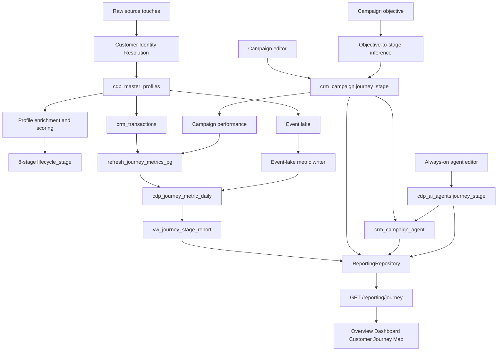
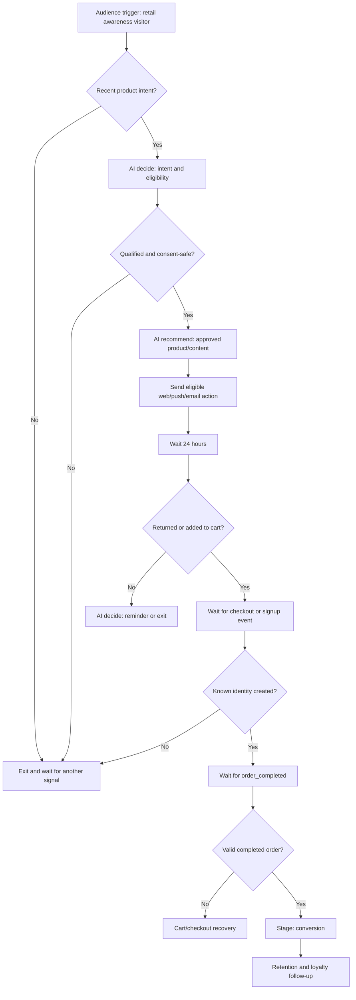
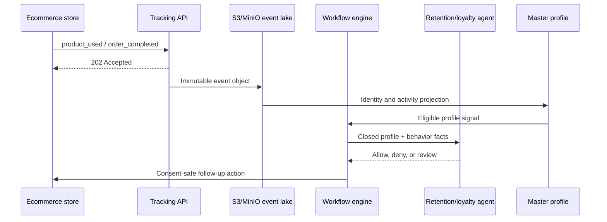
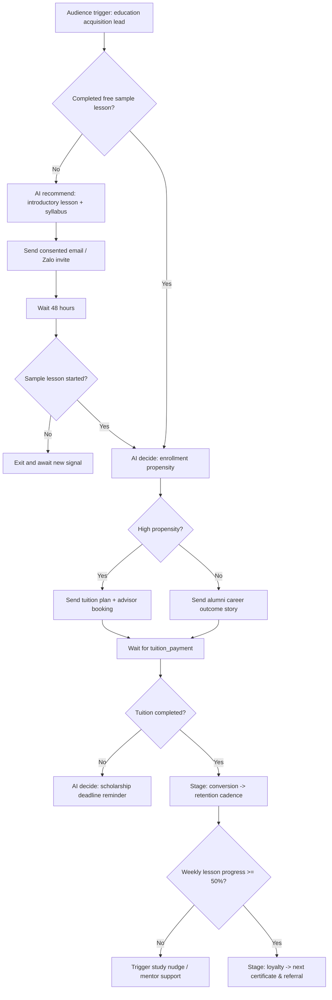
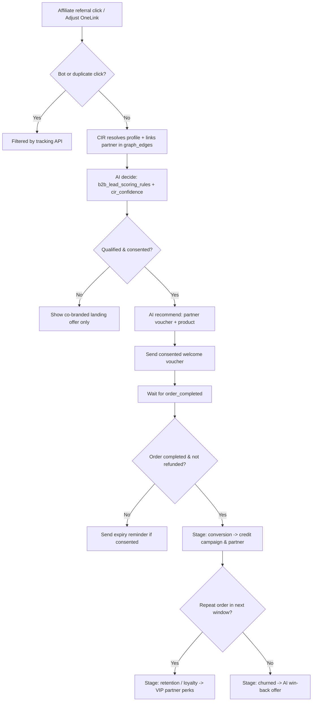

# Customer Journey Map

The Customer Journey Map is the tenant-scoped marketing and analytics report
that tracks how customer profiles progress through eight canonical lifecycle
stages. Each stage combines:

- a primary KPI and supporting stage KPIs with period-over-period comparisons;
- marketing campaigns targeted at the stage;
- campaign-to-agent assignments (`plan`, `decide`, `optimize`); and
- always-on AI agents configured for continuous scoring and optimization.

The report is rendered on the Overview Dashboard
([`overview-dashboard.html`](../../customer360-frontend/static/templates/dashboard/overview-dashboard.html))
and exposed through `GET /reporting/journey`
([`reporting_api.py`](../../customer360-api/core/routers/reporting_api.py))
backed by `customer360.vw_journey_stage_report`.

---

## Table of Contents

1. [The Eight Journey Stages](#1-the-eight-journey-stages)
2. [Source of Truth & Schema Contracts](#2-source-of-truth--schema-contracts)
3. [End-to-End Processing Pipeline](#3-end-to-end-processing-pipeline)
4. [Stage-by-Stage Processing Logic](#4-stage-by-stage-processing-logic)
5. [How to Test Locally](#5-how-to-test-locally)
6. [Troubleshooting](#6-troubleshooting)
7. [Operational & Tenant-Safety Rules](#7-operational--tenant-safety-rules)
8. [End-to-End Industry Use Cases](#8-end-to-end-industry-use-cases)
   - [Use Case 1: E-Commerce (B2C) — Web Visitor to Repeat Buyer](#use-case-1-e-commerce-b2c--web-visitor-to-repeat-buyer)
   - [Use Case 2: Education & EdTech (B2C) — Course Explorer to Enrolled Graduate](#use-case-2-education--edtech-b2c--course-explorer-to-enrolled-graduate)
   - [Use Case 3: Affiliate & Partner Marketing (B2B2C) — Publisher Referral to Settled Conversion](#use-case-3-affiliate--partner-marketing-b2b2c--publisher-referral-to-settled-conversion)
   - [Cross-Use-Case Verification Checklist & SQL](#cross-use-case-verification-checklist--sql)

---

## 1. The Eight Journey Stages

Stages are ordered and rendered consistently across the database, DAO, API,
seeding pipeline, and frontend UI:

| # | Stage (`journey_stage`) | Label | Meaning | Primary KPI (`metric_code`) | Supporting KPI (`metric_code`) | Typical Next Action |
|---:|---|---|---|---|---|---|
| 1 | `awareness` | **Awareness** | A person has been reached or observed but has not yet shown a qualified acquisition signal. | `visitors` (count, higher is better) | `awareness_conversion` (percent) | Build reach, capture consent, and create a recognizable first touch. |
| 2 | `acquisition` | **Acquisition** | A visitor has become an identifiable lead or supplied a qualified acquisition signal. | `new_leads` (count, higher is better) | `acquisition_conversion` (percent) | Qualify and nurture the lead with relevant proof and offers. |
| 3 | `activation` | **Activation** | The person has completed an initial product, app, account, or onboarding milestone. | `activated_users` (count, higher is better) | `activation_conversion` (percent) | Guide the person to the first meaningful value moment. |
| 4 | `engagement` | **Engagement** | The person is actively using the product or interacting across one or more channels. | `active_customers` (count, higher is better) | `purchase_frequency` (ratio) | Increase useful engagement and reduce friction. |
| 5 | `conversion` | **Conversion** | The person has completed a target commercial action, such as an order, booking, or tuition payment. | `orders` (count, higher is better) | `conversion_rate` (percent) | Improve conversion quality, basket size, and repeat intent. |
| 6 | `retention` | **Retention** | A converted customer remains active over a comparison period. | `retention_rate` (percent, higher is better) | `churn_risk_rate` (percent, lower is better) | Protect the relationship and intervene when churn risk rises. |
| 7 | `loyalty` | **Loyalty** | A retained customer repeatedly purchases, advocates, or demonstrates durable high value. | `repeat_purchase_rate` (percent, higher is better) | `referral_rate` (percent) | Reward loyalty, referrals, and premium-tier behavior. |
| 8 | `churned` | **Churned** | A customer has stopped engaging or purchasing in the current window compared with the prior window. | `churn_rate` (percent, lower is better) | `winback_rate` (percent, higher is better) | Trigger re-engagement, win-back, or suppression-safe recovery journeys. |

> **Note:** `churned` is a canonical journey stage, distinct from the
> predictive `churn_risk_tier` column (`low`, `medium`, `high`, `critical`) on
> `cdp_master_profiles`. A customer can have `churn_risk_tier = 'high'` while
> still in `retention`; `churned` represents customers who have lapsed and are
> tracked by the Churned stage and win-back programs.

---

## 2. Source of Truth & Schema Contracts

The canonical 8-stage vocabulary is defined in
[`journey.py`](../../customer360-dao/src/leo_customer360_dao/schemas/journey.py):

```text
awareness | acquisition | activation | engagement | conversion | retention | loyalty | churned
```

The database enforces this exact vocabulary via `CHECK` constraints across:

- `customer360.cdp_master_profiles.lifecycle_stage`
- `customer360.crm_campaign.journey_stage`
- `customer360.cdp_ai_agents.journey_stage`
- `customer360.cdp_journey_metric.journey_stage`
- `customer360.cdp_journey_metric_daily.journey_stage`

Schema and migration files:

- [`database-schema.sql`](../../customer360-database/database-schema.sql) — canonical schema definition.
- [`017_agent_campagn_journey.sql`](../../customer360-database/migrations/017_agent_campagn_journey.sql) — adds `journey_stage` to campaigns and AI agents, creates `crm_campaign_agent`, normalizes profile `lifecycle_stage` values across tenants under RLS, and seeds `LIFECYCLE_BEHAVIOR_*_BASE` persona scoring baselines.
- [`018_journey_report.sql`](../../customer360-database/migrations/018_journey_report.sql) — creates `cdp_journey_metric`, `cdp_journey_metric_domain`, `cdp_journey_metric_daily`, `refresh_journey_metrics_pg(p_tenant, p_date)`, and `vw_journey_stage_report`.

---

## 3. End-to-End Processing Pipeline



### 1. Identity resolution

Raw Adjust, OneSignal, Web Tracking, and other source records are loaded into
`cdp_raw_profiles_stage`. The CIR process consolidates matching raw records
into tenant-scoped `cdp_master_profiles` rows and records the links in
`cdp_profile_links`.

The journey map uses the resolved master profile as its customer-level
identity. It does not infer a cross-tenant profile from an unscoped query.

### 2. Profile enrichment and stage assignment

The demo seeder enriches each resolved profile with:

- `lifecycle_stage`;
- `last_activity_at`;
- `customer_since`;
- engagement and churn scores;
- lead conversion probability;
- historical and predictive CLV; and
- stage-aware segmentation tags and attributes.

For deterministic local testing, the full demo seeder distributes profiles
across all eight stages. Production pipelines may assign stages from business
rules or models, but the stored value must be one of the eight allowed
values.

### 3. Campaign targeting

Campaigns can store an explicit `crm_campaign.journey_stage`. If a campaign
does not yet have an explicit stage, the DAO infers one from its objective
using `infer_journey_stage_from_objective()`:

| Objective examples | Resolved stage |
|---|---|
| `Awareness`, `Brand awareness` | Awareness |
| `Leads`, `Lead generation`, `Acquisition` | Acquisition |
| `App Install`, `Activation`, `Onboarding` | Activation |
| `Visit store`, `Engagement` | Engagement |
| `Conversions`, `Conversion`, `Sales` | Conversion |
| `Retention` | Retention |
| `Loyalty`, `Referral` | Loyalty |
| `Win-back`, `Winback`, `Re-engagement`, `Churn` | Churned |

The campaign editor is the preferred place to set the stage explicitly.
Objective inference is a compatibility fallback, not a replacement for
explicit campaign configuration.

### 4. Campaign and AI-agent association

`crm_campaign_agent` links a campaign to one or more registered AI agents.
Each link has:

- `role`: `plan`, `decide`, or `optimize`;
- `autonomy`: `suggest` or `approve`;
- optional pinned instruction version;
- guardrails; and
- active status.

The report shows these assignments on the campaign card for the matching
stage. It separately shows always-on agents from `cdp_ai_agents` where
`journey_stage` matches the stage. An active agent with no stage can be
treated as cross-stage by the reporting repository.

### 5. KPI catalog and snapshots

`cdp_journey_metric` is the global metric catalog. It defines the label, unit,
source, primary flag, directionality, and applicable business models.
`cdp_journey_metric_daily` stores tenant-scoped values for:

- report date;
- trailing window (`1`, `7`, `30`, or `90` days);
- business model (`B2B`, `B2C`, or `B2B2C`);
- optional domain;
- journey stage;
- metric;
- dimension (`all`, `channel`, `campaign`, `segment`, or `agent`); and
- currency for campaign-derived metrics.

The PostgreSQL function
`customer360.refresh_journey_metrics_pg(tenant_id, report_date)` calculates
transaction, profile, and campaign metrics. Event-lake metrics such as
visitors, leads, activated users, conversion rate, referrals, and win-back
rate are written by the event-lake analytics process using the same snapshot
contract.

The report compares the current snapshot with the snapshot ending one window
earlier:

- count, ratio, currency: relative percentage change when a prior value is
  available;
- percent: point change (`current - previous`);
- `higher_is_better = false` is used for metrics such as churn rate so the UI
  can interpret direction correctly.

### 6. API and dashboard rendering

The API endpoint is:

```http
GET /reporting/journey?days=90&window=30
```

The authenticated tenant is authoritative. A supplied `tenant_id` query
parameter cannot override the tenant from the request authentication context.

The response always contains the eight ordered stage objects, even when a
stage has no current snapshot. In that case the DAO uses the metric catalog
to provide the primary KPI metadata with a `null` value, allowing the
frontend to render an explicit unavailable state rather than silently
omitting the stage.

The dashboard uses:

- the ordered stage ribbon;
- the stage primary KPI;
- period-over-period change;
- supporting metric cards and sparklines;
- campaign cards and assigned-agent badges; and
- always-on agent cards.

---

## 4. Stage-by-Stage Processing Logic

The following describes the processing logic for each stage. The stage is a
canonical business classification; exact event names and thresholds are
tenant-configurable in `cdp_journey_metric.rule`.

### 1. Awareness

**Inputs**

- anonymous or known visitor events;
- page views, ad impressions, content views, or first-touch events;
- campaign reach and attribution data.

**Processing**

1. Deduplicate events by tenant and profile/session identity.
2. Count distinct visitors in the requested trailing window.
3. Calculate the transition rate from visitors to the configured next-stage
   signal.
4. Attribute active awareness campaigns and their assigned agents.

**Report metrics**

- `visitors` — primary count;
- `awareness_conversion` — supporting percent.

**Typical agents**

- identity/confidence or reach-quality agent;
- audience discovery and brand-awareness planner.

### 2. Acquisition

**Inputs**

- lead-created or lead-qualified events;
- forms, registrations, account creation, and attributable acquisition
  campaigns;
- acquisition source and campaign fields on the profile.

**Processing**

1. Deduplicate newly acquired profiles or leads.
2. Count distinct new leads.
3. Compare qualified leads with the activation signal.
4. Apply consent, suppression, and tenant campaign rules before activation.

**Report metrics**

- `new_leads` — primary count;
- `acquisition_conversion` — supporting percent.

**Typical agents**

- lead scoring;
- acquisition audience planner;
- source-quality or qualification agent.

### 3. Activation

**Inputs**

- app install;
- account setup;
- onboarding completion;
- first meaningful product action.

**Processing**

1. Identify profiles that completed the tenant's activation event.
2. Count distinct activated users.
3. Compare activated users with the engagement or conversion signal.
4. Rank onboarding, recommendation, or activation content.

**Report metrics**

- `activated_users` — primary count;
- `activation_conversion` — supporting percent.

**Typical agents**

- product recommendation;
- onboarding/nurture agent;
- activation anomaly detector.

### 4. Engagement

**Inputs**

- recent sessions and meaningful product events;
- active customer transactions;
- source-system breadth and interaction history.

**Processing**

1. Determine active profiles in the reporting window.
2. Aggregate transaction-backed active customers and purchase frequency.
3. Combine engagement signals with profile recency and channel breadth.
4. Route engagement campaigns and AI decisions to eligible profiles.

**Report metrics**

- `active_customers` — primary count;
- `purchase_frequency` — supporting ratio.

**Typical agents**

- journey behavior clustering;
- engagement recommendation;
- anomaly detection.

### 5. Conversion

**Inputs**

- completed orders, bookings, subscriptions, or equivalent conversion facts;
- campaign performance records;
- transaction status and currency.

**Processing**

1. Exclude cancelled, failed, and refunded transactions according to the
   metric rule.
2. Count valid orders in each trailing window.
3. Calculate conversion rate from the event-lake conversion denominator.
4. Attribute spend, conversions, and revenue to campaign and agent
   dimensions without combining currencies.

**Report metrics**

- `orders` — primary count;
- `conversion_rate` — supporting percent;
- campaign spend, conversions, and revenue dimensions.

**Typical agents**

- demand forecast;
- offer/recommendation optimizer;
- campaign uplift optimizer.

### 6. Retention

**Inputs**

- current-window buyers;
- previous-window buyers;
- last activity and churn probability;
- support and sentiment events.

**Processing**

1. Build the previous buyer cohort for the same window size.
2. Find buyers present in both previous and current windows.
3. Calculate retained buyers divided by previous buyers.
4. Separately calculate the point-in-time share of active profiles above the
   configured churn probability threshold.

**Report metrics**

- `retention_rate` — primary percent;
- `churn_risk_rate` — supporting percent.

**Typical agents**

- customer experience/sentiment analyzer;
- campaign uplift optimizer;
- retention intervention agent.

### 7. Loyalty

**Inputs**

- repeat orders;
- customer tenure;
- membership tier;
- referrals, advocacy, and high-value behavior.

**Processing**

1. Count buyers with at least two valid purchases in the window.
2. Divide repeat buyers by current-window buyers.
3. Combine repeat-purchase data with CLV, tenure, and referral events for
   loyalty audiences.
4. Keep referral and campaign attribution tenant- and currency-safe.

**Report metrics**

- `repeat_purchase_rate` — primary percent;
- `referral_rate` — supporting percent.

**Typical agents**

- CLV regression;
- loyalty/premium upsell agent;
- referral optimization agent.

### 8. Churned

**Inputs**

- customer inactivity;
- lost or declining purchase behavior;
- high churn probability;
- win-back and re-engagement events.

**Processing**

1. Compare the previous buyer cohort with current buyers.
2. Count previous buyers who did not return.
3. Calculate churn rate as lost buyers divided by previous buyers.
4. Track win-back outcomes separately; a successful win-back does not erase
   the historical churned-stage measurement.
5. Apply suppression, consent, and quiet-hour rules before sending recovery
   actions.

**Report metrics**

- `churn_rate` — primary percent, lower is better;
- `winback_rate` — supporting percent.

**Typical agents**

- churn prediction;
- next-best-action;
- win-back/re-engagement optimizer.

---

## 5. How to Test Locally

### Prerequisites

Use the repository's normal local environment and ensure PostgreSQL,
Redis, object storage, and the application services required by the demo are
running. Do not copy credentials into this document or commit `.env` files.

### Full reset and demo seed

From the repository root:

```bash
./dev-c360.sh reset -y
```

The reset flow rebuilds the local database, applies the canonical schema and
migrations, then runs the demo pipeline:

1. seed raw Adjust/OneSignal/Web Tracking profiles;
2. run Customer Identity Resolution;
3. seed CRM campaigns, campaign-agent links, and AI agents;
4. enrich master profiles across all eight stages;
5. seed transactions, contacts, personas, and behavioral events;
6. refresh PostgreSQL journey metrics; and
7. populate event-lake-style journey snapshots for current and comparison
   windows.

The identity-resolution demo can also be run directly:

```bash
(cd customer360-backend/identity_resolution && bash run-demo.sh)
```

The demo uses tenant
`11111111-1111-1111-1111-111111111111` by default.

### Verify profile coverage

Run a tenant-scoped query:

```sql
SELECT lifecycle_stage, COUNT(*) AS profile_count
FROM customer360.cdp_master_profiles
WHERE tenant_id = '11111111-1111-1111-1111-111111111111'
GROUP BY lifecycle_stage
ORDER BY CASE lifecycle_stage
    WHEN 'awareness' THEN 1
    WHEN 'acquisition' THEN 2
    WHEN 'activation' THEN 3
    WHEN 'engagement' THEN 4
    WHEN 'conversion' THEN 5
    WHEN 'retention' THEN 6
    WHEN 'loyalty' THEN 7
    WHEN 'churned' THEN 8
END;
```

Expected result: all eight stage values are present after a full demo seed.

### Verify campaign and agent coverage

```sql
SELECT journey_stage, COUNT(*) AS campaign_count
FROM customer360.crm_campaign
WHERE tenant_id = '11111111-1111-1111-1111-111111111111'
GROUP BY journey_stage
ORDER BY journey_stage;

SELECT journey_stage, COUNT(*) AS agent_count
FROM customer360.cdp_ai_agents
WHERE journey_stage IS NOT NULL
GROUP BY journey_stage
ORDER BY journey_stage;

SELECT c.journey_stage, c.name, ca.agent_code, ca.role, ca.autonomy
FROM customer360.crm_campaign c
LEFT JOIN customer360.crm_campaign_agent ca
  ON ca.tenant_id = c.tenant_id
 AND ca.campaign_id = c.campaign_id
 AND ca.is_active = TRUE
WHERE c.tenant_id = '11111111-1111-1111-1111-111111111111'
ORDER BY c.journey_stage, c.name, ca.role;
```

### Verify KPI snapshots

```sql
SELECT
    report_date,
    window_days,
    journey_stage,
    metric_code,
    value,
    previous_value,
    change,
    change_kind
FROM customer360.vw_journey_stage_report
WHERE tenant_id = '11111111-1111-1111-1111-111111111111'
  AND dim_type = 'all'
  AND domain_code IS NULL
ORDER BY window_days, journey_stage, metric_code;
```

For a direct refresh of PostgreSQL-sourced metrics, set the tenant context
first because the function validates the RLS tenant:

```sql
SELECT set_config(
    'app.tenant_id',
    '11111111-1111-1111-1111-111111111111',
    false
);

SELECT customer360.refresh_journey_metrics_pg(
    '11111111-1111-1111-1111-111111111111'::uuid,
    CURRENT_DATE
);
```

### Verify the API

With the API running and an authenticated tenant session:

```bash
curl -sS 'http://localhost:8000/reporting/journey?days=90&window=30' \
  -H 'Authorization: Bearer <local-token>' | jq .
```

Verify that:

- `stages` contains exactly eight objects in the documented order;
- each stage has the expected `stage` and `label`;
- the primary metric is present even when its value is `null`;
- `campaigns` only contains campaigns for that stage;
- campaign agents include `plan`, `decide`, or `optimize` roles; and
- `agents` contains matching always-on agents.

The endpoint is tenant-isolated. A `tenant_id` query parameter that differs
from the authenticated tenant returns `403`.

### Verify the dashboard

Open the dashboard overview page in the frontend and inspect the Customer
Journey Map. Check:

1. the eight-stage ribbon is ordered from Awareness to Churned;
2. selecting a stage updates the stage card/details;
3. KPI values, prior-period changes, and unavailable states are explicit;
4. campaign cards show status, objective, and agent roles; and
5. Churned uses a lower-is-better churn-rate presentation and includes
   win-back context.

### Automated tests

Targeted journey and schema tests:

```bash
customer360-api/.venv/bin/pytest \
  customer360-database/tests/test_campaign_agent_schema.py \
  customer360-database/tests/test_journey_reporting_schema.py \
  customer360-dao/src/tests/test_journey_contracts.py \
  customer360-dao/src/tests/test_persona_engine.py \
  customer360-seeding/test_seed_full_demo_data.py \
  customer360-api/tests/test_reporting_journey_api.py
```

Run the broader service test suites when changing shared profile, campaign,
or reporting contracts.

---

## 6. Troubleshooting

### The migration fails while adding `lifecycle_stage` constraint

The migration must run after the base schema and before the journey report
migration. The current migration scopes updates by tenant because the profile
tables use forced RLS. Re-run from the database-schema step after deploying
the updated migration:

```bash
./deployments/deploy-all.sh uat apply --from db-schema
```

Do not disable RLS or add legacy values back to the constraint. If the error
continues, inspect invalid values with a privileged, tenant-scoped operational
query and check that the deployment role can set the `app.tenant_id` session
setting.

### A stage shows “Not available”

Check, in order:

1. `cdp_journey_metric` contains an active primary metric for the stage;
2. `cdp_journey_metric_daily` has a current row for the requested
   `window_days`;
3. `business_model` matches the tenant (`B2B`, `B2C`, or `B2B2C`);
4. `dim_type = 'all'` and `domain_code IS NULL` exist for the general report;
5. event-lake metrics have been written; and
6. the reporting cache has expired or has been invalidated.

The API may still return the stage and catalog KPI metadata when a snapshot is
missing. That is intentional and distinguishes “stage exists, data is
unavailable” from “stage was not implemented.”

### A campaign appears on the wrong stage

Inspect `crm_campaign.journey_stage` first. If it is `NULL`, compare the
objective with the objective mapping in
[`journey.py`](../../customer360-dao/src/leo_customer360_dao/schemas/journey.py).
Set the targeted stage explicitly in the campaign editor when the objective
wording is ambiguous.

### A campaign has no agent badge

Check that:

- the campaign and agent belong to the same tenant;
- `crm_campaign_agent.is_active = TRUE`;
- `agent_code` exists in `cdp_ai_agents`; and
- the assignment role is `plan`, `decide`, or `optimize`.

### Churned is empty

Churned requires both a valid current/previous buyer comparison for
`churn_rate` and event-lake or seeded data for `winback_rate`. Check
transaction dates, excluded transaction statuses, current and previous
windows, and the `churned` agent/campaign assignments separately.

---

## 7. Operational & Tenant-Safety Rules

- Always filter reporting data by the authenticated `tenant_id`.
- Always set `app.tenant_id` before writing or refreshing RLS-protected
  tenant tables.
- Never combine campaign currency totals across currencies.
- Treat `churn_risk_tier` as a risk score bucket, not a journey stage.
- Treat campaign approval, workflow approval, and execution status as
  separate controls.
- Do not use the journey report to send messages directly; activation and
  workflow execution remain explicit, approval-gated operations.

---

## 8. End-to-End Industry Use Cases

The three end-to-end use cases below show how web/app tracking, Customer
Identity Resolution (CIR), Audience Builder segments, AI agents, campaign
workflows, and transaction ledgers work together across all 8 stages for:

| Use Case | Business Model (`sys_tenant.business_model`) | Primary Domain (`sys_domain.domain_code`) | Core Journey Arc |
|---|---|---|---|
| **Use Case 1: E-Commerce** | `B2C` | `retail` | Anonymous storefront visitor → cart/account activation → first order (`conversion`) → repeat buyer (`loyalty`) / win-back (`churned`). |
| **Use Case 2: Education & EdTech** | `B2C` | `education` | Syllabus explorer → webinar/trial lead (`acquisition`) → trial lesson (`activation`) → tuition enrollment (`conversion`) → course completion (`retention`) → advanced certificate & referral (`loyalty`). |
| **Use Case 3: Affiliate & Partner Marketing** | `B2B2C` | `retail` / `travel` | Partner/publisher referral link click (`awareness`) → co-branded lead capture (`acquisition`) → app/account onboarding (`activation`) → merchant order + partner commission (`conversion`) → multi-merchant repeat (`retention`/`loyalty`) → partner/consumer reactivation (`churned`). |

---

### Use Case 1: E-Commerce (B2C) — Web Visitor to Repeat Buyer

This use case shows how a `B2C` retail ecommerce tenant (`domain = 'retail'`)
uses web tracking, identity resolution, an AI-assisted campaign workflow, and
transaction events to convert an anonymous visitor into a repeat customer.

#### Business Goal

An ecommerce retailer wants to:

1. identify anonymous visitors who show product intent;
2. nurture those visitors without exposing or inventing personal data;
3. convert the visitor into a registered and paying customer;
4. measure each stage transition; and
5. continue the relationship with retention and loyalty journeys.

The campaign is called **Ecommerce First Purchase Conversion** and targets
the `retail` domain.

#### Actors and Data Components

| Component | Responsibility |
|---|---|
| Ecommerce web SDK | Emits page, search, product, cart, checkout, and purchase events. |
| `customer360-event-api` | Validates and accepts tracking batches, then queues them without a database connection. |
| Redis Stream | Durable handoff between the public tracking API and the object-storage worker. |
| S3/MinIO Bronze event lake | Stores immutable compressed NDJSON event objects and processed markers. |
| CIR worker | Matches anonymous and known identities into `cdp_master_profiles` and `cdp_profile_links`. |
| Segment engine | Computes audience membership from profile and event-derived attributes. |
| Campaign workflow | Executes the approved per-profile graph with waits, conditions, AI nodes, and actions. |
| AI agents | Plan, decide, or optimize the next eligible action using supplied facts and guardrails. |
| Ecommerce webhook | Sends registration, checkout, and order-completed events. |
| Journey reporting | Writes and reads stage KPI snapshots for the dashboard. |

#### Campaign and Agent Configuration

Before activation, a marketer configures the campaign in the campaign editor:

```text
Campaign: Ecommerce First Purchase Conversion
Business Model: B2C
Domain: retail
Targeted Journey Stage: awareness
Objective: Conversions
Channel: Email / web notification / push, depending on consent
```

The explicit targeted stage is `awareness`, even though the objective
`Conversions` normally infers `conversion`. The explicit stage is important:
this campaign starts with visitors and is intended to move them through the
funnel. Objective inference is only a fallback when no explicit stage has
been saved.

Example campaign-agent assignments:

| Agent | Role | Purpose in this campaign |
|---|---|---|
| `lead_scoring` | `decide` | Scores whether the visitor has enough intent to enter nurture. |
| `product_recommendation` | `optimize` | Selects a product or content recommendation from the closed candidate set. |
| `campaign_planner` | `plan` | Produces a plan from the supplied audience, objective, constraints, and approved content. |
| `next_best_action` | `decide` | Chooses the next eligible action after a new signal. |
| `churn_prediction_v2` | `decide` | Used later for retention or win-back risk, not for unconsented acquisition. |

The campaign-agent relationship is stored in `crm_campaign_agent`. The
always-on agents used by the stage map are stored in
`cdp_ai_agents.journey_stage`.

#### Workflow Graph

The marketer creates and approves a workflow similar to:



The actual workflow must use the repository's supported node types and
persisted flow version. AI nodes do not bypass approval or directly publish a
campaign. They return a decision or recommendation that the workflow engine
evaluates against consent, suppression, connector, quiet-hour, and provider
rules.

#### Step 1: Anonymous Visitor Enters Awareness (`awareness`)

When the visitor opens the storefront, the web SDK generates stable
anonymous/session identifiers and emits a batch:

```bash
curl -i -X POST \
  'http://localhost:8010/api/v1/tracking/logs' \
  -H 'Content-Type: application/json' \
  -d '{
    "data_source_id": "11111111-1111-1111-1111-111111111111",
    "session_id": "web-session-7f2a",
    "anonymous_id": "web-anon-91ab",
    "device_fingerprint": "web-fingerprint-44cd",
    "metadata": {
      "source": "web",
      "domain": "retail",
      "utm_source": "google",
      "utm_campaign": "summer-running-shoes"
    },
    "events": [
      {
        "event_name": "page_view",
        "page_url": "https://shop.example.test/",
        "properties": {
          "page_type": "home"
        }
      },
      {
        "event_name": "product_view",
        "page_url": "https://shop.example.test/products/running-shoes",
        "properties": {
          "product_id": "shoe-1001",
          "category": "running-shoes"
        }
      },
      {
        "event_name": "search",
        "properties": {
          "query": "lightweight running shoes"
        }
      }
    ]
  }'
```

The tracking API:

1. validates the request size, identity fields, event structure, and dynamic
   properties;
2. rejects malformed or bot traffic according to tracking policy;
3. returns `202 Accepted` after publishing the batch to Redis Streams;
4. writes an immutable gzip-compressed NDJSON object to the source bucket;
5. writes a `_processed/<object-id>.json` marker after the object succeeds; and
6. does not connect directly to PostgreSQL.

At this point the visitor is an Awareness signal. The event is not yet a
known customer and should not be treated as a CRM contact unless the tenant
has a valid identity and an allowed activation path.

The Awareness report receives:

- a visitor count from distinct event identities;
- campaign attribution from UTM/source metadata;
- `awareness_conversion` when the configured next-stage event is observed.

#### Step 2: Intent Detection Moves the Visitor Toward Acquisition (`acquisition`)

An event-lake projection or analytics job consumes the immutable event object.
It derives non-PII behavioral facts such as:

```text
product_view_count = 3
search_count = 1
category = running-shoes
cart_value = 0
last_seen_at = current event time
source = google
```

The segment engine can use these facts through persisted profile attributes,
event projections, or a precomputed audience segment. A practical segment is:

```sql
domain = 'retail'
AND lifecycle_stage = 'awareness'
AND engagement_score >= 40
AND last_activity_at >= (now() - INTERVAL '7 days')
```

The AI decision agent receives only the closed input contract supplied by the
workflow. For example:

```json
{
  "profile": {
    "domain": "retail",
    "lifecycle_stage": "awareness",
    "engagement_score": 68,
    "preferred_channel": "Website",
    "source_systems": ["WebTracking"]
  },
  "behavior": {
    "product_view_count": 3,
    "search_count": 1,
    "cart_value": 0
  },
  "campaign": {
    "journey_stage": "awareness",
    "objective": "Conversions"
  },
  "candidate_content_item_ids": [
    "approved-product-card-1001",
    "approved-guide-running-shoes"
  ]
}
```

The agent may return a decision such as:

```json
{
  "decision": "allow",
  "next_stage": "acquisition",
  "reason_codes": ["high_product_intent", "recent_activity"],
  "recommended_action": "show_product_guide"
}
```

The agent must not invent a profile identity, product ID, template ID, or
personalized claim. If a required fact or consent signal is absent, it returns
`deny` or `review`, and the workflow exits or waits.

#### Step 3: Consent-Safe Nurture Action

The recommendation agent selects only from the closed list of approved
content. A possible action is:

```text
Show the approved running-shoe guide on the website
or display a consent-safe web notification.
```

For an anonymous visitor, the workflow should prefer an on-site or anonymous
session action. It must not send email or SMS merely because a hashed or
unverified identifier appears in an event. A message channel requires:

- an identity mapped to the profile;
- explicit channel consent;
- no active suppression record;
- a configured connector;
- valid template/content eligibility; and
- quiet-hour and frequency-cap checks.

The workflow records reached nodes and action outcomes in the action ledger.
An action that is skipped because consent is unavailable is different from a
workflow failure and must remain observable.

#### Step 4: Visitor Identifies and Reaches Activation (`activation`)

The visitor clicks the guide, creates an account, or submits checkout details.
The ecommerce site then sends an identity-bearing event. A webhook producer
authenticates the request with the tenant and data-source headers and, where
configured, HMAC:

```bash
curl -i -X POST \
  'https://api.example.test/data/api/v1/tracking/logs' \
  -H 'Content-Type: application/json' \
  -H 'X-Tenant-Id: 11111111-1111-1111-1111-111111111111' \
  -H 'X-Data-Source-Id: 22222222-2222-2222-2222-222222222222' \
  -H 'X-Signature-SHA256: <computed-hmac>' \
  -d '{
    "event_name": "account_created",
    "event_time": "2026-10-28T11:30:00Z",
    "profile_identities": {
      "email": "shopper@example.test",
      "external_customer_id": "shopper-0082",
      "device_id": "web-device-44cd"
    },
    "event_data": {
      "account_id": "acct-0082",
      "consent": {
        "email_opt_in": true,
        "push_opt_in": true
      }
    },
    "touchpoint_metadata": {
      "channel": "online_store",
      "source_url": "https://shop.example.test/register"
    }
  }'
```

The event is processed asynchronously. CIR uses the available identifiers and
existing identity links to consolidate the visitor's anonymous touch with a
master profile. The profile now has stronger Acquisition or Activation
evidence:

```text
source_systems = ["WebTracking"]
external_ids includes shopper-0082
communication_preferences.email_opt_in = true
communication_preferences.push_opt_in = true
lifecycle_stage = activation
```

The stage assignment is made by the profile enrichment or lifecycle pipeline;
the tracking API itself only validates and stores the event.

#### Step 5: Workflow Execution After Approval (`engagement`)

The campaign is not executed when it is merely saved. The required sequence
is:

1. Save the campaign and explicit targeted stage.
2. Save the workflow graph and segment association.
3. Assign campaign agents and guardrails.
4. Submit the campaign for human review.
5. Approve the campaign.
6. Approve the pinned workflow version.
7. Start the campaign through the activation API.
8. The activation job validates tenant, approval, active segment, and workflow
   readiness.
9. The activation job creates or reuses an execution ID and submits the
   workflow child run.
10. The per-profile flow engine evaluates conditions and AI nodes.

The workflow evaluates the newly identified profile:

```text
profile.lifecycle_stage = activation
profile.email_opt_in = true
profile.push_opt_in = true
profile.suppressed_channels = []
profile.last_activity_at = recent
```

The AI decide node can allow a push or email reminder. The notification
planner selects one approved template and fills only declared variables:

```json
{
  "template_id": "approved-first-purchase-template",
  "template_data": {
    "first_name": "provided-by-approved-profile-field",
    "product_url": "provided-by-approved-candidate-content"
  },
  "action_plan": [
    "Send one push reminder during the permitted local-time window"
  ]
}
```

If `email_opt_in` is false, the workflow must not fall back silently to
email. It may choose an explicitly eligible channel, wait for consent, or
exit with a recorded reason.

#### Step 6: Checkout and Order Completion (`conversion`)

When the visitor places an order, the ecommerce platform sends a signed
`order_completed` event:

```json
{
  "event_name": "order_completed",
  "event_time": "2026-10-28T12:15:00Z",
  "profile_identities": {
    "email": "shopper@example.test",
    "external_customer_id": "shopper-0082"
  },
  "event_data": {
    "order_id": "ORD-0082-1001",
    "currency": "VND",
    "order_value": 1290000,
    "item_count": 1,
    "items": [
      {
        "sku": "shoe-1001",
        "quantity": 1,
        "price": 1290000
      }
    ],
    "transaction_status": "completed"
  },
  "touchpoint_metadata": {
    "channel": "online_store",
    "campaign_id": "ecommerce-first-purchase-conversion"
  }
}
```

The event is persisted to the event lake, while the commerce/transaction
pipeline writes a valid completed row to `crm_transactions`. The conversion
metric excludes cancelled, failed, and refunded statuses.

The profile is now a Conversion-stage customer for the journey map:

```text
lifecycle_stage = conversion
customer_since = 2026-10-28
last_activity_at = order event time
historical_clv = order value
```

The conversion workflow can then:

- record campaign attribution;
- stop the acquisition reminder branch;
- send a post-purchase onboarding action;
- schedule a retention wait; and
- expose the order in `orders`, `conversion_rate`, campaign conversion, and
  revenue metrics.

#### Step 7: Repeat Purchase and Advocacy (`retention` & `loyalty`)

After the order, a retention workflow waits for product use, repeat browsing,
support interaction, or a second order:



When the customer purchases again within the comparison period:

- `repeat_purchase_rate` increases;
- the profile progresses to `loyalty`;
- `clv_regression_v1` / `clv_prediction` updates predicted value;
- the loyalty campaign offers referral or VIP benefits; and
- the Journey Map attributes the campaign and agent to Loyalty.

#### Step 8: Inactivity and Win-Back (`churned`)

If the customer does not return:

1. the previous buyer cohort remains the comparison denominator;
2. the current window shows no valid purchase;
3. the lost buyer contributes to `churn_rate`;
4. the profile is assigned `churned` by the lifecycle pipeline; and
5. `churn_prediction_v2` and `next_best_action` evaluate whether a recovery
   action is permitted.

A successful win-back is recorded as a new activity/conversion signal and
contributes to `winback_rate`; it does not rewrite historical snapshots.

---

### Use Case 2: Education & EdTech (B2C) — Course Explorer to Enrolled Graduate

This use case demonstrates how an online learning academy or university
(`business_model = 'B2C'`, `domain = 'education'`) tracks prospective learners
from anonymous curriculum browsing through trial lessons, tuition payment,
active course progress, certificate completion, and alumni upsell.

#### Business Goal

An EdTech provider wants to:

1. capture prospective students researching career certificates (`awareness`);
2. convert webinar or syllabus downloaders into qualified applicants (`acquisition`);
3. guide applicants to complete a free diagnostic or sample lesson (`activation`);
4. nurture engaged trial learners into paid tuition enrollment (`conversion`);
5. monitor weekly lesson completion to prevent course drop-off (`engagement` & `retention`); and
6. graduate learners into advanced pathways and alumni referrals (`loyalty`) or re-engage stalled learners (`churned`).

The campaign is called **Data & AI Certificate Enrollment Journey** and targets
the `education` domain.

#### Actors and Data Components

| Component | Responsibility |
|---|---|
| Learning Portal Web & Mobile SDK | Emits `view-course`, `download-syllabus`, `start-lesson`, `complete-lesson`, and `complete-course` events (`event_category = 'EDUCATION'`). |
| `customer360-event-api` | Validates and queues learner behavioral events to S3/MinIO without direct database writes. |
| CIR & Domain Profile Engine | Resolves learner identity into `cdp_master_profiles` and stores education-specific attributes (`student_id`, `enrolled_programs`, `learning_mode`, `course_completion_rate`) in `cdp_domain_profiles`. |
| Audience Builder (`cdp_segments`) | Evaluates education segments (for example, `lifecycle_stage IN ('awareness', 'acquisition', 'activation') AND domain = 'education'`). |
| AI Agents (`cdp_ai_agents`) | Scores enrollment propensity, recommends courses from `cdp_content_items`, and detects lesson-completion drop-offs. |
| LMS / Tuition Billing Webhook | Pushes `course_enrollment`, `tuition_payment`, and `certification_fee` transactions into `crm_transactions`. |

#### Campaign and Agent Configuration

```text
Campaign: Data & AI Certificate Enrollment Journey
Business Model: B2C
Domain: education
Targeted Journey Stage: acquisition
Objective: Leads
Channel: Email / Mobile App Push / Zalo OA
```

Assigned campaign and stage agents:

| Agent | Role | Stage | Responsibility in Education Journey |
|---|---|---|---|
| `lead_scoring` | `decide` | `acquisition` | Scores prospective students based on syllabus views, webinar attendance, and career track interest. |
| `product_recommendation` | `optimize` | `activation` | Recommends the best-fit introductory module or scholarship guide from approved `cdp_content_items`. |
| `journey_behavior_clustering` | `decide` | `engagement` | Clusters study cadence (`self_paced`, `instructor_led`, `hybrid`) and flags learners falling behind. |
| `cx_sentiment_llm_v1` | `decide` | `retention` | Analyzes mentor/support feedback to trigger academic advisor outreach before drop-out. |
| `clv_prediction` | `optimize` | `loyalty` | Identifies high-completion graduates for advanced degree tracks and alumni referral rewards. |
| `next_best_action` | `decide` | `churned` | Selects cohort deferral or refresher offers for inactive learners. |

#### Workflow Graph



#### Step 1: Prospective Learner Explores Curriculum (`awareness` → `acquisition`)

A prospective learner visits the academy website from a search campaign, views
the **AI Foundations** curriculum, and requests the syllabus:

```bash
curl -i -X POST \
  'http://localhost:8010/api/v1/tracking/logs' \
  -H 'Content-Type: application/json' \
  -d '{
    "data_source_id": "11111111-1111-1111-1111-111111111111",
    "session_id": "edu-session-301",
    "anonymous_id": "edu-anon-8841",
    "device_fingerprint": "edu-fp-9920",
    "metadata": {
      "source": "web",
      "domain": "education",
      "utm_source": "google",
      "utm_campaign": "vn_edu_scholarship_q4"
    },
    "events": [
      {
        "event_name": "start-course",
        "page_url": "https://academy.example.test/programs/ai-foundations",
        "properties": {
          "program_code": "AI-FOUND-101",
          "learning_mode": "hybrid",
          "preview": true
        }
      }
    ]
  }'
```

When the learner submits the syllabus form with explicit email/Zalo consent,
CIR resolves the profile with `domain = 'education'` and `lifecycle_stage = 'acquisition'`,
incrementing `new_leads` on the Acquisition stage card.

#### Step 2: Sample Lesson Onboarding (`activation`)

The approved workflow invokes `product_recommendation` to select an introductory
lesson from `cdp_content_items` (`domain = 'education'`) and sends a consented
invitation. When the learner completes the sample lesson:

```json
{
  "event_name": "complete-lesson",
  "event_time": "2026-10-28T14:10:00Z",
  "profile_identities": {
    "email": "learner.minh@example.test",
    "external_customer_id": "STU-204910"
  },
  "event_data": {
    "course_code": "AI-FOUND-101",
    "lesson_id": "LESSON-01",
    "completion_seconds": 1420
  },
  "touchpoint_metadata": {
    "channel": "web",
    "source_url": "https://academy.example.test/learn/ai-foundations/lesson-1"
  }
}
```

The profile advances to `lifecycle_stage = 'activation'` and increments
`activated_users` and `activation_conversion`.

#### Step 3: Tuition Enrollment (`conversion`) and Study Progress (`engagement` / `retention`)

When the learner pays tuition (`transaction_type = 'tuition_payment'` or
`course_enrollment` in `crm_transactions` with `transaction_status = 'completed'`),
`refresh_journey_metrics_pg` counts the transaction in `orders` (Conversion)
and `active_customers` (Engagement).

The learner's education domain profile (`cdp_domain_profiles`) tracks ongoing
progress:

```json
{
  "student_id": "STU-204910",
  "institution_name": "Demo Online Academy",
  "learning_mode": "hybrid",
  "course_completion_rate": 0.82,
  "enrolled_programs": ["AI Foundations", "Data Analytics Certificate"]
}
```

#### Step 4: Graduation, Advanced Tracks & At-Risk Recovery (`loyalty` & `churned`)

- **Loyalty (`loyalty`)**: Learners who enroll in a second certificate or pay
  `certification_fee` in a subsequent window increase `repeat_purchase_rate`,
  while alumni referrals increase `referral_rate`.
- **Churned (`churned`)**: Learners whose `course_completion_rate` stalls and
  who do not enroll in the next term are captured in `churn_rate` and routed to
  the `churned` stage win-back workflow (offering cohort transfer or a
  refresher module, subject to consent and suppression checks).

---

### Use Case 3: Affiliate & Partner Marketing (B2B2C) — Publisher Referral to Settled Conversion

This use case shows how a tenant operating a `B2B2C` go-to-market model
(`sys_tenant.business_model = 'B2B2C'`) orchestrates journeys that involve both
**B2B affiliate partners/publishers** (`crm_account` / `crm_contact`) and
**referred end consumers** (`cdp_master_profiles`) connected through
`customer360.graph_edges`.

#### Business Goal

A marketplace / partner-driven business wants to:

1. attribute inbound consumer traffic to specific affiliate publishers, KOLs,
   or B2B distribution partners (`awareness`);
2. verify traffic quality and filter bot/fraud clicks before attributing leads (`acquisition`);
3. onboard referred consumers through co-branded landing pages or app installs (`activation`);
4. convert referred consumers into settled orders while attributing partner
   revenue and commission (`conversion`);
5. retain both the end consumer and high-performing affiliate partners (`retention` & `loyalty`); and
6. detect inactive referred cohorts or dormant affiliate partners for win-back (`churned`).

The campaign is called **Partner Co-Branded Seasonal Promotion** and runs on a
tenant with `business_model = 'B2B2C'`.

#### Actors and Data Components

| Component | Responsibility |
|---|---|
| Partner Tracking Links & Web/Adjust SDK | Captures click and install events carrying `utm_source=affiliate`, `utm_medium=partner`, `utm_campaign`, and `partner_account_id`. |
| `customer360-event-api` | Filters bot User-Agents (`accepted=false, filtered=true`), enforces rate limits, and writes valid referral events to S3/MinIO. |
| B2B CRM Entities (`crm_account`, `crm_contact`) | Represents the affiliate publisher or partner organization and its account manager. |
| Relationship Graph (`graph_edges` & `cdp_relations`) | Links the referred `cdp_master_profiles` consumer to the partner `crm_account` / `crm_contact` (`from_type = 'cdp_master_profiles'`, `to_type = 'crm_contact'`). |
| `cdp_journey_metric_daily` (`business_model = 'B2B2C'`) | Stores `B2B2C` KPI snapshots across `all`, `channel`, `campaign`, `segment`, and `agent` dimensions. |
| Settlement & Order Ledger (`crm_transactions`) | Records the consumer's purchase (`transaction_status = 'completed'`) and excludes `cancelled`, `failed`, or `refunded` orders from conversion and partner payout metrics. |

#### Campaign and Agent Configuration

Ensure the tenant's go-to-market model is set to `B2B2C`:

```sql
UPDATE customer360.sys_tenant
SET business_model = 'B2B2C'
WHERE tenant_id = '11111111-1111-1111-1111-111111111111';
```

Campaign configuration:

```text
Campaign: Partner Co-Branded Seasonal Promotion
Business Model: B2B2C
Domain: retail (or travel)
Targeted Journey Stage: acquisition
Objective: Conversions
Channel: Paid Social / Affiliate Partner Network / Push / Email
```

Assigned campaign and stage agents:

| Agent | Role | Stage | Responsibility in B2B2C Affiliate Journey |
|---|---|---|---|
| `data_quality_cir_confidence` | `decide` | `awareness` | Evaluates identifier uniqueness and CIR match confidence on inbound affiliate traffic. |
| `b2b_lead_scoring_rules` | `decide` | `acquisition` | Scores partner-referred leads using partner tier, landing-page engagement, and profile completeness. |
| `product_recommendation` | `optimize` | `activation` | Selects co-branded partner offers from the closed `cdp_content_items` catalog. |
| `customer_demand_forecast` | `optimize` | `conversion` | Forecasts voucher/inventory demand for high-volume partner campaigns. |
| `campaign_uplift` | `optimize` | `retention` | Measures incremental uplift of partner co-marketing vs organic repeat purchases. |
| `clv_regression_v1` | `optimize` | `loyalty` | Predicts 90-day net CLV per partner source to optimize partner commission tiers. |
| `churn_prediction_v2` | `decide` | `churned` | Identifies referred customers at high risk of post-promo churn for win-back. |

#### Workflow Graph



#### Step 1: Affiliate Click & Bot-Safe Ingestion (`awareness`)

When a consumer clicks an affiliate publisher's link, the web SDK or mobile
attribution link sends the event with partner attribution metadata:

```bash
curl -i -X POST \
  'http://localhost:8010/api/v1/tracking/logs' \
  -H 'Content-Type: application/json' \
  -d '{
    "data_source_id": "11111111-1111-1111-1111-111111111111",
    "session_id": "aff-session-5501",
    "anonymous_id": "aff-anon-7712",
    "device_fingerprint": "aff-fp-3319",
    "metadata": {
      "source": "affiliate_network",
      "domain": "retail",
      "utm_source": "partner_shopora",
      "utm_medium": "affiliate",
      "utm_campaign": "retail-mega-meta-002",
      "partner_account": "Shopora"
    },
    "events": [
      {
        "event_name": "item-view",
        "page_url": "https://shop.example.test/partner/shopora/deals",
        "properties": {
          "affiliate_code": "AFF-SHOPORA-2026",
          "voucher_code": "SHOPORA15",
          "product_id": "SKU-8821"
        }
      }
    ]
  }'
```

Crawler or scraper traffic with bot User-Agents is filtered at the edge by
`customer360-event-api` (`accepted=false, filtered=true`), protecting both
`visitors` in the Awareness stage and partner click metrics.

#### Step 2: Co-Branded Signup & B2B2C Graph Linking (`acquisition` & `activation`)

When the referred shopper registers or claims the partner voucher:

1. CIR resolves the shopper into `cdp_master_profiles` (`acquisition_source = 'partner_shopora'`, `acquisition_campaign = 'retail-mega-meta-002'`).
2. The partner linkage is recorded in `customer360.graph_edges` connecting the
   consumer (`cdp_master_profiles`) with the partner organization/contact
   (`crm_account` / `crm_contact`), and in `cdp_master_profiles.attributes`:

```json
{
  "affiliate_code": "AFF-SHOPORA-2026",
  "partner_account_name": "Shopora",
  "journey_stage": "activation"
}
```

#### Step 3: Net Order Settlement & Multi-Dimensional Attribution (`conversion`)

When the shopper completes a purchase using the affiliate voucher, the order is
ingested into `crm_transactions` with `campaign_id` and `attributes.affiliate_code`.

Crucially, `refresh_journey_metrics_pg` inspects `cdp_journey_metric.rule` for
`orders`:

```json
{"exclude_status": ["cancelled", "failed", "refunded"]}
```

- Only valid, non-refunded orders are counted in `orders` (`conversion`).
- `refresh_journey_metrics_pg` writes `cdp_journey_metric_daily` rows with
  `business_model = 'B2B2C'` broken down by:
  - `dim_type = 'all'` (overall stage KPI),
  - `dim_type = 'channel'` (for example, `Affiliate` / `Paid Social`),
  - `dim_type = 'campaign'` (specific campaign UUID),
  - `dim_type = 'segment'` (targeted audience segment UUID), and
  - `dim_type = 'agent'` (attributed to each active AI agent in `crm_campaign_agent`).

#### Step 4: Post-Promo Retention, Partner CLV & Win-Back (`retention`, `loyalty`, `churned`)

Affiliate-acquired cohorts often exhibit higher initial churn if they only
bought for a one-time discount:

- **Retention (`retention`)**: `campaign_uplift` and `retention_rate` measure
  what percentage of partner-acquired buyers purchase again in the next window.
- **Loyalty (`loyalty`)**: `clv_regression_v1` evaluates repeat buyers
  (`repeat_purchase_rate`) and consumer-to-consumer referrals (`referral_rate`)
  so the marketing team can reward partners that bring high-CLV buyers rather
  than one-off discount hunters.
- **Churned (`churned`)**: Referred buyers who do not return in the subsequent
  window increase `churn_rate`. `churn_prediction_v2` and `next_best_action`
  trigger a consent-safe co-branded win-back workflow, and recovered buyers are
  measured in `winback_rate`.

---

### Cross-Use-Case Verification Checklist & SQL

Run any of the three use cases in order and verify each boundary:

| Boundary | Verification |
|---|---|
| Web / SDK tracking accepted | `POST /api/v1/tracking/logs` returns `202 Accepted` (bots return `filtered=true`). |
| Event persisted | S3/MinIO contains the immutable `.jsonl.gz` object and `_processed/<object_id>.json` marker. |
| Identity established | `cdp_profile_links` links raw source touches to `cdp_master_profiles`. |
| Domain & B2B2C links | `cdp_domain_profiles` stores domain attributes (`retail`, `education`); `graph_edges` stores partner/contact relationships. |
| Stage assigned | `cdp_master_profiles.lifecycle_stage` is one of the 8 canonical stages (`awareness` .. `churned`). |
| Campaign & workflow ready | Both `crm_campaign.approval_status` and pinned `crm_flow_version.approval_status` are `Approved`. |
| Agent decision & consent | `crm_campaign_workflow_action_runs` records allow/deny/skip outcomes and enforces explicit channel consent. |
| Conversion recorded | `crm_transactions` records completed transactions and excludes `cancelled`, `failed`, and `refunded` statuses. |
| Dashboard updated | `vw_journey_stage_report` and `GET /reporting/journey` return all 8 stages for the tenant's `business_model` (`B2C` or `B2B2C`). |

Useful SQL checks across all three use cases:

```sql
-- 1. Set tenant context for RLS-protected tables.
SELECT set_config('app.tenant_id', '11111111-1111-1111-1111-111111111111', false);

-- 2. Profile distribution across domains and the 8 journey stages (B2C retail, B2C education, B2B2C).
SELECT
    domain,
    lifecycle_stage,
    COUNT(*) AS profile_count,
    ROUND(AVG(engagement_score), 1) AS avg_engagement,
    ROUND(AVG(churn_probability), 3) AS avg_churn_prob
FROM customer360.cdp_master_profiles
WHERE tenant_id = '11111111-1111-1111-1111-111111111111'
GROUP BY domain, lifecycle_stage
ORDER BY domain, CASE lifecycle_stage
    WHEN 'awareness' THEN 1
    WHEN 'acquisition' THEN 2
    WHEN 'activation' THEN 3
    WHEN 'engagement' THEN 4
    WHEN 'conversion' THEN 5
    WHEN 'retention' THEN 6
    WHEN 'loyalty' THEN 7
    WHEN 'churned' THEN 8
END;

-- 3. Education domain profiles and course completion progress (Use Case 2).
SELECT
    dp.master_profile_id,
    dp.lifecycle_stage,
    dp.engagement_score,
    dp.domain_attributes ->> 'student_id' AS student_id,
    dp.domain_attributes ->> 'learning_mode' AS learning_mode,
    dp.domain_attributes ->> 'course_completion_rate' AS course_completion_rate,
    dp.domain_attributes -> 'enrolled_programs' AS enrolled_programs
FROM customer360.cdp_domain_profiles dp
JOIN customer360.sys_domain d ON d.domain_id = dp.domain_id
WHERE dp.tenant_id = '11111111-1111-1111-1111-111111111111'
  AND d.domain_code = 'education'
LIMIT 20;

-- 4. B2B2C partner-to-consumer relationship edges (Use Case 3).
SELECT
    ge.from_type,
    ge.from_id AS master_profile_id,
    ge.relation,
    ge.to_type,
    ge.to_id AS partner_entity_id,
    ge.description
FROM customer360.graph_edges ge
WHERE ge.tenant_id = '11111111-1111-1111-1111-111111111111'
  AND ge.from_type = 'cdp_master_profiles'
ORDER BY ge.created_at DESC
LIMIT 20;

-- 5. Campaign & AI agent attribution in cdp_journey_metric_daily.
SELECT
    journey_stage,
    metric_code,
    dim_type,
    dim_value,
    value,
    currency,
    business_model
FROM customer360.cdp_journey_metric_daily
WHERE tenant_id = '11111111-1111-1111-1111-111111111111'
  AND window_days = 30
  AND dim_type IN ('all', 'channel', 'campaign', 'agent')
ORDER BY report_date DESC, journey_stage, dim_type, metric_code
LIMIT 40;
```