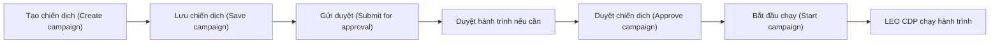

Trang **Campaigns** (danh sách chiến dịch) là nơi tạo, duyệt, chạy và theo dõi hiệu quả chiến dịch. Mỗi chiến dịch gắn với một nhóm khách và một hành trình.

## Dùng khi nào

- Tạo chiến dịch mới cho một nhóm khách.
- Duyệt và khởi chạy chiến dịch.
- So sánh chi phí và kết quả giữa các chiến dịch.
- Chạy thử nghiệm A/B.

## Thao tác chính

### Tạo và chạy chiến dịch

1. Chọn **Create campaign** (tạo chiến dịch), điền tên, chọn nhóm khách ở **Find segment** (tìm nhóm khách).
2. Dựng hành trình trong **Customer journey workflow** (trình dựng hành trình), gồm một sự kiện kích hoạt, điều kiện, thời gian chờ và hành động gửi tin.
3. Chọn **Save campaign** (lưu chiến dịch). Lúc này chưa có tin nào được gửi.
4. Trên trang chi tiết, chọn **Submit for approval** (gửi duyệt).
5. Quản trị viên duyệt hành trình nếu được yêu cầu, chọn **Approve campaign** (duyệt chiến dịch), rồi **Start campaign** (bắt đầu chạy).

### Theo dõi kết quả

Trang danh sách có các chỉ số chi phí, lượt hiển thị, lượt nhấp, chuyển đổi, doanh thu và ROAS (doanh thu thu về trên mỗi đồng chi cho quảng cáo). Trang chi tiết có tab **Performance report** (báo cáo hiệu quả) theo ngày, và tab **Experiments** (thử nghiệm) cho thử nghiệm A/B.

## Câu hỏi thường gặp

**Status** (trạng thái vận hành) khác **Approval State** (trạng thái duyệt) thế nào? Status cho biết chiến dịch đang chạy, tạm dừng hay đã kết thúc. Approval State cho biết chiến dịch đã được duyệt chưa.

**Ai được bấm Start campaign (bắt đầu chạy)?** Quản trị viên tài khoản, sau khi cả chiến dịch và hành trình đã được duyệt.

**Sửa chiến dịch đã duyệt thì sao?** Chiến dịch quay lại trạng thái chờ duyệt.

**ROAS là gì?** Là doanh thu chia cho chi phí quảng cáo. ROAS càng cao thì mỗi đồng quảng cáo mang về càng nhiều doanh thu.

## Liên quan

- [Nhóm khách hàng](segments)
- [Kịch bản theo ngành](../use-cases/)
