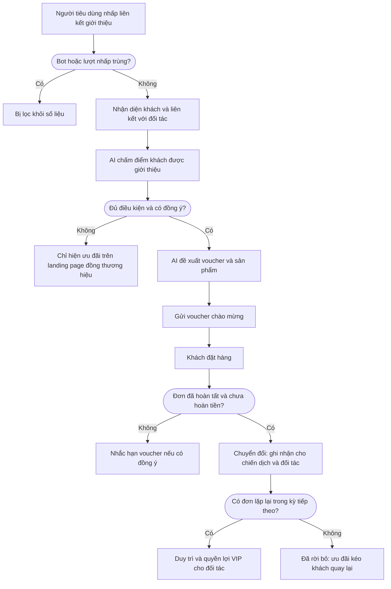

Cách một sàn hoặc doanh nghiệp bán qua đối tác theo dõi hành trình của cả đối tác affiliate lẫn người tiêu dùng được giới thiệu, từ lượt nhấp đến đơn hàng đã quyết toán.

## Mục tiêu kinh doanh

1. Phân bổ lưu lượng cho đúng nhà xuất bản affiliate, KOL hoặc đối tác phân phối.
2. Xác minh chất lượng lưu lượng, lọc lượt nhấp bot hoặc gian lận.
3. Onboarding người được giới thiệu qua landing page đồng thương hiệu hoặc cài ứng dụng.
4. Chuyển họ thành đơn hàng đã quyết toán, phân bổ doanh thu và hoa hồng cho đối tác.
5. Duy trì cả người tiêu dùng lẫn đối tác hiệu quả cao.
6. Phát hiện nhóm không hoạt động hoặc đối tác ngừng hoạt động để kéo khách quay lại.

## Hành trình khách hàng

Xanh lá là việc của khách hàng, xanh dương là việc của LEO CDP, cam là điều kiện.

## Tám giai đoạn

| Giai đoạn | Trong playbook này | Chỉ số chính |
|---|---|---|
| Nhận biết | Người tiêu dùng nhấp liên kết của đối tác. Lưu lượng bot được lọc để bảo vệ số liệu. | Khách truy cập |
| Thu hút | Khách đăng ký hoặc nhận voucher của đối tác. | Khách hàng tiềm năng mới |
| Kích hoạt | Khách onboarding qua landing page đồng thương hiệu hoặc cài ứng dụng. | Người dùng đã kích hoạt |
| Tương tác | Khách đang tương tác qua một hay nhiều kênh. | Khách hàng hoạt động |
| Chuyển đổi | Chỉ đơn hợp lệ, chưa hoàn tiền mới được tính. Số liệu tách theo kênh, chiến dịch, nhóm khách và AI agent. | Đơn hàng |
| Duy trì | Đo tỷ lệ người mua từ đối tác quay lại trong kỳ tiếp theo. | Tỷ lệ duy trì |
| Trung thành | Đánh giá khách mua lại và giới thiệu, để thưởng cho đối tác mang về khách giá trị cao. | Tỷ lệ mua lại |
| Đã rời bỏ | Người mua không quay lại làm tăng tỷ lệ rời bỏ. Có thể chạy chiến dịch kéo khách quay lại đồng thương hiệu khi được phép. | Tỷ lệ rời bỏ |

## Cần chuẩn bị

- Quản trị viên đặt mô hình kinh doanh của tài khoản doanh nghiệp của bạn trên LEO CDP là B2B2C.
- Liên kết tracking của đối tác có nguồn, chiến dịch và mã đối tác.
- Đối tác được khai báo là tài khoản và liên hệ trong CRM.
- Hệ thống đơn hàng gửi giao dịch và trạng thái quyết toán.

## Thiết lập trên LEO CDP

| Cấu hình mẫu | Giá trị |
|---|---|
| Campaign (tên chiến dịch) | Partner Co-Branded Seasonal Promotion |
| Mô hình | B2B2C |
| Ngành | retail (bán lẻ) hoặc travel (du lịch) |
| Giai đoạn mục tiêu | Thu hút |
| Mục tiêu | Conversions (chuyển đổi) |
| Kênh | Paid Social, mạng đối tác affiliate, Push, Email |

1. **Tạo nhóm khách.** Vào Segments, chọn **Create segment** (tạo nhóm khách). Nhóm mẫu: Khách hàng tiềm năng được đối tác giới thiệu, ở giai đoạn Thu hút.
2. **Tạo chiến dịch.** Vào Campaigns, chọn **Create campaign**, điền theo cấu hình mẫu và chọn nhóm khách ở **Find segment** (tìm nhóm khách).
3. **Vẽ hành trình.** Dựng các bước theo phần Hành trình khách hàng trong Customer journey workflow (trình dựng hành trình).
4. **Lưu.** Chọn **Save campaign**. Lúc này chưa có tin nào được gửi.
5. **Gửi duyệt.** Trên trang chi tiết chiến dịch, chọn **Submit for approval**.
6. **Duyệt và chạy.** Nếu hành trình đang chờ duyệt, quản trị viên duyệt hành trình trước, rồi chọn **Approve campaign** và **Start campaign**.
7. **Theo dõi.** Xem Customer Journey Map trên trang Overview.

LEO CDP chưa tạo sẵn nhóm khách, chiến dịch hay hành trình từ playbook, nên bạn cần thiết lập theo các bước trên.

## AI hỗ trợ gì

| Vai trò | Việc AI làm |
|---|---|
| Quyết định | Đánh giá độ tin cậy của định danh trên lưu lượng affiliate. |
| Quyết định | Chấm điểm khách theo hạng đối tác, tương tác landing page, độ đầy đủ hồ sơ. |
| Tối ưu | Chọn ưu đãi đồng thương hiệu từ danh mục đã duyệt. |
| Tối ưu | Dự báo nhu cầu voucher hoặc hàng tồn. |
| Tối ưu | Đo mức tăng thêm so với mua lại tự nhiên. |
| Tối ưu | Dự đoán giá trị khách theo nguồn đối tác để tối ưu bậc hoa hồng. |
| Quyết định | Xác định khách có nguy cơ rời bỏ sau khuyến mại. |

## Quy tắc an toàn

- AI không tự xuất bản chiến dịch. Việc duyệt và khởi chạy luôn do con người thực hiện.
- AI chỉ chọn trong danh sách đã duyệt, không tự tạo hồ sơ, sản phẩm, mẫu tin hay lời hứa cá nhân hóa.
- Thiếu dữ liệu hoặc thiếu đồng ý thì hành trình kết thúc hoặc chờ.
- Chỉ gửi qua kênh khi đã có hồ sơ khách, khách đồng ý, không bị chặn, kênh đã kết nối, nội dung hợp lệ, đúng khung giờ và giới hạn tần suất.
- Khách không đồng ý một kênh thì hệ thống không âm thầm chuyển sang kênh đó.
- Hành động bị bỏ qua vì thiếu đồng ý vẫn được ghi lại, và không tính là lỗi.

## Xử lý sự cố

| Tình huống | Cách xử lý |
|---|---|
| Giai đoạn hiển thị Không có dữ liệu | Giai đoạn vẫn tồn tại nhưng chưa có số liệu cho kỳ đang xem. Nhờ đội kỹ thuật kiểm tra dữ liệu báo cáo và mô hình kinh doanh của tài khoản doanh nghiệp của bạn trên LEO CDP. |
| Chiến dịch hiện ở sai giai đoạn | Chỉ định rõ giai đoạn mục tiêu trong trình soạn chiến dịch, thay vì để hệ thống suy ra từ mục tiêu. |
| Chiến dịch không có nhãn tác nhân AI | Kiểm tra tác nhân AI đang hoạt động, thuộc cùng tài khoản, và được gán vai trò Lập kế hoạch, Quyết định hoặc Tối ưu. |
| Đã rời bỏ không có dữ liệu | Giai đoạn này cần so sánh giữa kỳ hiện tại và kỳ trước. Kiểm tra ngày và trạng thái giao dịch. |
