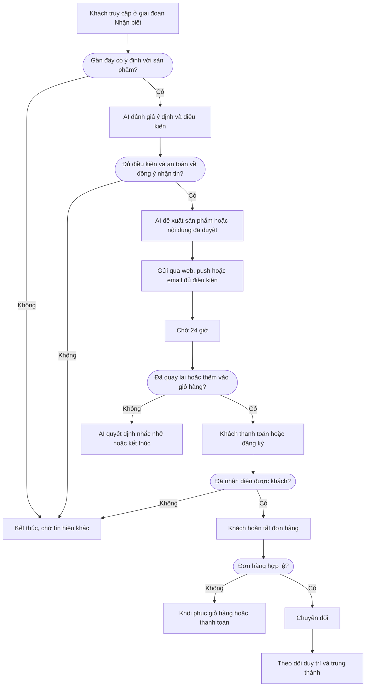

Cách một nhà bán lẻ trực tuyến dùng dữ liệu web, nhận diện khách hàng, hành trình có AI hỗ trợ và dữ liệu đơn hàng để biến khách truy cập ẩn danh thành khách mua lại.

## Mục tiêu kinh doanh

1. Nhận diện khách truy cập ẩn danh có ý định với sản phẩm.
2. Nuôi dưỡng họ mà không làm lộ hoặc bịa đặt dữ liệu cá nhân.
3. Chuyển họ thành khách đã đăng ký và thanh toán.
4. Đo lường từng lần chuyển giai đoạn.
5. Tiếp tục mối quan hệ qua hành trình duy trì và trung thành.

## Hành trình khách hàng

Xanh lá là việc của khách hàng, xanh dương là việc của LEO CDP, cam là điều kiện.

## Tám giai đoạn

| Giai đoạn | Trong playbook này | Chỉ số chính |
|---|---|---|
| Nhận biết | Khách vào cửa hàng, xem trang, xem sản phẩm, tìm kiếm. Đây mới là tín hiệu, chưa phải khách hàng đã biết. | Khách truy cập |
| Thu hút | Nhiều lượt xem và tìm kiếm cho thấy ý định. AI đánh giá khách có nên được nuôi dưỡng tiếp không. | Khách hàng tiềm năng mới |
| Kích hoạt | Khách nhấp vào hướng dẫn, tạo tài khoản hoặc gửi thông tin thanh toán. Lịch sử ẩn danh được nối vào hồ sơ. | Người dùng đã kích hoạt |
| Tương tác | Chiến dịch đã duyệt nhắc khách qua kênh đủ điều kiện. | Khách hàng hoạt động |
| Chuyển đổi | Khách hoàn tất đơn. Đơn đã hủy, thất bại hoặc hoàn tiền không được tính. | Đơn hàng |
| Duy trì | Khách quay lại dùng sản phẩm, xem lại, liên hệ hỗ trợ. | Tỷ lệ duy trì |
| Trung thành | Khách mua lại. Chiến dịch cung cấp quyền lợi giới thiệu hoặc VIP. | Tỷ lệ mua lại |
| Đã rời bỏ | Khách không quay lại mua. AI đánh giá hành động khôi phục có được phép không. | Tỷ lệ rời bỏ |

## Cần chuẩn bị

- Website gửi dữ liệu xem trang, tìm kiếm, sản phẩm, giỏ hàng, thanh toán và mua hàng về LEO CDP.
- Hệ thống bán hàng gửi sự kiện đăng ký, thanh toán và đơn hoàn tất.
- Nội dung và mẫu tin đã được duyệt.
- Kênh gửi tin đã kết nối.

## Thiết lập trên LEO CDP

| Cấu hình mẫu | Giá trị |
|---|---|
| Campaign (tên chiến dịch) | Ecommerce First Purchase Conversion |
| Mô hình | B2C |
| Ngành | retail (bán lẻ) |
| Giai đoạn mục tiêu | Nhận biết |
| Mục tiêu | Conversions (chuyển đổi) |
| Kênh | Email, thông báo web, push (tùy đồng ý nhận tin) |

1. **Tạo nhóm khách.** Vào Segments, chọn **Create segment** (tạo nhóm khách). Nhóm mẫu: Khách ngành retail ở giai đoạn Nhận biết, điểm tương tác từ 40 trở lên, hoạt động trong 7 ngày gần đây.
2. **Tạo chiến dịch.** Vào Campaigns, chọn **Create campaign**, điền theo cấu hình mẫu và chọn nhóm khách ở **Find segment** (tìm nhóm khách).
3. **Vẽ hành trình.** Dựng các bước theo phần Hành trình khách hàng trong Customer journey workflow (trình dựng hành trình).
4. **Lưu.** Chọn **Save campaign**. Lúc này chưa có tin nào được gửi.
5. **Gửi duyệt.** Trên trang chi tiết chiến dịch, chọn **Submit for approval**.
6. **Duyệt và chạy.** Nếu hành trình đang chờ duyệt, quản trị viên duyệt hành trình trước, rồi chọn **Approve campaign** và **Start campaign**.
7. **Theo dõi.** Xem Customer Journey Map trên trang Overview.

LEO CDP chưa tạo sẵn nhóm khách, chiến dịch hay hành trình từ playbook, nên bạn cần thiết lập theo các bước trên.

## AI hỗ trợ gì

| Vai trò | Việc AI làm |
|---|---|
| Quyết định | Chấm xem khách có đủ ý định để bắt đầu nuôi dưỡng không. |
| Tối ưu | Chọn sản phẩm hoặc nội dung trong danh sách đã duyệt. |
| Lập kế hoạch | Lập kế hoạch từ đối tượng, mục tiêu, ràng buộc và nội dung đã duyệt. |
| Quyết định | Chọn hành động đủ điều kiện tiếp theo sau tín hiệu mới. |
| Quyết định | Dùng về sau để đánh giá rủi ro rời bỏ hoặc kéo khách quay lại. |

## Quy tắc an toàn

- AI không tự xuất bản chiến dịch. Việc duyệt và khởi chạy luôn do con người thực hiện.
- AI chỉ chọn trong danh sách đã duyệt, không tự tạo hồ sơ, sản phẩm, mẫu tin hay lời hứa cá nhân hóa.
- Thiếu dữ liệu hoặc thiếu đồng ý thì hành trình kết thúc hoặc chờ.
- Chỉ gửi qua kênh khi đã có hồ sơ khách, khách đồng ý, không bị chặn, kênh đã kết nối, nội dung hợp lệ, đúng khung giờ và giới hạn tần suất.
- Khách không đồng ý một kênh thì hệ thống không âm thầm chuyển sang kênh đó.
- Hành động bị bỏ qua vì thiếu đồng ý vẫn được ghi lại, và không tính là lỗi.

## Xử lý sự cố

| Tình huống | Cách xử lý |
|---|---|
| Giai đoạn hiển thị Không có dữ liệu | Giai đoạn vẫn tồn tại nhưng chưa có số liệu cho kỳ đang xem. Nhờ đội kỹ thuật kiểm tra dữ liệu báo cáo và mô hình kinh doanh của tài khoản doanh nghiệp của bạn trên LEO CDP. |
| Chiến dịch hiện ở sai giai đoạn | Chỉ định rõ giai đoạn mục tiêu trong trình soạn chiến dịch, thay vì để hệ thống suy ra từ mục tiêu. |
| Chiến dịch không có nhãn tác nhân AI | Kiểm tra tác nhân AI đang hoạt động, thuộc cùng tài khoản, và được gán vai trò Lập kế hoạch, Quyết định hoặc Tối ưu. |
| Đã rời bỏ không có dữ liệu | Giai đoạn này cần so sánh giữa kỳ hiện tại và kỳ trước. Kiểm tra ngày và trạng thái giao dịch. |
