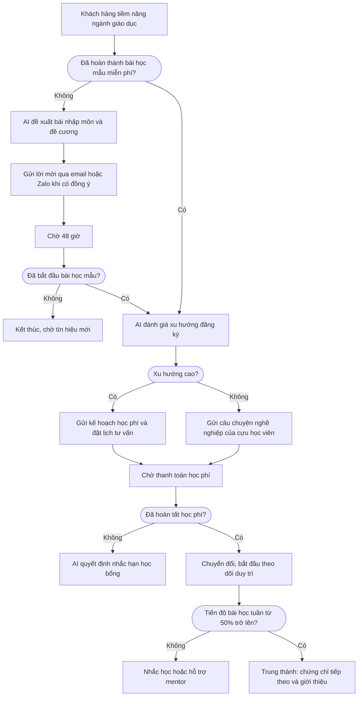

Cách một học viện trực tuyến hoặc trường đại học theo dõi học viên tiềm năng từ lúc xem chương trình học, qua bài học thử, đóng học phí, tiến độ học, chứng chỉ, đến lộ trình nâng cao.

## Mục tiêu kinh doanh

1. Thu hút học viên tiềm năng đang tìm hiểu chứng chỉ nghề nghiệp.
2. Chuyển người dự webinar hoặc tải đề cương thành ứng viên đủ điều kiện.
3. Hướng dẫn ứng viên hoàn thành bài đánh giá miễn phí hoặc bài học mẫu.
4. Nuôi dưỡng người học thử tích cực để đăng ký học phí.
5. Theo dõi hoàn thành bài học hằng tuần để ngăn bỏ dở.
6. Đưa học viên tốt nghiệp sang lộ trình nâng cao và giới thiệu, hoặc tái tương tác người học đình trệ.

## Hành trình khách hàng

Xanh lá là việc của khách hàng, xanh dương là việc của LEO CDP, cam là điều kiện.

## Tám giai đoạn

| Giai đoạn | Trong playbook này | Chỉ số chính |
|---|---|---|
| Nhận biết | Học viên tiềm năng vào website từ chiến dịch tìm kiếm và xem chương trình học. | Khách truy cập |
| Thu hút | Học viên gửi biểu mẫu đề cương kèm đồng ý nhận email hoặc Zalo. | Khách hàng tiềm năng mới |
| Kích hoạt | Học viên hoàn thành bài học mẫu. | Người dùng đã kích hoạt |
| Tương tác | Tiến độ học được theo dõi sau khi nhập học. | Khách hàng hoạt động |
| Chuyển đổi | Học viên thanh toán học phí. Giao dịch hoàn tất mới được tính. | Đơn hàng |
| Duy trì | Mức hoàn thành bài học hằng tuần được theo dõi để ngăn bỏ dở. | Tỷ lệ duy trì |
| Trung thành | Học viên đăng ký chứng chỉ thứ hai hoặc giới thiệu cựu học viên. | Tỷ lệ mua lại |
| Đã rời bỏ | Học viên đình trệ, không đăng ký kỳ tiếp theo. Đề xuất chuyển cohort hoặc ôn tập nếu được phép. | Tỷ lệ rời bỏ |

## Cần chuẩn bị

- Cổng học tập gửi dữ liệu xem khóa học, tải đề cương, bắt đầu và hoàn thành bài học.
- Hệ thống học phí gửi giao dịch đăng ký, học phí và phí chứng chỉ.
- Danh mục nội dung giáo dục đã được duyệt.
- Kênh Email, Mobile App Push, Zalo OA đã kết nối.

## Thiết lập trên LEO CDP

| Cấu hình mẫu | Giá trị |
|---|---|
| Campaign (tên chiến dịch) | Data & AI Certificate Enrollment Journey |
| Mô hình | B2C |
| Ngành | education (giáo dục) |
| Giai đoạn mục tiêu | Thu hút |
| Mục tiêu | Leads (khách hàng tiềm năng) |
| Kênh | Email, Mobile App Push, Zalo OA |

1. **Tạo nhóm khách.** Vào Segments, chọn **Create segment** (tạo nhóm khách). Nhóm mẫu: Học viên ngành education ở giai đoạn Nhận biết, Thu hút hoặc Kích hoạt.
2. **Tạo chiến dịch.** Vào Campaigns, chọn **Create campaign**, điền theo cấu hình mẫu và chọn nhóm khách ở **Find segment** (tìm nhóm khách).
3. **Vẽ hành trình.** Dựng các bước theo phần Hành trình khách hàng trong Customer journey workflow (trình dựng hành trình).
4. **Lưu.** Chọn **Save campaign**. Lúc này chưa có tin nào được gửi.
5. **Gửi duyệt.** Trên trang chi tiết chiến dịch, chọn **Submit for approval**.
6. **Duyệt và chạy.** Nếu hành trình đang chờ duyệt, quản trị viên duyệt hành trình trước, rồi chọn **Approve campaign** và **Start campaign**.
7. **Theo dõi.** Xem Customer Journey Map trên trang Overview.

LEO CDP chưa tạo sẵn nhóm khách, chiến dịch hay hành trình từ playbook, nên bạn cần thiết lập theo các bước trên.

## AI hỗ trợ gì

| Vai trò | Việc AI làm |
|---|---|
| Quyết định | Chấm điểm học viên tiềm năng theo lượt xem đề cương, dự webinar, mối quan tâm nghề nghiệp. |
| Tối ưu | Đề xuất module nhập môn hoặc hướng dẫn học bổng đã duyệt. |
| Quyết định | Phân nhóm nhịp độ học và đánh dấu học viên chậm tiến độ. |
| Quyết định | Phân tích phản hồi để kích hoạt tư vấn trước khi học viên bỏ khóa. |
| Tối ưu | Xác định học viên phù hợp với lộ trình nâng cao và thưởng giới thiệu. |
| Quyết định | Chọn phương án chuyển cohort hoặc học bổ túc cho học viên không hoạt động. |

## Quy tắc an toàn

- AI không tự xuất bản chiến dịch. Việc duyệt và khởi chạy luôn do con người thực hiện.
- AI chỉ chọn trong danh sách đã duyệt, không tự tạo hồ sơ, sản phẩm, mẫu tin hay lời hứa cá nhân hóa.
- Thiếu dữ liệu hoặc thiếu đồng ý thì hành trình kết thúc hoặc chờ.
- Chỉ gửi qua kênh khi đã có hồ sơ khách, khách đồng ý, không bị chặn, kênh đã kết nối, nội dung hợp lệ, đúng khung giờ và giới hạn tần suất.
- Khách không đồng ý một kênh thì hệ thống không âm thầm chuyển sang kênh đó.
- Hành động bị bỏ qua vì thiếu đồng ý vẫn được ghi lại, và không tính là lỗi.

## Xử lý sự cố

| Tình huống | Cách xử lý |
|---|---|
| Giai đoạn hiển thị Không có dữ liệu | Giai đoạn vẫn tồn tại nhưng chưa có số liệu cho kỳ đang xem. Nhờ đội kỹ thuật kiểm tra dữ liệu báo cáo và mô hình kinh doanh của tài khoản doanh nghiệp của bạn trên LEO CDP. |
| Chiến dịch hiện ở sai giai đoạn | Chỉ định rõ giai đoạn mục tiêu trong trình soạn chiến dịch, thay vì để hệ thống suy ra từ mục tiêu. |
| Chiến dịch không có nhãn tác nhân AI | Kiểm tra tác nhân AI đang hoạt động, thuộc cùng tài khoản, và được gán vai trò Lập kế hoạch, Quyết định hoặc Tối ưu. |
| Đã rời bỏ không có dữ liệu | Giai đoạn này cần so sánh giữa kỳ hiện tại và kỳ trước. Kiểm tra ngày và trạng thái giao dịch. |
