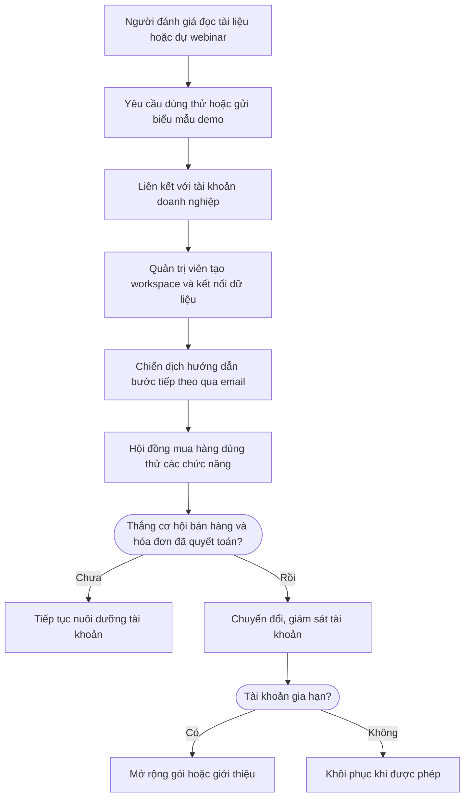

Cách một doanh nghiệp SaaS theo dõi người đánh giá kỹ thuật, tài khoản và hội đồng mua hàng, từ lúc đọc tài liệu đến dùng thử, ký hợp đồng và gia hạn. Ví dụ dùng chính LEO CDP làm sản phẩm.

## Mục tiêu kinh doanh

1. Thu hút người đánh giá kỹ thuật đọc tài liệu hoặc xem demo.
2. Xác định khách tiềm năng B2B và liên kết hội đồng mua hàng với tài khoản doanh nghiệp.
3. Đưa workspace dùng thử đến khoảnh khắc nhận ra giá trị.
4. Thúc đẩy dùng hằng tuần qua nhóm khách, chiến dịch và AI agent.
5. Chuyển tài khoản dùng thử thành thuê bao trả phí.
6. Giám sát tình trạng sử dụng và hỗ trợ để ngăn rủi ro gia hạn.
7. Mở rộng tài khoản dùng nhiều, hoặc tái tương tác tài khoản ngừng hoạt động.

## Hành trình khách hàng

Xanh lá là việc của khách hàng, xanh dương là việc của LEO CDP, cam là điều kiện.

## Tám giai đoạn

| Giai đoạn | Trong playbook này | Chỉ số chính |
|---|---|---|
| Nhận biết | Người đánh giá đọc tài liệu, xem sơ đồ hoặc dự webinar kiến trúc. | Khách truy cập |
| Thu hút | Yêu cầu dùng thử hoặc gửi biểu mẫu demo kèm email công việc và đồng ý. | Khách hàng tiềm năng mới |
| Kích hoạt | Quản trị viên tạo workspace, kết nối nguồn dữ liệu và thấy hồ sơ đầu tiên. | Người dùng đã kích hoạt |
| Tương tác | Hội đồng mua hàng xây nhóm khách, cấu hình AI và chạy thử chiến dịch. | Khách hàng hoạt động |
| Chuyển đổi | Cơ hội bán hàng thắng và hóa đơn thuê bao đầu tiên được quyết toán. | Đơn hàng |
| Duy trì | Khách gia hạn. Customer Success can thiệp trước ngày gia hạn khi có rủi ro. | Tỷ lệ duy trì |
| Trung thành | Khách mua thêm dung lượng, nâng cấp hoặc giới thiệu doanh nghiệp đối tác. | Tỷ lệ mua lại |
| Đã rời bỏ | Tài khoản không gia hạn và lưu lượng giảm về 0. Khôi phục khi được phép. | Tỷ lệ rời bỏ |

## Cần chuẩn bị

- Đội kỹ thuật thêm ngành saas cho tài khoản doanh nghiệp của bạn trên LEO CDP và đặt mô hình B2B.
- Trang tài liệu và sản phẩm gửi dữ liệu xem trang, tải tài liệu, đăng nhập, tạo workspace.
- Khách tiềm năng, liên hệ, tài khoản và cơ hội bán hàng có trong CRM.
- Hệ thống thanh toán gửi hóa đơn thuê bao đã quyết toán.

## Thiết lập trên LEO CDP

| Cấu hình mẫu | Giá trị |
|---|---|
| Campaign (tên chiến dịch) | LEO CDP Enterprise Sandbox-to-Subscription |
| Mô hình | B2B |
| Ngành | saas (phần mềm theo gói dịch vụ) |
| Giai đoạn mục tiêu | Kích hoạt |
| Mục tiêu | Conversions (chuyển đổi) |
| Kênh | Email |

1. **Tạo nhóm khách.** Vào Segments, chọn **Create segment** (tạo nhóm khách). Nhóm mẫu: Tài khoản SaaS ở giai đoạn Thu hút, Kích hoạt hoặc Tương tác, điểm tương tác từ 45 trở lên.
2. **Tạo chiến dịch.** Vào Campaigns, chọn **Create campaign**, điền theo cấu hình mẫu và chọn nhóm khách ở **Find segment** (tìm nhóm khách).
3. **Vẽ hành trình.** Dựng các bước theo phần Hành trình khách hàng trong Customer journey workflow (trình dựng hành trình).
4. **Lưu.** Chọn **Save campaign**. Lúc này chưa có tin nào được gửi.
5. **Gửi duyệt.** Trên trang chi tiết chiến dịch, chọn **Submit for approval**.
6. **Duyệt và chạy.** Nếu hành trình đang chờ duyệt, quản trị viên duyệt hành trình trước, rồi chọn **Approve campaign** và **Start campaign**.
7. **Theo dõi.** Xem Customer Journey Map trên trang Overview.

LEO CDP chưa tạo sẵn nhóm khách, chiến dịch hay hành trình từ playbook, nên bạn cần thiết lập theo các bước trên.

## AI hỗ trợ gì

| Vai trò | Việc AI làm |
|---|---|
| Quyết định | Xác minh email công việc, đồng ý nhận tin và mức sẵn sàng. |
| Quyết định | Chấm điểm thành viên hội đồng mua hàng theo vai trò. |
| Lập kế hoạch | Soạn chiến lược, kế hoạch và chọn mẫu từ tập ứng viên. |
| Tối ưu | Đề xuất bước onboarding tiếp theo. |
| Quyết định | Phát hiện mức dùng giảm đột ngột. |
| Quyết định | Phân tích phản hồi hỗ trợ để phát hiện rủi ro. |
| Tối ưu | Xác định tài khoản sẵn sàng nâng cấp. |
| Quyết định | Chấm xác suất rời bỏ của workspace. |

## Quy tắc an toàn

- AI không tự xuất bản chiến dịch. Việc duyệt và khởi chạy luôn do con người thực hiện.
- AI chỉ chọn trong danh sách đã duyệt, không tự tạo hồ sơ, sản phẩm, mẫu tin hay lời hứa cá nhân hóa.
- Thiếu dữ liệu hoặc thiếu đồng ý thì hành trình kết thúc hoặc chờ.
- Chỉ gửi qua kênh khi đã có hồ sơ khách, khách đồng ý, không bị chặn, kênh đã kết nối, nội dung hợp lệ, đúng khung giờ và giới hạn tần suất.
- Khách không đồng ý một kênh thì hệ thống không âm thầm chuyển sang kênh đó.
- Hành động bị bỏ qua vì thiếu đồng ý vẫn được ghi lại, và không tính là lỗi.

## Xử lý sự cố

| Tình huống | Cách xử lý |
|---|---|
| Giai đoạn hiển thị Không có dữ liệu | Giai đoạn vẫn tồn tại nhưng chưa có số liệu cho kỳ đang xem. Nhờ đội kỹ thuật kiểm tra dữ liệu báo cáo và mô hình kinh doanh của tài khoản doanh nghiệp của bạn trên LEO CDP. |
| Chiến dịch hiện ở sai giai đoạn | Chỉ định rõ giai đoạn mục tiêu trong trình soạn chiến dịch, thay vì để hệ thống suy ra từ mục tiêu. |
| Chiến dịch không có nhãn tác nhân AI | Kiểm tra tác nhân AI đang hoạt động, thuộc cùng tài khoản, và được gán vai trò Lập kế hoạch, Quyết định hoặc Tối ưu. |
| Đã rời bỏ không có dữ liệu | Giai đoạn này cần so sánh giữa kỳ hiện tại và kỳ trước. Kiểm tra ngày và trạng thái giao dịch. |
